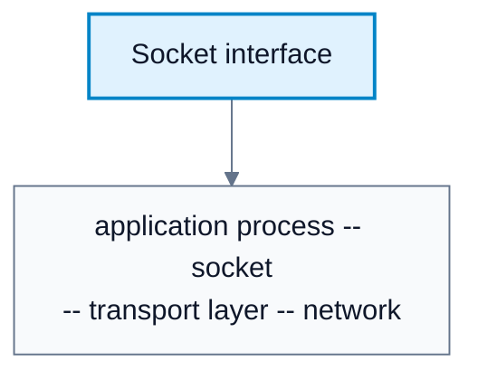
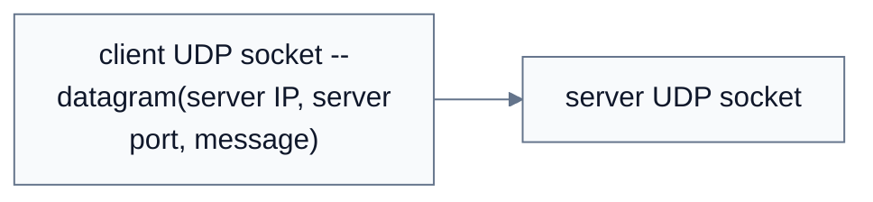
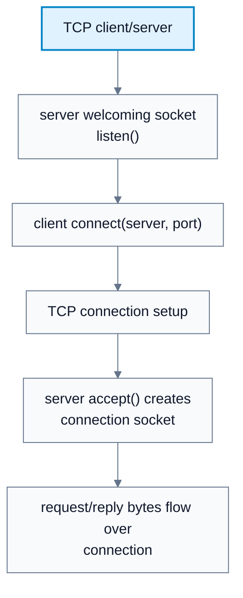
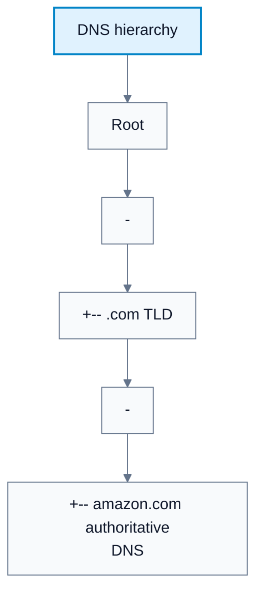

---
tags:
  - networks
---

# Application Layer

**Subject**: CSC3001F Networks  
**Source**: `Chapter2_ApplicationLayer_v2026.pdf`, Dr. Josiah Chavula, pages 1-68  
**Generated**: 2026-05-31

---

## Contents

- [[#Core Content|Core Content]]
  - [[#Processes And Application Architectures|Processes And Application Architectures]]
  - [[#Sockets And Addressing Processes|Sockets And Addressing Processes]]
  - [[#Application Service Requirements|Application Service Requirements]]
  - [[#UDP Socket Programming|UDP Socket Programming]]
  - [[#TCP Socket Programming|TCP Socket Programming]]
  - [[#Application-Layer Protocols|Application-Layer Protocols]]
  - [[#Web And HTTP|Web And HTTP]]
  - [[#Non-Persistent And Persistent HTTP|Non-Persistent And Persistent HTTP]]
  - [[#HTTP Messages|HTTP Messages]]
  - [[#Cookies|Cookies]]
  - [[#Web Caches|Web Caches]]
  - [[#Conditional GET|Conditional GET]]
  - [[#DNS|DNS]]
  - [[#DNS Hierarchy And Resolution|DNS Hierarchy And Resolution]]
  - [[#DNS Caching And Records|DNS Caching And Records]]

---

## Core Content

### Processes And Application Architectures

#### Definitions

> **Process**: A program running within a host. *In plain language: a process is the running application instance that sends or receives messages.*

> **Client Process**: A process that initiates communication. *In plain language: the client starts the exchange.*

> **Server Process**: A process that waits to be contacted. *In plain language: the server listens and responds.*

> **Client-Server Architecture**: An architecture with always-on servers and clients that contact them. *In plain language: browsers contact web servers; clients usually do not talk directly to each other.*

> **Peer-to-Peer Architecture**: An architecture where arbitrary end systems directly communicate and peers both request and provide service. *In plain language: every participant can act like both client and server.*

Processes on the same host use OS-defined inter-process communication. Processes on different hosts communicate by exchanging messages through sockets.

| Architecture | Server Behavior | Client/Peer Behavior | Strengths | Costs |
|---|---|---|---|---|
| Client-server | Always-on, permanent IP, often in data center | Contacts server, may have dynamic IP, does not directly contact other clients | Simple management, centralized control, scalable with data centers | Server infrastructure can be expensive |
| Peer-to-peer | No always-on central server required | Peers request service and provide service to others | Self-scalability: new peers add capacity | Intermittent peers and changing IP addresses make management complex |

Examples:

| Application | Common Architecture |
|---|---|
| HTTP web browsing | Client-server |
| IMAP email access | Client-server |
| FTP | Client-server |
| P2P file sharing | Peer-to-peer |
### Sockets And Addressing Processes

#### Definitions

> **Socket**: The door between an application process and the transport protocol. *In plain language: the application writes to and reads from a socket to use the network.*

> **IP Address**: A 32-bit host or interface identifier used for addressing datagrams in IPv4. *In plain language: it identifies the host/interface location for network-layer delivery.*

> **Port Number**: A transport-layer identifier associated with a process on a host. *In plain language: ports distinguish multiple applications running on the same host.*

A process sends and receives messages through a **socket**. The application developer controls the application side of the socket. The OS controls the transport, network, link, and physical layers below it.

An IP address alone is not enough to identify a receiving process because many processes can run on the same host. A destination is identified by:

```text
IP address + port number
```

Example:

```text
HTTP server host: gaia.cs.umass.edu
IP address: 128.119.245.12
HTTP port: 80
```

#### Diagram: Socket interface



Caption: The socket is the application-controlled door into OS-controlled transport services.


### Application Service Requirements

#### Definitions

> **Data Integrity Requirement**: Need for reliable, correct data transfer. *In plain language: some apps cannot tolerate missing or corrupted data.*

> **Timing Requirement**: Need for low delay to remain useful. *In plain language: real-time apps care about latency.*

> **Throughput Requirement**: Need for a minimum data rate. *In plain language: video needs enough bandwidth to play well.*

> **Elastic Application**: An application that can use whatever throughput it gets. *In plain language: it works faster or slower depending on available bandwidth.*

Applications differ in what they need from transport:

| Application | Data Loss | Throughput | Time Sensitive? |
|---|---|---|---|
| File transfer/download | No loss | Elastic | No |
| Email | No loss | Elastic | No |
| Web documents | No loss | Elastic | No |
| Real-time audio/video | Loss-tolerant | Audio: 5 Kbps-1 Mbps; video: 10 Kbps-5 Mbps | Yes, tens of ms |
| Streaming audio/video | Loss-tolerant | Similar to audio/video | Yes, seconds |
| Interactive games | Loss-tolerant | Kbps+ | Yes, tens of ms |
| Text messaging | No loss | Elastic | Sometimes |

TCP gives reliability, flow control, congestion control, and connection setup, but does not guarantee timing, minimum throughput, or security. UDP gives minimal unreliable datagram delivery, which is useful when applications want control over timing, retransmission, or message boundaries.
### UDP Socket Programming

#### Definitions

> **UDP Service**: Unreliable, unordered datagram transport without connection setup, reliability, flow control, or congestion control. *In plain language: UDP is minimal transport over IP.*

UDP has no connection setup. The sender explicitly attaches destination IP address and port number to each datagram. The receiver extracts the sender IP address and port number from the received datagram.

Client/server UDP pattern:

```text
server:
1. create UDP socket bound to port x
2. wait for datagram
3. read message and client address
4. send reply to that client address

client:
1. create UDP socket
2. create datagram with server IP and port x
3. send datagram
4. read reply
5. close socket
```

UDP viewpoint: unreliable transfer of groups of bytes, called datagrams. Data may be lost or arrive out of order.

#### Diagram: UDP client/server



Caption: UDP sends independent datagrams; destination address is attached to each send.


### TCP Socket Programming

#### Definitions

> **TCP Service**: Reliable, in-order, flow-controlled, congestion-controlled, connection-oriented transport. *In plain language: TCP is the careful byte-stream service.*

TCP is connection-oriented. The server must first create a welcoming socket. The client creates a TCP socket specifying the server IP address and port. TCP establishes a connection. The server creates a new connection socket for that client, allowing multiple clients to be served at once.

Client/server TCP pattern:

```text
server:
1. create welcoming socket
2. bind to server port
3. listen for incoming requests
4. accept connection, creating a connection socket
5. read request bytes from connection socket
6. send reply bytes
7. close connection socket

client:
1. create TCP socket
2. connect to server IP and port
3. send bytes
4. receive reply bytes
5. close socket
```

TCP viewpoint: reliable, in-order byte-stream transfer. TCP does not preserve application message boundaries.

#### Diagram: TCP client/server



Caption: TCP creates a connection before application data transfer.


### Application-Layer Protocols

#### Definitions

> **Application-Layer Protocol**: A protocol defining message types, syntax, semantics, and rules for when and how processes send/respond. *In plain language: it is the application conversation format.*

> **Open Protocol**: A protocol defined in public RFCs. *In plain language: anyone can implement it, enabling interoperability.*

> **Proprietary Protocol**: A protocol controlled by a vendor or service. *In plain language: the rules are not fully public or standardized.*

An application-layer protocol defines:

| Feature | Meaning |
|---|---|
| Message types | Request, response, or other protocol-specific types |
| Syntax | Fields and field delimiters |
| Semantics | Meaning of field values |
| Rules | When and how processes send and respond |

Open protocols such as HTTP and SMTP are defined in RFCs. Proprietary protocols such as some conferencing or gaming protocols are controlled by vendors.
### Web And HTTP

#### Definitions

> **HTTP**: HyperText Transfer Protocol, the Web's application-layer protocol. *In plain language: HTTP is how browsers request web objects and servers send them.*

> **Web Object**: A file-like resource in a web page, such as HTML, image, audio, or script. *In plain language: a page is made of one base object and referenced objects.*

> **URL**: Uniform Resource Locator, containing host name and path name for an object. *In plain language: it tells the browser which server and which object to request.*

> **Stateless Protocol**: A protocol where the server keeps no information about past client requests. *In plain language: each request is handled independently unless extra state is added.*

A web page consists of objects. A base HTML file can reference JPEGs, scripts, audio, video, and other objects. Each object is addressable by a URL:

```text
www.someschool.edu/someDept/pic.gif
host name: www.someschool.edu
path name: /someDept/pic.gif
```

HTTP uses TCP:

1. Client opens TCP connection to server, usually port 80 for HTTP.
2. Server accepts TCP connection.
3. Browser and server exchange HTTP messages.
4. TCP connection is closed or reused.

HTTP itself is stateless: the server keeps no built-in protocol memory of prior requests.
### Non-Persistent And Persistent HTTP

#### Definitions

> **RTT**: Round-trip time, the time for a small packet to go from client to server and back. *In plain language: RTT is request-and-reply travel time.*

> **Non-Persistent HTTP**: HTTP mode where at most one object is sent per TCP connection. *In plain language: every object needs its own connection.*

> **Persistent HTTP**: HTTP mode where multiple objects can be sent over one TCP connection. *In plain language: reuse the connection for several objects.*

| Feature | Non-Persistent HTTP | Persistent HTTP |
|---|---|---|
| TCP connection use | One object per TCP connection | Multiple objects per connection |
| Connection overhead | High | Lower |
| Response time | About `2 RTT + transmission time` per object | Can be as little as one RTT for multiple referenced objects |
| Browser workaround | Parallel TCP connections | Reuse open connection |

For non-persistent HTTP, fetching one object takes:

```text
response time = 1 RTT for TCP setup
              + 1 RTT for request and first response bytes
              + object transmission time
              = 2 RTT + transmission time
```

#### Diagram: Non-persistent HTTP timing


Caption: Non-persistent HTTP pays setup and request RTT cost per object.


### HTTP Messages

HTTP request example:

```http
GET /index.html HTTP/1.1
Host: www-net.cs.umass.edu
User-Agent: Mozilla/5.0
Accept: text/html,application/xhtml+xml
Connection: keep-alive
```

HTTP request methods:

| Method | Use |
|---|---|
| GET | Request an object; can include query parameters in URL |
| POST | Send form input or data in entity body |
| HEAD | Request headers only |
| PUT | Upload or replace an object at a URL |

HTTP response contains a status line, headers, blank line, then data:

```http
HTTP/1.1 200 OK
Date: Tue, 08 Sep 2020 00:53:20 GMT
Server: Apache/2.4.6
Content-Length: 2651
Content-Type: text/html; charset=UTF-8

<data>
```

Common status codes:

| Code | Meaning |
|---|---|
| 200 OK | Request succeeded |
| 301 Moved Permanently | Object moved; new location in `Location:` header |
| 400 Bad Request | Request not understood |
| 404 Not Found | Object not found |
| 505 HTTP Version Not Supported | HTTP version not supported |
### Cookies

#### Definitions

> **Cookie**: A mechanism for carrying state using HTTP headers, a browser cookie file, and a server-side database. *In plain language: cookies let sites recognize a browser across requests.*

Cookies add state to HTTP using four components:

1. `Set-Cookie` header in HTTP response.
2. `Cookie` header in later HTTP requests.
3. Cookie file kept by browser.
4. Back-end database at the website.

Uses include authorization, shopping carts, recommendations, and webmail session state. Privacy issue: persistent third-party cookies can track a common identity across multiple websites.
### Web Caches

#### Definitions

> **Web Cache / Proxy Server**: A server that can satisfy client HTTP requests without always contacting the origin server. *In plain language: a nearby cache stores copies to reduce delay and traffic.*

A web cache satisfies client requests without always contacting the origin server.

Cache behavior:

1. Browser sends HTTP request to cache.
2. If object is cached and fresh, cache returns it.
3. If not, cache requests object from origin server.
4. Cache stores object and returns it to client.

Benefits:

| Benefit | Reason |
|---|---|
| Lower response time | Cache is closer to clients |
| Lower institutional access-link traffic | Popular objects served locally |
| Better content delivery | Caches help providers serve users efficiently |
### Conditional GET

#### Definitions

> **Conditional GET**: An HTTP request that asks the server to send the object only if the cached copy is stale. *In plain language: it avoids resending unchanged objects.*

Conditional GET avoids sending an object if the cache already has a fresh copy:

```http
GET /object HTTP/1.1
If-Modified-Since: <date>
```

Server responses:

| Condition | Response |
|---|---|
| Object not modified before date | `304 Not Modified`, no object body |
| Object modified after date | `200 OK` with object data |
### DNS

#### Definitions

> **DNS**: Domain Name System, a distributed hierarchical database and application-layer protocol for name/address translation. *In plain language: DNS maps names like `www.example.com` to IP addresses.*

DNS maps between human-friendly hostnames and IP addresses. It is a distributed hierarchical database implemented by many name servers. It is an application-layer protocol even though it provides a core Internet function.

DNS services:

| Service | Example |
|---|---|
| Hostname-to-IP translation | `www.example.com -> 93.184.216.34` |
| Host aliasing | Alias maps to canonical name |
| Mail server aliasing | Domain maps to SMTP mail server |
| Load distribution | One name maps to multiple replicated server IPs |

Why DNS is not centralized:

| Problem | Why It Matters |
|---|---|
| Single point of failure | One server failure would break name resolution |
| Traffic volume | DNS handles trillions of queries per day |
| Distant database | Delay would be high for global users |
| Maintenance | Millions of organizations manage records |
| Scalability | Centralization cannot handle scale and autonomy |
### DNS Hierarchy And Resolution

#### Definitions

> **Root DNS Server**: A top-level contact point used when a resolver needs to find TLD servers. *In plain language: root servers point resolvers toward the right top-level domain.*

> **TLD Server**: A DNS server responsible for a top-level domain such as `.com`, `.org`, `.edu`, or a country code. *In plain language: TLD servers know where authoritative servers for domains are.*

> **Authoritative DNS Server**: A DNS server with official records for an organization's hosts. *In plain language: it is the source of truth for a domain's names.*

> **Local DNS Server**: The DNS server a host queries first, usually provided by an ISP or institution. *In plain language: it is your resolver.*

> **Iterated Query**: A DNS query style where each contacted server replies with the next server to ask. *In plain language: "I do not know, ask this server."*

> **Recursive Query**: A DNS query style where the contacted server takes responsibility for resolving the name. *In plain language: "I will ask the others and return the final answer."*

DNS hierarchy:

```text
Root DNS servers
  -> TLD DNS servers (.com, .org, .edu, country TLDs)
      -> authoritative DNS servers for domains
```

First approximation for `www.amazon.com`:

1. Query root server to find `.com` DNS server.
2. Query `.com` server to find `amazon.com` authoritative server.
3. Query `amazon.com` authoritative server to get IP for `www.amazon.com`.

Local DNS servers do not strictly belong to the hierarchy. Hosts query local DNS first. The local server answers from cache if possible, or forwards/resolves through the hierarchy.

#### Diagram: DNS hierarchy



Caption: Resolution walks the hierarchy until an authoritative mapping is found.


### DNS Caching And Records

#### Definitions

> **Resource Record (RR)**: A DNS database entry with format `(name, value, type, ttl)`. *In plain language: it is one DNS fact with a lifetime.*

> **A Record**: DNS record mapping a hostname to an IP address. *In plain language: name -> address.*

> **NS Record**: DNS record naming an authoritative server for a domain. *In plain language: domain -> DNS server.*

> **CNAME Record**: DNS record mapping an alias to a canonical name. *In plain language: nickname -> real DNS name.*

> **MX Record**: DNS record naming a mail server for a domain. *In plain language: domain -> mail server.*

> **TTL**: Time to live for cached DNS records. *In plain language: after this time, the cached answer expires.*

DNS caches mappings with TTL values. Caching improves response time and reduces query load, but cached entries can be out of date until TTL expires.

Resource record format:

```text
(name, value, type, ttl)
```

| Type | Name Field | Value Field |
|---|---|---|
| A | Hostname | IP address |
| NS | Domain | Hostname of authoritative DNS server |
| CNAME | Alias name | Canonical name |
| MX | Domain | Mail server name |

DNS query and reply messages share the same format, including identification, flags, question count, answer RR count, authority RR count, and additional RR count.
