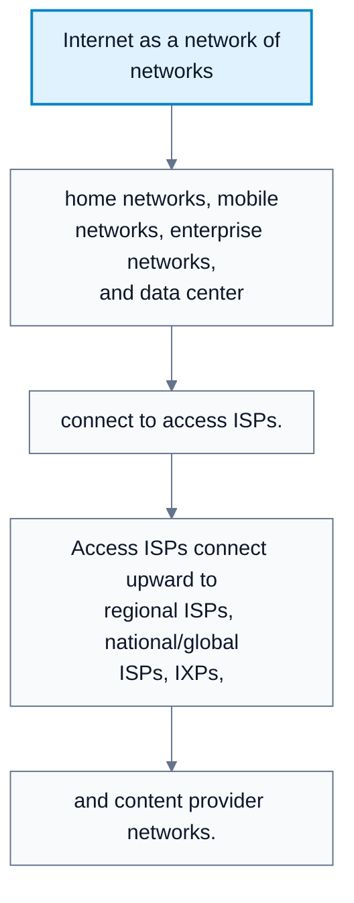
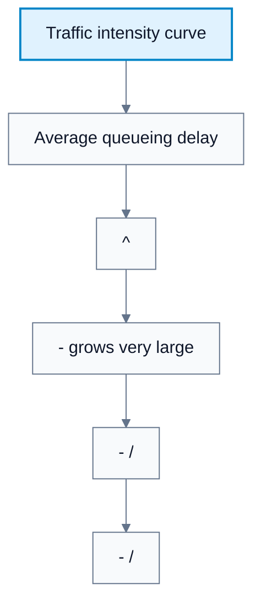
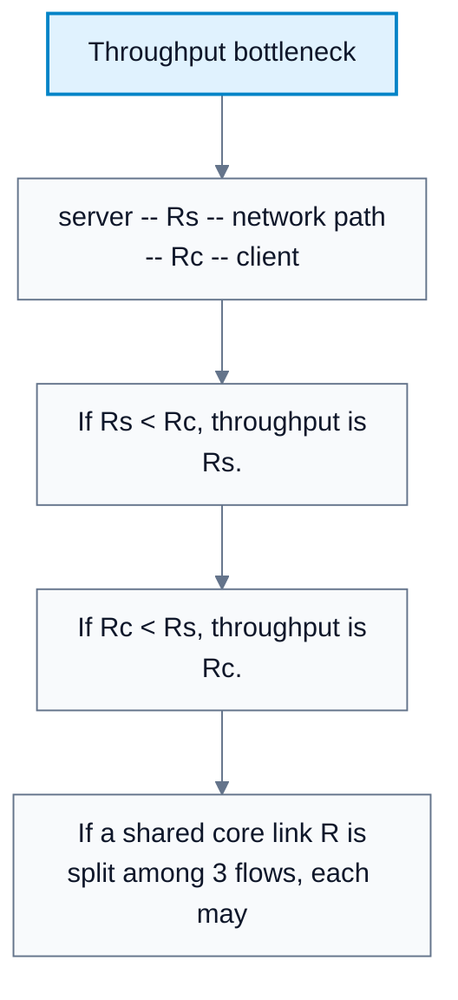

---
tags:
  - networks
---

# Introduction To Computer Networks

**Subject**: CSC3001F Networks  
**Source**: `Chapter1_Introduction_v2026.pdf`, Dr. Josiah Chavula, pages 1-57  
**Generated**: 2026-05-31

---

## Contents

- [[#Core Content|Core Content]]
  - [[#The Internet: Nuts And Bolts View|The Internet: Nuts And Bolts View]]
  - [[#The Internet: Services View|The Internet: Services View]]
  - [[#Protocols|Protocols]]
  - [[#Layering And Service Models|Layering And Service Models]]
  - [[#Internet Protocol Stack|Internet Protocol Stack]]
  - [[#Encapsulation|Encapsulation]]
  - [[#Network Edge, Access Networks, And Core|Network Edge, Access Networks, And Core]]
  - [[#Internet Structure: Network Of Networks|Internet Structure: Network Of Networks]]
  - [[#Forwarding Versus Routing|Forwarding Versus Routing]]
  - [[#Packet Switching And Store-And-Forward|Packet Switching And Store-And-Forward]]
  - [[#Queueing, Delay, And Loss|Queueing, Delay, And Loss]]
  - [[#Ping And Traceroute|Ping And Traceroute]]
  - [[#Throughput|Throughput]]

---

## Core Content

### The Internet: Nuts And Bolts View

#### Definitions

> **Internet**: A global "network of networks" made from interconnected hosts, packet switches, communication links, and ISPs. *In plain language: the Internet is many separately managed networks connected so packets can move between almost any two hosts.*

> **Host / End System**: A connected computing device running network applications at the Internet edge. *In plain language: laptops, phones, servers, and IoT devices are hosts.*

> **Communication Link**: A physical or wireless path connecting network devices, such as fiber, copper, radio, or satellite. *In plain language: it is the medium packets travel across.*

> **RFC**: Request for Comments, the document series used to publish Internet standards and protocol specifications. *In plain language: RFCs are where many Internet rules are written down.*

> **IETF**: Internet Engineering Task Force, the standards organization behind many Internet protocol standards. *In plain language: the IETF is one of the main groups that standardizes Internet protocols.*

The Internet is built from billions of **hosts** or **end systems**, connected by **communication links** and **packet switches**. Hosts run network applications at the edge. Packet switches include **routers**, which forward IP packets between networks, and **switches**, which forward frames within local networks.

The Internet is not one single centrally owned network. It is a **network of networks**: home networks, enterprise networks, campus networks, mobile networks, regional ISPs, national/global ISPs, data center networks, and content provider networks all interconnect.

Protocols are everywhere in this system. Examples from the source include **HTTP**, streaming video protocols, Skype-like real-time protocols, **TCP**, **IP**, **WiFi**, **4G**, and **Ethernet**. Protocol standards are commonly published as **RFCs** through bodies such as the **IETF**.
### The Internet: Services View

The Internet also acts as infrastructure that provides services to distributed applications:

| Application Type | Internet Service Needed |
|---|---|
| Web and e-commerce | Request/response object transfer |
| Streaming video | Continuous delivery at usable rate |
| Multimedia conferencing | Low delay and interactive delivery |
| Email and messaging | Reliable message transfer |
| Games | Timely interaction and enough throughput |
| Social media and cloud apps | Scalable client/server or distributed communication |

Applications use programming interfaces, often sockets, as "hooks" into Internet transport services. This is analogous to choosing a postal service option: an application asks the transport layer for a service, then relies on lower layers to carry data.
### Protocols

#### Definitions

> **Protocol**: Rules defining message formats, message order, and actions taken when messages are sent, received, or events occur. *In plain language: a protocol is the conversation script computers follow.*

> **Message**: Application-layer data. *In plain language: this is what an application wants to send.*

A protocol specifies:

1. The messages that may be sent.
2. The order in which messages are sent and received.
3. The format of each message.
4. The actions taken when messages or other events occur.

Human protocol example:

1. Person A says "Hi".
2. Person B replies "Hi".
3. Person A asks for the time.
4. Person B replies with the time.

Network protocol example:

1. Client sends a TCP connection request.
2. Server sends a TCP connection response.
3. Client sends an HTTP GET request.
4. Server sends the requested file.
### Layering And Service Models

#### Definitions

> **Layer**: A level in a protocol architecture that implements a service using the service of the layer below. *In plain language: layers let us reason about one job at a time.*

> **Service Model**: The behavior a layer offers to the layer above it. *In plain language: it is the promise a layer makes to its users.*

Networks are complex because they contain many pieces: applications, hosts, routers, links, protocols, hardware, and software. **Layering** gives explicit structure and modularity.

The air travel analogy from the source:

| Layered Travel Step | Service Provided |
|---|---|
| Ticketing | Purchase/complaint service |
| Baggage | Check/claim service |
| Gates | Load/unload service |
| Runway | Takeoff/landing service |
| Airplane routing | Route across airports |

Each layer implements its service using its own internal actions and the service of the layer below. Changing one layer's implementation can be transparent to the rest of the system, as long as the service interface remains the same.
### Internet Protocol Stack

#### Definitions

> **Datagram**: A network-layer packet, especially an IP packet. *In plain language: IP carries datagrams from host to host.*

| Layer | Main Service | Example Protocols / Technologies |
|---|---|---|
| Application | Support network applications | HTTP, IMAP, SMTP, DNS |
| Transport | Process-to-process data transfer | TCP, UDP |
| Network | Route datagrams from source host to destination host | IP, routing protocols |
| Link | Transfer data between neighboring network elements | Ethernet, 802.11 WiFi, PPP |
| Physical | Move raw bits on the medium | Copper, fiber, radio |

The OSI model has seven layers: application, presentation, session, transport, network, link, physical. The Internet stack does not have separate presentation and session layers. If encryption, compression, data representation, synchronization, checkpointing, or session recovery are needed, they are implemented in the application or libraries used by the application.
### Encapsulation

#### Definitions

> **Encapsulation**: Adding a protocol header, and sometimes trailer, around data from the layer above. *In plain language: each layer wraps the data with its own control information.*

> **Segment**: A transport-layer packet, usually carrying an application message plus a transport header. *In plain language: TCP and UDP send segments.*

> **Frame**: A link-layer packet carrying a network-layer datagram over one physical link. *In plain language: Ethernet and WiFi send frames.*

Encapsulation creates a nested structure:

1. The application creates a **message**, `M`.
2. The transport layer adds a transport header, `Ht`, creating a **segment**: `[Ht | M]`.
3. The network layer adds a network header, `Hn`, creating a **datagram**: `[Hn | Ht | M]`.
4. The link layer adds a link header, `Hl`, creating a **frame**: `[Hl | Hn | Ht | M]`.
5. At the destination, headers are removed in reverse order and the message is delivered to the application.

Switches usually process link-layer headers. Routers process network-layer headers. End hosts process all layers.

#### Diagram: Encapsulation

```mermaid
%%{init: {"theme":"base","themeVariables":{"primaryColor":"#e0f2fe","primaryTextColor":"#0f172a","primaryBorderColor":"#0284c7","lineColor":"#64748b","secondaryColor":"#f8fafc","tertiaryColor":"#dcfce7","fontFamily":"Inter, ui-sans-serif, system-ui, -apple-system, BlinkMacSystemFont, Segoe UI, sans-serif"},"flowchart":{"curve":"basis","htmlLabels":true,"padding":12}}}%%
flowchart LR
    N0["Transport: Ht M"]
    N1["segment"]
    N0 --> N1

    classDef default fill:#f8fafc,stroke:#64748b,stroke-width:1px,color:#0f172a;
    classDef focus fill:#e0f2fe,stroke:#0284c7,stroke-width:2px,color:#0f172a;
    classDef outcome fill:#dcfce7,stroke:#16a34a,stroke-width:2px,color:#052e16;
    classDef warning fill:#fee2e2,stroke:#dc2626,stroke-width:2px,color:#7f1d1d;
    classDef muted fill:#f1f5f9,stroke:#94a3b8,stroke-width:1px,color:#334155;
```



Caption: Each layer adds the control information it needs to provide its service.


### Network Edge, Access Networks, And Core

#### Definitions

> **Router**: A packet switch that operates at the network layer and forwards IP datagrams. *In plain language: routers move packets between networks.*

> **Network**: A collection of devices, routers, and links managed by an organization. *In plain language: a home network, campus network, ISP network, and data center network are all networks.*

> **Network Edge**: The hosts and servers where applications run. *In plain language: the edge is where users and applications live.*

> **Access Network**: The network that connects an end system to its first router. *In plain language: WiFi, Ethernet, fiber, cable, and cellular access connect you to the Internet.*

> **Network Core**: The mesh of interconnected routers that move packets across the Internet. *In plain language: the core is the packet-moving backbone between edges.*

The **network edge** contains clients and servers. Servers often run in data centers. Access networks connect end systems to an edge router. Examples include residential broadband, institutional Ethernet/WiFi, and mobile access networks such as 4G/5G.

The **network core** is a mesh of interconnected routers. Hosts break application-layer messages into packets, and the network forwards those packets hop by hop from source to destination.
### Internet Structure: Network Of Networks

#### Definitions

> **ISP**: Internet Service Provider, a network that provides Internet connectivity. *In plain language: an ISP connects homes, institutions, companies, or other ISPs.*

> **IXP**: Internet Exchange Point, a place where networks interconnect and exchange traffic. *In plain language: IXPs let ISPs peer directly instead of always using transit providers.*

> **Peering Link**: A direct interconnection between networks to exchange traffic. *In plain language: peers send each other traffic without going through a higher provider.*

> **Tier-1 ISP**: A large, well-connected ISP with national or international coverage. *In plain language: tier-1 networks sit near the center of the Internet's provider hierarchy.*

> **Content Provider Network**: A private network run by a company such as Google, Microsoft, Facebook, or Akamai to connect data centers and serve users. *In plain language: big content providers build their own networks to put content closer to users.*

It would not scale to directly connect every access ISP to every other access ISP: that would require `O(N^2)` connections. Instead, Internet structure evolved through economics and policy:

1. Access ISPs connect users and institutions.
2. Regional ISPs aggregate many access networks.
3. National/global ISPs provide wider transit.
4. IXPs let networks interconnect and peer.
5. Content provider networks connect their own data centers and often bypass some transit paths.

At the center are a small number of well-connected networks, including tier-1 ISPs and large content provider networks.

#### Diagram: Internet as a network of networks



Caption: This shows why the Internet is not one network but a hierarchy and mesh of independently managed networks.


### Forwarding Versus Routing

#### Definitions

> **Forwarding**: The local router action of moving an arriving packet from an input link to the correct output link. *In plain language: forwarding is one router's immediate packet decision.*

> **Routing**: The global process of determining the path packets take from source to destination. *In plain language: routing decides the route; forwarding follows it.*

| Concept | Scope | Question Answered | Example |
|---|---|---|---|
| Forwarding | Local, inside one router | Which output link should this arriving packet use? | Router checks destination header and forwarding table |
| Routing | Global, across the network | Which path should packets take from source to destination? | Routing algorithm computes paths and fills forwarding tables |

Forwarding is like getting through one road interchange. Routing is like planning the whole trip.
### Packet Switching And Store-And-Forward

#### Definitions

> **Packet**: A chunk of data carried through the network. *In plain language: large application data is split into smaller units for transmission.*

> **Packet Switch**: A device that forwards packets. *In plain language: routers and switches receive packets or frames on one link and send them out another.*

> **Switch**: A packet switch that operates at the link layer and forwards frames. *In plain language: switches move frames within a local network.*

> **Packet Switching**: Breaking messages into packets and forwarding each packet through routers over shared links. *In plain language: packets from many users share the same network infrastructure.*

> **Store-and-Forward**: A router must receive a whole packet before forwarding it to the next link. *In plain language: a packet cannot leave a router until it has fully arrived.*

In packet switching, hosts split messages into packets. Each packet is forwarded independently through routers.

With **store-and-forward**, a router must receive the entire packet before transmitting it onto the next link. For a packet of length `L` bits and a link rate `R` bits/sec:

```text
dtrans = L / R
```

Source example:

```text
L = 10 Kbits
R = 100 Mbps
dtrans = 10,000 / 100,000,000 = 0.0001 s = 0.1 ms
```
### Queueing, Delay, And Loss

#### Definitions

> **Processing Delay**: Time spent checking errors and determining the output link. *In plain language: it is the router's per-packet decision time.*

> **Queueing Delay**: Time a packet waits in a router buffer before transmission. *In plain language: it is waiting time caused by congestion.*

> **Transmission Delay**: Time required to push all bits of a packet into the link, `L/R`. *In plain language: it is serialization time.*

> **Propagation Delay**: Time for a bit to physically travel across a link, `d/s`. *In plain language: it is signal travel time.*

> **Nodal Delay**: Total delay at a node: `dproc + dqueue + dtrans + dprop`. *In plain language: it is all delay components for one hop.*

> **Traffic Intensity**: Ratio `La/R`, where `L` is packet length, `a` is packet arrival rate, and `R` is link rate. *In plain language: it measures how hard the link is being loaded.*

> **Packet Loss**: Dropping a packet because a queue or buffer is full. *In plain language: loss happens when there is no space to store an arriving packet.*

Packets queue when work arrives faster than it can be serviced. If packets arrive at an output link faster than the link can transmit them, packets wait in a buffer. If the buffer fills, arriving packets are dropped.

Nodal delay:

```text
dnodal = dproc + dqueue + dtrans + dprop
dtrans = L / R
dprop = d / s
traffic intensity = La / R
```

Queueing behavior:

| Traffic Intensity | Expected Queueing Delay |
|---|---|
| `La/R ~ 0` | Small |
| `La/R -> 1` | Large |
| `La/R > 1` | Work arrives faster than service; average delay grows without bound |

#### Diagram: Delay at one router

```mermaid
%%{init: {"theme":"base","themeVariables":{"primaryColor":"#e0f2fe","primaryTextColor":"#0f172a","primaryBorderColor":"#0284c7","lineColor":"#64748b","secondaryColor":"#f8fafc","tertiaryColor":"#dcfce7","fontFamily":"Inter, ui-sans-serif, system-ui, -apple-system, BlinkMacSystemFont, Segoe UI, sans-serif"},"flowchart":{"curve":"basis","htmlLabels":true,"padding":12}}}%%
flowchart LR
    N0["incoming link"]
    N1["processing"]
    N2["queue"]
    N3["transmission"]
    N4["propagation"]
    N5["next node"]
    N0 --> N1
    N1 --> N2
    N2 --> N3
    N3 --> N4
    N4 --> N5

    classDef default fill:#f8fafc,stroke:#64748b,stroke-width:1px,color:#0f172a;
    classDef focus fill:#e0f2fe,stroke:#0284c7,stroke-width:2px,color:#0f172a;
    classDef outcome fill:#dcfce7,stroke:#16a34a,stroke-width:2px,color:#052e16;
    classDef warning fill:#fee2e2,stroke:#dc2626,stroke-width:2px,color:#7f1d1d;
    classDef muted fill:#f1f5f9,stroke:#94a3b8,stroke-width:1px,color:#334155;
```



Caption: Total nodal delay is the sum of processing, waiting, serialization, and physical travel time.


#### Diagram: Traffic intensity curve



Caption: Queueing delay rises sharply as traffic intensity approaches 1.


### Ping And Traceroute

#### Definitions

> **Ping**: A tool for measuring round-trip delay to a destination. *In plain language: ping asks "how long did it take to get a reply?".*

> **Traceroute**: A tool that shows routers along a path and delay measurements to each hop. *In plain language: traceroute shows the route packets appear to take.*

The source compares real measurements to Google:

| Network | Resolved Google IP | Observed Delay | Path Length |
|---|---:|---:|---:|
| Afrihost CPT | `64.233.165.147` in Europe | about 250 ms | 26 hops |
| UCT network | `216.58.223.132` in Johannesburg | about 17 ms | 11 hops |

This shows that name resolution and routing can send different access networks to different server replicas and paths.

**Traceroute** sends probes with increasing time-to-live values. Router `i` on the path returns a reply when the probe expires there, allowing the sender to measure delay to that hop. Asterisks mean the probe was lost or the router did not reply.
### Throughput

#### Definitions

> **Transmission Rate / Bandwidth**: The rate at which bits can be pushed into a link, measured in bits per second. *In plain language: it is the link's sending speed.*

> **Throughput**: The rate at which bits are delivered from sender to receiver. *In plain language: it is the actual delivered data rate.*

> **Bottleneck Link**: The link on a path that constrains end-to-end throughput. *In plain language: total speed is limited by the slowest relevant link.*

Throughput is the rate at which bits are delivered. It may be:

| Throughput Type | Meaning |
|---|---|
| Instantaneous | Rate at a given moment |
| Average | Rate over a longer interval |

For a path with server access rate `Rs` and client access rate `Rc`, the end-to-end throughput is constrained by the smaller rate:

```text
throughput = min(Rs, Rc)
```

With a shared backbone link `R` fairly shared by three connections:

```text
per-connection throughput = min(Rs, Rc, R/3)
```

The bottleneck link is the link that constrains end-to-end throughput.

#### Diagram: Throughput bottleneck



Caption: End-to-end throughput is limited by the slowest relevant segment of the path.
