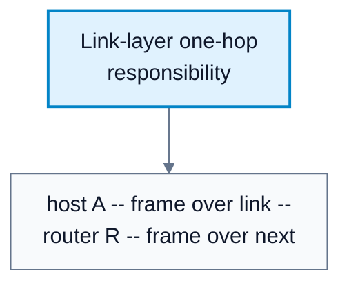
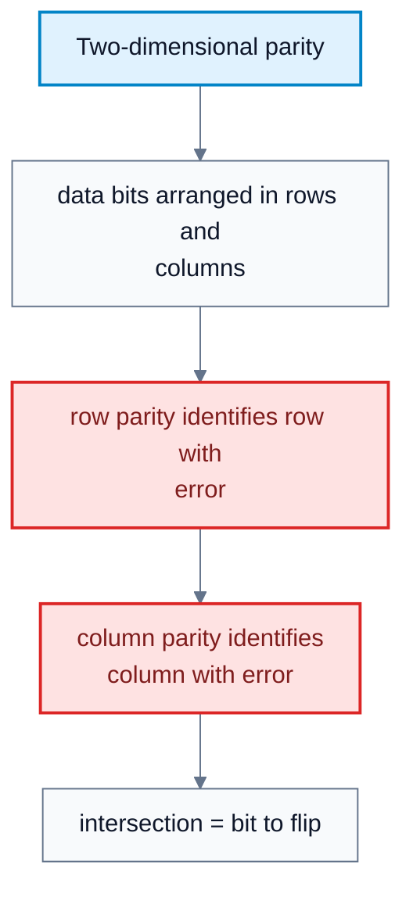
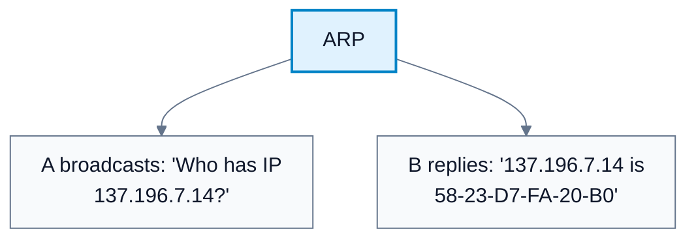
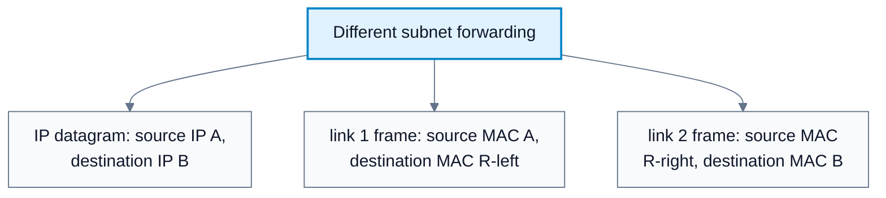
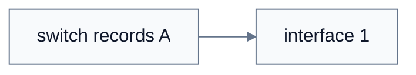

# Link Layer

**Subject**: CSC3001F Networks  
**Source**: `LinkLayer_v2025 - Copy.pptx`, Dr. Josiah Chavula, slides 1-43  
**Generated**: 2026-05-31

---

## Core Content

### Link-Layer Context

#### Definitions

> **Link Layer**: The layer responsible for transferring a datagram from one node to a physically adjacent node over a link. *In plain language: it moves packets one hop at a time.*

> **Node**: A host or router. *In plain language: any device participating in link-layer communication.*

> **Link**: A communication channel connecting adjacent nodes along a path. *In plain language: one hop's physical or wireless connection.*

> **Frame**: A layer-2 packet that encapsulates a network-layer datagram. *In plain language: the link-layer unit sent across one link.*

The link layer transfers datagrams over individual links. A source-to-destination path can use different link protocols on different hops: for example, WiFi on the first hop and Ethernet inside a campus network.

Transportation analogy from the source:

| Networking | Travel Analogy |
|---|---|
| Datagram | Traveler |
| Communication link | Travel segment |
| Link-layer protocol | Transportation mode |
| Routing algorithm | Travel agent |

Different links provide different services. A wireless link may need stronger reliability due to high bit-error rates, while a low-error fiber or Ethernet link may not use link-level reliable delivery.

#### Diagram: Link-layer one-hop responsibility



Caption: The link layer only handles delivery to the physically adjacent node.


### Link-Layer Services

#### Definitions

> **Framing**: Encapsulating a datagram into a frame with header and trailer. *In plain language: wrapping the IP packet for local delivery.*

> **Link Access**: Rules for using a link, especially a shared link. *In plain language: deciding who may transmit now.*

> **Error Correction**: Receiver identifies and corrects bit errors without retransmission. *In plain language: fixing certain errors locally.*

> **Full Duplex**: Both ends can transmit at the same time. *In plain language: send and receive simultaneously.*

> **Half Duplex**: Both ends can transmit, but not at the same time. *In plain language: one direction at a time.*

| Service | Meaning |
|---|---|
| Framing | Encapsulate datagram in frame with header/trailer |
| Link access | Control access to a shared medium |
| MAC addressing | Identify source/destination interfaces locally |
| Reliable delivery | Reliable transfer between adjacent nodes |
| Flow control | Pace adjacent sender and receiver |
| Error detection | Detect corrupted frames |
| Error correction | Correct some bit errors without retransmission |
| Half/full duplex | Define whether both ends can transmit simultaneously |

Why both link-level and end-to-end reliability? Link-level reliability can recover quickly over a noisy local link. End-to-end reliability is still needed because packets may be lost or corrupted elsewhere.
### Implementation In Hosts

#### Definitions

> **NIC**: Network Interface Card or chip implementing link and physical layer functions. *In plain language: the hardware/firmware/software that connects a host to the network.*

The link layer is implemented in every host, usually in a NIC or chip such as Ethernet or WiFi hardware. It combines hardware, software, and firmware. The NIC attaches to the host bus and implements link-layer and physical-layer functions.
### Error Detection And Parity

#### Definitions

> **Error Detection**: Receiver detects bit errors and may signal retransmission or drop the frame. *In plain language: noticing the bits were damaged.*

> **EDC**: Error detection and correction bits added as redundancy. *In plain language: extra bits used to check data.*

> **Parity Bit**: A bit added so the number of 1s is even or odd. *In plain language: a simple error-checking bit.*

> **Two-Dimensional Parity**: Parity computed across rows and columns to detect and correct single-bit errors. *In plain language: row and column checks pinpoint one flipped bit.*

Error detection is not perfectly reliable. Protocols may miss errors, but larger EDC fields usually improve detection/correction.

Single-bit parity:

1. Add one parity bit.
2. With even parity, choose parity bit so the total number of 1s is even.
3. Detects single-bit errors.

Two-dimensional parity:

1. Arrange data bits in rows and columns.
2. Compute parity for each row and column.
3. A single-bit error causes one row parity error and one column parity error.
4. The receiver identifies their intersection and corrects the bit.

#### Diagram: Two-dimensional parity



Caption: Two-dimensional parity can detect and correct a single-bit error.


### Multiple Access Links And Protocols

#### Definitions

> **Point-to-Point Link**: Link with one sender and one receiver, such as host-to-switch. *In plain language: a private link between two endpoints.*

> **Broadcast Link**: Shared medium where multiple nodes can transmit and hear each other. *In plain language: many devices share the same channel.*

> **Multiple Access Protocol**: Distributed algorithm determining how nodes share a broadcast channel. *In plain language: rules for taking turns on a shared medium.*

> **MAC Protocol**: Protocol governing medium access. *In plain language: the channel-sharing rule.*

> **Collision**: Two or more simultaneous transmissions interfering at a receiver. *In plain language: messages overlap and corrupt each other.*

Two link types:

| Link Type | Examples |
|---|---|
| Point-to-point | Host to Ethernet switch, PPP dial-up |
| Broadcast/shared | Old Ethernet, upstream cable access, 802.11 WiFi, cellular, satellite |

Multiple-access protocol classes:

| Class | Examples | Idea |
|---|---|---|
| Channel partitioning | TDMA, FDMA, CDMA | Divide time, frequency, or code |
| Random access | ALOHA, slotted ALOHA, CSMA/CD, CSMA/CA | Transmit dynamically; handle collisions |
| Taking turns | Polling, token passing, Bluetooth, FDDI, token ring | Coordinate who transmits next |

Carrier sensing is easier in some wired technologies and harder in wireless technologies.
### MAC Addresses And ARP


> **MAC Address**: A 48-bit LAN/physical/Ethernet address used locally to move frames between interfaces on the same subnet. *i.e: the local hardware-style address for one interface.*

> **ARP**: Address Resolution Protocol, used to determine a MAC address from an IP address on the same LAN. *i.e: "Who has this IP? Tell me your MAC."*

> **ARP Table**: Cache of IP-to-MAC mappings with TTL. *i.e: a local table remembering recent address resolutions.*

> **Broadcast MAC Address**: `FF-FF-FF-FF-FF-FF`, received by all nodes on the LAN. *i.e: send this frame to everyone locally.*

MAC addresses are used locally to move frames between interfaces on the same subnet. They are usually 48 bits and written in hexadecimal:

```text
1A-2F-BB-76-09-AD
```

Each interface has:

| Address | Scope | Purpose |
|---|---|---|
| MAC address | Local LAN | Frame delivery on a link/subnet |
| IP address | Network layer | Datagram delivery across networks |

ARP answers: given an IP address on the same LAN, what is the MAC address?

ARP table entries:

```text
<IP address; MAC address; TTL>
```

**ARP process**(Host A wants to send to B's IP address, B's MAC is not in A's ARP table):
*1*. A broadcasts ARP query with destination MAC `FF-FF-FF-FF-FF-FF`.
*2*. All LAN nodes receive the query.
*3*. B replies directly to A with its MAC address.
*4*. A stores the mapping in its ARP table until TTL expires.

#### Diagram: ARP



Caption: ARP resolves local IP addresses to local MAC addresses.


### Routing To Another Subnet

When A sends a datagram to B on another subnet through router R (A->R->B, A knows B's IP and R's IP & R's MAC):

*1*. A creates IP datagram with `<IP_src = A, IP_dest=B>`
*2*. A creates link-layer frame with MAC source A and MAC destination R's local interface.
*3*. R receives frame, extracts datagram, and passes it to IP.
*4*. R determines outgoing interface toward B.
*5*. R creates a new frame with MAC source R's outgoing interface and MAC destination B.
*6*. B receives frame, extracts datagram, and passes it up to IP.

Key point: IP source/destination stay end-to-end as A and B. MAC source/destination change on each link.

#### Diagram: Different subnet forwarding



Caption: IP addresses stay end-to-end; MAC addresses change hop by hop.


### Ethernet

#### Definitions

> **Ethernet**: Dominant wired LAN technology, historically from bus Ethernet to switched Ethernet. *In plain language: the main wired local-network link technology.*

> **Collision Domain**: Set of devices whose transmissions can collide. *In plain language: a shared region where simultaneous sends interfere.*

Ethernet is the dominant wired LAN technology. It was the first widely used LAN technology, is simple and cheap, and has scaled from 10 Mbps to hundreds of Gbps.

Physical topology:

| Topology | Notes |
|---|---|
| Bus Ethernet | Popular through mid-1990s; all nodes in same collision domain |
| Switched Ethernet | Dominant today; switch in center; each link separate; no host collisions on full-duplex links |
### Ethernet Switches

#### Definitions

> **Ethernet Switch**: Link-layer networking device that stores and forwards Ethernet frames using MAC addresses. *In plain language: it connects local hosts and learns where MAC addresses live.*

An Ethernet switch:

1. Is a link-layer device.
2. Stores and forwards Ethernet frames.
3. Examines incoming frame MAC destination address.
4. Selectively forwards to one or more outgoing links.
5. Is transparent to hosts.
6. Is plug-and-play and self-learning.

Switches support simultaneous transmissions when they use different output links. However, two transmissions to the same output cannot both be sent at the same time.
### Switch Self-Learning And Forwarding

#### Definitions

> **Switch Table**: Table mapping MAC address to switch interface and timestamp/TTL. *In plain language: the switch's learned local forwarding table.*

> **Self-Learning**: Switch behavior where it records the source MAC address and incoming interface of frames. *In plain language: switches learn locations by watching traffic.*

> **Flooding**: Forwarding a frame out all interfaces except the one it arrived on. *In plain language: send everywhere because destination location is unknown.*

Switch table entry:

```text
(MAC address, interface, timestamp/TTL)
```

When a frame arrives:

1. Record source MAC and incoming interface.
2. Look up destination MAC in switch table.
3. If entry found and destination is on the incoming segment, drop the frame.
4. If entry found and destination is on another interface, forward only on that interface.
5. If no entry found, flood on all interfaces except the arriving interface.

Self-learning works across interconnected switches the same way it works on a single switch: frames reveal where source MAC addresses are reachable.

#### Diagram: Switch self-learning



Caption: Switches build forwarding tables from observed source addresses.


### Switches Versus Routers

| Feature | Switch | Router |
|---|---|---|
| Layer | Link | Network |
| Unit | Frame | Datagram |
| Header examined | MAC/link-layer header | IP/network-layer header |
| Table built by | Self-learning, flooding | Routing algorithms and routing protocols |
| Address type | MAC address | IP address |
| Scope | LAN/subnet | Between networks |

Both are store-and-forward devices and both have forwarding tables.
### A Day In The Life (John lenon and mr mcarthy, Beatles 1967) Of A Web Request lol

A student attaches a laptop to a campus network and requests `www.google.com`.

1. **DHCP**: laptop gets its IP address, first-hop router address, and DNS server address.
2. **ARP before DNS**: laptop needs router MAC address to send DNS query off the LAN.
3. **DNS**: laptop sends DNS query; IP datagram is routed to DNS server; DNS returns Google's IP address.
4. **TCP**: laptop opens TCP socket to Google's web server; TCP three-way handshake occurs.
5. **HTTP**: browser sends HTTP request into TCP socket; server returns HTTP reply containing web page.

This single web request uses application, transport, network, link, and physical layers together.

## Worked Examples

### Example 1: Even Parity
**Problem**: Data bits are `101011`. Choose an even parity bit.  
**Step 1**: Count 1s in data: four 1s.  
**Step 2**: Four is already even.  
**Answer**: Parity bit is `0`.

### Example 2: Two-Dimensional Parity Correction
**Problem**: A received block has row 3 parity wrong and column 5 parity wrong. What error is indicated?  
**Step 1**: Row parity identifies the row containing the bit error.  
**Step 2**: Column parity identifies the column containing the bit error.  
**Answer**: Flip the bit at row 3, column 5.

### Example 3: ARP Resolution
**Problem**: Host A knows B's IP `137.196.7.14` but not B's MAC. What happens?  
**Step 1**: A broadcasts ARP query to `FF-FF-FF-FF-FF-FF`.  
**Step 2**: Every LAN node receives the query.  
**Step 3**: B replies directly with its MAC `58-23-D7-FA-20-B0`.  
**Step 4**: A records mapping in ARP table.  
**Answer**: A can now send an Ethernet frame directly to B's MAC on the LAN.

### Example 4: Sending To Another Subnet
**Problem**: A at IP `111.111.111.111` sends to B at `222.222.222.222` through router R. Whose MAC address is in A's first frame destination?  
**Step 1**: B is on another subnet, so A sends to first-hop router R.  
**Step 2**: IP destination remains B.  
**Step 3**: Link destination must be R's MAC on A's LAN.  
**Answer**: A's frame destination MAC is R's local interface MAC, not B's MAC.

### Example 5: Switch Forwarding
**Problem**: A switch table has `A -> 1`, `A' -> 4`. A frame from A to A' arrives on interface 1. What does the switch do?  
**Step 1**: Record/refresh source `A -> 1`.  
**Step 2**: Look up destination `A'` and find interface 4.  
**Step 3**: Destination is not on incoming interface.  
**Answer**: Forward the frame only on interface 4.

---

## Common Mistakes / Gotchas
- Confusing a frame with a datagram. A frame carries a datagram over one link.
- Thinking MAC addresses are end-to-end. MAC addresses are local and change hop by hop.
- Thinking ARP resolves names. DNS resolves names; ARP resolves IP-to-MAC on a LAN.
- Forgetting ARP broadcasts queries but replies directly.
- Assuming switches need manual configuration. Ethernet switches are plug-and-play and self-learning.
- Treating a switch like a router. Switches inspect MAC headers; routers inspect IP headers.
- Forgetting two devices can transmit simultaneously through a switch only if output links do not conflict.
- Assuming link-level reliability removes the need for end-to-end reliability. Loss can occur beyond one link.

---

## Summary / Cheat Sheet

| Term | Meaning |
|------|---------|
| Node | Host or router |
| Link | One-hop channel |
| Frame | Link-layer packet |
| MAC address | Local interface address |
| ARP | IP-to-MAC resolution |
| NIC | Link/physical implementation |
| EDC | Error detection/correction bits |
| Collision | Simultaneous transmissions interfere |
| Switch table | MAC -> interface mapping |
| Flooding | Unknown destination sent on all other interfaces |

**Key Rules**:

```text
Same subnet: frame destination MAC = target host MAC
Different subnet: frame destination MAC = first-hop router MAC
IP source/destination remain end-to-end
MAC source/destination change on every link
Switch learning: record source MAC on incoming interface
Unknown destination: flood
Known destination on incoming interface: drop
Known destination on other interface: forward there
```

**Key Takeaways**:
- The link layer provides one-hop delivery.
- MAC addresses are local; IP addresses support end-to-end routing.
- ARP connects IP addressing to local MAC delivery.
- Ethernet switches learn by watching source addresses and flood unknown destinations.
- A simple web request exercises all layers: DHCP, ARP, DNS, TCP, and HTTP.

---

## Practice Questions

**Q1**: What is the link layer responsible for?  
> Answer: Transferring a datagram from one node to a physically adjacent node over a link.

**Q2**: What does ARP do?  
> Answer: It resolves an IP address on the local LAN to the corresponding MAC address.

**Q3**: If a host sends to a destination outside its subnet, what MAC address does it use as the frame destination?  
> Answer: The MAC address of its first-hop router's local interface.

**Q4**: How does a switch learn that MAC address A is reachable on interface 1?  
> Answer: When a frame with source MAC A arrives on interface 1, the switch records `A -> interface 1`.

**Q5**: Give one difference and one similarity between switches and routers.  
> Answer: Difference: switches use MAC addresses at link layer; routers use IP addresses at network layer. Similarity: both are store-and-forward and use forwarding tables.
