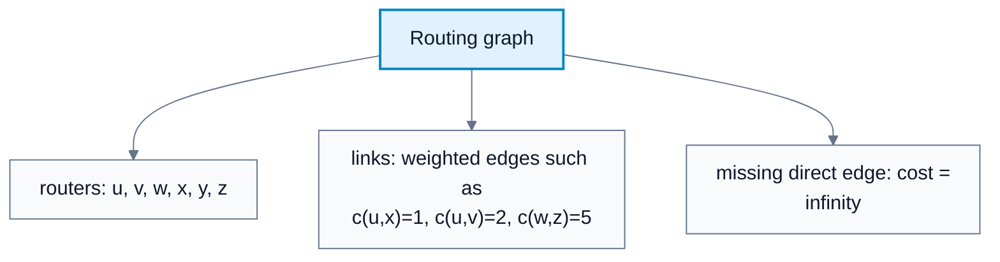
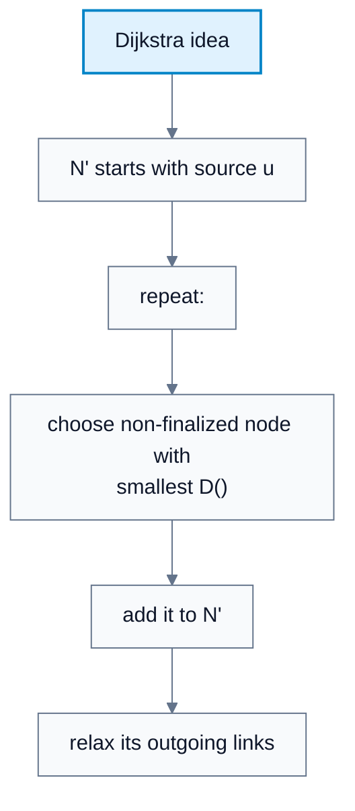
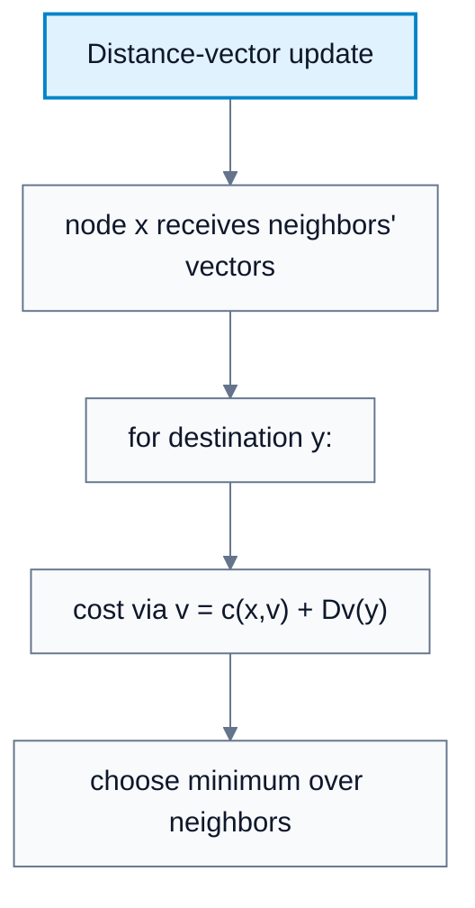
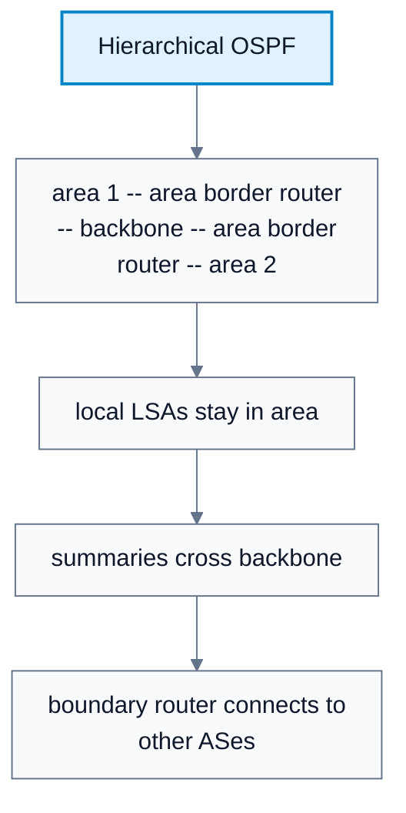

---
tags:
  - networks
---

# Network Layer: Control Plane

**Subject**: CSC3001F Networks  
**Source**: `NetworkLayer_2025_control.pdf`, Dr. Josiah Chavula, pages 1-48  
**Generated**: 2026-05-31

---

## Contents

- [[#Core Content|Core Content]]
  - [[#Routing Protocol Goal|Routing Protocol Goal]]
  - [[#Routing Algorithm Classification|Routing Algorithm Classification]]
  - [[#Dijkstra's Link-State Algorithm|Dijkstra's Link-State Algorithm]]
  - [[#Distance-Vector Routing|Distance-Vector Routing]]
  - [[#Making Routing Scalable|Making Routing Scalable]]
  - [[#Intra-AS Routing And OSPF|Intra-AS Routing And OSPF]]
  - [[#BGP: Internet Inter-AS Routing|BGP: Internet Inter-AS Routing]]
  - [[#BGP Attributes And Messages|BGP Attributes And Messages]]
  - [[#BGP Path Advertisement|BGP Path Advertisement]]
  - [[#Why Intra-AS And Inter-AS Routing Differ|Why Intra-AS And Inter-AS Routing Differ]]
  - [[#Hot Potato Routing|Hot Potato Routing]]
  - [[#BGP Policy And Route Selection|BGP Policy And Route Selection]]

---

## Core Content

### Routing Protocol Goal

#### Definitions

> **Control Plane**: The network-layer logic that determines how datagrams are routed among routers from source to destination. *In plain language: it decides paths and creates forwarding information.*

> **Forwarding**: Moving packets from router input to router output. *In plain language: local packet movement in the data plane.*

> **Routing**: Determining the route taken by packets from source to destination. *In plain language: path computation across the network.*

> **Routing Protocol**: A protocol whose goal is to determine good paths through the network. *In plain language: routers use it to learn where to send traffic.*

> **Path**: A sequence of routers a packet traverses from source host to destination host. *In plain language: the route through the router graph.*

> **Graph**: Routing abstraction `G = (N, E)` with routers as nodes and links as edges. *In plain language: routing turns the network into a weighted graph.*

> **Link Cost**: A weight assigned to a direct link between routers. *In plain language: cost says how expensive or undesirable a link is.*

Routing protocols determine "good" paths from sending hosts to receiving hosts through routers. Good can mean least cost, fastest, least congested, or best according to policy.

The routing graph abstraction:

```text
G = (N, E)
N = set of routers
E = set of links
cx,y = cost of direct link between x and y
cx,y = infinity if x and y are not direct neighbors
```

Link costs may be:

1. Always 1.
2. Inversely related to bandwidth.
3. Inversely related to congestion.
4. Set by operator policy.

#### Diagram: Routing graph



Caption: Routing algorithms compute least-cost paths over a weighted graph.


### Routing Algorithm Classification

#### Definitions

> **Global Routing Algorithm**: Algorithm where routers know complete topology and link-cost information. *In plain language: every router has the full map.*

> **Decentralized Routing Algorithm**: Algorithm where routers compute routes through iterative exchanges with neighbors. *In plain language: routers learn from neighbors, not a full map initially.*

> **Static Routing**: Routing where routes change slowly over time. *In plain language: paths are relatively fixed.*

> **Dynamic Routing**: Routing where routes change in response to updates or link-cost changes. *In plain language: paths adapt.*

| Classification | Option | Meaning |
|---|---|---|
| Information scope | Global | All routers know complete topology and costs |
| Information scope | Decentralized | Routers initially know only neighbors and exchange information |
| Route change speed | Static | Routes change slowly |
| Route change speed | Dynamic | Routes change periodically or when costs change |

**Link-state** algorithms are global. **Distance-vector** algorithms are decentralized.
### Dijkstra's Link-State Algorithm

#### Definitions

> **Link-State Algorithm**: A global routing algorithm using complete topology knowledge. *In plain language: routers flood link states and compute shortest paths.*

> **Dijkstra's Algorithm**: Link-state shortest-path algorithm computing least-cost paths from one source to all destinations. *In plain language: repeatedly lock in the nearest unknown node.*

> **N'**: Set of nodes whose least-cost path from the source is definitively known. *In plain language: finalized nodes in Dijkstra.*

> **D(v)**: Current estimate of least-cost path from source to destination `v`. *In plain language: best known cost so far.*

> **p(v)**: Predecessor of `v` along the current least-cost path. *In plain language: the previous hop on the best known route.*

Assumptions:

1. Topology and link costs are known to all nodes through link-state broadcast.
2. All nodes have the same information.
3. Each node computes least-cost paths from itself to all destinations.
4. The result gives that node's forwarding table.

Algorithm:

```text
Initialization:
N' = {u}
for all nodes v:
  if v adjacent to u:
    D(v) = c(u,v)
  else:
    D(v) = infinity

Loop:
  find w not in N' with minimum D(w)
  add w to N'
  for each neighbor v of w not in N':
    D(v) = min(D(v), D(w) + c(w,v))
until all nodes are in N'
```

After each iteration, one more destination has a definitive least-cost path.

#### Diagram: Dijkstra idea



Caption: Link-state routing finalizes one least-cost destination per iteration.


### Distance-Vector Routing

#### Definitions

> **Distance-Vector Algorithm**: Decentralized routing algorithm where routers exchange distance estimates with neighbors. *In plain language: each router tells neighbors its current best distances.*

> **Bellman-Ford Equation**: `Dx(y) = minv { cx,v + Dv(y) }` over neighbors `v`. *In plain language: my best cost to destination is the cheapest neighbor plus that neighbor's cost.*

Distance-vector routing is based on the Bellman-Ford equation:

```text
Dx(y) = min over neighbors v { cx,v + Dv(y) }
```

Meaning:

1. `Dx(y)` is node `x`'s least-cost estimate to destination `y`.
2. `cx,v` is the direct cost from `x` to neighbor `v`.
3. `Dv(y)` is neighbor `v`'s estimate to destination `y`.
4. The neighbor that gives the minimum becomes the next hop.

Distance-vector behavior:

1. From time to time, each node sends its distance vector estimate to neighbors.
2. When `x` receives a new vector from a neighbor, it recomputes using Bellman-Ford.
3. If `x`'s vector changes, it notifies neighbors.
4. Under minor natural conditions, estimates converge to actual least costs.

Properties:

| Property | Distance Vector |
|---|---|
| Iterative | Updates happen repeatedly |
| Asynchronous | Nodes update on local link changes or neighbor messages |
| Distributed | No node needs full topology |
| Self-stopping | No updates are sent if nothing changes |

#### Diagram: Distance-vector update



Caption: A router's best path is chosen by comparing neighbor-advertised costs.


### Making Routing Scalable

#### Definitions

> **Autonomous System (AS)**: A region/domain of routers under one administrative control. *In plain language: one organization's network domain for routing.*

> **Gateway Router**: Router at the edge of an AS with links to routers in other ASes. *In plain language: the AS border router.*

Flat routing is idealized. In the real Internet:

1. There are billions of destinations.
2. Routers cannot store every destination individually.
3. Routing-table exchange would swamp links.
4. Networks need administrative autonomy.

The Internet aggregates routers into **autonomous systems**.

| Routing Type | Scope | Examples |
|---|---|---|
| Intra-AS / intra-domain | Within one AS | RIP, EIGRP, OSPF, IS-IS |
| Inter-AS / inter-domain | Between ASes | BGP |

Gateway routers perform inter-domain routing and also participate in intra-domain routing.
### Intra-AS Routing And OSPF

#### Definitions

> **Intra-AS Routing**: Routing within a single AS. *In plain language: internal routing.*

> **OSPF**: Open Shortest Path First, an open link-state intra-AS routing protocol. *In plain language: OSPF floods link-state advertisements and uses Dijkstra inside an AS.*

> **Hierarchical OSPF**: OSPF design with local areas and a backbone to scale link-state routing. *In plain language: detailed flooding stays inside areas; summaries cross the backbone.*

Common intra-AS protocols:

| Protocol | Type | Notes |
|---|---|---|
| RIP | Distance vector | Classic DV; exchanged every 30 seconds; no longer widely used |
| EIGRP | Distance-vector based | Formerly Cisco-proprietary; opened in RFC 7868 |
| OSPF | Link state | Open standard; uses Dijkstra |
| IS-IS | Link state | ISO standard, similar to OSPF |

OSPF properties:

1. Open and publicly available.
2. Classic link-state routing.
3. Routers flood OSPF link-state advertisements directly over IP.
4. Supports multiple link-cost metrics such as bandwidth and delay.
5. Each router builds full topology and computes forwarding table using Dijkstra.
6. OSPF messages are authenticated to prevent malicious intrusion.

Hierarchical OSPF:

| Router / Area Type | Role |
|---|---|
| Local routers | Flood link-state information only inside an area |
| Area border routers | Summarize distances from their area and advertise to backbone |
| Backbone routers | Run OSPF limited to backbone |
| Boundary routers | Connect to other ASes |

This reduces flooding scope and table detail outside local areas.

#### Diagram: Hierarchical OSPF



Caption: Hierarchy reduces flooding and hides detailed topology between areas.


### BGP: Internet Inter-AS Routing

#### Definitions

> **Inter-AS Routing**: Routing between ASes. *In plain language: routing among organizations/providers.*

> **BGP**: Border Gateway Protocol, the de facto inter-domain routing protocol. *In plain language: BGP is the glue between ASes on the Internet.*

> **Path Vector Protocol**: Routing protocol advertising paths as sequences of ASes. *In plain language: route advertisements carry the AS path taken.*

> **eBGP**: External BGP, used to obtain reachability information from neighboring ASes. *In plain language: BGP between ASes.*

> **iBGP**: Internal BGP, used to propagate BGP reachability information inside an AS. *In plain language: BGP within one AS.*

BGP is the de facto inter-domain routing protocol. It lets subnets advertise their existence and reachability to the Internet:

```text
"I am here; here is who I can reach; here is how."
```

BGP gives each AS the means to:

1. Use eBGP to learn reachability from neighboring ASes.
2. Use iBGP to propagate reachability to AS-internal routers.
3. Determine good routes based on reachability and policy.

BGP sessions run over semi-permanent TCP connections between BGP peers. BGP is a path-vector protocol because route advertisements include AS paths.
### BGP Attributes And Messages

#### Definitions

> **Prefix**: Destination network being advertised in BGP. *In plain language: the address block a route reaches.*

> **AS-PATH**: BGP attribute listing ASes through which the prefix advertisement has passed. *In plain language: the inter-domain path.*

> **NEXT-HOP**: BGP attribute identifying the router/interface to the next-hop AS. *In plain language: where to send packets next inside your AS.*

> **Policy-Based Routing**: Route acceptance, selection, and advertisement based on administrative policy. *In plain language: business rules can dominate shortest path.*

BGP advertised route:

```text
prefix + attributes
```

Important attributes:

| Attribute | Meaning |
|---|---|
| AS-PATH | List of ASes through which advertisement passed |
| NEXT-HOP | Specific internal-AS router to the next-hop AS |

BGP messages:

| Message | Purpose |
|---|---|
| OPEN | Opens TCP connection to peer and authenticates sender |
| UPDATE | Advertises new path or withdraws old path |
| KEEPALIVE | Keeps connection alive and ACKs OPEN |
| NOTIFICATION | Reports errors and can close connection |
### BGP Path Advertisement

Example from source:

1. AS3 gateway `3a` advertises path `AS3, X` to AS2 gateway `2c`.
2. AS2 policy accepts the route.
3. AS2 propagates the route internally through iBGP.
4. AS2 gateway `2a` advertises `AS2, AS3, X` to AS1.
5. AS1 may also learn `AS3, X` directly from AS3.
6. AS1 policy chooses which path to use and propagates it internally.

When an internal router learns "path to X goes through gateway 1c", it still uses OSPF/intra-AS routing to find the correct local interface to reach gateway `1c`.

#### Diagram: BGP advertisement

```mermaid
%%{init: {"theme":"base","themeVariables":{"primaryColor":"#e0f2fe","primaryTextColor":"#0f172a","primaryBorderColor":"#0284c7","lineColor":"#64748b","secondaryColor":"#f8fafc","tertiaryColor":"#dcfce7","fontFamily":"Inter, ui-sans-serif, system-ui, -apple-system, BlinkMacSystemFont, Segoe UI, sans-serif"},"flowchart":{"curve":"basis","htmlLabels":true,"padding":12}}}%%
flowchart LR
    N0["AS3"]
    N1["AS2: AS3, X"]
    N0 --> N1

    classDef default fill:#f8fafc,stroke:#64748b,stroke-width:1px,color:#0f172a;
    classDef focus fill:#e0f2fe,stroke:#0284c7,stroke-width:2px,color:#0f172a;
    classDef outcome fill:#dcfce7,stroke:#16a34a,stroke-width:2px,color:#052e16;
    classDef warning fill:#fee2e2,stroke:#dc2626,stroke-width:2px,color:#7f1d1d;
    classDef muted fill:#f1f5f9,stroke:#94a3b8,stroke-width:1px,color:#334155;
```



Caption: BGP carries AS-level paths and lets policy choose among them.


### Why Intra-AS And Inter-AS Routing Differ

| Issue | Intra-AS | Inter-AS |
|---|---|---|
| Policy | Less important under one admin | Dominant; admins control who uses network |
| Scale | Smaller, internal | Internet-scale |
| Performance | Can optimize performance metrics | Policy often dominates performance |
| Trust | Same organization | Different organizations |
### Hot Potato Routing

#### Definitions

> **Hot Potato Routing**: Choosing the nearest local gateway to hand traffic to another AS quickly. *In plain language: get traffic out of your network at lowest internal cost.*

Hot potato routing chooses the gateway with least intra-domain cost, even if the AS-level path is longer. The AS tries to hand traffic to another AS as quickly as possible.

Example: if router `2d` can route to prefix `X` via gateways `2a` or `2c`, and OSPF cost to `2a` is lower, `2d` chooses `2a`, even if the external AS path via `2a` has more AS hops.
### BGP Policy And Route Selection

#### Definitions

> **Route Leak**: Incorrect route advertisement that causes traffic to follow unintended AS paths. *In plain language: a bad BGP announcement can misdirect traffic at Internet scale.*

Policy examples from the source:

1. An ISP may only want to route traffic to/from its customer networks, not carry free transit traffic between other provider networks.
2. A provider may advertise customer routes to other providers.
3. A provider may choose not to advertise a learned provider route to another provider if it earns no revenue.
4. A dual-homed customer may avoid advertising routes that would make it carry transit traffic between providers.

BGP route selection:

1. Highest local preference: policy decision.
2. Shortest AS-PATH.
3. Closest NEXT-HOP router: hot potato routing.
4. Additional criteria.
