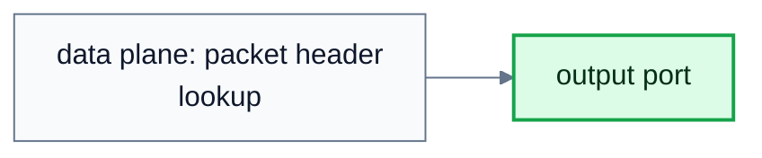
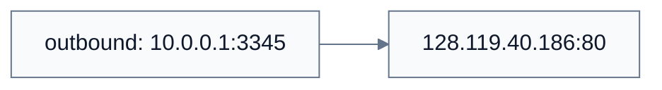
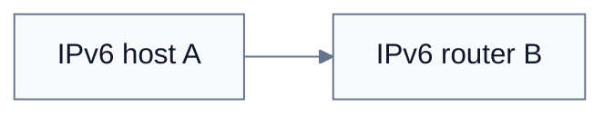
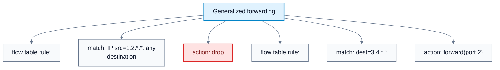

# Network Layer: Data Plane

**Subject**: CSC3001F Networks  
**Source**: `NetworkLayer_2025-DataPlane.pptx`, Dr. Josiah Chavula, slides 1-52  
**Generated**: 2026-05-31

---

## Core Content

### Network-Layer Service

#### Definitions

> **Network Layer**: The layer that transfers transport-layer segments from a sending host to a receiving host by encapsulating them in datagrams. *In plain language: it moves packets between hosts across routers.*

> **Best-Effort Service**: Internet service model with no guarantee of delivery, order, timing, or bandwidth. *In plain language: IP tries to deliver but does not promise success.*

> **QoS**: Quality of Service guarantees such as bandwidth, loss, order, or timing guarantees. *In plain language: QoS is stronger service behavior than best effort.*

The sender network layer encapsulates transport segments into datagrams and passes them to the link layer. The receiver network layer delivers segment payloads to the transport layer. Routers run network-layer protocols and examine header fields in every IP datagram passing through them.

The Internet's main service model is **best effort**:

| Guarantee | Internet Best Effort |
|---|---|
| Successful delivery | No guarantee |
| Delivery timing | No guarantee |
| Delivery order | No guarantee |
| Bandwidth | No guarantee |

Other architectures have offered stronger models, such as ATM Constant Bit Rate, ATM Available Bit Rate, Intserv guaranteed service, and Diffserv differentiated service.
### Data Plane And Control Plane

#### Definitions

> **Router**: A network-layer device that examines IP header fields and moves datagrams from input ports to output ports. *In plain language: routers choose the next hop for datagrams.*

> **Routing**: Determining the source-to-destination path packets should take. *In plain language: network-wide path planning.*

> **Data Plane**: Local per-router function determining how arriving datagrams are forwarded. *In plain language: the fast packet-moving part of routers.*

> **Control Plane**: Network-wide logic that determines routes and forwarding-table contents. *In plain language: the decision system that programs forwarding behavior.*

> **Per-Router Control Plane**: Traditional approach where routing algorithm components run in each router and interact. *In plain language: routers compute routes together.*

> **SDN Control Plane**: Software-defined networking approach where a remote controller computes and installs forwarding rules. *In plain language: a logically centralized controller programs routers/switches.*

| Plane | Scope | Job | Implementation Examples |
|---|---|---|---|
| Data plane | Local per-router | Forward datagrams from input port to output port | Hardware forwarding table lookup |
| Control plane | Network-wide | Determine routes and install forwarding behavior | Routing protocols or SDN controller |

Traditional routers run routing algorithm components in each router. SDN moves control logic into a logically centralized controller that computes and installs forwarding tables in network devices.

#### Diagram: Data plane and control plane



Caption: The control plane decides forwarding behavior; the data plane applies it.


### Destination-Based Forwarding And Longest Prefix Matching

#### Definitions

> **Forwarding**: Moving a packet from a router input link to an appropriate output link. *In plain language: one router's local action.*

> **Destination-Based Forwarding**: Forwarding based on the destination IP address. *In plain language: route by where the packet is going.*

> **Longest Prefix Matching**: Choosing the forwarding-table entry with the longest address prefix matching the destination address. *In plain language: use the most specific matching route.*

Destination-based forwarding uses the destination IP address. Because address ranges do not always divide neatly, routers use **longest prefix matching**.

Rule: when more than one forwarding-table entry matches a destination address, choose the entry with the longest matching prefix.

Example table from the source:

| Destination Prefix Pattern | Interface |
|---|---:|
| `11001000 00010111 00010*** ********` | 0 |
| `11001000 00010111 00011000 ********` | 1 |
| `11001000 00010111 00011*** ********` | 2 |
| otherwise | 3 |

Destination `11001000 00010111 00010110 10100001` matches the first prefix, so interface 0. Destination `11001000 00010111 00011000 10101010` matches the more specific second prefix, so interface 1.

#### Diagram: Longest prefix matching


Caption: More specific matching prefixes override broader matches.


### IPv4 Datagram Format

#### Definitions

> **Datagram**: A network-layer packet, especially an IP packet. *In plain language: it is the packet routers forward.*

Important IPv4 fields:

| Field | Purpose |
|---|---|
| Version | IP protocol version |
| Header length | Header size |
| Type of service | Diffserv bits and ECN bits |
| Total length | Datagram length in bytes |
| Identifier, flags, fragment offset | Fragmentation/reassembly support |
| TTL | Maximum remaining hops; decremented at routers |
| Upper-layer protocol | TCP, UDP, or another payload protocol |
| Header checksum | Detects header errors |
| Source IP address | Sender interface |
| Destination IP address | Destination interface |
| Options | Optional fields such as timestamp or record route |
| Payload | Usually TCP or UDP segment |

Maximum IPv4 datagram length is 64 KB, but datagrams are typically 1500 bytes or less. A common TCP/IP overhead is 20 bytes IP header plus 20 bytes TCP header, before application-layer overhead.
### IP Addressing, Interfaces, And Subnets

#### Definitions

> **IPv4 Address**: A 32-bit identifier associated with a host or router interface. *In plain language: an address belongs to an interface, not an entire device.*

> **Interface**: The connection between a host/router and a physical link. *In plain language: each network attachment point has its own address.*

> **Subnet**: Device interfaces that can physically reach each other without passing through an intervening router. *In plain language: a local IP network segment.*

> **Subnet Mask / Prefix Length**: Number of high-order bits used for the subnet part of an address, written `/x`. *In plain language: `/24` means the first 24 bits name the subnet.*

An IPv4 address is a 32-bit identifier associated with an interface. Routers have multiple interfaces. Hosts typically have one or two, such as wired Ethernet and wireless WiFi.

Dotted-decimal notation splits the 32 bits into four 8-bit fields:

```text
223.1.1.1 = 11011111 00000001 00000001 00000001
```

A subnet is formed by interfaces that can reach each other without passing through an intervening router. IP addresses have structure:

```text
subnet part: high-order bits shared by the subnet
host part: remaining low-order bits
```

Example: `223.1.1.0/24` means high-order 24 bits are the subnet prefix.
### CIDR And Hierarchical Addressing

#### Definitions

> **CIDR**: Classless InterDomain Routing, using arbitrary-length prefixes written `a.b.c.d/x`. *In plain language: CIDR lets networks be sized and advertised flexibly.*

> **Route aggregation**: Combining several smaller, contiguous network prefixes into one larger prefix that can be advertised as a single route. *In plain language: routers can store and advertise one summary route instead of many individual subnet routes.*

CIDR address format:

```text
a.b.c.d/x
```

where `x` is the number of prefix bits.

Example from the source:

```text
200.23.16.0/23
binary prefix: 11001000 00010111 00010000 00000000
```

Hierarchical addressing enables route aggregation. If an ISP owns `200.23.16.0/20`, it can allocate eight `/23` blocks:

| Organization | Prefix |
|---|---|
| Org 0 | `200.23.16.0/23` |
| Org 1 | `200.23.18.0/23` |
| Org 2 | `200.23.20.0/23` |
| ... | ... |
| Org 7 | `200.23.30.0/23` |

The ISP can advertise the aggregate `200.23.16.0/20`. If Org 1 moves to another ISP, the new ISP can advertise a more specific `200.23.18.0/23`, and longest prefix matching directs that traffic to the new provider.

ICANN allocates IP address space through regional registries and manages the DNS root zone. The final IPv4 blocks were allocated to regional registries in 2011, motivating NAT and IPv6.
### DHCP

#### Definitions

> **DHCP**: Dynamic Host Configuration Protocol, used by hosts to dynamically obtain an IP address and other network settings. *In plain language: DHCP lets devices join a network automatically.*

DHCP lets a host dynamically obtain an IP address when it joins a network. It can renew leases, reuse addresses only while devices are connected, and support mobile users.

DHCP exchange:

| Step | Message | Meaning |
|---|---|---|
| 1 | DHCP Discover | Client broadcasts: "Is there a DHCP server?" |
| 2 | DHCP Offer | Server broadcasts: "Here is an address you can use." |
| 3 | DHCP Request | Client broadcasts: "I want this address." |
| 4 | DHCP ACK | Server broadcasts: "You have this address." |

DHCP can return more than the IP address:

1. First-hop router address.
2. DNS server name and IP address.
3. Network mask/prefix information.
### NAT

#### Definitions

> **NAT**: Network Address Translation, where devices in a local network share one public IPv4 address through address/port rewriting. *In plain language: NAT hides many private hosts behind one public IP.*

> **Private IP Address Space**: Address blocks usable only inside local networks, including `10/8`, `172.16/12`, and `192.168/16`. *In plain language: these addresses are not globally routed on the public Internet.*

> **NAT Translation Table**: Table mapping public `(NAT IP, port)` pairs to private `(LAN IP, port)` pairs. *In plain language: it remembers which internal connection each external port represents.*

NAT lets all devices in a local network share one public IPv4 address. Inside the network, hosts use private addresses. Outside the network, all outgoing datagrams appear to come from the NAT router's public address but with different source port numbers.

NAT outgoing behavior:

1. Replace source `(private IP, source port)` with `(NAT public IP, new source port)`.
2. Store mapping in NAT table.
3. Remote server replies to `(NAT public IP, new source port)`.

NAT incoming behavior:

1. Look up destination `(NAT public IP, port)` in NAT table.
2. Replace destination with original `(private IP, port)`.
3. Forward into LAN.

Advantages:

| Advantage | Explanation |
|---|---|
| Saves public IPv4 addresses | One public address supports many devices |
| Local renumbering | Internal host addresses can change without outside notification |
| ISP change | Local addresses need not change when provider changes |
| Basic hiding | Internal devices are not directly addressable from outside |

Controversies:

| Concern | Explanation |
|---|---|
| Layer violation | Routers "should" process only layer 3, but NAT edits ports |
| End-to-end argument | End hosts no longer communicate with stable end-to-end addresses |
| IPv6 alternative | Address shortage could be solved by IPv6 |
| NAT traversal | External clients struggle to connect to servers behind NAT |

#### Diagram: NAT translation



Caption: NAT uses a table to reverse the address/port rewrite for replies.


### IPv6

#### Definitions

> **IPv6**: IP version with 128-bit addresses and a simplified fixed-length header. *In plain language: IPv6 greatly expands address space and changes header processing.*

> **Flow Label**: IPv6 field intended to identify datagrams in the same flow. *In plain language: it can mark packets that should receive similar treatment.*

> **Hop Limit**: IPv6 field replacing IPv4 TTL. *In plain language: it limits how many routers a packet can traverse.*

IPv6 motivations:

1. IPv4 32-bit address exhaustion.
2. Faster processing/forwarding with a fixed 40-byte header.
3. Support for different treatment of flows.

IPv6 changes:

| Feature | IPv4 | IPv6 |
|---|---|---|
| Address size | 32 bits | 128 bits |
| Header checksum | Present | Removed |
| Fragmentation/reassembly | In header | Removed from routers |
| Options | Header options | Next-header approach |
| Hop control | TTL | Hop limit |

IPv6 notation:

```text
2001:0718:1c01:0016:020d:56ff:fe77:52a3
```

Rules:

1. 128 bits written as 8 groups of 16-bit hexadecimal values.
2. Leading zeros in a group may be omitted.
3. Consecutive all-zero groups may be compressed with `::` once.
4. Prefixes use CIDR-style notation, e.g. `21DA:D3::/48`.
### IPv6 Transition And Tunneling

#### Definitions

> **Tunneling**: Carrying one protocol's packet as payload inside another protocol's packet. *In plain language: packet inside a packet.*

The Internet cannot upgrade every router at once. There are no global "flag days." Mixed IPv4/IPv6 networks use tunneling.

Tunneling example:

```text
IPv6 router A -> IPv6 datagram -> IPv4 tunnel -> IPv6 router F
```

Across the IPv4 part, the IPv6 datagram is payload inside an IPv4 datagram. The outer IPv4 source/destination addresses are the tunnel endpoints; the inner IPv6 source/destination remain the original communicating hosts.

#### Diagram: IPv6 tunneling through IPv4



Caption: Tunneling lets IPv6 islands communicate across IPv4-only regions.


### Generalized Forwarding And OpenFlow

#### Definitions

> **Generalized Forwarding**: Match-plus-action forwarding over many possible header fields. *In plain language: not just destination IP; match fields and take actions.*

> **Flow Table**: A table of match patterns, actions, priorities, and counters. *In plain language: it says what to do with packets that match a rule.*

> **OpenFlow**: A protocol/abstraction for flow-table entries matching link, network, and transport fields. *In plain language: OpenFlow lets controllers program match-action rules.*

Destination-based forwarding matches only destination IP. **Generalized forwarding** uses a match-plus-action abstraction:

```text
match packet header fields -> take action
```

Possible actions:

1. Forward to one or more ports.
2. Drop.
3. Modify header fields.
4. Copy or send packet to controller.
5. Log or count.

Flow table fields include match, action, priority, and counters for packets/bytes. OpenFlow can match link-layer, network-layer, and transport-layer fields:

| Layer | Example Match Fields |
|---|---|
| Link | Ingress port, source MAC, destination MAC, Ethernet type, VLAN ID |
| Network | IP source, IP destination, IP protocol, IP ToS |
| Transport | TCP/UDP source port, TCP/UDP destination port |

OpenFlow examples:

| Device Behavior | Match | Action |
|---|---|---|
| Router | Longest destination IP prefix | Forward out link |
| Switch | Destination MAC address | Forward or flood |
| Firewall | IP addresses and TCP/UDP ports | Permit or deny |
| NAT | IP address and port | Rewrite address and port |

#### Diagram: Generalized forwarding



Caption: Match-plus-action unifies routers, switches, firewalls, and NAT behavior.

## Worked Examples

### Example 1: Longest Prefix Match
**Problem**: Choose output interface for destination `11001000 00010111 00011000 10101010` using the source table.  
**Step 1**: Check prefix `11001000 00010111 00010*** ********`: no match, because the third byte begins `00011000`, not `00010`.  
**Step 2**: Check prefix `11001000 00010111 00011000 ********`: match.  
**Step 3**: Check prefix `11001000 00010111 00011*** ********`: match, but shorter.  
**Answer**: Choose the more specific second entry, interface `1`.

### Example 2: DHCP Join
**Problem**: A laptop joins a LAN and has no IP address. What messages occur?  
**Step 1**: Client broadcasts DHCP Discover from `0.0.0.0:68` to `255.255.255.255:67`.  
**Step 2**: Server broadcasts DHCP Offer with offered IP and lease time.  
**Step 3**: Client broadcasts DHCP Request for the offered IP.  
**Step 4**: Server broadcasts DHCP ACK confirming lease.  
**Answer**: The host obtains IP address, lease, first-hop router, DNS server, and mask information.

### Example 3: CIDR Allocation
**Problem**: An ISP has `200.23.16.0/20`. How many `/23` blocks can it allocate?  
**Step 1**: `/20` to `/23` increases prefix length by 3 bits.  
**Step 2**: `2^3 = 8` sub-blocks.  
**Answer**: The ISP can allocate eight `/23` blocks.

### Example 4: NAT Table
**Problem**: Host `10.0.0.1:3345` contacts server `128.119.40.186:80`. NAT public address is `138.76.29.7`, chosen port `5001`. What mapping is stored?  
**Step 1**: Outgoing source becomes `138.76.29.7:5001`.  
**Step 2**: Original LAN endpoint is `10.0.0.1:3345`.  
**Answer**: NAT table stores `138.76.29.7:5001 -> 10.0.0.1:3345`.

### Example 5: IPv6 Compression
**Problem**: Compress `2001:0718:0000:0000:020d:56ff:fe77:52a3`.  
**Step 1**: Remove leading zeros: `2001:718:0:0:20d:56ff:fe77:52a3`.  
**Step 2**: Compress one run of zero groups with `::`.  
**Answer**: `2001:718::20d:56ff:fe77:52a3`.

---

## Common Mistakes / Gotchas
- Saying an IP address belongs to a host rather than an interface.
- Choosing the first matching prefix instead of the longest matching prefix.
- Confusing forwarding with routing, or data plane with control plane.
- Forgetting best-effort IP gives no delivery, timing, ordering, or bandwidth guarantee.
- Assuming DHCP only returns an IP address. It can return router, DNS, and mask settings too.
- Forgetting NAT rewrites transport-layer ports, not just IP addresses.
- Treating private addresses as globally routable public addresses.
- Using `::` more than once in an IPv6 address; it can only be used once.
- Assuming all routers must support IPv6 before IPv6 can be used; tunneling supports mixed deployment.
- Thinking OpenFlow is only routing. It can express switch, router, firewall, and NAT-like behavior.

---

## Summary / Cheat Sheet

| Term | Meaning |
|------|---------|
| Best effort | No delivery/order/timing/bandwidth guarantees |
| Data plane | Local forwarding |
| Control plane | Network-wide routing/control logic |
| Longest prefix match | Use most specific matching route |
| Interface | Network attachment point |
| Subnet | Interfaces reachable without router |
| CIDR | `a.b.c.d/x` prefix notation |
| Route aggregation | Summarize multiple contiguous prefixes as one larger advertised route |
| DHCP | Dynamic host configuration |
| NAT | Private-public address/port rewriting |
| IPv6 | 128-bit successor to IPv4 |
| Tunneling | Packet inside packet |
| Flow table | Match-action forwarding table |

**Key Formulas / Rules**:

```text
CIDR block count from /a to /b = 2^(b-a)
Longest prefix matching: choose the matching route with greatest prefix length
NAT outbound: (private IP, private port) -> (public IP, new port)
IPv6 address length = 128 bits = 8 groups of 16 bits
```

**Key Takeaways**:
- The Internet network layer is best effort.
- Routers forward locally, while routing/control logic determines tables.
- Addressing structure enables aggregation and scalable forwarding.
- DHCP automates host configuration.
- NAT stretches IPv4 address space but complicates end-to-end connectivity.
- IPv6 expands addresses and simplifies router processing.
- Generalized forwarding broadens routing into programmable match-action behavior.

---

## Practice Questions

**Q1**: What is the difference between data plane and control plane?  
> Answer: The data plane forwards packets locally at routers. The control plane determines routes and forwarding-table contents across the network.

**Q2**: Why does longest prefix matching use the longest match instead of any match?  
> Answer: Multiple prefixes can match one address. The longest prefix is the most specific route and should override broader aggregates.

**Q3**: Name the four DHCP messages in order.  
> Answer: Discover, Offer, Request, ACK.

**Q4**: Give two advantages and two controversies of NAT.  
> Answer: Advantages: saves public IPv4 addresses and allows internal renumbering. Controversies: violates layer/end-to-end assumptions and causes NAT traversal problems.

**Q5**: What IPv4 header fields are removed from IPv6's main header?  
> Answer: Header checksum, fragmentation/reassembly fields, and options are removed from the main header path; options move to next-header mechanisms.
