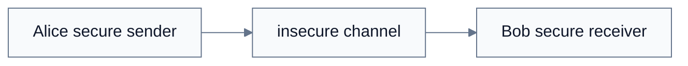
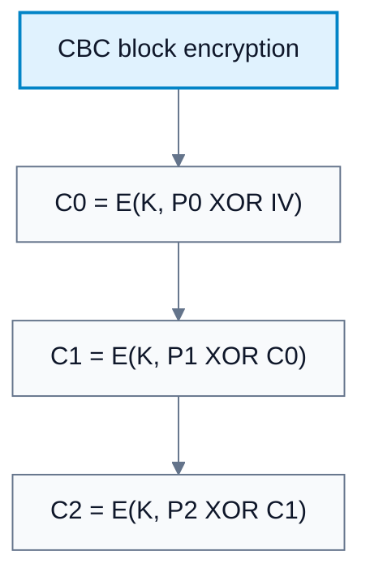
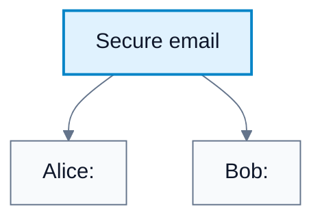
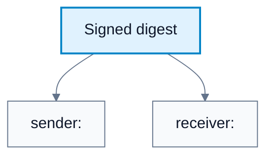
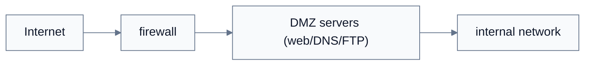

---
tags:
  - networks
---

# Network Security

**Subject**: CSC3001F Networks  
**Source**: `NetworkSecurity_v2025.pptx`, Dr. Josiah Chavula, slides 1-49  
**Generated**: 2026-05-31

---

## Contents

- [[#Core Content|Core Content]]
  - [[#Security Goals And Threat Model|Security Goals And Threat Model]]
  - [[#Cryptography Basics|Cryptography Basics]]
  - [[#Block Ciphers, ECB, And CBC|Block Ciphers, ECB, And CBC]]
  - [[#Symmetric-Key Cryptography|Symmetric-Key Cryptography]]
  - [[#Public-Key Cryptography And Session Keys|Public-Key Cryptography And Session Keys]]
  - [[#Authentication With Nonces|Authentication With Nonces]]
  - [[#Digital Signatures And Message Digests|Digital Signatures And Message Digests]]
  - [[#Certification Authorities|Certification Authorities]]
  - [[#Secure Email|Secure Email]]
  - [[#TLS|TLS]]
  - [[#Firewalls|Firewalls]]
  - [[#Stateless Packet Filtering And ACLs|Stateless Packet Filtering And ACLs]]
  - [[#Stateful Packet Filtering|Stateful Packet Filtering]]
  - [[#Intrusion Detection Systems|Intrusion Detection Systems]]

---

## Core Content

### Security Goals And Threat Model

#### Definitions

> **Confidentiality**: Only the sender and intended receiver should understand message contents. *In plain language: outsiders should not read the data.*

> **Authentication**: Sender and receiver confirm each other's identity. *In plain language: know who you are talking to.*

> **Message Integrity**: Sender and receiver can detect whether a message was altered. *In plain language: know the message was not changed.*

> **Access And Availability**: Services must be accessible and available to authorized users. *In plain language: legitimate users should be able to use the service.*

> **Eavesdropping**: Intercepting messages. *In plain language: listening in.*

> **Impersonation / Spoofing**: Faking a source address or identity. *In plain language: pretending to be someone else.*

> **Hijacking**: Taking over an ongoing connection by removing or replacing a participant. *In plain language: inserting yourself into someone else's session.*

> **Denial Of Service (DoS)**: Preventing service use by overloading or disrupting resources. *In plain language: making a service unavailable.*

Network security aims to provide:

| Goal | Meaning |
|---|---|
| Confidentiality | Only intended endpoints understand content |
| Authentication | Endpoints confirm identity |
| Message integrity | Modification is detectable |
| Access and availability | Authorized users can access services |

The source uses Alice and Bob as honest parties and Trudy as the intruder. Trudy may intercept, delete, insert, spoof, hijack, or overload traffic. Real Alice/Bob pairs include browser/server, online banking client/server, DNS servers, and BGP routers.

#### Diagram: Alice, Bob, Trudy



Caption: Network security mechanisms protect communication despite an active attacker.


### Cryptography Basics

#### Definitions

> **Plaintext**: Original readable message `m`. *In plain language: data before encryption.*

> **Ciphertext**: Encrypted message. *In plain language: scrambled data.*

> **Encryption Key**: Key used by an encryption algorithm to transform plaintext into ciphertext. *In plain language: the secret or public value used to lock data.*

> **Decryption Key**: Key used to transform ciphertext back into plaintext. *In plain language: the value used to unlock data.*

> **Kerckhoffs's Principle**: A cryptosystem should remain secure even if everything except the key is public. *In plain language: security should depend on the key, not a secret algorithm.*

Notation:

```text
m = plaintext message
KA(m) = ciphertext encrypted with key KA
m = KB(KA(m)) = decryption with key KB recovers plaintext
```

Security should not depend on hiding the algorithm. Kerckhoffs's principle and Shannon's maxim both say the enemy may know the system; security relies on the key.
### Block Ciphers, ECB, And CBC

#### Definitions

> **Block Cipher**: Cipher that encrypts fixed-size plaintext blocks, commonly 64 to 128 bits. *i.e: encrypt data chunk by chunk.*

> **ECB Mode**: Electronic Codebook mode, encrypting each block independently. *i.e: equal plaintext blocks become equal ciphertext blocks, leaking patterns.*

> **CBC Mode**: Cipher Block Chaining, XORing each plaintext block with previous ciphertext before encryption. *i.e: each encrypted block depends on previous context.*

> **Initialization Vector (IV)**: Random value used with the first block in CBC. *i.e: the starting randomness needed because the first block has no previous ciphertext.*

Most ciphers are block ciphers operating on fixed-size plaintext blocks, commonly 64 to 128 bits.

ECB weakness:

*1*. Each block is encrypted independently.
*2*. The same plaintext block always gives the same ciphertext block.
*3*. Repeating plaintext patterns remain visible in ciphertext patterns.

CBC improvement:

*1*. XOR each plaintext block with the previous ciphertext block before encryption.
*2*. First block is XORed with random IV.
*3*. IV is included with ciphertext so decryption can start.
*4*. Each ciphertext block depends on previous context, hiding repeated block patterns.

#### Diagram: CBC block encryption



Caption: Each ciphertext block depends on previous ciphertext, hiding repeated plaintext blocks.


### Symmetric-Key Cryptography

#### Definitions

> **Symmetric-Key Cryptography**: Sender and receiver share the same secret key. *In plain language: one shared secret locks and unlocks messages.*

> **DES**: Data Encryption Standard, a 56-bit symmetric-key block cipher standard. *In plain language: an older symmetric cipher now too weak against brute force.*

> **3DES**: Applying DES three times with different keys. *In plain language: a way to strengthen DES by repeated encryption.*

> **AES**: Advanced Encryption Standard, a NIST symmetric-key standard using 128-bit blocks and 128/192/256-bit keys. *In plain language: the modern standard symmetric block cipher.*

In symmetric-key cryptography, Alice and Bob share the same secret key `KS`.

Example simple substitution:

```text
plaintext alphabet:  abcdefghijklmnopqrstuvwxyz
ciphertext alphabet: mnbvcxzasdfghjklpoiuytrewq

plaintext:  bob. i love you. alice
ciphertext: nkn. s gktc wky. mgsbc
```

The key is the substitution mapping. More sophisticated schemes can use multiple substitution ciphers and a cycling pattern.

DES and AES:

| Cipher | Properties | Security Status |
|---|---|---|
| DES | 56-bit key, 64-bit block, NIST 1993 standard | Brute-forced in less than a day in DES challenge |
| 3DES | DES applied three times with different keys | Stronger than DES but legacy |
| AES | 128-bit blocks, 128/192/256-bit keys, NIST standard since 2001 | Modern standard; brute force infeasible at normal assumptions |
### Public-Key Cryptography And Session Keys

#### Definitions

> **Public-Key Cryptography**: Uses a public key known to all and a private key known only to the owner. *In plain language: anyone can encrypt to you, but only you can decrypt.*

> **RSA**: Public-key cryptosystem using a public/private key pair for encryption and signatures. *In plain language: a classic asymmetric algorithm for secure exchange and signing.*

> **Session Key**: Temporary symmetric key used for one secure session. *In plain language: public-key crypto helps agree on it; fast symmetric crypto sends the data.*

Symmetric crypto requires Alice and Bob to agree on a shared secret key first. Public-key cryptography solves this with a public key known to all and a private key known only to the owner.

For Bob:

```text
K+B = Bob's public key
K-B = Bob's private key
m = K-B(K+B(m))
```

Requirements:

1. Public and private key operations must invert correctly.
2. Given the public key, it must be computationally infeasible to compute the private key.

RSA is computationally intensive. Symmetric algorithms are much faster. In practice:

1. Use public-key crypto to establish a secure connection or exchange a session key.
2. Use symmetric session key `KS` to encrypt bulk data.

#### Diagram: Secure email



Caption: Secure email combines symmetric encryption, public-key encryption, and signatures.


### Authentication With Nonces

#### Definitions

> **Nonce**: Number used once. *In plain language: a freshness challenge that prevents replay.*

> **Replay Attack**: Reusing an old valid message to trick a protocol. *In plain language: copying yesterday's proof and sending it again.*

Goal: avoid playback/replay attacks.

Shared-key nonce protocol:

1. Alice claims: "I am Alice."
2. Bob sends nonce `R`.
3. Alice returns `KAB(R)`.
4. Bob verifies only someone with shared key `KAB` could encrypt `R`.
5. Because `R` is fresh, an old response cannot be replayed.

Public-key version:

1. Bob sends nonce `R`.
2. Alice signs/encrypts with her private key.
3. Bob uses Alice's public key to verify the response recovers `R`.

Need caution: Bob must know the public key actually belongs to Alice, which leads to certificates and CAs.
### Digital Signatures And Message Digests

#### Definitions

> **Digital Signature**: Cryptographic proof that a sender signed a message or digest using their private key. *In plain language: a verifiable nonforgeable signature.*

> **Non-Repudiation**: Sender cannot later deny signing a message. *In plain language: the signature can prove authorship.*

> **Hash Function**: Function producing a fixed-size digest from a message. *In plain language: a fingerprint of data.*

> **Message Digest**: Fixed-length hash output `H(m)`. *In plain language: the message fingerprint.*

A simple digital signature signs a message with the sender's private key:

```text
signature = K-B(m)
verify with K+B(signature) = m
```

This is expensive for large messages, so systems sign a hash:

1. Compute digest `H(m)`.
2. Sign digest with private key: `K-B(H(m))`.
3. Send message and signed digest.
4. Receiver hashes received message to get `H(m)`.
5. Receiver decrypts signature using public key.
6. If digests match, integrity and signer authentication hold.

Hash function properties from the source:

1. Many-to-one.
2. Produces fixed-size digest.
3. Given digest `x`, computationally infeasible to find `m` such that `x = H(m)`.

#### Diagram: Signed digest



Caption: Signing the digest is efficient and verifies integrity plus signer identity.


### Certification Authorities

#### Definitions

> **Certification Authority (CA)**: Entity that binds public keys to identities by signing certificates. *In plain language: a trusted organization saying "this public key belongs to this entity."*

> **Certificate**: Data binding an identity to a public key, digitally signed by a CA. *In plain language: a signed public-key identity card.*

A CA binds a public key to an entity:

1. Entity registers public key and proves identity.
2. CA creates certificate containing identity and public key.
3. CA digitally signs certificate with CA private key.
4. Others verify certificate using CA public key.

Without CAs, an attacker could substitute their public key and impersonate a party.
### Secure Email

Confidential email from Alice to Bob:

1. Alice generates random symmetric session key `KS`.
2. Alice encrypts message: `KS(m)`.
3. Alice encrypts session key with Bob's public key: `K+B(KS)`.
4. Alice sends both.
5. Bob uses private key `K-B` to recover `KS`.
6. Bob uses `KS` to decrypt the message.

Integrity and authentication:

1. Alice computes `H(m)`.
2. Alice signs digest with her private key: `K-A(H(m))`.
3. Bob verifies using Alice's public key and compares hashes.

Confidentiality plus integrity/authentication uses three keys:

1. Alice's private key for signing.
2. Bob's public key for protecting the session key.
3. New symmetric session key for encrypting the message.

PGP is an example system that combines these ideas for email.
### TLS

#### Definitions

> **TLS**: Transport-layer security protocol used by HTTPS and many applications to provide confidentiality, integrity, and authentication. *In plain language: the security layer used for secure web connections.*

> **Cipher Suite**: Set of algorithms used for key generation, encryption, MAC/integrity, and digital signatures. *In plain language: the negotiated crypto toolkit for a TLS connection.*

> **Diffie-Hellman (DH)**: Public-key key agreement technique used to establish shared secrets. *In plain language: lets parties agree on a key over an insecure network.*

TLS is widely deployed above transport and is used by HTTPS on port 443. It provides:

| Security Property | TLS Mechanism |
|---|---|
| Confidentiality | Symmetric encryption |
| Integrity | Cryptographic hashing/authenticated encryption |
| Authentication | Public-key certificates |

SSL is deprecated. TLS 1.3 was standardized in 2018. TLS can be used by many applications via an API.

TLS placement examples:

| Stack | Description |
|---|---|
| HTTP/2 over TCP with TLS | Common HTTPS style |
| HTTP/3 over QUIC over UDP | QUIC incorporates TLS mechanisms |

TLS 1.3 cipher suites are more limited than TLS 1.2:

1. Only 5 choices rather than 37.
2. Requires Diffie-Hellman for key exchange.
3. Uses authenticated encryption for data.
4. Several choices are AES-based.
5. HMAC uses SHA-family cryptographic hashes.

TLS 1.3 handshakes:

| Handshake | Behavior | Risk |
|---|---|---|
| 1-RTT | Client hello with supported suites and DH params; server chooses suite, sends cert; client checks cert and generates key | Normal fast setup |
| 0-RTT | Resumes earlier connection and sends encrypted application data in initial hello | Vulnerable to replay; safer for idempotent requests such as some GETs |
### Firewalls

#### Definitions

> **Firewall**: Device or software that isolates an internal network by allowing some packets and blocking others. *In plain language: network traffic gatekeeper.*

A firewall isolates an organization's internal network from the public Internet, allowing some packets and blocking others.

Reasons:

1. Prevent denial of service such as SYN flooding.
2. Prevent illegal modification/access of internal data.
3. Allow only authorized access to internal resources.

Firewall types from source:

1. Stateless packet filters.
2. Stateful packet filters.
3. Application gateways.
### Stateless Packet Filtering And ACLs

#### Definitions

> **Stateless Packet Filter**: Firewall that filters each packet independently using header fields. *In plain language: decision based only on this packet's headers.*

> **ACL**: Access Control List, ordered rules of action/condition pairs. *In plain language: top-to-bottom firewall rule table.*

Stateless packet filters decide packet-by-packet based on:

1. Source IP address.
2. Destination IP address.
3. TCP/UDP source and destination ports.
4. ICMP message type.
5. TCP SYN/ACK bits.

Example policies:

| Policy | Firewall Setting |
|---|---|
| No outside web access | Drop all outgoing packets to port 80 |
| No incoming TCP except public web server | Drop incoming TCP SYN except to public server IP port 80 |
| Prevent web-radio bandwidth use | Drop incoming UDP except DNS and router broadcasts |
| Prevent smurf DoS participation | Drop ICMP to broadcast address |
| Prevent traceroute | Drop outgoing ICMP TTL-expired traffic |

ACLs are ordered `(action, condition)` rules applied top to bottom. A common default final rule is deny all.
### Stateful Packet Filtering

#### Definitions

> **Stateful Packet Filter**: Firewall that tracks connection state and admits packets that make sense for known connections. *In plain language: it remembers active flows.*

Stateless filters can admit packets that make no sense, such as inbound packets with destination port 80 and ACK set even if no internal connection exists.

Stateful filters:

1. Track TCP connection setup with SYN.
2. Track teardown with FIN.
3. Store active connection state.
4. Timeout inactive connections.
5. Check connection table before admitting packets that claim to be part of a connection.
### Intrusion Detection Systems

#### Definitions

> **IDS**: Intrusion Detection System, monitoring packet contents and traffic patterns for attacks. *In plain language: looks deeper than headers for suspicious behavior.*

> **Deep Packet Inspection**: Inspecting packet payload contents for known attack strings or signatures. *In plain language: reading inside packets, not just headers.*

> **DMZ**: Demilitarized zone, network area exposing public servers while separating them from the internal network. *In plain language: a buffer zone for public-facing services.*

Packet filtering typically operates on TCP/IP headers and does not correlate sessions deeply. IDSs go further:

1. Deep packet inspection for known virus/attack strings.
2. Correlation across multiple packets and sessions.
3. Detection of port scanning, network mapping, and DoS attacks.

IDS sensors may be placed at different network locations, including a DMZ containing web, DNS, and FTP servers.

#### Diagram: Firewall and IDS placement



Caption: Firewalls block by policy; IDSs inspect for attacks and suspicious patterns.
