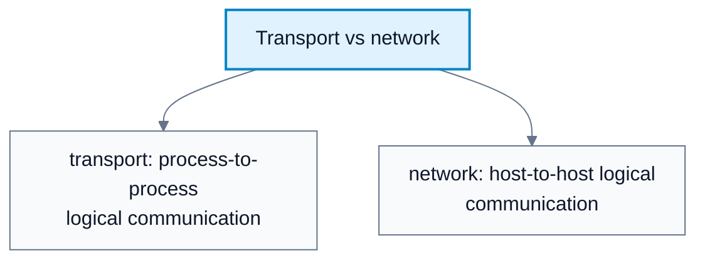
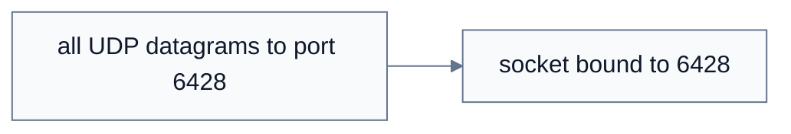
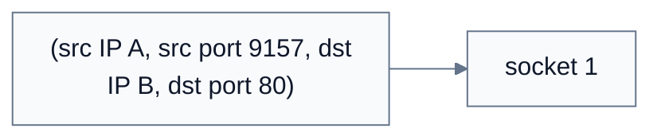
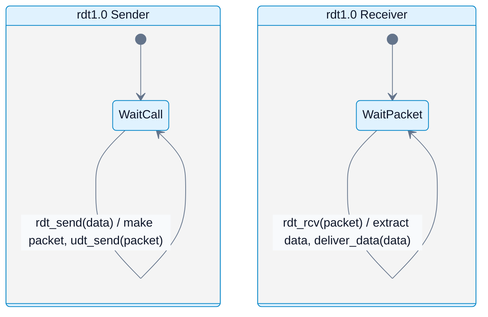
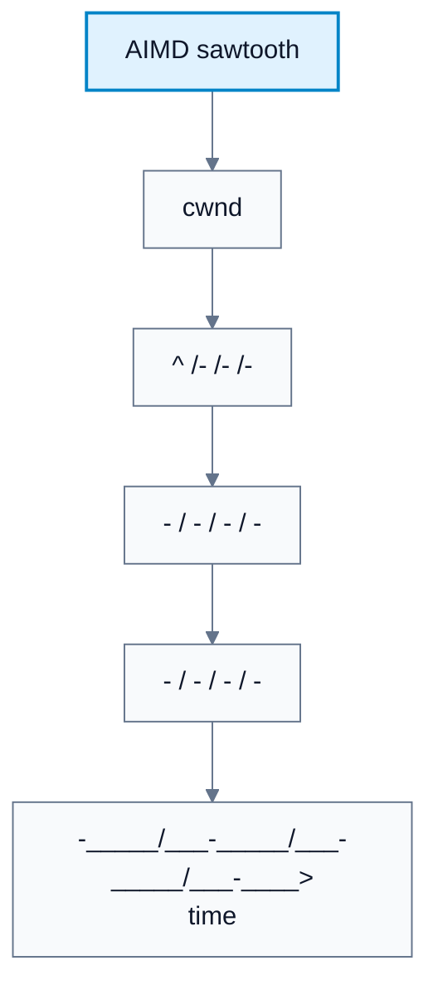
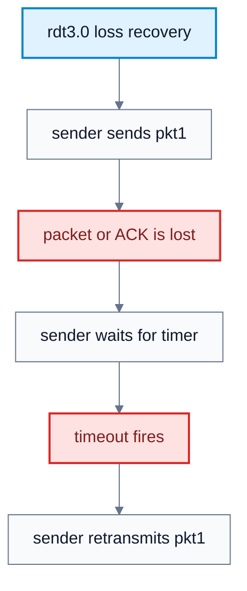
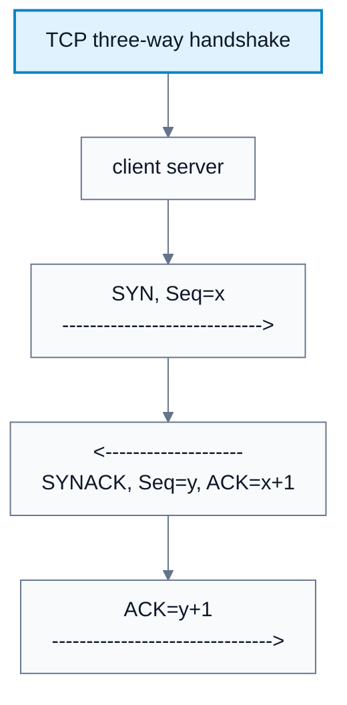

# Transport Layer

**Subject**: CSC3001F Networks  
**Source**: `Transport_v2025.pptx`, Dr. Josiah Chavula, slides 1-86  
**Generated**: 2026-05-31

---

## Core Content

### Transport Services And Protocols

#### Definitions

> **Transport Layer**: The layer that provides logical communication between application processes on different hosts. *In plain language: it lets processes talk as if directly connected.*

> **Logical Communication**: The abstraction that two processes can communicate without caring about the many routers and links between them. *In plain language: the network details are hidden from the application.*

> **Segment**: A transport-layer packet made from application data plus a transport header. *In plain language: TCP and UDP carry data in segments.*

> **TCP**: Transmission Control Protocol, providing reliable, in-order, connection-oriented byte-stream transport with flow and congestion control. *In plain language: TCP is the careful transport protocol.*

> **UDP**: User Datagram Protocol, providing connectionless, unreliable, unordered datagram transport. *In plain language: UDP is a thin extension of best-effort IP.*

The network layer provides host-to-host logical communication. The transport layer builds on that and provides process-to-process logical communication.

Transport actions:

| Sender | Receiver |
|---|---|
| Accepts application-layer message | Receives segment from IP |
| Determines transport header fields | Checks header values |
| Creates segment | Extracts application message |
| Passes segment to IP | Demultiplexes data to correct socket |

TCP and UDP are the two main Internet transport protocols. TCP adds reliability, ordering, flow control, congestion control, and connection setup. UDP adds little beyond ports and checksum over best-effort IP.

#### Diagram: Transport vs network



Caption: The transport layer extends host delivery into process delivery.


### Multiplexing And Demultiplexing

#### Definitions

> **Multiplexing**: Gathering data from multiple sockets and adding transport headers so the receiver can identify the destination socket. *In plain language: the sender labels outgoing data for the right process.*

> **Demultiplexing**: Using header fields in received segments to deliver data to the correct socket. *In plain language: the receiver sorts arriving data to the right process.*

> **Port Number**: Transport-layer identifier used to distinguish sockets/processes on a host. *In plain language: ports let many processes share one IP address.*

> **UDP Socket Identifier**: Destination port number at the receiving host. *In plain language: UDP demux mainly uses the destination port.*

> **TCP Socket Identifier**: Four-tuple `(source IP, source port, destination IP, destination port)`. *In plain language: TCP distinguishes connections using both endpoint addresses and ports.*

The receiving host gets IP datagrams. Each datagram has source and destination IP addresses and carries a transport segment. Each segment has source and destination port numbers. The host uses these fields to direct the segment to a socket.

| Protocol | Demux Key | Consequence |
|---|---|---|
| UDP | Destination port | Datagrams from different sources to the same destination port go to the same socket |
| TCP | Source IP, source port, destination IP, destination port | A server can maintain many simultaneous connections to the same destination port |

Example: a web server at IP `B`, port `80`, can distinguish clients `A:9157`, `C:5775`, and `C:9157` because each TCP connection has a different four-tuple.

#### Diagram: UDP demultiplexing



Caption: UDP demux does not create separate sockets per client four-tuple.


#### Diagram: TCP demultiplexing



Caption: TCP uses the four-tuple, so one server port can support many connections.


### Reliable Data Transfer: The Problem

#### Definitions

> **Reliable Data Transfer (RDT)**: Protocol logic that provides reliable delivery over an unreliable channel. *In plain language: RDT adds checks, ACKs, and retransmissions to hide loss/corruption.*

Reliable data transfer is easy if the channel is reliable. It becomes harder as the channel can corrupt, lose, duplicate, or reorder packets.

Important idea from the source: the sender and receiver do not directly know each other's state. The sender only learns about receiver state through messages such as ACKs.

RDT interface terms:

| Function | Meaning |
|---|---|
| `rdt_send(data)` | Called by application to send data |
| `udt_send(packet)` | Called by RDT to send packet over unreliable channel |
| `rdt_rcv(packet)` | Called when a packet arrives |
| `deliver_data(data)` | Called by RDT to deliver data to application |

#### Diagram: stateDiagram-v2



Caption: rdt1.0 assumes a reliable channel, so the sender only makes and sends packets, while the receiver only extracts and delivers data.


### RDT Protocol Evolution

#### Definitions

> **Checksum**: Error-detection value carried with data. *In plain language: it helps detect bit errors.*

> **NAK**: Negative acknowledgement indicating data was corrupted or not accepted. *In plain language: "That was bad; resend."*

> **Sequence Number**: Number carried in a packet or byte stream to identify order and detect duplicates. *In plain language: it labels data so receiver and sender know what arrived.*

| Version | Channel Assumption | Mechanisms | Problem Solved |
|---|---|---|---|
| rdt1.0 | Reliable channel | Simple send/deliver | No errors or loss |
| rdt2.0 | Bit errors | Checksum, ACK, NAK, retransmission | Detect and recover from corruption |
| rdt2.1/2.2 | Bit errors and corrupted ACK/NAK | Sequence numbers, duplicate handling, ACK-only style | Avoid duplicate delivery and remove NAK |
| rdt3.0 | Bit errors and loss | Checksum, sequence numbers, ACKs, timeout, retransmission | Recover from lost data or ACKs |

rdt3.0 handles:

1. Data packet loss: sender times out and retransmits.
2. ACK loss: sender retransmits; receiver detects duplicate using sequence number.
3. Premature timeout: duplicate may arrive; receiver discards duplicate and re-ACKs.
### Stop-And-Wait Performance

#### Definitions

> **Stop-And-Wait**: Protocol where the sender sends one packet and waits for a response before sending the next. *In plain language: only one packet can be in flight.*

Stop-and-wait can be correct but inefficient. The source example:

```text
Link rate R = 1 Gbps
Packet length L = 8000 bits
Propagation delay one-way = 15 ms
RTT = 30 ms
Transmission time L/R = 8000 / 10^9 = 8 us = 0.008 ms
```

Sender utilization:

```text
Usender = (L/R) / (RTT + L/R)
        = 0.008 / 30.008
        = 0.00027
```

So the sender is busy only about 0.027% of the time. The protocol, not the physical link, limits performance.
### Pipelined Protocols

#### Definitions

> **Pipelining**: Allowing multiple transmitted but unacknowledged packets to be in flight. *In plain language: keep the pipe full instead of waiting after every packet.*

Pipelining lets multiple packets be in flight at once. It requires:

1. Larger sequence number range.
2. Sender buffering for unacknowledged packets.
3. Receiver buffering depending on protocol.

Three-packet pipelining can increase utilization by roughly a factor of three compared with stop-and-wait.
### Go-Back-N

#### Definitions

> **ACK**: Acknowledgement indicating data was received correctly. *In plain language: "I got it."*

> **Go-Back-N (GBN)**: Pipelined protocol using cumulative ACKs and retransmitting a lost packet plus later packets in the window. *In plain language: if one packet is missing, resend from there onward.*

> **Cumulative ACK**: ACK that acknowledges all data up to a given sequence number. *In plain language: "I have everything up through here."*

GBN sender:

1. Maintains a window of up to `N` consecutive transmitted but unACKed packets.
2. Uses `k`-bit sequence numbers.
3. Receives cumulative ACKs.
4. Keeps a timer for the oldest in-flight packet.
5. On timeout for packet `n`, retransmits packet `n` and all higher sequence packets in the window.

GBN receiver:

1. Sends ACK for highest in-order packet received.
2. May generate duplicate ACKs.
3. Only needs to remember `rcv_base`.
4. On out-of-order packet, discards or buffers depending on implementation, then re-ACKs highest in-order packet.
### Selective Repeat

#### Definitions

> **Selective Repeat (SR)**: Pipelined protocol where packets are individually acknowledged and only missing packets are retransmitted. *In plain language: resend only what was lost.*

Selective Repeat receiver individually acknowledges each correctly received packet and buffers out-of-order packets for later in-order delivery. The sender maintains a timer for each unACKed packet and retransmits only the timed-out packet.

| Feature | Go-Back-N | Selective Repeat |
|---|---|---|
| ACK style | Cumulative | Individual |
| Receiver buffering | Minimal; out-of-order often discarded | Buffers out-of-order |
| Retransmission after loss | Lost packet and later window packets | Only missing packet |
| Efficiency | Lower when loss occurs | Higher, but more state |
### TCP Overview

#### Definitions

> **MSS**: Maximum Segment Size, the maximum TCP data payload in one segment. *In plain language: it is the largest chunk of application data TCP puts in a segment.*

TCP properties:

| Property | Meaning |
|---|---|
| Point-to-point | One sender and one receiver per connection |
| Reliable byte stream | In-order bytes; no message boundaries |
| Full duplex | Data flows both directions in same connection |
| MSS | Maximum segment data size, commonly around 1460 bytes |
| Cumulative ACKs | ACK number gives next expected byte |
| Pipelined | Flow and congestion control set window size |
| Connection-oriented | Handshake initializes state |
| Flow-controlled | Sender does not overflow receiver |

TCP sequence numbers count bytes, not segments. The sequence number is the byte-stream number of the first data byte in the segment. The ACK number is the next byte expected from the other side.

#### Diagram: AIMD sawtooth



Caption: TCP probes upward additively and cuts down multiplicatively on loss.


### TCP Segment Fields

Important TCP fields from the source:

| Field | Purpose |
|---|---|
| Source port, destination port | Multiplexing/demultiplexing |
| Sequence number | First byte number in segment data |
| Acknowledgement number | Next expected byte |
| Header length | TCP header size |
| Receive window | Flow control |
| Checksum | Error detection |
| SYN, FIN, RST | Connection management |
| ACK bit | Indicates acknowledgement field is valid |
| CWR/ECE | Congestion notification |
| Options | Optional TCP features |
### RTT Estimation And Timeout

#### Definitions

> **Timeout**: Event triggered when an ACK is not received within a chosen interval. *In plain language: if silence lasts too long, retransmit.*

> **SampleRTT**: Measured time from segment transmission to ACK receipt, ignoring retransmissions. *In plain language: one observed round-trip measurement.*

> **EstimatedRTT**: Smoothed RTT estimate computed with an exponential weighted moving average. *In plain language: TCP's rolling best guess of RTT.*

> **DevRTT**: Smoothed estimate of variation between SampleRTT and EstimatedRTT. *In plain language: how much RTT measurements are wobbling.*

> **TimeoutInterval**: TCP timeout value, commonly `EstimatedRTT + 4*DevRTT`. *In plain language: wait longer when RTT is variable.*

TCP needs a timeout longer than RTT, but RTT varies. If timeout is too short, TCP retransmits unnecessarily. If too long, TCP reacts slowly to loss.

RTT estimation:

```text
EstimatedRTT = (1 - alpha) * EstimatedRTT + alpha * SampleRTT
typical alpha = 0.125
```

Deviation:

```text
DevRTT = (1 - beta) * DevRTT + beta * |SampleRTT - EstimatedRTT|
typical beta = 0.25
```

Timeout:

```text
TimeoutInterval = EstimatedRTT + 4 * DevRTT
```
### TCP Sender And Receiver Behavior

#### Definitions

> **Fast Retransmit**: TCP retransmission triggered by triple duplicate ACKs before timeout. *In plain language: three repeated ACKs strongly suggest a missing segment.*

TCP sender:

1. On data from application: create segment with sequence number.
2. Start timer if not already running.
3. On timeout: retransmit segment that caused timeout and restart timer.
4. On ACK: if it acknowledges new data, advance send base and restart timer if unACKed data remains.

TCP receiver ACK generation:

| Event | Receiver Action |
|---|---|
| In-order segment arrives and all previous data already ACKed | Delayed ACK; wait up to 500 ms for next segment |
| In-order segment arrives with another ACK pending | Send one cumulative ACK for both |
| Out-of-order segment arrives above expected byte | Send duplicate ACK for next expected byte |
| Segment fills gap | Send ACK immediately |

Fast retransmit: if the sender receives three additional ACKs for the same data, it retransmits the oldest unACKed segment without waiting for timeout.

#### Diagram: rdt3.0 loss recovery



Caption: Timeout plus sequence numbers handle loss and delayed duplicates.


### TCP Connection Management

#### Definitions

> **SYN**: TCP control flag used to start a connection and synchronize initial sequence numbers. *In plain language: "I want to connect."*

> **FIN**: TCP control flag used to close one side of a connection. *In plain language: "I am done sending."*

TCP handshake establishes shared state and initial sequence numbers. A two-way handshake can fail under variable delay, retransmission, and message reordering, causing half-open connections or duplicate data acceptance.

TCP three-way handshake:

1. Client chooses initial sequence number `x` and sends `SYN`, `Seq=x`.
2. Server chooses initial sequence number `y` and sends `SYNACK`, `Seq=y`, `ACK=x+1`.
3. Client sends `ACK`, `ACK=y+1`, and connection enters established state.

Closing:

1. Each side closes its direction independently.
2. Closing side sends `FIN=1`.
3. Receiver ACKs the FIN.
4. ACK for received FIN can be combined with its own FIN.
5. Simultaneous FIN exchanges can be handled.

#### Diagram: TCP three-way handshake



Caption: The third message proves the client received the server's sequence number.


### TCP Flow Control

#### Definitions

> **Flow Control**: Mechanism preventing a sender from overwhelming the receiver's buffer. *In plain language: receiver controls sender speed relative to its own capacity.*

> **Receive Window (rwnd)**: Receiver-advertised free buffer space. *In plain language: how many more bytes the receiver can accept.*

If TCP delivers data into a socket buffer faster than the application reads it, the buffer may overflow. TCP flow control prevents this.

The receiver advertises free buffer space in the TCP header's receive window field:

```text
rwnd = free receiver buffer space
sender must keep unACKed in-flight data <= rwnd
```

This guarantees the receiver buffer is not overflowed by the sender.
### Congestion Control

#### Definitions

> **Congestion**: Too many sources sending too much data too fast for the network to handle. *In plain language: router queues overflow and delays grow.*

> **Congestion Control**: Mechanism preventing senders from overloading the network. *In plain language: sender adapts rate to network conditions.*

> **Congestion Window (cwnd)**: TCP sender-side limit on unacknowledged in-flight data based on congestion control. *In plain language: it controls how much TCP may inject into the network.*

> **AIMD**: Additive Increase Multiplicative Decrease. *In plain language: TCP slowly increases rate, then cuts sharply on loss.*

> **Slow Start**: TCP startup behavior where `cwnd` starts at 1 MSS and grows exponentially, roughly doubling every RTT. *In plain language: TCP starts cautiously but ramps up quickly.*

Congestion is a network problem, not just a receiver problem:

| Flow Control | Congestion Control |
|---|---|
| One sender may overwhelm one receiver | Many senders may overwhelm routers/links |
| Uses receiver buffer state | Uses network congestion signals |
| Controlled by receive window `rwnd` | Controlled by congestion window `cwnd` |

Costs of congestion:

1. Queueing delay grows as capacity is approached.
2. Packet loss triggers retransmission.
3. Retransmissions consume capacity.
4. Premature timeouts create unnecessary duplicates.
5. Packets later dropped downstream waste upstream transmission and buffer resources.
6. Effective throughput decreases.

Congestion control approaches:

| Approach | Feedback |
|---|---|
| End-to-end | Sender infers congestion from loss/delay; TCP uses this |
| Network-assisted | Routers provide explicit congestion feedback; examples include TCP ECN, ATM, DECbit |

TCP AIMD:

```text
Additive increase: raise sending rate by about 1 MSS per RTT until loss
Multiplicative decrease: cut sending rate in half on loss
```

TCP uses **cwnd** to limit in-flight data:

```text
LastByteSent - LastByteAcked <= cwnd
approximate TCP rate = cwnd / RTT bytes/sec
```

Slow start:

1. Initially `cwnd = 1 MSS`.
2. Increase `cwnd` for every ACK received.
3. This roughly doubles `cwnd` every RTT.
4. Rate starts low but grows exponentially until the first loss event or threshold.

## Worked Examples

### Example 1: UDP Versus TCP Demultiplexing
**Problem**: Three clients send to server IP `B`, destination port `80`. Two clients use the same source port but different IPs. How are segments delivered?  
**Step 1**: UDP delivery checks destination port. All datagrams to port `80` go to the same UDP socket.  
**Step 2**: TCP delivery checks four-tuple. Different source IPs or source ports create different connection sockets.  
**Answer**: UDP groups by destination port; TCP separates by full four-tuple.

### Example 2: Stop-And-Wait Utilization
**Problem**: Use the source values `R = 1 Gbps`, `L = 8000 bits`, `RTT = 30 ms`. Find sender utilization.  
**Step 1**: `L/R = 8000 / 10^9 = 8 us = 0.008 ms`.  
**Step 2**: `Usender = (L/R) / (RTT + L/R)`.  
**Step 3**: `0.008 / 30.008 = 0.00027`.  
**Answer**: Utilization is about `0.027%`, very poor.

### Example 3: Go-Back-N Loss
**Problem**: Window size is 4. Sender sends packets 0, 1, 2, 3. Packet 2 is lost. What happens in GBN?  
**Step 1**: Receiver gets 0 and ACKs 0.  
**Step 2**: Receiver gets 1 and ACKs 1.  
**Step 3**: Packet 2 is lost. Receiver gets 3 out of order and sends duplicate ACK 1.  
**Step 4**: Sender times out for packet 2.  
**Step 5**: Sender retransmits packets 2, 3, and any later packets in the window.  
**Answer**: GBN retransmits from the missing packet onward.

### Example 4: Selective Repeat Loss
**Problem**: Same window and loss as above, but using Selective Repeat.  
**Step 1**: Receiver ACKs 0 and 1.  
**Step 2**: Receiver gets 3 out of order, buffers it, and ACKs 3.  
**Step 3**: Sender times out only for packet 2.  
**Step 4**: Sender retransmits packet 2 only.  
**Step 5**: Receiver can now deliver 2, then buffered 3.  
**Answer**: Selective Repeat avoids retransmitting correctly received packets.

### Example 5: TCP ACK Numbers
**Problem**: Host A sends one byte with `Seq=42` to Host B. What ACK should B send?  
**Step 1**: TCP ACK number is the next expected byte.  
**Step 2**: One byte starting at 42 occupies byte 42.  
**Answer**: B sends `ACK=43`.

### Example 6: TCP Timeout Calculation
**Problem**: `EstimatedRTT = 100 ms`, `DevRTT = 15 ms`. Find `TimeoutInterval`.  
**Step 1**: Use `TimeoutInterval = EstimatedRTT + 4*DevRTT`.  
**Step 2**: `100 + 4(15) = 160 ms`.  
**Answer**: Timeout should be `160 ms`.

### Example 7: Flow Control Limit
**Problem**: Receiver advertises `rwnd = 20,000 bytes`. Sender has `LastByteSent = 80,000` and `LastByteAcked = 65,000`. May it send 8,000 more bytes?  
**Step 1**: Current in-flight data is `80,000 - 65,000 = 15,000 bytes`.  
**Step 2**: Allowed additional data is `20,000 - 15,000 = 5,000 bytes`.  
**Answer**: It may not send 8,000 bytes; it can send at most 5,000 bytes under flow control.

---

## Common Mistakes / Gotchas
- Confusing host-to-host delivery with process-to-process delivery.
- Thinking UDP creates a separate server socket for each client. UDP demux uses destination port.
- Thinking TCP sequence numbers count segments. They count bytes.
- Forgetting that TCP ACKs are cumulative and name the next expected byte.
- Assuming timeout always means loss. Delayed ACKs or delayed packets can cause premature timeout.
- Forgetting stop-and-wait can be correct but still waste most link capacity.
- Confusing flow control with congestion control. Flow control protects receiver buffers; congestion control protects the network.
- Thinking a two-way handshake is enough in a network with delay, loss, reordering, and retransmission.
- Treating slow start as slow forever. It starts low but grows exponentially.

---

## Summary / Cheat Sheet

| Term | Meaning |
|------|---------|
| Segment | Transport-layer packet |
| Multiplexing | Label outgoing data for sockets |
| Demultiplexing | Deliver incoming data to correct socket |
| UDP demux | Destination port |
| TCP demux | Four-tuple |
| Stop-and-wait | One in-flight packet |
| Pipelining | Multiple in-flight packets |
| GBN | Cumulative ACK, retransmit from loss onward |
| Selective Repeat | Individual ACKs, retransmit only lost packets |
| rwnd | Receiver buffer limit |
| cwnd | Congestion limit |
| AIMD | Additive increase, multiplicative decrease |

**Key Formulas**:

```text
Stop-and-wait utilization = (L/R) / (RTT + L/R)
EstimatedRTT = (1 - alpha) * EstimatedRTT + alpha * SampleRTT
DevRTT = (1 - beta) * DevRTT + beta * |SampleRTT - EstimatedRTT|
TimeoutInterval = EstimatedRTT + 4 * DevRTT
TCP flow control: LastByteSent - LastByteAcked <= rwnd
TCP congestion rate approx = cwnd / RTT
```

**Key Takeaways**:
- Transport hides network complexity and delivers data between processes.
- Reliable transfer requires checksums, sequence numbers, ACKs, retransmission, and timers.
- Pipelining is essential for high utilization on high-delay paths.
- TCP combines reliability, connection management, flow control, and congestion control.
- Congestion wastes capacity through delay, loss, retransmissions, and dropped downstream packets.

---

## Practice Questions

**Q1**: What fields identify a TCP socket?  
> Answer: Source IP address, source port, destination IP address, and destination port.

**Q2**: Why does rdt2.0 need sequence numbers once ACK/NAK messages can be corrupted?  
> Answer: If the sender retransmits after a corrupted ACK/NAK, the receiver may see a duplicate. Sequence numbers let it detect and discard duplicates.

**Q3**: What does a TCP ACK number mean?  
> Answer: It is the sequence number of the next byte expected from the other side.

**Q4**: Why can triple duplicate ACKs trigger fast retransmit?  
> Answer: They indicate multiple later segments arrived while an earlier segment is still missing, making loss likely before timeout expires.

**Q5**: State the difference between `rwnd` and `cwnd`.  
> Answer: `rwnd` is receiver-advertised free buffer space for flow control. `cwnd` is sender-side congestion-control limit based on inferred network congestion.
