# CSC3001F Networks FSM Diagrams

**Subject**: CSC3001F Networks  
**Source**: Current notes in `Courses/CSC3001F-networks/Lecture_Notes/`, especially `../Lecture_Notes/Transport_Layer.md`  
**Format**: Mermaid `stateDiagram-v2`

---

## RDT Interface Context

---

## rdt1.0 Sender

Reliable channel, so the sender only accepts data from above and sends it.

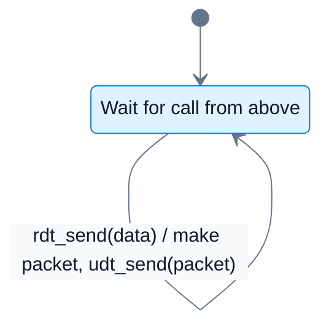

## rdt1.0 Receiver

Reliable channel, so the receiver only accepts packets from below and delivers data.

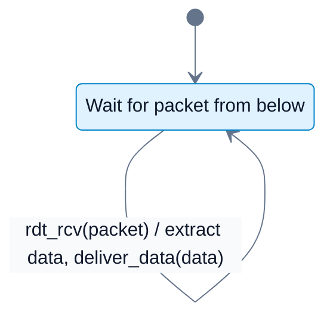

---

## rdt2.0 Sender

Bit errors possible. Sender uses checksum, ACK, NAK, and retransmission.

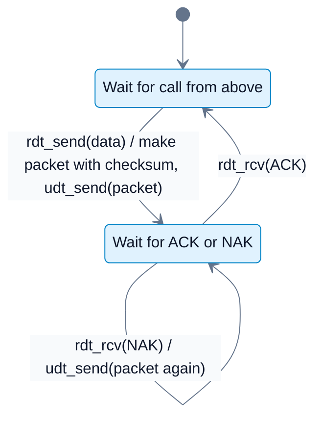

## rdt2.0 Receiver

Bit errors possible. Receiver ACKs uncorrupted packets and NAKs corrupted packets.

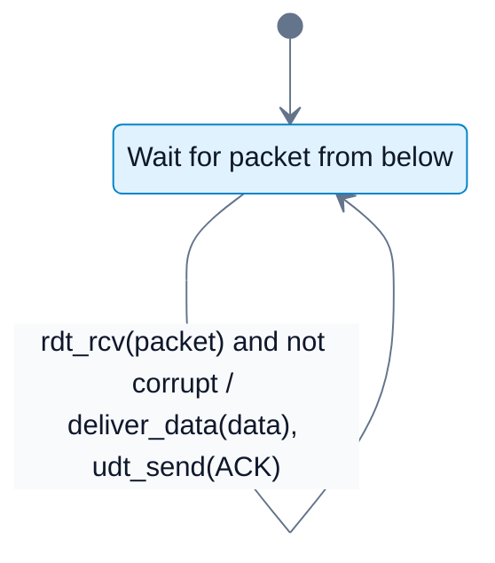

---

## rdt2.1 Sender

ACK or NAK can be corrupted, so sequence numbers are added. The sender alternates between sequence number 0 and sequence number 1.

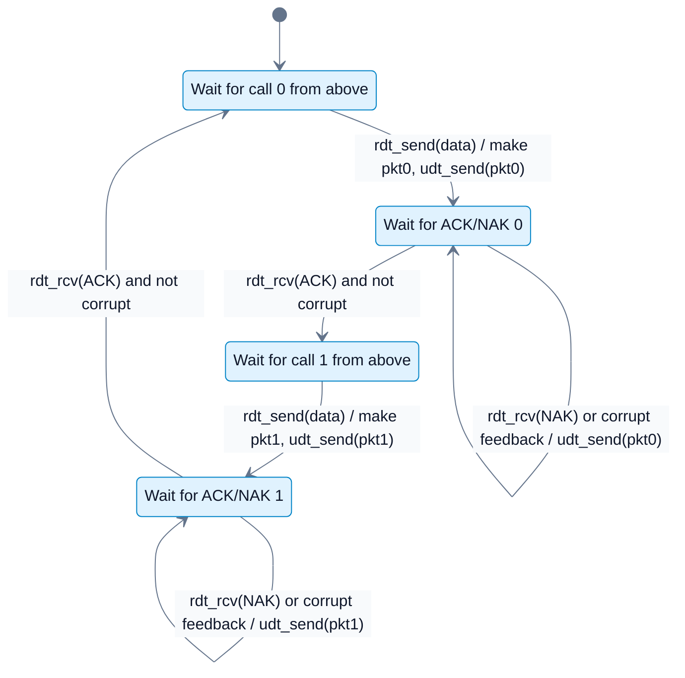

## rdt2.1 Receiver

Receiver uses sequence numbers to detect duplicates after corrupted ACK/NAK feedback.

---

## rdt2.2 Sender

NAKs are removed. Duplicate ACKs are used to trigger retransmission.

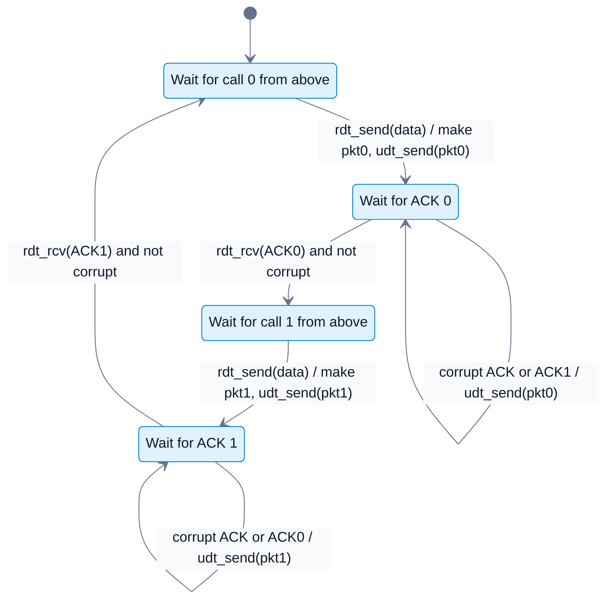

## rdt2.2 Receiver

Receiver sends ACK for the last correctly received packet instead of sending NAK.

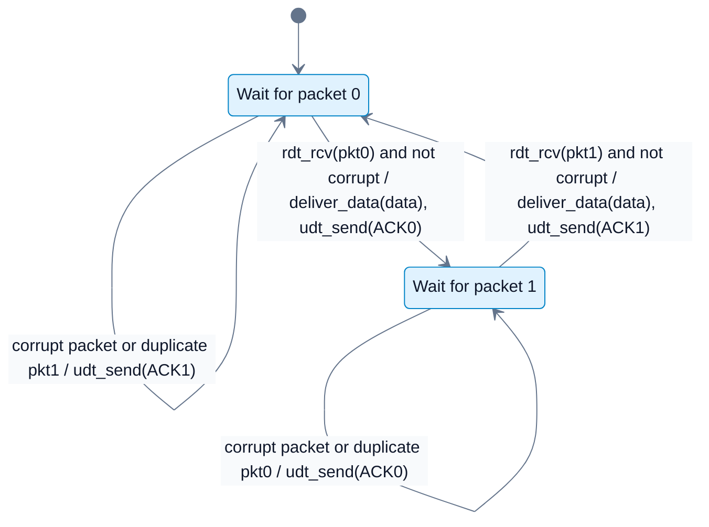

---

## rdt3.0 Sender

Loss is possible. Sender adds a timer and retransmits on timeout.

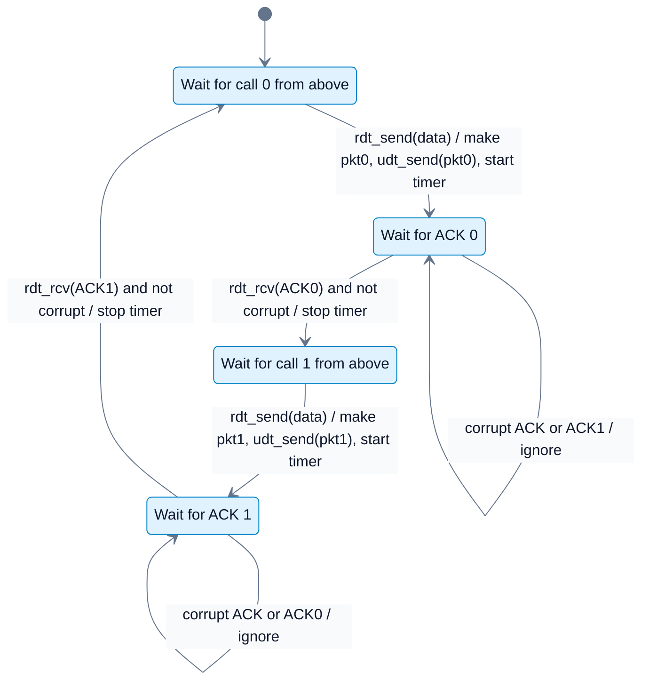

## rdt3.0 Receiver

Receiver behavior is effectively the same ACK-only duplicate-handling logic as rdt2.2.

---

## Go-Back-N Sender

The notes describe the GBN sender as maintaining a window, cumulative ACKs, and one timer for the oldest in-flight packet.

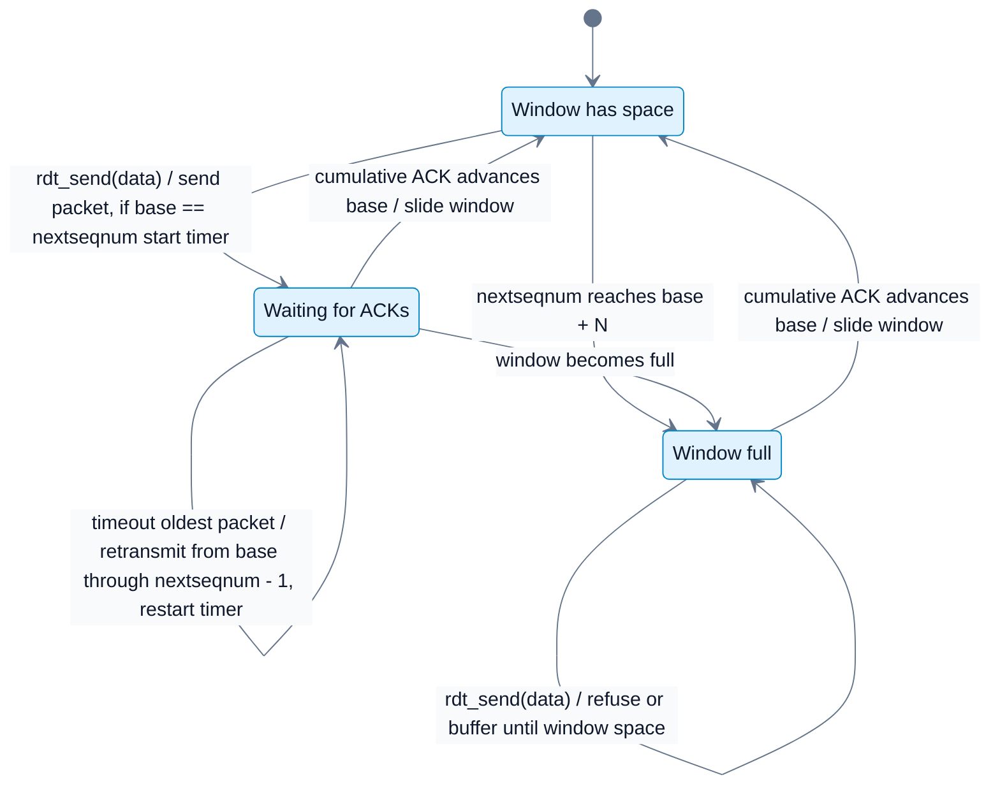

## Go-Back-N Receiver

The notes describe the receiver as accepting only the next expected in-order packet and re-ACKing the highest in-order packet.

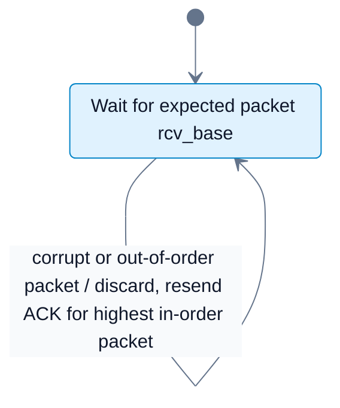

---

## Selective Repeat Sender

Selective Repeat individually tracks packets and retransmits only the timed-out packet.

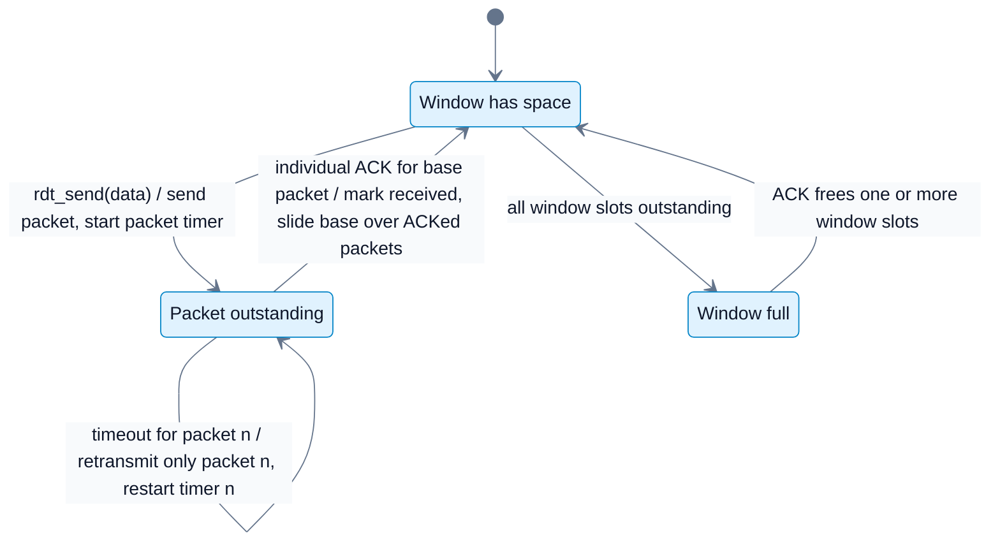

## Selective Repeat Receiver

Selective Repeat buffers out-of-order packets and individually ACKs correctly received packets.

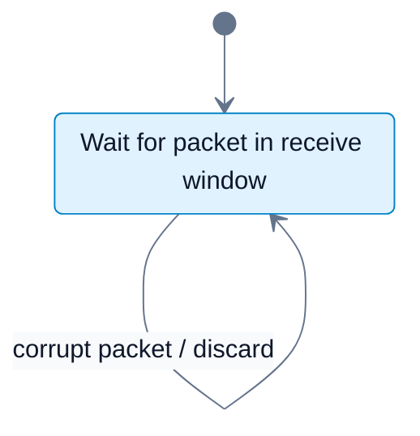

---

## TCP Connection Management

The notes cover the three-way handshake and graceful close. This Mermaid FSM is a compact study version of those states.

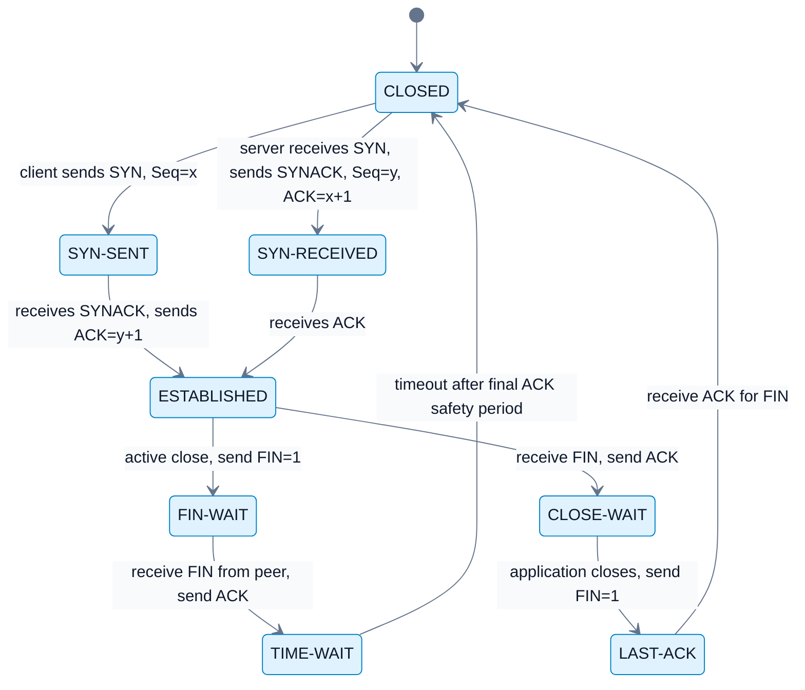
