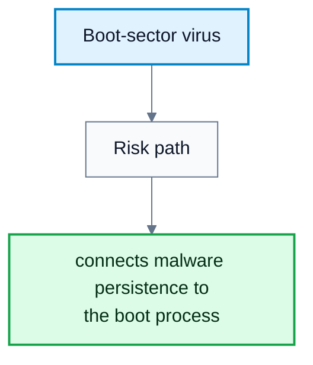
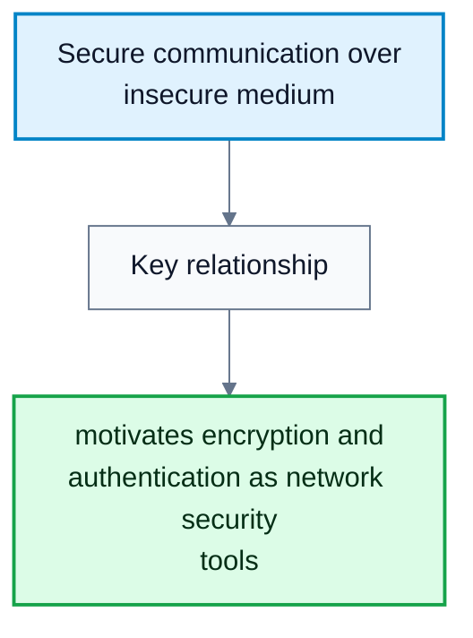
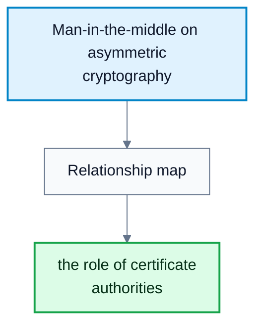
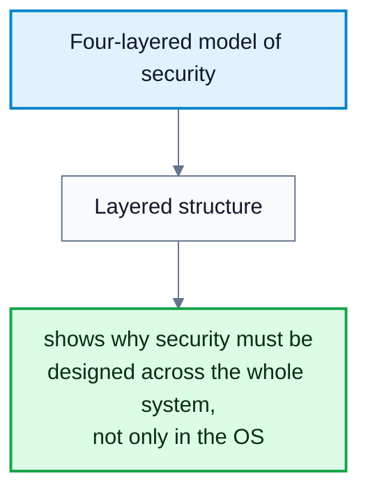
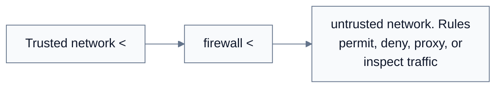

---
tags:
  - operating-systems
---

# Security

**Subject**: CSC3002F Operating Systems  
**Source**: `Operating Systems 1 Ch16.pdf`, Aslam Safla, pages 1-56  
**Generated**: 2026-06-03

---

## Contents

- [[#Core Content|Core Content]]
  - [[#The Security Problem|The Security Problem]]
  - [[#Attack Methods And Security Levels|Attack Methods And Security Levels]]
  - [[#Program Threats: Malware, Trojans, Trap Doors, Code Injection|Program Threats: Malware, Trojans, Trap Doors, Code Injection]]
  - [[#Viruses, Worms, Port Scanning, And DoS|Viruses, Worms, Port Scanning, And DoS]]
  - [[#Cryptography: Encryption|Cryptography: Encryption]]
  - [[#Authentication, Hashing, MACs, And Digital Signatures|Authentication, Hashing, MACs, And Digital Signatures]]
  - [[#Key Distribution, Certificates, TLS, And User Authentication|Key Distribution, Certificates, TLS, And User Authentication]]
  - [[#Implementing Security Defenses|Implementing Security Defenses]]
  - [[#Security Classifications And Windows Example|Security Classifications And Windows Example]]

---

## Core Content

### The Security Problem

#### Definitions

> **Security**: Ensuring resources are used and accessed as intended under all circumstances.

> **Intruder / Cracker**: Someone attempting to breach system security.

> **Threat**: A potential security violation.

> **Attack**: An attempt to breach security.

Perfect security is unachievable. The practical goal is to make the cost, difficulty, and risk high enough to deter most attackers. Accidental misuse is usually easier to defend against than malicious misuse.

Security violations include:

| Category | Meaning |
|---|---|
| Breach of confidentiality | Unauthorized reading of data |
| Breach of integrity | Unauthorized modification of data |
| Breach of availability | Unauthorized destruction or blocking of data/service |
| Theft of service | Unauthorized use of resources |
| Denial of service | Preventing legitimate use |
### Attack Methods And Security Levels

#### Definitions

> **Masquerading**: Pretending to be an authorized user.

> **Replay Attack**: Reusing captured communication, possibly with modification.

> **Man-in-the-Middle Attack**: An intruder sits between sender and receiver and impersonates each side to the other.

> **Session Hijacking**: Intercepting an already established session to bypass authentication.

> **Privilege Escalation**: Gaining access beyond the rights a user or resource should have.

Security must work at multiple levels:

| Level | Examples |
|---|---|
| Physical | Data centers, servers, terminals, device access |
| Application | Benign or malicious apps, unsafe code, application bugs |
| Operating system | Protection mechanisms, debugging, kernel/user boundaries |
| Network | Interception, interruption, denial of service |

Security is as weak as the weakest link. Humans are often that link through phishing and social engineering. Excessive security can also reduce usability and encourage workarounds, so security design must balance protection and practical use.
### Program Threats: Malware, Trojans, Trap Doors, Code Injection

#### Definitions

> **Malware**: Software designed to exploit, disable, or damage a computer.

> **Trojan Horse**: A program or code segment that misuses its environment while appearing legitimate.

> **Spyware**: Software that captures user data or displays unwanted ads, often installed with legitimate software.

> **Ransomware**: Malware that encrypts or locks data and demands payment.

> **Trap Door / Backdoor**: A hidden identifier, password, or path that bypasses normal security.

> **Remote Access Tool (RAT)**: Tool left behind to allow repeated remote control.

> **Code Injection**: Adding or modifying executable code through a bug in otherwise non-malicious system code.

> **Buffer Overflow**: Writing beyond a buffer's bounds, often allowing adjacent memory or control data to be overwritten.

Program threats often violate the principle of least privilege. A vulnerable program running with a user's permissions can let attack code get a shell, open a network port, delete files, or download more malware.

The source's C buffer-overflow example uses a fixed-size `buffer` and copies `argv[1]` without bounds checking. If the input is too long, memory after the buffer can be overwritten. Defenses include code review, disabling stack execution, and marking pages non-executable.

#### Diagram: Buffer-overflow/code-injection flow

```mermaid
%%{init: {"theme":"base","themeVariables":{"primaryColor":"#e0f2fe","primaryTextColor":"#0f172a","primaryBorderColor":"#0284c7","lineColor":"#64748b","secondaryColor":"#f8fafc","tertiaryColor":"#dcfce7","fontFamily":"Inter, ui-sans-serif, system-ui, -apple-system, BlinkMacSystemFont, Segoe UI, sans-serif"},"flowchart":{"curve":"basis","htmlLabels":true,"padding":12}}}%%
flowchart LR
    N0["Attacker input exceeds buffer"]
    N1["adjacent memory/control data<br/>overwritten"]
    N2["execution<br/>redirects/trampolines to<br/>injected code"]
    N3["attacker gains process<br/>privileges"]
    N0 --> N1
    N1 --> N2
    N2 --> N3

    classDef default fill:#f8fafc,stroke:#64748b,stroke-width:1px,color:#0f172a;
    classDef focus fill:#e0f2fe,stroke:#0284c7,stroke-width:2px,color:#0f172a;
    classDef outcome fill:#dcfce7,stroke:#16a34a,stroke-width:2px,color:#052e16;
    classDef warning fill:#fee2e2,stroke:#dc2626,stroke-width:2px,color:#7f1d1d;
    classDef muted fill:#f1f5f9,stroke:#94a3b8,stroke-width:1px,color:#334155;
    class N0 warning;
    class N3 warning;
```

Caption: This explains why non-executable memory, bounds checking, and code review matter.

#### Diagram: Boot-sector virus

Caption: This diagram connects malware persistence to the boot process.

### Viruses, Worms, Port Scanning, And DoS

#### Definitions

> **Virus**: A self-replicating code fragment embedded in a legitimate program.

> **Virus Dropper**: Software that inserts a virus onto a system.

> **Polymorphic Virus**: A virus that changes its representation to avoid signature detection.

> **Worm**: A standalone program that spreads using network mechanisms.

> **Port Scanning**: Automated attempts to connect to ranges of ports/IPs to identify services and vulnerabilities.

> **Denial of Service (DoS)**: Overloading or disrupting a target so legitimate work cannot proceed.

> **Distributed Denial of Service (DDoS)**: A DoS attack launched from many sites at once.

Viruses may be file/parasitic, boot/memory, macro, source-code, polymorphic, encrypted, stealth, tunneling, multipartite, or armored. Attacks moved from experiments to organized crime, botnets, spam delivery, DDoS, and credential theft.

Network threats are hard because physical boundaries vanish once a system is on the Internet. IP addresses alone are not reliable identity. Attackers use port scanners such as `nmap` or vulnerability tools such as `nessus`, often launched from compromised zombie systems.

DoS can be accidental, such as badly written `fork()` code, or deliberate, such as extortion or punishment. A SYN flood exploits the start of the TCP connection handshake by consuming resources for half-open connections.
### Cryptography: Encryption

#### Definitions

> **Cryptography**: Use of mathematical techniques and secrets to constrain message senders/receivers and create trust relationships.

> **Encryption**: Transforming plaintext into ciphertext so only holders of the key can recover the message.

> **Plaintext**: The original readable message.

> **Ciphertext**: The encrypted message.

> **Key**: Secret or public/private value used by a cryptographic algorithm.

Formally, an encryption algorithm uses:

$$
K=\text{set of keys},\quad M=\text{set of messages},\quad C=\text{set of ciphertexts}
$$

Encryption functions:

$$
E:K\rightarrow(M\rightarrow C)
$$

Decryption functions:

$$
D:K\rightarrow(C\rightarrow M)
$$

Essential property:

$$
\text{Given } c\in C,\ \text{recovering } m \text{ such that } E_k(m)=c \text{ requires } k.
$$

| Encryption Type | Key Use | Examples / Notes |
|---|---|---|
| Symmetric encryption | Same secret key encrypts and decrypts | DES, Triple-DES, AES, RC4 |
| Asymmetric encryption | Public key encrypts, private key decrypts | RSA |

AES uses key sizes $128$, $192$, or $256$ bits and operates on $128$-bit blocks. RC4 is a stream cipher but has known vulnerabilities. Asymmetric encryption is computationally heavier and is usually not used for bulk data.

RSA uses large primes $p$ and $q$:

$$
N=pq
$$

The public exponent $k_e$ and private exponent $k_d$ satisfy:

$$
k_ek_d \bmod ((p-1)(q-1))=1
$$

Encryption:

$$
E_{k_e,N}(m)=m^{k_e}\bmod N
$$

Decryption:

$$
D_{k_d,N}(c)=c^{k_d}\bmod N
$$

Source example:

$$
p=7,\quad q=13,\quad N=91,\quad (p-1)(q-1)=72
$$

Choose:

$$
k_e=5,\quad k_d=29
$$

Public key is $(5,91)$ and private key is $(29,91)$.
### Authentication, Hashing, MACs, And Digital Signatures

#### Definitions

> **Authentication**: Constraining and verifying the potential senders of a message.

> **Authenticator**: A value attached to a message to prove authenticity.

> **Hash Function**: A function producing a small fixed-size message digest from a message.

> **Collision Resistance**: It is infeasible to find distinct messages with the same hash.

> **Message Authentication Code (MAC)**: A cryptographic checksum generated from a message using a secret key.

> **Digital Signature**: An authenticator produced with a private key and verifiable with a public key.

Authentication algorithm components:

$$
K=\text{keys},\quad M=\text{messages},\quad A=\text{authenticators}
$$

Signing/authenticator generation:

$$
S:K\rightarrow(M\rightarrow A)
$$

Verification:

$$
V:K\rightarrow(M\times A\rightarrow\{\text{true},\text{false}\})
$$

Hashes alone are not enough for authentication because an attacker can modify the message and recompute the hash if the hash function is public. A MAC authenticates the hash or message using a secret key.

Digital signatures reverse the RSA-like key use: the private key signs and the public key verifies. For RSA-style signatures:

$$
S_{k_s}(m)=H(m)^{k_s}\bmod N
$$

Verification checks:

$$
V_{k_v}(m,a):\quad a^{k_v}\bmod N=H(m)
$$

Authentication is useful even without confidentiality, such as signed patches. It can also support non-repudiation.
### Key Distribution, Certificates, TLS, And User Authentication

#### Definitions

> **Certificate Authority (CA)**: A trusted party that signs public keys after verifying identity.

> **Digital Certificate**: Proof that a public key belongs to an entity, signed by a trusted party.

> **TLS / SSL**: Transport-layer cryptographic protocol used for secure communication such as HTTPS.

> **Session Key**: A temporary symmetric key used for one communication session.

> **Multi-Factor Authentication**: Authentication requiring two or more factors.

Symmetric key distribution is difficult because both parties need the same secret. Asymmetric public keys are easier to distribute, but still vulnerable to man-in-the-middle substitution unless public keys are certified.

TLS/SSL uses asymmetric cryptography to authenticate the server and establish a symmetric session key. The session then uses symmetric encryption for bulk data because it is faster.

User authentication commonly uses passwords. Good practice includes strong/non-guessable passwords, change history, logging invalid attempts, not logging failed passwords themselves, and preventing unauthorized transfer. Password storage should use one-way hashing plus salt so identical passwords do not produce identical stored values.

One-time passwords, hardware tokens, biometrics, and multi-factor authentication reduce reliance on a single reusable secret.

#### Diagram: Secure communication over insecure medium

Caption: This diagram motivates encryption and authentication as network security tools.

#### Diagram: Man-in-the-middle on asymmetric cryptography

Caption: This explains the role of certificate authorities.

### Implementing Security Defenses

#### Definitions

> **Defense In Depth**: Using multiple security layers rather than relying on one control.

> **Security Policy**: A statement of what is being secured and what rules apply.

> **Vulnerability Assessment**: Comparing the real system state to the desired security policy.

> **Intrusion Detection**: Detecting attempted or successful intrusions.

> **Signature-Based Detection**: Detecting known bad patterns.

> **Anomaly Detection**: Detecting behavior different from normal behavior.

> **Firewall**: A network or host control limiting access between security domains.

Defenses include user education, secure communication, physical protection, reducing attack surface, secure daemon/service configuration, patching, trusted signed software, logging/auditing, antivirus, strong passphrases, intrusion detection, firewalling, vulnerability assessments, and encryption of disks/files.

Firewall types in the source:

| Firewall Type | What It Controls |
|---|---|
| Network firewall | Traffic between trusted and untrusted hosts |
| Personal firewall | Traffic to/from one host |
| Application proxy firewall | Application protocols such as SMTP |
| System-call firewall | Important system calls and possibly their arguments |

Firewalls can be tunneled or spoofed: disallowed protocols can be wrapped inside allowed protocols, and IP/host rules can be evaded if identity is spoofable.

#### Diagram: Four-layered model of security

Caption: This diagram shows why security must be designed across the whole system, not only in the OS.

#### Diagram: Firewall domain separation

Caption: This shows how firewalls enforce boundaries between security domains.

### Security Classifications And Windows Example

#### Definitions

> **Security Identifier (SID)**: A unique identifier for a Windows user or group.

> **Access Token**: A Windows object containing a user's SID, group SIDs, and privileges for a process.

> **Security Descriptor**: Windows object metadata describing permissions.

The U.S. Department of Defense classification model:

| Division | Meaning |
|---|---|
| D | Minimal security |
| C | Discretionary protection and auditing; C1/C2 |
| B | C properties plus sensitivity labels; B1/B2/B3 |
| A | Formal design and verification |

Windows security is account-based. Login creates an access token containing the user SID, group SIDs, and special privileges. Each process gets a copy. Objects have security descriptors with permissions, and access checks compare the process token against object security attributes. Later Windows versions add mandatory integrity controls with integrity labels.
