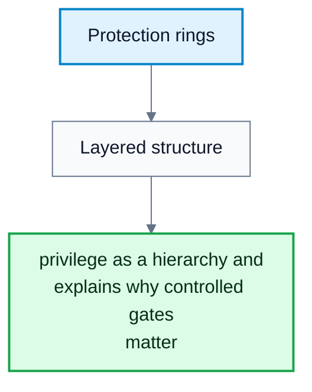
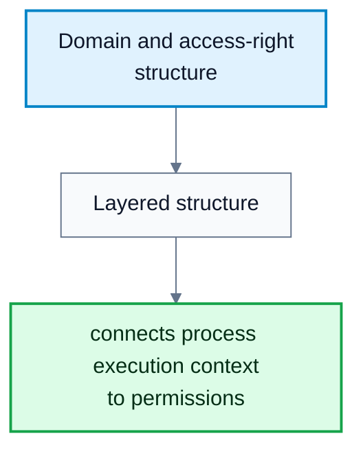
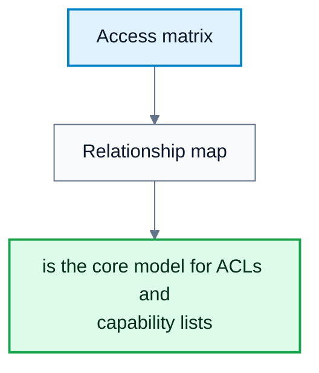
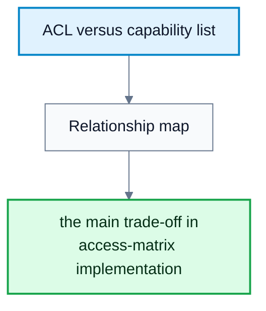
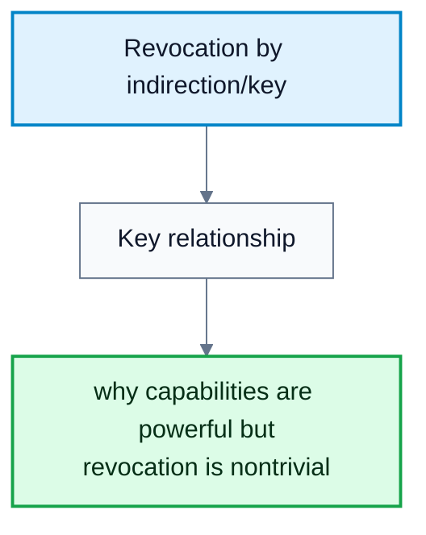
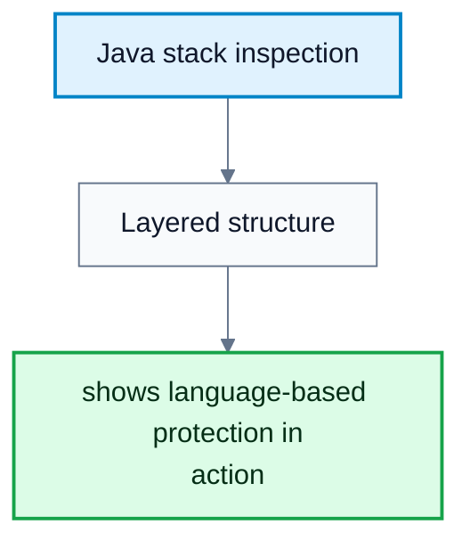

---
tags:
  - operating-systems
---

# Protection

**Subject**: CSC3002F Operating Systems  
**Source**: `Operating Systems 1 Ch17.pdf`, Aslam Safla, pages 1-39  
**Generated**: 2026-06-03

---

## Contents

- [[#Core Content|Core Content]]
  - [[#Goals And Principles Of Protection|Goals And Principles Of Protection]]
  - [[#Protection Rings And Domains|Protection Rings And Domains]]
  - [[#UNIX And Android Domain Implementations|UNIX And Android Domain Implementations]]
  - [[#Access Matrix Model|Access Matrix Model]]
  - [[#Implementing The Access Matrix|Implementing The Access Matrix]]
  - [[#Revocation, RBAC, MAC, And Capabilities|Revocation, RBAC, MAC, And Capabilities]]
  - [[#Other Protection Improvements And Language-Based Protection|Other Protection Improvements And Language-Based Protection]]

---

## Core Content

### Goals And Principles Of Protection

#### Definitions

> **Protection**: Mechanisms ensuring each object is accessed correctly and only by processes allowed to do so.

> **Object**: A hardware or software resource with a unique name and well-defined operations.

> **Principle Of Least Privilege**: Programs, users, and systems should receive only the privileges required for their tasks.

> **Compartmentalization**: Protecting individual system components using specific permissions and access restrictions.

> **Audit Trail**: A record of protection-oriented activities.

Protection is not the same as security, but it is one of security's core mechanisms. A protection model treats a system as a collection of objects and operations. The protection problem is to ensure only allowed operations occur.

Least privilege can be static or dynamic. Static privilege stays fixed during a process/system lifetime. Dynamic privilege changes as needed through domain switching or privilege escalation. Fine-grained privilege is more protective but more complex; coarse-grained privilege is simpler but grants larger chunks of power.
### Protection Rings And Domains

#### Definitions

> **Protection Ring**: A hierarchical privilege level separating system components.

> **Gate**: A controlled transfer path between protection levels.

> **Domain Of Protection**: A set of access rights defining resources a process may access.

> **Access Right**: Permission to perform operations on an object.

> **Domain Switching**: Changing a process from one protection domain to another.

Rings separate functions by privilege, such as kernel code and user applications. Hardware support is required. Gates, system calls, traps, and interrupts control transfers between levels. Hypervisors and ARM TrustZone add further privilege levels for virtualization and secure functions.

A computer can be treated as processes and objects. A process should access only objects it currently needs. An access right is:

$$
\langle \text{object-name},\ \text{rights-set}\rangle
$$

A domain is a set of access rights:

$$
\text{Domain}=\{\langle O_i,\ R_i\rangle\}
$$

Domains may be associated with users, processes, or procedures. Associations can be static or dynamic.

#### Diagram: Protection rings

Caption: This shows privilege as a hierarchy and explains why controlled gates matter.

### UNIX And Android Domain Implementations

#### Definitions

> **User ID (UID)**: Identifier representing a user or app domain.

> **setuid Bit**: A UNIX file bit that causes execution under the file owner's user ID.

> **su**: Command that switches to another user's domain after password authentication.

> **sudo**: Command prefix for executing a command in another domain if policy permits.

In UNIX, a domain is often represented by the user ID. Domain switching can happen through setuid execution, `su`, or `sudo`.

Android assigns distinct UIDs/GIDs per application at install time through the `installd` daemon and gives each app a private data directory such as `/data/data/<appname>`. This reuses UNIX user isolation to separate apps. Android extends the model with special GIDs for operations such as networking and isolated UIDs that restrict RPC access.

#### Diagram: Domain and access-right structure

Caption: This diagram connects process execution context to permissions.

### Access Matrix Model

#### Definitions

> **Access Matrix**: A protection model where rows are domains and columns are objects.

> **Owner Right**: A special right allowing a domain to define access rights for an object.

> **Copy Right**: A right allowing a domain to copy an operation right to another domain/object entry.

> **Control Right**: A right allowing a domain to modify another domain's access rights.

> **Transfer Right**: A right allowing switching from one domain to another.

The access matrix entry:

$$
\text{Access}(i,j)
$$

is the set of operations a process executing in domain $D_i$ can invoke on object $O_j$.

If a process in $D_i$ tries operation $\text{op}$ on $O_j$, access is allowed only if:

$$
\text{op}\in \text{Access}(i,j)
$$

The access matrix separates mechanism from policy:

| Aspect | Responsibility |
|---|---|
| Mechanism | OS provides the matrix and enforces rules strictly |
| Policy | User/administrator decides who can access what and in which mode |

The model can express dynamic protection with rights that add/delete/copy/transfer/control access. It does not solve the general confinement problem by itself.
### Implementing The Access Matrix

#### Definitions

> **Global Table**: A table of triples $\langle \text{domain},\text{object},\text{rights-set}\rangle$.

> **Access-Control List (ACL)**: Per-object list of domains and rights.

> **Capability List**: Per-domain list of objects and allowed operations.

> **Capability**: A protected object reference representing permission.

> **Lock-Key Scheme**: A compromise where objects have locks and domains have keys; access succeeds when a key matches a lock.

| Implementation | Strength | Weakness |
|---|---|---|
| Global table | Simple concept | Can be huge and hard to group |
| ACLs | Match user/object administration needs | Per-access checks can be slow; domain rights are non-local |
| Capability lists | Localize rights for a process/domain | Revocation can be inefficient |
| Lock-key | Flexible, easy revocation by changing locks/keys | Requires secure key management |

Most systems combine ACLs and capabilities. First access checks the object's ACL. If allowed, a capability is attached to the process. Later accesses can use the capability without repeated ACL search. When the last access ends, the capability is destroyed.

#### Diagram: Access matrix

Caption: This diagram is the core model for ACLs and capability lists.

#### Diagram: ACL versus capability list

Caption: This explains the main trade-off in access-matrix implementation.

### Revocation, RBAC, MAC, And Capabilities

#### Definitions

> **Revocation**: Removing a domain's access right to an object.

> **Role-Based Access Control (RBAC)**: Access control based on roles assigned to users.

> **Discretionary Access Control (DAC)**: Access control where users/admins set permissions on objects.

> **Mandatory Access Control (MAC)**: Access control enforced by system policy that even root cannot bypass.

> **Label**: Metadata assigned to a subject/object for MAC policy decisions.

Revocation choices:

| Choice | Options |
|---|---|
| Timing | Immediate or delayed |
| Scope | Selective or general |
| Amount | Partial or total |
| Duration | Temporary or permanent |

Revoking ACL entries is straightforward: remove the rights from the object's access list. Revoking capabilities is harder because the system must find all outstanding capabilities. Methods include reacquisition, back-pointers, indirection through a global table, or keys/master keys.

Solaris RBAC assigns privileges to roles and roles to users. A role may be enabled by password to gain its privileges. MAC systems such as Trusted Solaris, TrustedBSD/macOS, SELinux, and Windows integrity controls assign labels to subjects and objects and evaluate policy on each request.

POSIX-style capabilities slice root powers into separate bits, often with permitted, effective, and inheritable sets. This implements least privilege more directly than all-or-nothing root access.

#### Diagram: Revocation by indirection/key

Caption: This shows why capabilities are powerful but revocation is nontrivial.

### Other Protection Improvements And Language-Based Protection

#### Definitions

> **System Integrity Protection (SIP)**: macOS protection restricting access to system files/resources even by root.

> **System-Call Filtering**: Restricting which system calls a process may execute, possibly including argument inspection.

> **Sandboxing**: Running a process in a limited environment with irremovable restrictions.

> **Code Signing**: Signing executable code with a cryptographic hash so modifications invalidate trust.

> **Language-Based Protection**: Enforcing protection policies through programming-language/runtime checks.

SIP restricts changes to protected macOS system resources and requires signed kernel extensions/apps depending on configuration. Linux SECCOMP-BPF provides system-call filtering. Sandboxing limits a process early in startup before it can access resources outside its profile. Code signing makes tampering detectable and can allow vendors to block old or unsafe programs.

Java protection is handled by the JVM. A class receives a protection domain when loaded. If code invokes a privileged operation, stack inspection checks whether the call chain is allowed. Java's load-time and run-time checks enforce type safety, and classes encapsulate data/methods.

#### Diagram: Java stack inspection

Caption: This diagram shows language-based protection in action.
