---
tags:
  - operating-systems
---

# Operating Systems

**Subject**: CSC3002F Operating Systems  
**Generated**: 2026-06-04  
**Scope**: Consolidated core content from the current operating systems notes.

## Lecturer Coverage

- **Aslam Safla**: Introduction and computer-system structure; OS services and structures; main memory; demand paging and page replacement; frame allocation, thrashing, and working sets; security; protection.
- **Michelle Kuttel**: Processes; process scheduling; process synchronization; deadlock.

## Contents

1. [[#Introduction And Computer System Structure|Introduction And Computer System Structure]]
2. [[#Operating System Services And Structures|Operating System Services And Structures]]
3. [[#Main Memory|Main Memory]]
4. [[#Demand Paging And Page Replacement|Demand Paging And Page Replacement]]
5. [[#Frame Allocation, Thrashing, And Working Sets|Frame Allocation, Thrashing, And Working Sets]]
6. [[#Security|Security]]
7. [[#Protection|Protection]]
8. [[#Processes|Processes]]
9. [[#Process Scheduling|Process Scheduling]]
10. [[#Process Synchronization|Process Synchronization]]
11. [[#Deadlock|Deadlock]]

## Source Notes

1. Introduction And Computer System Structure — `ASLAM/01_Introduction_And_Computer_System_Structure.md`
2. Operating System Services And Structures — `ASLAM/02_Operating_System_Services_And_Structures.md`
3. Main Memory — `ASLAM/03_Main_Memory.md`
4. Demand Paging And Page Replacement — `ASLAM/04_Demand_Paging_And_Page_Replacement.md`
5. Frame Allocation, Thrashing, And Working Sets — `ASLAM/05_Frame_Allocation_Thrashing_And_Working_Sets.md`
6. Security — `ASLAM/06_Security.md`
7. Protection — `ASLAM/07_Protection.md`
8. Processes — `MICHEL/01_Processes.md`
9. Process Scheduling — `MICHEL/02_Process_Scheduling.md`
10. Process Synchronization — `MICHEL/03_Process_Synchronization.md`
11. Deadlock — `MICHEL/04_Deadlock.md`

---

# Introduction And Computer System Structure

**Subject**: CSC3002F Operating Systems  
**Source**: `Operating Systems 1 Ch1.pdf`, Aslam Safla, pages 1-66  
**Generated**: 2026-06-03

---

## Core Content

### What An Operating System Does

#### Definitions

> **Operating System**: Software that controls and coordinates the use of hardware among application programs and users.

> **Hardware**: The basic computing resources, including CPU, memory, and I/O devices.

> **Application Program**: A program that defines how system resources are used to solve a user's computing problem.

> **Resource Allocator**: The OS role of allocating CPU time, memory, files, and I/O devices among competing users and programs.

> **Control Program**: The OS role of controlling user programs and I/O devices to prevent errors and improper use.

A computer system is divided into four conceptual components:

| Component | Role | Examples |
|---|---|---|
| Hardware | Provides raw computing resources | CPU, main memory, disks, keyboards, displays |
| Operating system | Coordinates and controls hardware use | Kernel, device drivers, schedulers |
| Application programs | Use resources to solve user problems | Browsers, compilers, games, databases |
| Users | Request work from the system | People, machines, other computers |

The OS looks different from different points of view. A user on a laptop values convenience, ease of use, and responsiveness. A shared mainframe or server must also maximize resource use and keep many users from interfering with each other. Mobile devices emphasize usability, battery life, and sensors such as touch, GPS, and voice input. Embedded systems may have little or no direct UI and run mostly without human intervention.


### Computer-System Organization

#### Definitions

> **Device Controller**: Hardware responsible for a particular device type and connected to the rest of the system through a bus.

> **Device Driver**: OS software that manages a device controller and provides a uniform interface to the kernel.

> **Interrupt**: A signal that transfers control to an interrupt service routine. **signal that tells the cpu to stop what its doing and handle something else.**

> **Interrupt Vector**: A table containing addresses of interrupt service routines.

> **Trap / Exception**: A software-generated interrupt caused by an error or a user request.

One or more CPUs and several device controllers connect through a common bus and share memory. The CPU and I/O devices can execute concurrently, so the OS must coordinate competition for memory cycles and device completion events.

Interrupt-driven I/O works like this:

1. A device controller performs I/O into or out of its local buffer.
2. The CPU moves data between main memory and the controller's buffer, unless DMA is used.
3. When the controller finishes, it raises an interrupt.
4. The interrupt vector directs execution to the correct interrupt service routine.
5. The OS saves the interrupted CPU state, handles the event, restores state, and resumes execution.

The OS is therefore **interrupt driven**: hardware interrupts report device events, and software interrupts/traps report system calls or exceptional conditions such as division by zero.


### I/O, Bootstrap, Storage, And DMA

#### Definitions

> **System Call**: A request from a user program for an OS service.

> **Bootstrap Program**: Initial code loaded at power-up or reboot that initializes the system and loads the kernel. Typically stored in ROM/EPROM, known as firmware.

> **Firmware**: Software stored in ROM or EPROM/NVM that provides low-level startup code.

> **Main Memory**: The large storage area the CPU can access directly.

> **Secondary Storage**: Nonvolatile storage used as an extension of main memory.

> **Caching**: Copying information into faster storage so future access is quicker.

> **Direct Memory Access (DMA)**: A method where a device controller transfers blocks directly between its buffer and main memory without CPU intervention for every byte, only one interrupt per block instead of per byte.

The source distinguishes two broad I/O styles:

| I/O Style                    | Control Returns To User Program | Consequence                                                                       |
| ---------------------------- | ------------------------------- | --------------------------------------------------------------------------------- |
| Synchronous/blocking I/O     | Only after I/O completion       | Simpler, but the CPU may idle or only one I/O request may be outstanding          |
| Asynchronous/nonblocking I/O | immediately without waiting     | More concurrency, but the OS must track device status and let programs wait later |

For asynchronous I/O, the OS maintains a **device-status table** with each device's type, address, and state. Programs can use system calls to wait for completion.

Storage is organized as a hierarchy by speed, cost, and volatility. Registers and caches are fastest and most expensive per byte. Main memory is directly accessible but volatile. Secondary storage is slower and nonvolatile. Hard disks organize surfaces into tracks and sectors; NVM/SSDs are faster than HDDs and increasingly common.

DMA matters because high-speed devices would waste CPU time if every byte caused an interrupt. With DMA, one interrupt is generated per block rather than per byte.

**Storage-Decive Hierarchy:**

<svg width="100%" viewBox="0 0 680 520" role="img">
<title>Storage hierarchy diagram</title>
<defs>
  <marker id="arrow" viewBox="0 0 10 10" refX="8" refY="5" markerWidth="6" markerHeight="6" orient="auto-start-reverse">
    <path d="M2 1L8 5L2 9" fill="none" stroke="context-stroke" stroke-width="1.5" stroke-linecap="round" stroke-linejoin="round"/>
  </marker>
</defs>
<rect x="285" y="30"  width="110" height="28" rx="3" fill="none" stroke="#4a90d9" stroke-width="1.2"/>
<text x="340" y="49" text-anchor="middle" font-size="12" fill="#888" font-family="sans-serif">registers</text>
<rect x="265" y="75"  width="150" height="28" rx="3" fill="none" stroke="#4a90d9" stroke-width="1.2"/>
<text x="340" y="94" text-anchor="middle" font-size="12" fill="#888" font-family="sans-serif">cache</text>
<rect x="235" y="120" width="210" height="28" rx="3" fill="none" stroke="#4a90d9" stroke-width="1.2"/>
<text x="340" y="139" text-anchor="middle" font-size="12" fill="#888" font-family="sans-serif">main memory</text>
<rect x="195" y="185" width="290" height="28" rx="3" fill="none" stroke="#4a90d9" stroke-width="1.2"/>
<text x="340" y="204" text-anchor="middle" font-size="12" fill="#888" font-family="sans-serif">nonvolatile memory</text>
<rect x="155" y="235" width="370" height="28" rx="3" fill="none" stroke="#4a90d9" stroke-width="1.2"/>
<text x="340" y="254" text-anchor="middle" font-size="12" fill="#888" font-family="sans-serif">hard-disk drives</text>
<rect x="110" y="285" width="460" height="28" rx="3" fill="none" stroke="#4a90d9" stroke-width="1.2"/>
<text x="340" y="304" text-anchor="middle" font-size="12" fill="#888" font-family="sans-serif">optical disk</text>
<rect x="60"  y="335" width="560" height="28" rx="3" fill="none" stroke="#4a90d9" stroke-width="1.2"/>
<text x="340" y="354" text-anchor="middle" font-size="12" fill="#888" font-family="sans-serif">magnetic tapes</text>
<line x1="340" y1="58"  x2="340" y2="73"  stroke="#888" stroke-width="1.2" marker-end="url(#arrow)"/>
<line x1="340" y1="103" x2="340" y2="118" stroke="#888" stroke-width="1.2" marker-end="url(#arrow)"/>
<line x1="340" y1="148" x2="340" y2="183" stroke="#888" stroke-width="1.2" marker-end="url(#arrow)"/>
<line x1="340" y1="213" x2="340" y2="233" stroke="#888" stroke-width="1.2" marker-end="url(#arrow)"/>
<line x1="340" y1="263" x2="340" y2="283" stroke="#888" stroke-width="1.2" marker-end="url(#arrow)"/>
<line x1="340" y1="313" x2="340" y2="333" stroke="#888" stroke-width="1.2" marker-end="url(#arrow)"/>
<line x1="230" y1="163" x2="450" y2="163" stroke="#888" stroke-width="0.8" stroke-dasharray="5,4"/>
<text x="100" y="158" text-anchor="end" font-size="11" fill="#888" font-family="sans-serif">volatile</text>
<text x="100" y="171" text-anchor="end" font-size="11" fill="#888" font-family="sans-serif">storage</text>
<text x="100" y="200" text-anchor="end" font-size="11" fill="#888" font-family="sans-serif">nonvolatile</text>
<text x="100" y="213" text-anchor="end" font-size="11" fill="#888" font-family="sans-serif">storage</text>
<line x1="28" y1="30"  x2="28" y2="363" stroke="#888" stroke-width="1.2" marker-start="url(#arrow)" marker-end="url(#arrow)"/>
<text x="20" y="100" text-anchor="middle" font-size="11" fill="#888" font-family="sans-serif" transform="rotate(-90,20,197)">smaller</text>
<text x="20" y="300" text-anchor="middle" font-size="11" fill="#888" font-family="sans-serif" transform="rotate(-90,20,310)">larger</text>
<text x="340" y="18" text-anchor="middle" font-size="11" fill="#888" font-family="sans-serif">storage capacity</text>
<line x1="652" y1="30"  x2="652" y2="363" stroke="#888" stroke-width="1.2" marker-start="url(#arrow)" marker-end="url(#arrow)"/>
<text x="660" y="100" text-anchor="middle" font-size="11" fill="#888" font-family="sans-serif" transform="rotate(90,660,197)">faster</text>
<text x="660" y="300" text-anchor="middle" font-size="11" fill="#888" font-family="sans-serif" transform="rotate(90,660,310)">slower</text>
<text x="340" y="395" text-anchor="middle" font-size="11" fill="#888" font-family="sans-serif">access time</text>
<line x1="455" y1="30"  x2="620" y2="30"  stroke="#888" stroke-width="0.8"/>
<line x1="455" y1="163" x2="620" y2="163" stroke="#888" stroke-width="0.8"/>
<text x="622" y="103" font-size="11" fill="#888" font-family="sans-serif">primary</text>
<text x="622" y="116" font-size="11" fill="#888" font-family="sans-serif">storage</text>
<line x1="490" y1="163" x2="620" y2="163" stroke="#888" stroke-width="0.8"/>
<line x1="490" y1="265" x2="620" y2="265" stroke="#888" stroke-width="0.8"/>
<text x="622" y="220" font-size="11" fill="#888" font-family="sans-serif">secondary</text>
<text x="622" y="233" font-size="11" fill="#888" font-family="sans-serif">storage</text>
<line x1="530" y1="265" x2="620" y2="265" stroke="#888" stroke-width="0.8"/>
<line x1="530" y1="363" x2="620" y2="363" stroke="#888" stroke-width="0.8"/>
<text x="622" y="320" font-size="11" fill="#888" font-family="sans-serif">tertiary</text>
<text x="622" y="333" font-size="11" fill="#888" font-family="sans-serif">storage</text>
</svg>

### Operating-System Operations

#### Definitions

> **Kernel**: The core OS component that runs with privileged access and manages hardware and core resources.

> **Daemon / Service**: A background system process that provides services outside the kernel.

> **Multiprogramming**: Keeping several jobs in memory so the CPU always has another job to run when one waits.

> **Multitasking / Time Sharing**: Rapidly switching the CPU among jobs so users can interact with programs while they run.

> **CPU Scheduling**: Choosing which ready process/thread should run next.

> **Swapping**: Moving processes between memory and secondary storage to allow more processes than fit in RAM at once.

> **Virtual Memory**: A memory abstraction that allows processes to execute without being completely resident in physical memory.

After bootstrapping, the kernel loads and starts system daemons. The kernel responds to hardware interrupts, traps, exceptions, and system calls. It also deals with process failures such as infinite loops, illegal memory modification, or attempts to modify the OS.

Multiprogramming improves CPU utilization:

1. Keep a subset of jobs in memory.
2. Select one job to run.
3. When that job waits for I/O, switch to another job.
4. Repeat so the CPU has useful work while devices are busy.

Time sharing extends this by switching frequently enough to support interactive users. If several jobs are ready, CPU scheduling chooses among them. If memory pressure is high, swapping and virtual memory support execution even when all process code/data is not simultaneously in RAM.
### Dual Mode, Privilege, And Timers

#### Definitions

> **User Mode**: A restricted CPU mode used for ordinary application code.

> **Kernel Mode**: A privileged CPU mode used for OS code.

> **Mode Bit**: Hardware state indicating whether the CPU is executing user or kernel code.

> **Privileged Instruction**: An instruction that may execute only in kernel mode.

> **Timer**: Hardware that interrupts after a set time interval.

Dual-mode operation protects the OS and other processes. User code cannot simply set the mode bit to kernel mode. Instead, a system call transfers control into the kernel through a controlled path, and return from the system call restores user mode.

The timer prevents a user process from monopolizing the CPU:

1. The OS sets a counter before scheduling a process.
2. A physical clock decrements the counter.
3. When the counter reaches zero, a timer interrupt occurs.
4. The kernel regains control and may reschedule or terminate the program.


### OS Management Responsibilities

#### Definitions

> **Process**: A program in execution.

> **Thread**: A path of execution within a process.

> **File System**: The OS abstraction that provides a logical view of stored information as files and directories.

> **Protection**: Mechanisms controlling access of processes or users to OS-defined resources.

> **Security**: Defense against internal and external attacks.

The OS is responsible for:

| Area | Main Responsibilities |
|---|---|
| Process management | Create/delete processes, suspend/resume, synchronization, communication, deadlock handling |
| Memory management | Track memory use, choose what moves into/out of memory, allocate/deallocate memory |
| File-system management | Create/delete files/directories, manipulate files, map files to storage, backup |
| Mass-storage management | Mount/unmount, free-space management, storage allocation, disk scheduling, partitioning, protection |
| I/O subsystem | Buffering, caching, spooling, uniform device-driver interface, device-specific drivers |
| Protection/security | User IDs, group IDs, access control, privilege escalation control, defense against attacks |

Caching appears across hardware, OS, and applications. In multitasking and multiprocessor environments, the OS/hardware must ensure the most recent value is observed. Multiprocessor systems need cache coherency; distributed systems are even more complex because copies may exist on different machines.
### System Architectures And Computing Environments

#### Definitions

> **Virtualization**: Running applications or guest operating systems inside another OS or virtual machine monitor.

> **Virtual Machine Manager (VMM)**: Software that provides virtualization services.

> **Distributed System**: A collection of separate, networked systems that communicate and may appear as one system.

> **Multiprocessor System**: A system with multiple processors, also called a parallel or tightly coupled system.

> **Symmetric Multiprocessing (SMP)**: A multiprocessor design where each processor can perform all tasks.

> **Asymmetric Multiprocessing**: A design where each processor is assigned a specific task.

> **Clustered System**: Multiple systems working together, often sharing storage, for high availability or high performance.

Virtualization is useful for running multiple OSes on a laptop, compatibility testing, software development across OS targets, QA testing, and data-center compute management. Emulation is needed when the source CPU type differs from the target CPU type, but it is usually slower than native virtualization.

Multiprocessor systems improve throughput, provide economy of scale, and can improve reliability through graceful degradation or fault tolerance. Clustered systems are like multiprocessors at a larger scale: separate machines coordinate, often with shared storage and a storage-area network.

The source lists common computing environments:

| Environment | Core Idea |
|---|---|
| Traditional | Stand-alone general-purpose machines, now usually networked |
| Mobile | Smartphones/tablets with wireless networking, sensors, and battery constraints |
| Client-server | Servers respond to requests from clients, such as compute servers or file servers |
| Peer-to-peer | Nodes act as clients, servers, or both |
| Cloud computing | Compute, storage, and applications delivered as network services |
| Real-time embedded | Special-purpose systems with fixed time constraints |

Cloud types include public, private, and hybrid cloud. Service models include **SaaS**, **PaaS**, and **IaaS**.


### Free/Open Source OSes And Kernel Data Structures

#### Definitions

> **Open-Source Operating System**: An OS made available in source-code form.

> **Copyleft**: A licensing approach associated with the GNU GPL that preserves software freedom in derivative works.

> **Bitmap**: A string of binary digits representing the status of many items.

Open-source OSes such as GNU/Linux, BSD UNIX, Solaris, and parts of macOS make OS internals easier to study. Virtualization also lets students experiment with multiple OSes without dedicated hardware.

Kernel implementations use standard data structures:

| Data Structure | OS Use |
|---|---|
| Singly/doubly/circular linked lists | Ready queues, device lists, kernel object lists |
| Binary search trees / balanced trees | Ordered lookup; balanced search can be $O(\log n)$ |
| Hash maps | Fast average-case lookup by key |
| Bitmaps | Track free/used frames, blocks, or resource slots |

---

# Operating System Services And Structures

**Subject**: CSC3002F Operating Systems  
**Source**: `Operating Systems 1 Ch2.pdf`, Aslam Safla, pages 1-52  
**Generated**: 2026-06-03

---

## Core Content

### Operating-System Services

#### Definitions

> **Operating-System Service**: A function the OS provides to users, programs, or the system itself.

> **User Interface (UI)**: The way users interact with the OS.

> **Resource Allocation**: Assigning CPU cycles, memory, storage, and I/O devices among competing jobs/users.

> **Accounting**: Tracking resource use by users and jobs.

OS services fall into two broad groups:

| Service Group | Services | Purpose |
|---|---|---|
| Helpful to users/programs | UI, program execution, I/O operations, file-system manipulation, communications, error detection | Make programs usable and reliable |
| Efficient system operation | Resource allocation, accounting, protection and security | Make sharing safe, fair, and efficient |

Programs need OS services to load into memory, start execution, end normally or abnormally, perform I/O, manipulate files/directories, communicate with other processes, and receive error handling. The OS also detects CPU, memory, I/O-device, and program errors and takes appropriate action.


### User Interfaces

#### Definitions

> **Command-Line Interface (CLI)**: A UI where commands are typed directly to a command interpreter.

> **Shell**: A command interpreter, sometimes built into the kernel but usually a system program.

> **Graphical User Interface (GUI)**: A UI based on windows, icons, menus, mouse/keyboard, and visual objects.

> **Touchscreen Interface**: A UI based on gestures, touch selection, virtual keyboard, and sometimes voice.

A CLI fetches commands from the user and executes them. Some commands are built into the shell; others are simply names of programs. If commands are external programs, adding features does not require changing the shell itself.

GUIs use a desktop metaphor where icons represent files, programs, and actions. Many systems provide both CLI and GUI: Windows has a GUI with command shells; macOS has the Aqua GUI over a UNIX-like kernel and shells; UNIX/Linux systems often use CLI plus optional GUIs.
### System Calls, APIs, And Parameter Passing

#### Definitions

> **System Call**: The programming interface to OS services.

> **Application Programming Interface (API)**: A higher-level interface used by programs, often hiding direct system-call details.

> **System-Call Interface**: The OS layer that maps system-call numbers to kernel routines.

> **Runtime Support Library**: Compiler-provided library code that helps implement APIs and system calls.

Programs usually call APIs rather than raw system calls. Common APIs include Win32 for Windows, POSIX for UNIX/Linux/macOS-like systems, and the Java API for the JVM.

System-call implementation normally works as follows:

1. Each system call has an associated number.
2. The system-call interface stores a table indexed by these numbers.
3. A program calls an API/library wrapper.
4. The wrapper places the system-call number and parameters where the OS expects them.
5. A trap/system-call instruction enters the kernel.
6. The system-call interface invokes the intended kernel routine.
7. The kernel returns status and values to the caller.

Parameter-passing methods:

| Method | How It Works | Strength |
|---|---|---|
| Registers | Parameters placed directly in CPU registers | Fast and simple for small fixed parameter sets |
| Memory block/table | Parameters stored in memory; address passed in a register | Handles many/large parameters; used by Linux/Solaris style systems |
| Stack | Parameters pushed by program and popped by OS | Not limited by register count |


### Types Of System Calls

#### Definitions

> **Process Control Call**: A system call that creates, terminates, loads, executes, waits, signals, or changes process attributes.

> **File Management Call**: A system call for creating, deleting, opening, closing, reading, writing, repositioning, or changing file attributes.

> **Device Management Call**: A system call that requests, releases, reads, writes, or configures devices.

> **Message Passing**: A communication model where processes send and receive messages through the OS.

> **Shared Memory**: A communication model where processes access a common memory region.

| Category | Examples |
|---|---|
| Process control | create/terminate, load/execute, wait event, signal event, allocate/free memory, dump memory, debugger support, locks |
| File management | create/delete, open/close, read/write/reposition, get/set attributes |
| Device management | request/release device, read/write/reposition, get/set attributes, attach/detach |
| Information maintenance | get/set time/date, get/set system data, get/set attributes |
| Communications | create/delete connection, send/receive, shared-memory access, transfer status, remote attach/detach |
| Protection | control resource access, get/set permissions, allow/deny user access |

The standard C `printf()` example illustrates layering: a user program calls `printf()`, the C library formats output, and eventually a `write()` system call transfers bytes to the OS.
### Examples: MS-DOS And FreeBSD

#### Definitions

> **Single-Tasking System**: A system that runs one main user program at a time.

> **Multitasking System**: A system that can run multiple processes concurrently.

> **Fork**: A UNIX-style system call that creates a new process.

> **Exec**: A UNIX-style system call that loads a new program into a process.

MS-DOS was single-tasking. At startup, the shell was loaded. Running a program loaded it into memory, overwriting much of the shell except the kernel. When the program exited, the shell reloaded.

FreeBSD is multitasking. A user logs in and chooses a shell. The shell uses `fork()` to create a child process, `exec()` to load the requested program into that child, and then either waits for termination or continues accepting commands. Exit code `0` indicates no error; positive codes indicate errors.
### System Programs

#### Definitions

> **System Program**: A program that provides a convenient environment for program development and execution.

> **Background Service / Daemon**: A long-running user-context process started at boot to provide system facilities.

Most users experience the OS through system programs, not raw system calls.

| System Program Type | Examples |
|---|---|
| File management | Create, delete, copy, rename, print, list files/directories |
| Status information | Date, time, free memory, disk space, users, performance/logging/debugging |
| File modification | Text editors, search commands, text transformation tools |
| Programming support | Compilers, assemblers, debuggers, interpreters |
| Program loading/execution | Loaders, linkage editors, overlay loaders, debugging systems |
| Communications | Remote login, file transfer, email, web browsing, messaging |
| Background services | Disk checking, scheduling, error logging, printing |
| Application programs | User-run programs not considered part of the OS |
### OS Design, Implementation, And Policy/Mechanism

#### Definitions

> **Policy**: The decision about what will be done.

> **Mechanism**: The implementation of how something is done.

> **SYSGEN**: System generation/configuration that builds or tunes an OS for a particular hardware configuration.

OS design starts by defining goals and specifications. User goals emphasize convenience, ease of learning, reliability, safety, and speed. System goals emphasize ease of design, implementation, maintenance, flexibility, reliability, correctness, and efficiency.

Separating policy from mechanism increases flexibility. Example: a timer interrupt mechanism can support many scheduling policies. If the scheduling policy changes, the low-level timer mechanism does not have to change.

OS implementation has evolved from assembly language to C/C++ and mixed-language systems. Low-level parts may still use assembly, the main kernel often uses C, and system programs use C, C++, shell scripts, Perl, Python, and similar languages. Higher-level languages improve portability but can cost performance.
### Operating-System Structures

#### Definitions

> **Monolithic Kernel**: A kernel structure where many OS services run in one large kernel address space.

> **Layered Structure**: An OS structure where each layer uses only lower-level services.

> **Microkernel**: A kernel structure that moves as much functionality as possible into user space and keeps the kernel small.

> **Loadable Kernel Module**: A kernel component that can be loaded as needed through known interfaces.

> **Hybrid System**: An OS structure combining multiple design approaches.

| Structure | Main Idea | Strength | Weakness |
|---|---|---|---|
| Simple/MS-DOS | Minimal separation between modules | Small and direct | Weak interfaces and protection boundaries |
| Traditional UNIX | System programs plus a large kernel below system-call interface | Powerful and practical | Many functions in one kernel level |
| Layered | Each layer uses lower layers | Modularity and abstraction | Hard to define efficient layers |
| Microkernel | Move services to user space; communicate by message passing | Easier extension, portability, reliability, security | User/kernel communication overhead |
| Modules | Core components separate and dynamically loadable | Flexible, modern, efficient | Still requires careful kernel interfaces |
| Hybrid | Combine approaches | Matches real performance/security/usability needs | Harder to classify and reason about |

Linux and Solaris are largely monolithic but modular. Windows is mostly monolithic with microkernel-like subsystem ideas. macOS is hybrid: Aqua UI, Cocoa environment, Darwin/XNU kernel, Mach microkernel components, BSD UNIX parts, I/O Kit, and loadable kernel extensions.


### Mobile OS Structures: iOS And Android

#### Definitions

> **iOS**: Apple's mobile OS for iPhone and iPad, structured from macOS ideas but adapted for mobile.

> **Android**: An open-source mobile OS based on a modified Linux kernel and Java-oriented application stack.

iOS is structured on macOS but does not run macOS applications natively and runs on different CPU architectures. It includes Cocoa Touch for app development, media services for graphics/audio/video, core services such as cloud and databases, and a core OS based on the macOS kernel.

Android is based on a modified Linux kernel that provides process, memory, device-driver, and power management. It adds libraries such as WebKit, SQLite, multimedia support, and a smaller libc. Apps are developed with Java and Android APIs; Java class files are compiled to bytecode and run in the Android runtime environment.


### Debugging, Performance Tuning, And Boot

#### Definitions

> **Debugging**: Finding and fixing errors.

> **Core Dump**: A file capturing a failed process's memory.

> **Crash Dump**: A file capturing kernel memory after an OS failure.

> **Tracing**: Recording system activities for later analysis.

> **Profiling**: Periodically sampling execution to find performance trends.

> **Bootstrap Loader**: Small code that locates the kernel, loads it into memory, and starts it.

OS debugging uses log files, core dumps, crash dumps, traces, and profiling. Performance tuning removes bottlenecks and requires tools that display system behavior, such as `top` or Windows Task Manager. DTrace is an example of live instrumentation, where probes fire when code executes and state data is sent to consumers.

System boot begins at a fixed memory location when power is initialized. Firmware ROM holds initial boot code. A bootstrap loader in ROM/EEPROM or a boot block locates the kernel, loads it, and starts it. GRUB is a common bootstrap loader that can select among kernels, disks, versions, and boot options.

---

# Main Memory

**Subject**: CSC3002F Operating Systems  
**Source**: `Operating Systems 1 Ch9v2.pdf`, Aslam Safla, pages 1-74  
**Generated**: 2026-06-03

---

## Core Content

### CPU Access, Cache, And Protection

#### Definitions

> **Main Memory**: The directly addressable storage that must contain at least the instructions/data currently being executed.

> **Register**: Very fast CPU-local storage accessed in one CPU clock cycle or less.

> **Cache**: Fast storage between CPU registers and slower storage, used for frequently accessed data/instructions.

> **Buffer Cache**: Fast storage for frequently used instructions or memory addresses, including translation lookaside buffer style caching.

> **Disk Cache**: Fast memory storing recently accessed disk blocks to avoid disk latency.

A program must be brought from disk into memory and placed within a process before it can run. The CPU can directly access only registers and main memory. Main memory is much slower than registers, so memory accesses can stall the CPU. Cache exists to reduce these stalls.

Memory protection is necessary because multiple processes and the OS may share physical memory. A user process must not read/write another process's memory or kernel memory unless explicitly allowed.
### Base/Limit Registers And Address Binding

#### Definitions

> **Base Register**: A register containing the smallest physical address a process may access.

> **Limit Register**: A register containing the size/range of the process's logical address space.

> **Address Binding**: Mapping addresses from one address space to another.

> **Compile-Time Binding**: Binding addresses when the program is compiled.

> **Load-Time Binding**: Binding addresses when the program is loaded into memory.

> **Execution-Time Binding**: Binding addresses dynamically while the program runs.

Addresses appear in different forms during a program's life:

| Stage | Address Form |
|---|---|
| Source code | Symbolic names |
| Compiled code | Relocatable addresses such as "14 bytes from this module" |
| Loaded/running image | Absolute physical or translated addresses |

Binding can occur at:

| Binding Time | Requirement | Consequence |
|---|---|---|
| Compile time | Starting memory location known in advance | Absolute code; recompile if location changes |
| Load time | Starting location known only at load | Relocatable code |
| Execution time | Process may move while executing | Requires hardware address translation, such as base/limit or page tables |

With base/limit protection, every user-mode memory reference must be checked:

$$
\text{legal access if } 0 \le \text{logical address} < \text{limit}
$$

The physical address for a simple relocation-register model is:

$$
\text{physical address}=\text{relocation register}+\text{logical address}
$$


### Logical And Physical Address Spaces

#### Definitions

> **Logical Address / Virtual Address**: An address generated by the CPU.

> **Physical Address**: The address seen by the memory unit.

> **Logical Address Space**: The set of all logical addresses generated by a program.

> **Physical Address Space**: The set of physical addresses generated after translation.

> **Memory-Management Unit (MMU)**: Hardware that maps virtual addresses to physical addresses at run time.

Logical and physical addresses are the same for compile-time and load-time binding, but they differ under execution-time binding. The user program deals only with logical addresses; the MMU translates them before memory access.
### Dynamic Loading, Dynamic Linking, And Swapping

#### Definitions

> **Dynamic Loading**: Loading a routine only when it is called.

> **Static Linking**: Combining system libraries and program code into one binary image at load time.

> **Dynamic Linking**: Postponing linking until execution time.

> **Stub**: A small piece of code that locates a memory-resident library routine and replaces itself with the routine address.

> **Swapping**: Moving a process temporarily out of memory to a backing store and later bringing it back.

> **Backing Store**: Fast disk space large enough to hold process memory images.

Dynamic loading improves memory utilization because code for rare cases is not loaded until called. It usually needs no special OS support, although the OS may provide libraries to help.

Dynamic linking is especially useful for shared libraries. If the routine is not already in the process address space, the OS can add it. Versioning matters when patching shared libraries because programs may depend on specific versions.

Swapping allows total process memory demand to exceed physical memory. Its cost is dominated by transfer time:

$$
\text{swap transfer time}=\frac{\text{process image size}}{\text{disk transfer rate}}
$$

Example:

$$
\frac{100\ \text{MB}}{50\ \text{MB/s}}=2\ \text{s}=2000\ \text{ms}
$$

Swapping out and swapping in a same-sized process costs about:

$$
2000\ \text{ms}+2000\ \text{ms}=4000\ \text{ms}=4\ \text{s}
$$

Pending I/O complicates swapping because I/O into process memory could target the wrong process after memory reuse. One workaround is double buffering through kernel space, but that adds overhead. Modern OSes usually use modified swapping only under severe memory pressure. Mobile systems often avoid swapping because flash storage has limited write cycles and poor throughput.

### Contiguous And Multiple-Partition Allocation

#### Definitions

> **Contiguous Allocation**: A memory allocation method where each process occupies one contiguous region of physical memory.

> **Partition**: A section of memory allocated for OS or process use.

> **Multiple-Partition Allocation**: A contiguous memory allocation method where memory is divided into several partitions so multiple processes can reside in memory at once.

> **Hole**: A block of available memory.

> **First-Fit**: Allocate the first hole large enough.

> **Best-Fit**: Allocate the smallest hole large enough.

> **Worst-Fit**: Allocate the largest hole.

> **External Fragmentation**: Free memory exists, but not contiguously enough to satisfy a request.

> **Internal Fragmentation**: Allocated memory is larger than requested and the extra space inside the allocation is unused.

Main memory may be split into an OS region and a user-process region. Contiguous allocation is an early memory-management method where each process occupies one contiguous section of physical memory.

In **multiple-partition allocation**, the degree of multiprogramming is limited by the number of partitions that can hold active processes. Variable-sized partitions improve efficiency because each partition can be sized to the needs of a specific process.

The OS maintains information about:

| Partition State | Meaning |
|---|---|
| Allocated partition | A contiguous memory region currently assigned to a process |
| Free partition / hole | A contiguous available memory region |

When a process arrives, it is allocated memory from a hole large enough to accommodate it. When a process exits, its partition becomes free. If adjacent partitions are also free, the OS combines them into a larger hole.


Dynamic storage allocation problem:

$$
\text{Given request size } n,\ \text{choose a free hole of size } \ge n.
$$

| Algorithm | Rule | Trade-Off |
|---|---|---|
| First-fit | First hole big enough | Fast, usually good utilization |
| Best-fit | Smallest hole big enough | Produces smallest leftover hole but may require full search |
| Worst-fit | Largest hole | Leaves large remainder but usually worse utilization |

The source notes the **50-percent rule** for first-fit style allocation: given $N$ allocated blocks, about $0.5N$ blocks can be lost to fragmentation, so roughly one third of memory may be unusable.

Compaction reduces external fragmentation by moving memory contents so free memory becomes one large block. It is possible only with dynamic relocation at execution time and interacts with I/O because a job may need to stay fixed while I/O is pending.

### Segmentation

#### Definitions

> **Segmentation**: A memory-management scheme matching the user's view of memory as logical segments.

> **Segment**: A logical unit such as main program, procedure, function, method, object, stack, symbol table, or array.

> **Segment Table**: A table mapping segment numbers to physical bases and limits.

> **Segment-Table Base Register (STBR)**: Register pointing to the segment table.

> **Segment-Table Length Register (STLR)**: Register giving the number of segments used by a program.

A segmented logical address is a two-tuple:

$$
\langle \text{segment number},\ \text{offset}\rangle
$$

Each segment-table entry stores:

| Field | Meaning |
|---|---|
| Base | Starting physical address of the segment |
| Limit | Segment length |
| Validation/protection bits | Whether segment is legal and allowed operations such as read/write/execute |

Segment number $s$ is legal if:

$$
s < \text{STLR}
$$

Since segments vary in length, allocation is a dynamic storage-allocation problem and can suffer external fragmentation.
### Paging

#### Definitions

> **Paging**: A memory-management scheme where logical memory is split into fixed-size pages and physical memory into same-size frames.

> **Frame**: A fixed-size block of physical memory.

> **Page**: A fixed-size block of logical memory.

> **Page Table**: Per-process table translating page numbers to frame numbers.

> **Page Offset**: The displacement inside a page.

Paging avoids external fragmentation and avoids variable-sized memory chunks, but it still has internal fragmentation.

For logical address space $2^m$ and page size $2^n$, the CPU-generated address is split into:

$$
\text{logical address}=(p,d)
$$

where:

$$
p=\text{page number},\quad d=\text{page offset}
$$

The page number indexes the page table. The frame number from the table combines with the same offset to produce the physical address:

$$
\text{physical address}=(f,d)
$$

**Page Table Adressing**

<svg width="100%" viewBox="0 0 900 520" role="img" xmlns="http://www.w3.org/2000/svg">
<title>Paging page table mapping example</title>
<desc>Logical memory has four 4-byte pages. The page table maps pages 0, 1, 2, and 3 to physical frames 5, 6, 1, and 2 in a 32-byte physical memory.</desc>
<g font-family="Inter, ui-sans-serif, system-ui, -apple-system, BlinkMacSystemFont, Segoe UI, sans-serif" font-size="16">
<g>
<text x="210" y="472" text-anchor="middle" fill="#f8fafc" font-size="17">logical memory</text>
<rect x="222" y="38" width="48" height="384" fill="#2d3544" stroke="#8b8f96" stroke-width="1.5" vector-effect="non-scaling-stroke"/>
<line x1="222" y1="134" x2="270" y2="134" stroke="#8b8f96" stroke-width="1.4" vector-effect="non-scaling-stroke"/>
<line x1="222" y1="230" x2="270" y2="230" stroke="#8b8f96" stroke-width="1.4" vector-effect="non-scaling-stroke"/>
<line x1="222" y1="326" x2="270" y2="326" stroke="#8b8f96" stroke-width="1.4" vector-effect="non-scaling-stroke"/>
<line x1="174" y1="38" x2="222" y2="38" stroke="#ffffff" stroke-width="1.5" vector-effect="non-scaling-stroke"/>
<line x1="174" y1="134" x2="222" y2="134" stroke="#ffffff" stroke-width="1.5" vector-effect="non-scaling-stroke"/>
<line x1="174" y1="230" x2="222" y2="230" stroke="#ffffff" stroke-width="1.5" vector-effect="non-scaling-stroke"/>
<line x1="174" y1="326" x2="222" y2="326" stroke="#ffffff" stroke-width="1.5" vector-effect="non-scaling-stroke"/>
<text x="204" y="62" text-anchor="end" fill="#a3a3a3">0</text>
<text x="204" y="86" text-anchor="end" fill="#a3a3a3">1</text>
<text x="204" y="110" text-anchor="end" fill="#a3a3a3">2</text>
<text x="204" y="130" text-anchor="end" fill="#a3a3a3">3</text>
<text x="204" y="158" text-anchor="end" fill="#a3a3a3">4</text>
<text x="204" y="182" text-anchor="end" fill="#a3a3a3">5</text>
<text x="204" y="206" text-anchor="end" fill="#a3a3a3">6</text>
<text x="204" y="226" text-anchor="end" fill="#a3a3a3">7</text>
<text x="204" y="254" text-anchor="end" fill="#a3a3a3">8</text>
<text x="204" y="278" text-anchor="end" fill="#a3a3a3">9</text>
<text x="204" y="302" text-anchor="end" fill="#a3a3a3">10</text>
<text x="204" y="322" text-anchor="end" fill="#a3a3a3">11</text>
<text x="204" y="350" text-anchor="end" fill="#a3a3a3">12</text>
<text x="204" y="374" text-anchor="end" fill="#a3a3a3">13</text>
<text x="204" y="398" text-anchor="end" fill="#a3a3a3">14</text>
<text x="204" y="418" text-anchor="end" fill="#a3a3a3">15</text>
<text x="246" y="62" text-anchor="middle" fill="#f8fafc">a</text>
<text x="246" y="86" text-anchor="middle" fill="#f8fafc">b</text>
<text x="246" y="110" text-anchor="middle" fill="#f8fafc">c</text>
<text x="246" y="130" text-anchor="middle" fill="#f8fafc">d</text>
<text x="246" y="158" text-anchor="middle" fill="#f8fafc">e</text>
<text x="246" y="182" text-anchor="middle" fill="#f8fafc">f</text>
<text x="246" y="206" text-anchor="middle" fill="#f8fafc">g</text>
<text x="246" y="226" text-anchor="middle" fill="#f8fafc">h</text>
<text x="246" y="254" text-anchor="middle" fill="#f8fafc">i</text>
<text x="246" y="278" text-anchor="middle" fill="#f8fafc">j</text>
<text x="246" y="302" text-anchor="middle" fill="#f8fafc">k</text>
<text x="246" y="322" text-anchor="middle" fill="#f8fafc">l</text>
<text x="246" y="350" text-anchor="middle" fill="#f8fafc">m</text>
<text x="246" y="374" text-anchor="middle" fill="#f8fafc">n</text>
<text x="246" y="398" text-anchor="middle" fill="#f8fafc">o</text>
<text x="246" y="418" text-anchor="middle" fill="#f8fafc">p</text>
</g>
<g>
<text x="450" y="336" text-anchor="middle" fill="#f8fafc" font-size="17">page table</text>
<rect x="430" y="168" width="40" height="136" fill="none" stroke="#8b8f96" stroke-width="1.5" vector-effect="non-scaling-stroke"/>
<line x1="430" y1="202" x2="470" y2="202" stroke="#8b8f96" stroke-width="1.3" vector-effect="non-scaling-stroke"/>
<line x1="430" y1="236" x2="470" y2="236" stroke="#8b8f96" stroke-width="1.3" vector-effect="non-scaling-stroke"/>
<line x1="430" y1="270" x2="470" y2="270" stroke="#8b8f96" stroke-width="1.3" vector-effect="non-scaling-stroke"/>
<text x="416" y="191" text-anchor="end" fill="#a3a3a3">0</text>
<text x="416" y="225" text-anchor="end" fill="#a3a3a3">1</text>
<text x="416" y="259" text-anchor="end" fill="#a3a3a3">2</text>
<text x="416" y="293" text-anchor="end" fill="#a3a3a3">3</text>
<text x="450" y="191" text-anchor="middle" fill="#f8fafc">5</text>
<text x="450" y="225" text-anchor="middle" fill="#f8fafc">6</text>
<text x="450" y="259" text-anchor="middle" fill="#f8fafc">1</text>
<text x="450" y="293" text-anchor="middle" fill="#f8fafc">2</text>
</g>
<g>
<text x="704" y="472" text-anchor="middle" fill="#f8fafc" font-size="17">physical memory</text>
<rect x="702" y="38" width="48" height="384" fill="#c7edff" fill-opacity="0.22" stroke="#8b8f96" stroke-width="1.5" vector-effect="non-scaling-stroke"/>
<rect x="702" y="86" width="48" height="96" fill="#2d3544" stroke="none"/>
<rect x="702" y="182" width="48" height="48" fill="#2d3544" stroke="none"/>
<rect x="702" y="278" width="48" height="96" fill="#2d3544" stroke="none"/>
<line x1="702" y1="86" x2="750" y2="86" stroke="#8b8f96" stroke-width="1.4" vector-effect="non-scaling-stroke"/>
<line x1="702" y1="134" x2="750" y2="134" stroke="#8b8f96" stroke-width="1.4" vector-effect="non-scaling-stroke"/>
<line x1="702" y1="182" x2="750" y2="182" stroke="#8b8f96" stroke-width="1.4" vector-effect="non-scaling-stroke"/>
<line x1="702" y1="230" x2="750" y2="230" stroke="#8b8f96" stroke-width="1.4" vector-effect="non-scaling-stroke"/>
<line x1="702" y1="278" x2="750" y2="278" stroke="#8b8f96" stroke-width="1.4" vector-effect="non-scaling-stroke"/>
<line x1="702" y1="326" x2="750" y2="326" stroke="#8b8f96" stroke-width="1.4" vector-effect="non-scaling-stroke"/>
<line x1="702" y1="374" x2="750" y2="374" stroke="#8b8f96" stroke-width="1.4" vector-effect="non-scaling-stroke"/>
<line x1="654" y1="38" x2="702" y2="38" stroke="#ffffff" stroke-width="1.5" vector-effect="non-scaling-stroke"/>
<line x1="654" y1="86" x2="702" y2="86" stroke="#ffffff" stroke-width="1.5" vector-effect="non-scaling-stroke"/>
<line x1="654" y1="134" x2="702" y2="134" stroke="#ffffff" stroke-width="1.5" vector-effect="non-scaling-stroke"/>
<line x1="654" y1="182" x2="702" y2="182" stroke="#ffffff" stroke-width="1.5" vector-effect="non-scaling-stroke"/>
<line x1="654" y1="230" x2="702" y2="230" stroke="#ffffff" stroke-width="1.5" vector-effect="non-scaling-stroke"/>
<line x1="654" y1="278" x2="702" y2="278" stroke="#ffffff" stroke-width="1.5" vector-effect="non-scaling-stroke"/>
<line x1="654" y1="326" x2="702" y2="326" stroke="#ffffff" stroke-width="1.5" vector-effect="non-scaling-stroke"/>
<line x1="654" y1="374" x2="702" y2="374" stroke="#ffffff" stroke-width="1.5" vector-effect="non-scaling-stroke"/>
<text x="674" y="62" text-anchor="end" fill="#a3a3a3">0</text>
<text x="674" y="110" text-anchor="end" fill="#a3a3a3">4</text>
<text x="674" y="158" text-anchor="end" fill="#a3a3a3">8</text>
<text x="674" y="206" text-anchor="end" fill="#a3a3a3">12</text>
<text x="674" y="254" text-anchor="end" fill="#a3a3a3">16</text>
<text x="674" y="302" text-anchor="end" fill="#a3a3a3">20</text>
<text x="674" y="350" text-anchor="end" fill="#a3a3a3">24</text>
<text x="674" y="398" text-anchor="end" fill="#a3a3a3">28</text>
<g font-size="12">
<text x="726" y="98" text-anchor="middle" fill="#f8fafc">i</text>
<text x="726" y="110" text-anchor="middle" fill="#f8fafc">j</text>
<text x="726" y="122" text-anchor="middle" fill="#f8fafc">k</text>
<text x="726" y="132" text-anchor="middle" fill="#f8fafc">l</text>
<text x="726" y="146" text-anchor="middle" fill="#f8fafc">m</text>
<text x="726" y="158" text-anchor="middle" fill="#f8fafc">n</text>
<text x="726" y="170" text-anchor="middle" fill="#f8fafc">o</text>
<text x="726" y="180" text-anchor="middle" fill="#f8fafc">p</text>
<text x="726" y="290" text-anchor="middle" fill="#f8fafc">a</text>
<text x="726" y="302" text-anchor="middle" fill="#f8fafc">b</text>
<text x="726" y="314" text-anchor="middle" fill="#f8fafc">c</text>
<text x="726" y="324" text-anchor="middle" fill="#f8fafc">d</text>
<text x="726" y="338" text-anchor="middle" fill="#f8fafc">e</text>
<text x="726" y="350" text-anchor="middle" fill="#f8fafc">f</text>
<text x="726" y="362" text-anchor="middle" fill="#f8fafc">g</text>
<text x="726" y="372" text-anchor="middle" fill="#f8fafc">h</text>
</g>
</g>
<text x="450" y="504" text-anchor="middle" fill="#f8fafc" font-size="18">n = 2, m = 4: 32-byte physical memory and 4-byte pages</text>
</g>
</svg>

![[slide_page_table_example.svg]]

**Page Table adressing:**

![[exam_q2_full_diagram.svg]]

**Internal fragmentation** **example:**

$$
\text{page size}=2048\ \text{bytes}
$$

$$
\text{process size}=72{,}766\ \text{bytes}=35\ \text{pages}+1086\ \text{bytes}
$$

$$
\text{internal fragmentation}=2048-1086=962\ \text{bytes}
$$

Worst-case internal fragmentation is:

$$
\text{frame size}-1\ \text{byte}
$$

Average internal fragmentation is approximately:

$$
\frac{1}{2}\times\text{frame size}
$$

**Paging question formulas:**
$\text{virtual adress }= <\text{page number bits } | \text{ offset bits}>$
$\text{offset bits }=\log2(\text{page size})$
$\text{virtual page number bits } = \text{virtual address size} - \text{offset}$
$\text{number of page table entries }=\text{number of virtual pages}$
$P$


### Page Tables, TLBs, And Effective Access Time

#### Definitions

> **Page-Table Base Register (PTBR)**: Register pointing to the page table in memory.

> **Page-Table Length Register (PTLR)**: Register indicating page-table size.

> **Translation Lookaside Buffer (TLB)**: A small fast associative cache for recent page-table translations.

> **Associative Memory**: Memory searched in parallel by content.

> **Hit Ratio**: The percentage of references found in the TLB.

Without a TLB, each memory access may require two memory accesses:

1. Access page table to translate page number.
2. Access actual data/instruction.

A TLB checks recent translations first. On a TLB hit, the frame is found quickly. On a miss, the OS/hardware reads the page table and may load the translation into the TLB.

The source gives effective access time examples. If memory access is $100$ ns, TLB lookup is small or included, and hit ratio is $\alpha$:

$$
\text{EAT}=\alpha(100\ \text{ns})+(1-\alpha)(200\ \text{ns})
$$

For $\alpha=0.80$:

$$
\text{EAT}=0.80(100)+0.20(200)=120\ \text{ns}
$$

For $\alpha=0.99$:

$$
\text{EAT}=0.99(100)+0.01(200)=101\ \text{ns}
$$

TLBs may use address-space identifiers (ASIDs) to identify which process owns a translation. Without ASIDs, TLBs often need flushing at context switch.


### Memory Protection, Shared Pages, And Page-Table Structures

#### Definitions

> **Valid-Invalid Bit**: Page-table bit indicating whether a page is part of the process's legal logical address space.

> **Shared Code**: Read-only reentrant code shared among processes.

> **Hierarchical Paging**: Breaking a page table into multiple levels.

> **Hashed Page Table**: A page-table structure using a hash of virtual page numbers.

> **Inverted Page Table**: A table with one entry per physical frame rather than one table per process over all logical pages.

Memory protection is implemented by associating protection bit with each frame to indicate if read-only or read-write access is allowed.

Memory protection can include read-only/read-write/execute bits per frame/page. Any invalid or disallowed access traps to the kernel.

Straightforward page tables get large. For a 32-bit logical address space and $4$ KB pages:

$$
\frac{2^{32}}{2^{12}}=2^{20}=1{,}048{,}576\ \text{entries}
$$

If each entry is $4$ bytes:

$$
2^{20}\times4=4\ \text{MB}
$$

That is only for one page table. Hierarchical, hashed, and inverted page tables reduce or restructure this overhead.

| Structure | Main Idea | Best Use |
|---|---|---|
| Hierarchical page table | Split page table into levels | Avoid huge contiguous page tables |
| Hashed page table | Hash virtual page number to a chain | Large address spaces, especially sparse access |
| Inverted page table | One entry per physical frame | Save memory when virtual address spaces are huge |
### Architecture Examples

#### Definitions

> **IA-32**: Intel 32-bit architecture supporting segmentation and segmentation with paging.

> **Page Address Extension (PAE)**: Intel extension allowing 32-bit systems to address more than $4$ GB of physical memory.

> **x86-64**: 64-bit x86 architecture.

> **ARM**: Energy-efficient CPU architecture dominant in mobile devices.

IA-32 supports segments up to $4$ GB and up to $16$ K segments per process, split between a local descriptor table and a global descriptor table. CPU logical addresses pass through segmentation to produce linear addresses, then through paging to produce physical addresses.

PAE expands physical address space to $36$ bits, or:

$$
2^{36}\ \text{bytes}=64\ \text{GB}
$$

x86-64 is theoretically enormous, but practical implementations often use $48$-bit virtual addresses, with page sizes such as $4$ KB, $2$ MB, and $1$ GB. ARM supports $4$ KB and $16$ KB pages, larger sections, and multi-level TLBs.

---

# Demand Paging And Page Replacement

**Subject**: CSC3002F Operating Systems  
**Source**: `Demand Pagingv2.pdf`, Aslam Safla, pages 1-90  
**Generated**: 2026-06-03

---

## Core Content

### Demand Paging

#### Definitions

> **Demand Paging**: A virtual-memory strategy where a page is brought into main memory only when it is referenced.

> **Page**: A fixed-size block of virtual memory.

> **Frame**: A fixed-size block of physical memory that can hold one page.

> **Virtual Address (VA)**: The address generated by a process and translated by the memory system.

Demand paging is used because a process usually does not need every piece of its code and data in memory at once. Loading only referenced pages improves:

| Resource | Why Demand Paging Helps |
|---|---|
| Memory space | Unused pages stay on secondary storage instead of occupying RAM |
| Startup time | A process can begin before every page is loaded |
| Multiprogramming | More processes can share RAM because each needs only its active pages |
| I/O work | The OS avoids loading pages that may never be touched |

Few systems try to predict every future memory access perfectly. Demand paging instead reacts to actual references.
### Page Hits, Page Faults, And Address Translation

#### Definitions

> **Page Hit**: A reference to a page that is already resident in physical memory.

> **Page Fault**: A trap raised when a process references a virtual page that is not currently available in physical memory or is marked invalid.

> **Page Table Entry (PTE)**: An entry storing translation and status information for a virtual page.

> **Valid Bit**: A PTE bit indicating whether the page can currently be translated as a valid resident page.

> **Memory-Management Unit (MMU)**: Hardware that translates virtual addresses to physical addresses and detects invalid accesses.

> **Translation Lookaside Buffer (TLB)**: A small cache of recent virtual-to-physical translations.

On a normal page hit, the CPU generates a virtual address, the MMU checks the TLB or page table, and translation produces a physical frame plus offset.

On a page fault, the valid bit or translation state says the page is not currently in physical memory. The MMU traps into the OS, and the OS runs a page-fault handler.

The simplified condition is:

$$
\text{if PTE.valid}=1,\ \text{translate normally}
$$

$$
\text{if PTE.valid}=0,\ \text{raise page fault}
$$

The source frames a page fault as a system-call-like transition into the OS: user code does not voluntarily call the fault handler, but the MMU trap switches control to kernel code.

### Handling A Page Fault

#### Definitions

> **Trap**: A controlled transfer from user execution to the operating system.

> **Page-Fault Handler**: OS code that resolves a page fault.

> **Victim Page**: A resident page selected for eviction so its frame can be reused.

> **Secondary Storage**: Non-volatile storage such as disk used to hold pages not currently in RAM.

The source's page-fault handling path is:

1. The CPU requests a virtual address from the MMU.
2. The MMU determines the page-table entry address.
3. The MMU attempts to read the PTE from the page table, possibly through cache.
4. If the valid bit is `0`, the MMU triggers a page-fault exception.
5. The OS page-fault handler finds an available frame or chooses a victim page.
6. If a victim page must be removed, the handler swaps it out when needed.
7. The handler reads the faulting page from secondary storage into the selected frame.
8. The handler updates the page table entry.
9. The original process resumes and restarts the faulting instruction.

A process waiting for disk I/O cannot keep running during the fault. While the page is being fetched, the OS may run another ready process; the faulting process waits until the required page is available.


### Causes Of Page Faults

#### Definitions

> **Compulsory Fault**: A page fault caused because the page has not yet been brought into physical memory.

> **Capacity Fault**: A page fault caused because physical memory is too small for the active demand.

> **Policy Fault**: A page fault caused because a page replacement algorithm evicted a page that is needed again.

The source separates faults into three causes:

| Fault Type | Core Cause | Typical Interpretation |
|---|---|---|
| Compulsory | Page is not resident yet | Expected first-use cost |
| Capacity | Not enough physical memory | More frames or fewer active processes may be needed |
| Policy | Replacement algorithm evicted the page | The algorithm did not match the process's access pattern |

The page-fault handler searches translation structures first, such as the TLB and page table. If the page is truly absent from main memory, it must be fetched from secondary storage.
### Evaluating Page Replacement Algorithms

#### Definitions

> **Page Replacement Algorithm**: A policy for choosing which resident page to evict when a page fault occurs and no free frame is available.

> **Reference String**: A sequence of page numbers accessed by a process.

> **Page-Fault Rate**: The proportion or count of references that cause page faults.

The goal of page replacement is to reduce the fault rate by evicting the best victim page. The best possible victim is a page that will never be used again, or will be used farthest in the future.

The source evaluates algorithms by running them on a reference string with a fixed number of frames:

$$
\text{page-fault count}=\#\{\text{references that are not already resident}\}
$$

Repeated references to a resident page do not cause page faults.

Algorithms covered in the source include:

| Algorithm | Main Idea |
|---|---|
| Random | Evict a randomly selected page |
| FIFO | Evict the oldest loaded page |
| OPT | Evict the page whose next use is farthest in the future |
| LRU | Evict the page least recently used in the past |
| MFU | Evict the most frequently used page |
| Clock | Approximate LRU with a circular list and reference bits |
| N-Chance Clock | Give pages multiple clock sweeps before eviction |
| Aging / NFU variants | Approximate recency/frequency with counters |


### Random And FIFO Replacement

#### Definitions

> **Random Replacement**: A replacement policy that chooses an arbitrary resident page as victim.

> **First In, First Out (FIFO)**: A replacement policy that evicts the page that has been resident for the longest time.

Random replacement is simple, but its performance is unpredictable. That makes it difficult to reason about real-time or performance guarantees.

FIFO uses a queue of resident pages:

1. Insert a page at the back of the queue when it is loaded.
2. On replacement, remove the page at the front of the queue.
3. Do not move a page just because it is referenced again.

| FIFO Property | Consequence |
|---|---|
| Simple queue implementation | Low bookkeeping overhead |
| Each page gets roughly equal residence time | Fair in a narrow sense |
| Ignores actual usage | Can evict heavily used pages |

FIFO can perform poorly because the oldest page may still be important.


### OPT: Optimal Replacement

#### Definitions

> **Optimal Replacement (OPT)**: The page replacement algorithm that evicts the page whose next reference is farthest in the future.

> **Belady's Theorem**: The theorem that evicting the page whose next use is farthest away minimizes the page-fault rate.

OPT is not implementable in a normal live system because the OS does not know the future reference string. It is still useful as a benchmark: other algorithms can be compared against OPT to see how close they get to the theoretical minimum.

For the source reference string with three frames:

$$
7,0,1,2,0,3,0,4,2,3,0,3,0,3,2,1,2,0,1,7,0,1
$$

OPT gives:

$$
\text{page faults}=9
$$
### LRU, MFU, And Counting Algorithms

#### Definitions

> **Least Recently Used (LRU)**: A replacement policy that evicts the page that has not been used for the longest time.

> **Most Frequently Used (MFU)**: A replacement policy that evicts the page with the highest use count.

> **Timestamp**: A recorded time value associated with a page reference.

LRU uses past behavior as a substitute for unknowable future behavior. The assumption is locality: recently used pages are likely to be used again soon.

For the same source reference string with three frames, the source gives:

$$
\text{LRU page faults}=12
$$

So, on that example:

$$
\text{OPT}=9 < \text{LRU}=12 < \text{FIFO}=15
$$

LRU implementation needs bookkeeping. A counter implementation works like this:

1. Maintain a counter or timestamp for every page.
2. On every page reference, copy the current time into that page's record.
3. On replacement, scan pages and select the page with the smallest timestamp.

This is computationally expensive because the OS or hardware must record recency information and search for the oldest timestamp.

MFU is based on a different intuition: a heavily used page may have already served its purpose. In practice, MFU can be a poor match for locality because frequently used pages may remain important.

Counting algorithms and LRU approximations usually require hardware assistance such as reference bits, dirty bits, counters, or timestamps.
### Belady's Anomaly And Stack Algorithms

#### Definitions

> **Belady's Anomaly**: A phenomenon where increasing the number of frames increases the number of page faults for some algorithms.

> **Stack Algorithm**: A replacement algorithm where the pages resident with $N$ frames are always a subset of the pages resident with $N+1$ frames.

The source demonstrates Belady's anomaly using FIFO and this reference string:

$$
3,2,1,0,3,2,4,3,2,1,0,4
$$

With FIFO:

| Frames | Page Faults |
|---:|---:|
| $3$ | $9$ |
| $4$ | $10$ |

The extra frame increases the fault count, so FIFO suffers Belady's anomaly.

Stack algorithms do not suffer from Belady's anomaly because the $N$-frame resident set is contained in the $(N+1)$-frame resident set:

$$
S_N(t)\subseteq S_{N+1}(t)
$$

Increasing memory size is therefore guaranteed to reduce or preserve the page-fault count, not increase it. LRU and OPT are stack-style algorithms in this sense.


### Clock: Approximate LRU

#### Definitions

> **Clock Algorithm**: An approximate LRU replacement policy that arranges pages in a circular list and uses a reference bit to give recently used pages a second chance.

> **Reference Bit / Used Bit**: A bit set when a page is referenced.

> **Clock Hand**: A pointer into the circular page list.

Clock approximates LRU without exact timestamps.

On a page reference:

1. If the page is in memory, set its reference bit to `1`.
2. If the page is not in memory, a page fault occurs.
3. The clock hand checks the current page.
4. If the current page has reference bit `0`, replace it.
5. If the current page has reference bit `1`, set it to `0` and advance the hand.
6. Repeat until a page with reference bit `0` is found.

The key rule is:

$$
\text{replace page }p\text{ if }p.\text{used}=0
$$

$$
\text{if }p.\text{used}=1,\ \text{set }p.\text{used}=0\text{ and give it another chance}
$$

Clock is faster than exact LRU because setting one reference bit is cheap and the OS does not need exact timestamps for every access.

Worst case: if every page has its used bit set, the clock hand may scan all $N$ pages:

$$
\text{worst-case scan cost}=O(N)
$$


### Dirty Pages, Second Chance, And N-Chance Clock

#### Definitions

> **Dirty Bit**: A bit set when a page has been modified after being loaded.

> **Dirty Page**: A modified page that must be written back before its frame is reused.

> **Clean Page**: A page whose memory contents match backing storage.

> **Second Chance**: A clock-style rule that avoids immediately evicting recently referenced pages.

> **N-Chance Clock**: A clock variant that gives each page $N$ chances before replacement.

Dirty pages matter because reusing a frame may require disk write-back. A clean page can be discarded more cheaply.

The source uses the pair:

$$
(\text{used bit},\ \text{dirty bit})
$$

A common preference order is:

| State | Meaning | Replacement Preference |
|---|---|---|
| $(0,0)$ | Not recently used and clean | Best victim |
| $(0,1)$ | Not recently used but dirty | Possible victim, but write-back needed |
| $(1,0)$ | Recently used and clean | Give another chance |
| $(1,1)$ | Recently used and dirty | Avoid if possible |

Dirty clock variants can allow dirty pages to survive a sweep so the OS has time to write them back asynchronously.

N-Chance Clock adds a counter:

1. On page fault, inspect the page under the clock hand.
2. If the used bit is `0` and the page has exhausted its chances, replace it.
3. If the used bit is `1`, increment or update its chance counter.
4. When the counter reaches $N$, clear the used bit or make the page eligible.
5. A page may need $N$ sweeps before replacement.

Larger $N$ gives a better approximation of LRU but can spend more time cycling to find a victim. Smaller $N$ is more efficient but replaces pages sooner.

Modern operating systems, including Linux/Unix/macOS and Windows-family systems, use practical approximations of LRU such as Clock, N-Chance Clock, and aging/NFU-style variants.

---

# Frame Allocation, Thrashing, And Working Sets

**Subject**: CSC3002F Operating Systems  
**Source**: `Frame Allocation.pdf`, Aslam Safla, pages 1-66  
**Generated**: 2026-06-03

---

## Core Content

### The Frame Allocation Problem

#### Definitions

> **Physical Frame Allocation**: The OS decision of how many physical memory frames each process should receive.

> **Virtual Memory**: A memory abstraction where processes use virtual address spaces that may be larger than physical memory.

> **Load Control**: OS control over how many processes are allowed to compete for memory at one time.

Demand paging answers when to load a page: only when a page fault occurs. Page replacement answers what to evict when memory is full. Frame allocation answers a different question:

$$
\text{How many frames should each process get?}
$$

The OS must decide whether:

1. Every process gets the same number of frames.
2. Larger or more important processes get more frames.
3. Some processes should be swapped out completely.
4. Frames should stay fixed per process or move dynamically between processes.

The allocation decision affects page-fault rate, fairness, throughput, and whether the system starts thrashing.
### Local And Global Replacement

#### Definitions

> **Local Replacement**: Page replacement where a process can evict only its own pages.

> **Global Replacement**: Page replacement where a victim page may be selected from all frames in the system.

> **Resident Set**: The set of pages from a process currently held in physical memory.

All page replacement algorithms can be applied locally or globally.

| Replacement Scope | Victim Chosen From | Strength | Weakness |
|---|---|---|---|
| Local | Only the faulting process's frames | More predictable per-process behavior | A process may be stuck with too few frames even if freeable frames exist elsewhere |
| Global | Any process's frames | Better overall memory utilization | Process runtime can vary because other processes can steal frames |

Local replacement limits damage: if one process starts faulting badly, it mostly hurts itself. Global replacement can improve total throughput, but memory-hungry processes may keep stealing frames from each other and destabilize performance.


### Frame Allocation Methods

#### Definitions

> **Fixed Allocation**: An allocation policy where each process receives a fixed number of frames.

> **Equal Allocation**: A fixed allocation policy where every process receives the same number of frames.

> **Proportional Allocation**: A fixed allocation policy where processes receive frames proportional to process size.

> **Priority Allocation**: An allocation policy where frame assignment depends on process priority.

With equal allocation, if there are $m$ frames and $n$ processes, each process receives:

$$
\frac{m}{n}
$$

Example from the source:

$$
m=100,\quad n=5
$$

$$
\frac{100}{5}=20\ \text{frames per process}
$$

With proportional allocation:

$$
s_i=\text{size of process }p_i
$$

$$
S=\sum_i s_i
$$

$$
m=\text{total number of frames}
$$

$$
a_i=\frac{s_i}{S}\times m
$$

where $a_i$ is the allocation for process $p_i$.

| Method | Allocation Rule | Useful When |
|---|---|---|
| Equal | Same frames per process | Processes are similar or fairness is prioritized |
| Proportional | Frames proportional to process size | Process sizes differ substantially |
| Priority | Frames based on OS/user/process priority | Some work is more important than other work |
| Dynamic global | Frames grow/shrink with demand | System wants high utilization and can tolerate variability |

Priority allocation can select a victim frame from a lower-priority process when a higher-priority process faults. Priority may depend on kernel importance, time limits, memory requirements, I/O behavior, and policy decisions.
### Reclaiming Pages And Free Frame Lists

#### Definitions

> **Free Frame List**: A list of physical frames currently available for allocation.

> **Page-Out**: The act of moving pages from memory to backing storage to free frames.

> **Threshold**: A configured minimum level that triggers action when crossed.

Reclaiming pages is a global replacement strategy designed to keep free frames available.

The source's reclaiming strategy:

1. Maintain a free frame list.
2. Satisfy memory requests from that list.
3. When the number of free frames falls below a threshold, trigger page replacement.
4. Reclaim pages so future faults can be handled without waiting for emergency eviction.

This attempts to ensure the system has enough free memory for incoming requests.

The source's Linux/Ubuntu example:

| Mechanism | Description |
|---|---|
| Free frame list | Linux maintains free frames for faulting processes |
| Low-free threshold | If free frames fall below `lots-free`, page-out begins |
| `lots-free` | About $1/64$ of main memory in the source example |
| Replacement algorithm | Clock-style page replacement |
| Last resort | If page-out cannot keep enough free pages, whole processes may be swapped out |


### What Causes Page Replacement Pressure

#### Definitions

> **Compulsory Fault**: A fault because a page has not yet been loaded into main memory.

> **Capacity Fault**: A fault because physical memory cannot hold the active pages.

> **Policy Fault**: A fault because the replacement algorithm evicted a page that is needed again.

Page replacement pressure appears when page faults require frames. The same three fault causes from demand paging matter here:

| Fault Type | Allocation Connection |
|---|---|
| Compulsory | Allocation cannot avoid first references, but enough free frames make them easier to satisfy |
| Capacity | More frames or fewer active processes may be needed |
| Policy | Better local/global replacement or better load control may reduce faults |

When allocation is too tight, page faults become frequent. If too many processes are active, every process may have too few frames to hold its active pages.
### Thrashing

#### Definitions

> **Thrashing**: A condition where a process or system spends most of its time swapping pages instead of doing useful computation.

> **CPU Utilization**: The fraction of time the CPU is doing useful work.

> **Over-Commitment**: A state where active processes collectively demand more memory than physical memory can support.

<svg width="100%" viewBox="0 0 680 380" role="img">
<title>CPU utilization vs degree of multiprogramming</title>
<defs>
  <marker id="arrow" viewBox="0 0 10 10" refX="8" refY="5" markerWidth="6" markerHeight="6" orient="auto-start-reverse">
    <path d="M2 1L8 5L2 9" fill="none" stroke="context-stroke" stroke-width="1.5" stroke-linecap="round" stroke-linejoin="round"/>
  </marker>
</defs>
<line x1="80" y1="30" x2="80" y2="310" stroke="#ffffff" stroke-width="1.5" marker-end="url(#arrow)"/>
<line x1="80" y1="310" x2="640" y2="310" stroke="#ffffff" stroke-width="1.5" marker-end="url(#arrow)"/>
<text x="68" y="180" text-anchor="middle" font-size="13" fill="#ffffff" font-family="sans-serif" transform="rotate(-90,68,180)">CPU utilization</text>
<text x="360" y="350" text-anchor="middle" font-size="13" fill="#ffffff" font-family="sans-serif">degree of multiprogramming</text>
<path d="M 90 308 C 130 295, 170 265, 220 230 C 270 195, 320 158, 370 130 C 400 114, 430 103, 455 99 C 470 97, 480 97, 490 99 C 500 102, 508 110, 514 124 C 522 145, 524 175, 522 205 C 519 235, 514 262, 507 280 C 500 296, 492 305, 483 308" fill="none" stroke="#4a90d9" stroke-width="2.5" stroke-linecap="round" stroke-linejoin="round"/>
<line x1="510" y1="148" x2="510" y2="158" stroke="#ffffff" stroke-width="1.2"/>
<line x1="510" y1="158" x2="600" y2="158" stroke="#ffffff" stroke-width="1.2" marker-end="url(#arrow)"/>
<text x="605" y="163" font-size="13" fill="#ffffff" font-family="sans-serif">thrashing</text>
</svg>

Thrashing occurs when page-fault handling dominates useful work. A process that does not have enough frames has a high page-fault rate, so:

1. The process faults.
2. The OS spends time doing disk I/O.
3. CPU utilization drops because processes are waiting for pages.
4. The OS may mistakenly add more processes because the CPU looks underused.
5. More active processes reduce frames per process even further.
6. Page-fault rate gets worse.

Thrashing can be caused by:

| Cause | Explanation |
|---|---|
| Bad replacement policy | The algorithm conflicts with program locality |
| Too many active processes | Memory is over-committed |
| Too few frames per process | Processes cannot hold their active pages |
| Global frame stealing | Processes repeatedly take frames from each other |


### Preventing Thrashing

#### Definitions

> **Working Set**: The set of pages a process has used recently and is likely to need again.

> **Working Set Algorithm**: A load-control and replacement approach that keeps recently referenced pages in memory and runs only processes whose working sets fit.

Main thrashing controls:

| Option | Method | Effect |
|---|---|---|
| Local or priority replacement | Limit replacement to a process or lower-priority victims | One thrashing process cannot easily make all processes thrash |
| Working set model | Run only processes whose working sets fit into available frames | Prevents over-commitment by suspending processes that do not fit |

Local replacement can isolate damage but may make the affected process slow. Working set load control attacks the system-level cause: too many active pages competing for too few frames.
### Locality And Program Structure

#### Definitions

> **Locality Of Reference**: The tendency of memory references to cluster around a small set of pages for a period of time.

> **Temporal Locality**: Reuse of the same memory locations over time.

> **Spatial Locality**: Use of memory locations near other recently used locations.

Virtual memory works because of locality. During a short time period, a program usually uses only a subset of its pages. If that subset fits in memory, compulsory misses happen early and then performance becomes good.

Examples:

| Source Example | Locality Type |
|---|---|
| Accessing array elements in sequence | Spatial locality |
| Executing instructions in sequence | Spatial locality |
| Repeatedly cycling through a loop | Temporal locality |

The source's array example assumes a $128\times128$ integer array where each row is stored in one page and only one page-table entry/frame is effectively available for the array access pattern.

Row-oriented traversal:
```python
for (i = 0; i < 128; i++){
	for(j = 0; j < 128; j++){
		data[i,j] = 0;
	}
}
```

This accesses one row at a time. Since each row fits in one page:

$$
\text{page faults}=128
$$

Column-oriented traversal:

```python
for (j = 0; j < 128; j++){
	for(i = 0; i < 128; i++){
		data[i,j] = 0;
	}
}
```

This jumps across rows. With one row page available at a time:

$$
\text{page faults}=128\times128=16{,}384
$$

The program's access pattern can therefore change page faults dramatically without changing the data size.


### Working Set Model

#### Definitions

> **Working Set Window ($w$)**: The time interval or number of page references used to decide which pages count as recent.

> **Working Set Size ($|WS(t,w)|$)**: The number of distinct pages in the working set at time $t$ using window $w$.

> **Total Frame Demand ($D$)**: The total number of frames demanded by active working sets.

At time $t$, the working set is:

$$
WS(t,w)=\{p\mid p\text{ was referenced during the last }w\text{ references or time units}\}
$$

The working set size is:

$$
|WS(t,w)|
$$

For multiple active processes:

$$
D=\sum_i |WS_i(t,w)|
$$

Let:

$$
m=\text{available physical frames}
$$

Then:

$$
D>m\Rightarrow \text{the active working sets do not fit}
$$

If a process's own demand does not fit in the frames allocated to it, the process behaves badly:

| Condition | Global Replacement Result | Local Replacement Result |
|---|---|---|
| Working set fits | Good performance after compulsory faults | Good performance after compulsory faults |
| Working set does not fit | Thrashing can spread through frame stealing | The process is slow but damage is more contained |

The working set algorithm:

1. Estimate each process's working set size $|WS_i(t,w)|$.
2. Start or continue a process only if enough frames can be allocated to its working set.
3. Use local page replacement inside the process.
4. Track working set size over time.
5. Dynamically reallocate frames as locality changes.
6. Suspend or swap out a process if its working set cannot fit.

**Working set example:**

<svg width="100%" viewBox="0 0 680 280" role="img">
<title>Working Set Example</title>
<defs>
  <marker id="arr" viewBox="0 0 10 10" refX="8" refY="5" markerWidth="6" markerHeight="6" orient="auto-start-reverse">
    <path d="M2 1L8 5L2 9" fill="none" stroke="context-stroke" stroke-width="1.5" stroke-linecap="round" stroke-linejoin="round"/>
  </marker>
</defs>
<text x="30" y="30" font-size="12" fill="#ffffff" font-family="sans-serif">page reference string</text>
<text x="30" y="60" font-size="13" fill="#ffffff" font-family="monospace" letter-spacing="2">. . . 2 6 1 5 7 7 7 7 5 1 6 2 3 4 1 2 3 4 4 4 3 4 3 4 4 4 1 3 2 3 4 4 4 3 4 4 4 . . .</text>
<line x1="258" y1="65" x2="258" y2="175" stroke="#ffffff" stroke-width="1.5" marker-end="url(#arr)"/>
<line x1="490" y1="65" x2="490" y2="175" stroke="#ffffff" stroke-width="1.5" marker-end="url(#arr)"/>
<line x1="130" y1="115" x2="255" y2="115" stroke="#ffffff" stroke-width="1.2" marker-start="url(#arr)" marker-end="url(#arr)"/>
<text x="185" y="105" text-anchor="middle" font-size="14" fill="#ffffff" font-family="serif" font-style="italic">Δ</text>
<line x1="362" y1="115" x2="487" y2="115" stroke="#ffffff" stroke-width="1.2" marker-start="url(#arr)" marker-end="url(#arr)"/>
<text x="422" y="105" text-anchor="middle" font-size="14" fill="#ffffff" font-family="serif" font-style="italic">Δ</text>
<text x="258" y="195" text-anchor="middle" font-size="13" fill="#ffffff" font-family="serif" font-style="italic">t</text>
<text x="265" y="198" font-size="10" fill="#ffffff" font-family="serif">1</text>
<text x="490" y="195" text-anchor="middle" font-size="13" fill="#ffffff" font-family="serif" font-style="italic">t</text>
<text x="497" y="198" font-size="10" fill="#ffffff" font-family="serif">2</text>
<text x="150" y="245" text-anchor="middle" font-size="13" fill="#ffffff" font-family="sans-serif">WS(t1)</text>
<text x="183" y="248" font-size="10" fill="#ffffff" font-family="sans-serif"></text>
<text x="188" y="245" font-size="13" fill="#ffffff" font-family="sans-serif">) = {1,2,5,6,7}</text>
<text x="420" y="245" text-anchor="middle" font-size="13" fill="#ffffff" font-family="sans-serif">WS(t</text>
<text x="453" y="248" font-size="10" fill="#ffffff" font-family="sans-serif">2</text>
<text x="458" y="245" font-size="13" fill="#ffffff" font-family="sans-serif">) = {3,4}</text>
</svg>

### Page-Fault Frequency And Working Set Updates

#### Definitions

> **Page-Fault Frequency (PFF)**: A measure based on how often a process faults.

> **Faulting Page**: The page whose reference caused the current page fault.

The source connects page-fault frequency with the working set window. Track:

$$
t_{\text{last-PF}}=\text{time or reference count of the previous page fault}
$$

$$
t_{\text{current}}=\text{current time or reference count}
$$

If:

$$
t_{\text{current}}-t_{\text{last-PF}}>w
$$

then remove pages not referenced in the interval:

$$
[t_{\text{last-PF}},t_{\text{current}}]
$$

If:

$$
t_{\text{current}}-t_{\text{last-PF}}\le w
$$

then add the faulting page to memory.

In pseudocode:

```text
if page_refs_since_last_fault > w:
    remove pages not referenced since the last page fault
else:
    add the faulting page to memory
```

This adapts the resident set to the process's current locality.
### Choosing The Working Set Window

#### Definitions

> **Locality**: A phase of execution where a process repeatedly uses a related group of pages.

Choosing $w$ is critical.

The source notes that one page fault can take about:

$$
10\ \text{ms}
$$

and that this can correspond to roughly:

$$
2{,}000{,}000\ \text{instructions}
$$

So $w$ must usually be much larger than a single page-fault service time.

| Window Choice | Effect |
|---|---|
| $w$ too small | The working set misses part of the current locality, causing excessive page faults |
| $w$ too large | The working set includes several localities, wasting memory and slowing other processes |
| $w\rightarrow\infty$ | The working set approaches the entire program |

The goal is to choose a window large enough to capture the current locality but not so large that old localities stay resident unnecessarily.

---

# Security

**Subject**: CSC3002F Operating Systems  
**Source**: `Operating Systems 1 Ch16.pdf`, Aslam Safla, pages 1-56  
**Generated**: 2026-06-03

---

## Core Content

### The Security Problem

#### Definitions

> **Security**: Ensuring resources are used and accessed as intended under all circumstances.

> **Intruder / Cracker**: Someone attempting to breach system security.

> **Threat**: A potential security violation.

> **Attack**: An attempt to breach security.

Perfect security is unachievable. The practical goal is to make the cost, difficulty, and risk high enough to deter most attackers. Accidental misuse is usually easier to defend against than malicious misuse.

Security violations include:

| Category | Meaning |
|---|---|
| Breach of confidentiality | Unauthorized reading of data |
| Breach of integrity | Unauthorized modification of data |
| Breach of availability | Unauthorized destruction or blocking of data/service |
| Theft of service | Unauthorized use of resources |
| Denial of service | Preventing legitimate use |
### Attack Methods And Security Levels

#### Definitions

> **Masquerading**: Pretending to be an authorized user.

> **Replay Attack**: Reusing captured communication, possibly with modification.

> **Man-in-the-Middle Attack**: An intruder sits between sender and receiver and impersonates each side to the other.

> **Session Hijacking**: Intercepting an already established session to bypass authentication.

> **Privilege Escalation**: Gaining access beyond the rights a user or resource should have.

Security must work at multiple levels:

| Level | Examples |
|---|---|
| Physical | Data centers, servers, terminals, device access |
| Application | Benign or malicious apps, unsafe code, application bugs |
| Operating system | Protection mechanisms, debugging, kernel/user boundaries |
| Network | Interception, interruption, denial of service |

Security is as weak as the weakest link. Humans are often that link through phishing and social engineering. Excessive security can also reduce usability and encourage workarounds, so security design must balance protection and practical use.
### Program Threats: Malware, Trojans, Trap Doors, Code Injection

#### Definitions

> **Malware**: Software designed to exploit, disable, or damage a computer.

> **Trojan Horse**: A program or code segment that misuses its environment while appearing legitimate.

> **Spyware**: Software that captures user data or displays unwanted ads, often installed with legitimate software.

> **Ransomware**: Malware that encrypts or locks data and demands payment.

> **Trap Door / Backdoor**: A hidden identifier, password, or path that bypasses normal security.

> **Remote Access Tool (RAT)**: Tool left behind to allow repeated remote control.

> **Code Injection**: Adding or modifying executable code through a bug in otherwise non-malicious system code.

> **Buffer Overflow**: Writing beyond a buffer's bounds, often allowing adjacent memory or control data to be overwritten.

Program threats often violate the principle of least privilege. A vulnerable program running with a user's permissions can let attack code get a shell, open a network port, delete files, or download more malware.

The source's C buffer-overflow example uses a fixed-size `buffer` and copies `argv[1]` without bounds checking. If the input is too long, memory after the buffer can be overwritten. Defenses include code review, disabling stack execution, and marking pages non-executable.

#### Diagram: Buffer-overflow/code-injection flow

```mermaid
%%{init: {"theme":"base","themeVariables":{"primaryColor":"#e0f2fe","primaryTextColor":"#0f172a","primaryBorderColor":"#0284c7","lineColor":"#64748b","secondaryColor":"#f8fafc","tertiaryColor":"#dcfce7","fontFamily":"Inter, ui-sans-serif, system-ui, -apple-system, BlinkMacSystemFont, Segoe UI, sans-serif"},"flowchart":{"curve":"basis","htmlLabels":true,"padding":12}}}%%
flowchart LR
    N0["Attacker input exceeds buffer"]
    N1["adjacent memory/control data<br/>overwritten"]
    N2["execution<br/>redirects/trampolines to<br/>injected code"]
    N3["attacker gains process<br/>privileges"]
    N0 --> N1
    N1 --> N2
    N2 --> N3

    classDef default fill:#f8fafc,stroke:#64748b,stroke-width:1px,color:#0f172a;
    classDef focus fill:#e0f2fe,stroke:#0284c7,stroke-width:2px,color:#0f172a;
    classDef outcome fill:#dcfce7,stroke:#16a34a,stroke-width:2px,color:#052e16;
    classDef warning fill:#fee2e2,stroke:#dc2626,stroke-width:2px,color:#7f1d1d;
    classDef muted fill:#f1f5f9,stroke:#94a3b8,stroke-width:1px,color:#334155;
    class N0 warning;
    class N3 warning;
```

Caption: This explains why non-executable memory, bounds checking, and code review matter.


#### Diagram: Boot-sector virus

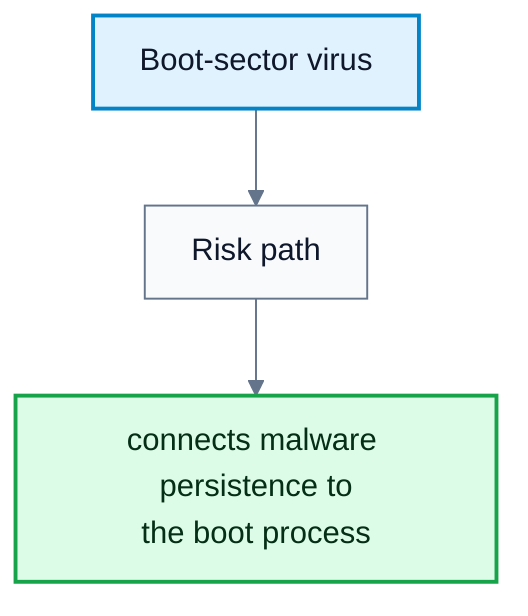

Caption: This diagram connects malware persistence to the boot process.

### Viruses, Worms, Port Scanning, And DoS

#### Definitions

> **Virus**: A self-replicating code fragment embedded in a legitimate program.

> **Virus Dropper**: Software that inserts a virus onto a system.

> **Polymorphic Virus**: A virus that changes its representation to avoid signature detection.

> **Worm**: A standalone program that spreads using network mechanisms.

> **Port Scanning**: Automated attempts to connect to ranges of ports/IPs to identify services and vulnerabilities.

> **Denial of Service (DoS)**: Overloading or disrupting a target so legitimate work cannot proceed.

> **Distributed Denial of Service (DDoS)**: A DoS attack launched from many sites at once.

Viruses may be file/parasitic, boot/memory, macro, source-code, polymorphic, encrypted, stealth, tunneling, multipartite, or armored. Attacks moved from experiments to organized crime, botnets, spam delivery, DDoS, and credential theft.

Network threats are hard because physical boundaries vanish once a system is on the Internet. IP addresses alone are not reliable identity. Attackers use port scanners such as `nmap` or vulnerability tools such as `nessus`, often launched from compromised zombie systems.

DoS can be accidental, such as badly written `fork()` code, or deliberate, such as extortion or punishment. A SYN flood exploits the start of the TCP connection handshake by consuming resources for half-open connections.
### Cryptography: Encryption

#### Definitions

> **Cryptography**: Use of mathematical techniques and secrets to constrain message senders/receivers and create trust relationships.

> **Encryption**: Transforming plaintext into ciphertext so only holders of the key can recover the message.

> **Plaintext**: The original readable message.

> **Ciphertext**: The encrypted message.

> **Key**: Secret or public/private value used by a cryptographic algorithm.

Formally, an encryption algorithm uses:

$$
K=\text{set of keys},\quad M=\text{set of messages},\quad C=\text{set of ciphertexts}
$$

Encryption functions:

$$
E:K\rightarrow(M\rightarrow C)
$$

Decryption functions:

$$
D:K\rightarrow(C\rightarrow M)
$$

Essential property:

$$
\text{Given } c\in C,\ \text{recovering } m \text{ such that } E_k(m)=c \text{ requires } k.
$$

| Encryption Type | Key Use | Examples / Notes |
|---|---|---|
| Symmetric encryption | Same secret key encrypts and decrypts | DES, Triple-DES, AES, RC4 |
| Asymmetric encryption | Public key encrypts, private key decrypts | RSA |

AES uses key sizes $128$, $192$, or $256$ bits and operates on $128$-bit blocks. RC4 is a stream cipher but has known vulnerabilities. Asymmetric encryption is computationally heavier and is usually not used for bulk data.

RSA uses large primes $p$ and $q$:

$$
N=pq
$$

The public exponent $k_e$ and private exponent $k_d$ satisfy:

$$
k_ek_d \bmod ((p-1)(q-1))=1
$$

Encryption:

$$
E_{k_e,N}(m)=m^{k_e}\bmod N
$$

Decryption:

$$
D_{k_d,N}(c)=c^{k_d}\bmod N
$$

Source example:

$$
p=7,\quad q=13,\quad N=91,\quad (p-1)(q-1)=72
$$

Choose:

$$
k_e=5,\quad k_d=29
$$

Public key is $(5,91)$ and private key is $(29,91)$.
### Authentication, Hashing, MACs, And Digital Signatures

#### Definitions

> **Authentication**: Constraining and verifying the potential senders of a message.

> **Authenticator**: A value attached to a message to prove authenticity.

> **Hash Function**: A function producing a small fixed-size message digest from a message.

> **Collision Resistance**: It is infeasible to find distinct messages with the same hash.

> **Message Authentication Code (MAC)**: A cryptographic checksum generated from a message using a secret key.

> **Digital Signature**: An authenticator produced with a private key and verifiable with a public key.

Authentication algorithm components:

$$
K=\text{keys},\quad M=\text{messages},\quad A=\text{authenticators}
$$

Signing/authenticator generation:

$$
S:K\rightarrow(M\rightarrow A)
$$

Verification:

$$
V:K\rightarrow(M\times A\rightarrow\{\text{true},\text{false}\})
$$

Hashes alone are not enough for authentication because an attacker can modify the message and recompute the hash if the hash function is public. A MAC authenticates the hash or message using a secret key.

Digital signatures reverse the RSA-like key use: the private key signs and the public key verifies. For RSA-style signatures:

$$
S_{k_s}(m)=H(m)^{k_s}\bmod N
$$

Verification checks:

$$
V_{k_v}(m,a):\quad a^{k_v}\bmod N=H(m)
$$

Authentication is useful even without confidentiality, such as signed patches. It can also support non-repudiation.
### Key Distribution, Certificates, TLS, And User Authentication

#### Definitions

> **Certificate Authority (CA)**: A trusted party that signs public keys after verifying identity.

> **Digital Certificate**: Proof that a public key belongs to an entity, signed by a trusted party.

> **TLS / SSL**: Transport-layer cryptographic protocol used for secure communication such as HTTPS.

> **Session Key**: A temporary symmetric key used for one communication session.

> **Multi-Factor Authentication**: Authentication requiring two or more factors.

Symmetric key distribution is difficult because both parties need the same secret. Asymmetric public keys are easier to distribute, but still vulnerable to man-in-the-middle substitution unless public keys are certified.

TLS/SSL uses asymmetric cryptography to authenticate the server and establish a symmetric session key. The session then uses symmetric encryption for bulk data because it is faster.

User authentication commonly uses passwords. Good practice includes strong/non-guessable passwords, change history, logging invalid attempts, not logging failed passwords themselves, and preventing unauthorized transfer. Password storage should use one-way hashing plus salt so identical passwords do not produce identical stored values.

One-time passwords, hardware tokens, biometrics, and multi-factor authentication reduce reliance on a single reusable secret.

#### Diagram: Secure communication over insecure medium

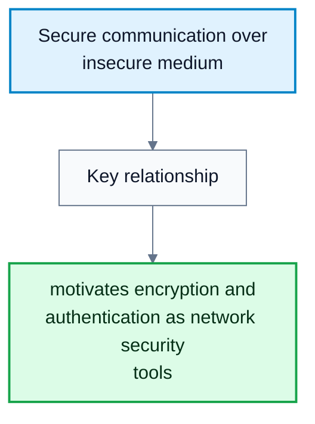

Caption: This diagram motivates encryption and authentication as network security tools.

#### Diagram: Man-in-the-middle on asymmetric cryptography

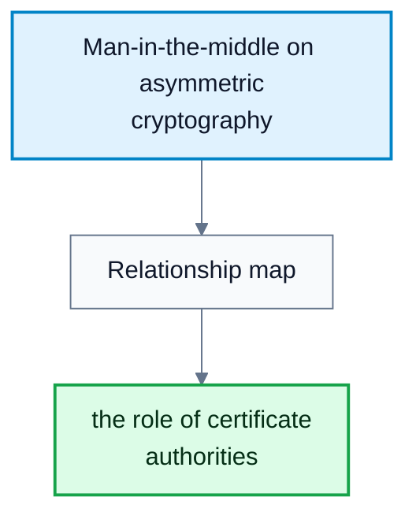

Caption: This explains the role of certificate authorities.

### Implementing Security Defenses

#### Definitions

> **Defense In Depth**: Using multiple security layers rather than relying on one control.

> **Security Policy**: A statement of what is being secured and what rules apply.

> **Vulnerability Assessment**: Comparing the real system state to the desired security policy.

> **Intrusion Detection**: Detecting attempted or successful intrusions.

> **Signature-Based Detection**: Detecting known bad patterns.

> **Anomaly Detection**: Detecting behavior different from normal behavior.

> **Firewall**: A network or host control limiting access between security domains.

Defenses include user education, secure communication, physical protection, reducing attack surface, secure daemon/service configuration, patching, trusted signed software, logging/auditing, antivirus, strong passphrases, intrusion detection, firewalling, vulnerability assessments, and encryption of disks/files.

Firewall types in the source:

| Firewall Type | What It Controls |
|---|---|
| Network firewall | Traffic between trusted and untrusted hosts |
| Personal firewall | Traffic to/from one host |
| Application proxy firewall | Application protocols such as SMTP |
| System-call firewall | Important system calls and possibly their arguments |

Firewalls can be tunneled or spoofed: disallowed protocols can be wrapped inside allowed protocols, and IP/host rules can be evaded if identity is spoofable.

#### Diagram: Four-layered model of security

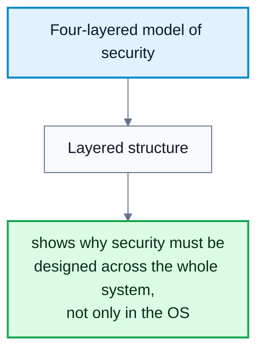

Caption: This diagram shows why security must be designed across the whole system, not only in the OS.

#### Diagram: Firewall domain separation


Caption: This shows how firewalls enforce boundaries between security domains.


### Security Classifications And Windows Example

#### Definitions

> **Security Identifier (SID)**: A unique identifier for a Windows user or group.

> **Access Token**: A Windows object containing a user's SID, group SIDs, and privileges for a process.

> **Security Descriptor**: Windows object metadata describing permissions.

The U.S. Department of Defense classification model:

| Division | Meaning |
|---|---|
| D | Minimal security |
| C | Discretionary protection and auditing; C1/C2 |
| B | C properties plus sensitivity labels; B1/B2/B3 |
| A | Formal design and verification |

Windows security is account-based. Login creates an access token containing the user SID, group SIDs, and special privileges. Each process gets a copy. Objects have security descriptors with permissions, and access checks compare the process token against object security attributes. Later Windows versions add mandatory integrity controls with integrity labels.

---

# Protection

**Subject**: CSC3002F Operating Systems  
**Source**: `Operating Systems 1 Ch17.pdf`, Aslam Safla, pages 1-39  
**Generated**: 2026-06-03

---

## Core Content

### Goals And Principles Of Protection

#### Definitions

> **Protection**: Mechanisms ensuring each object is accessed correctly and only by processes allowed to do so.

> **Object**: A hardware or software resource with a unique name and well-defined operations.

> **Principle Of Least Privilege**: Programs, users, and systems should receive only the privileges required for their tasks.

> **Compartmentalization**: Protecting individual system components using specific permissions and access restrictions.

> **Audit Trail**: A record of protection-oriented activities.

Protection is not the same as security, but it is one of security's core mechanisms. A protection model treats a system as a collection of objects and operations. The protection problem is to ensure only allowed operations occur.

Least privilege can be static or dynamic. Static privilege stays fixed during a process/system lifetime. Dynamic privilege changes as needed through domain switching or privilege escalation. Fine-grained privilege is more protective but more complex; coarse-grained privilege is simpler but grants larger chunks of power.
### Protection Rings And Domains

#### Definitions

> **Protection Ring**: A hierarchical privilege level separating system components.

> **Gate**: A controlled transfer path between protection levels.

> **Domain Of Protection**: A set of access rights defining resources a process may access.

> **Access Right**: Permission to perform operations on an object.

> **Domain Switching**: Changing a process from one protection domain to another.

Rings separate functions by privilege, such as kernel code and user applications. Hardware support is required. Gates, system calls, traps, and interrupts control transfers between levels. Hypervisors and ARM TrustZone add further privilege levels for virtualization and secure functions.

A computer can be treated as processes and objects. A process should access only objects it currently needs. An access right is:

$$
\langle \text{object-name},\ \text{rights-set}\rangle
$$

A domain is a set of access rights:

$$
\text{Domain}=\{\langle O_i,\ R_i\rangle\}
$$

Domains may be associated with users, processes, or procedures. Associations can be static or dynamic.

#### Diagram: Protection rings

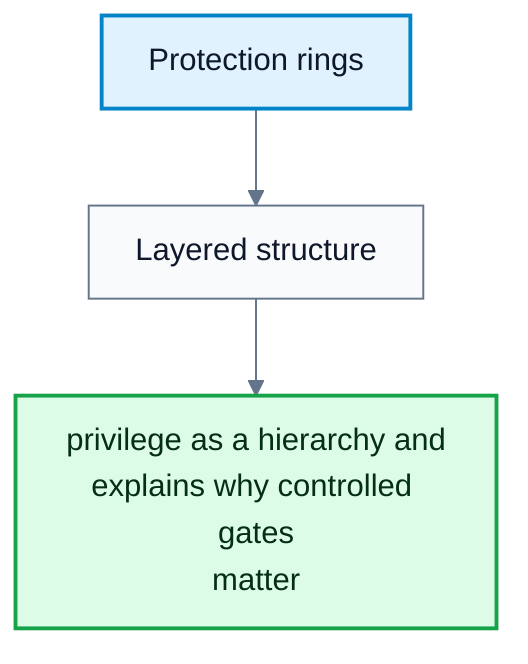

Caption: This shows privilege as a hierarchy and explains why controlled gates matter.

### UNIX And Android Domain Implementations

#### Definitions

> **User ID (UID)**: Identifier representing a user or app domain.

> **setuid Bit**: A UNIX file bit that causes execution under the file owner's user ID.

> **su**: Command that switches to another user's domain after password authentication.

> **sudo**: Command prefix for executing a command in another domain if policy permits.

In UNIX, a domain is often represented by the user ID. Domain switching can happen through setuid execution, `su`, or `sudo`.

Android assigns distinct UIDs/GIDs per application at install time through the `installd` daemon and gives each app a private data directory such as `/data/data/<appname>`. This reuses UNIX user isolation to separate apps. Android extends the model with special GIDs for operations such as networking and isolated UIDs that restrict RPC access.

#### Diagram: Domain and access-right structure

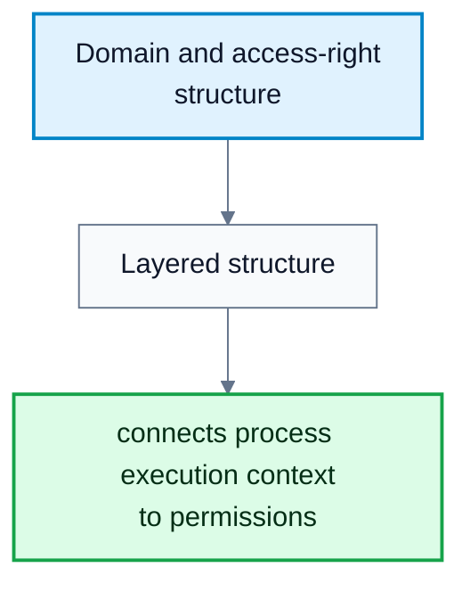

Caption: This diagram connects process execution context to permissions.

### Access Matrix Model

#### Definitions

> **Access Matrix**: A protection model where rows are domains and columns are objects.

> **Owner Right**: A special right allowing a domain to define access rights for an object.

> **Copy Right**: A right allowing a domain to copy an operation right to another domain/object entry.

> **Control Right**: A right allowing a domain to modify another domain's access rights.

> **Transfer Right**: A right allowing switching from one domain to another.

The access matrix entry:

$$
\text{Access}(i,j)
$$

is the set of operations a process executing in domain $D_i$ can invoke on object $O_j$.

If a process in $D_i$ tries operation $\text{op}$ on $O_j$, access is allowed only if:

$$
\text{op}\in \text{Access}(i,j)
$$

The access matrix separates mechanism from policy:

| Aspect | Responsibility |
|---|---|
| Mechanism | OS provides the matrix and enforces rules strictly |
| Policy | User/administrator decides who can access what and in which mode |

The model can express dynamic protection with rights that add/delete/copy/transfer/control access. It does not solve the general confinement problem by itself.
### Implementing The Access Matrix

#### Definitions

> **Global Table**: A table of triples $\langle \text{domain},\text{object},\text{rights-set}\rangle$.

> **Access-Control List (ACL)**: Per-object list of domains and rights.

> **Capability List**: Per-domain list of objects and allowed operations.

> **Capability**: A protected object reference representing permission.

> **Lock-Key Scheme**: A compromise where objects have locks and domains have keys; access succeeds when a key matches a lock.

| Implementation | Strength | Weakness |
|---|---|---|
| Global table | Simple concept | Can be huge and hard to group |
| ACLs | Match user/object administration needs | Per-access checks can be slow; domain rights are non-local |
| Capability lists | Localize rights for a process/domain | Revocation can be inefficient |
| Lock-key | Flexible, easy revocation by changing locks/keys | Requires secure key management |

Most systems combine ACLs and capabilities. First access checks the object's ACL. If allowed, a capability is attached to the process. Later accesses can use the capability without repeated ACL search. When the last access ends, the capability is destroyed.

#### Diagram: Access matrix

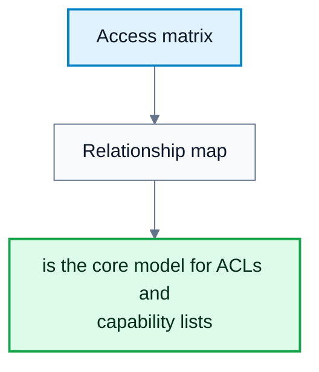

Caption: This diagram is the core model for ACLs and capability lists.

#### Diagram: ACL versus capability list

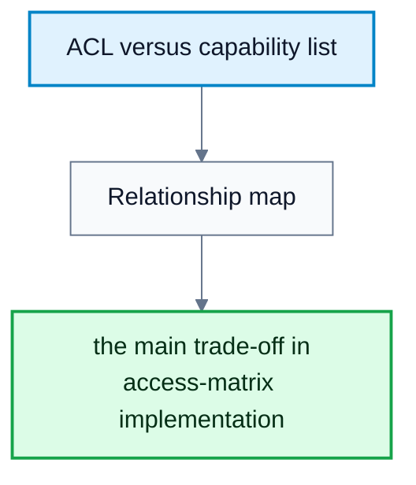

Caption: This explains the main trade-off in access-matrix implementation.

### Revocation, RBAC, MAC, And Capabilities

#### Definitions

> **Revocation**: Removing a domain's access right to an object.

> **Role-Based Access Control (RBAC)**: Access control based on roles assigned to users.

> **Discretionary Access Control (DAC)**: Access control where users/admins set permissions on objects.

> **Mandatory Access Control (MAC)**: Access control enforced by system policy that even root cannot bypass.

> **Label**: Metadata assigned to a subject/object for MAC policy decisions.

Revocation choices:

| Choice | Options |
|---|---|
| Timing | Immediate or delayed |
| Scope | Selective or general |
| Amount | Partial or total |
| Duration | Temporary or permanent |

Revoking ACL entries is straightforward: remove the rights from the object's access list. Revoking capabilities is harder because the system must find all outstanding capabilities. Methods include reacquisition, back-pointers, indirection through a global table, or keys/master keys.

Solaris RBAC assigns privileges to roles and roles to users. A role may be enabled by password to gain its privileges. MAC systems such as Trusted Solaris, TrustedBSD/macOS, SELinux, and Windows integrity controls assign labels to subjects and objects and evaluate policy on each request.

POSIX-style capabilities slice root powers into separate bits, often with permitted, effective, and inheritable sets. This implements least privilege more directly than all-or-nothing root access.

#### Diagram: Revocation by indirection/key

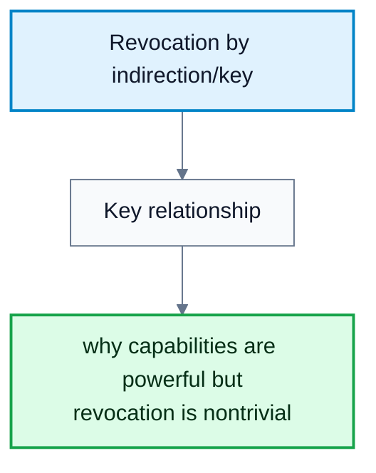

Caption: This shows why capabilities are powerful but revocation is nontrivial.

### Other Protection Improvements And Language-Based Protection

#### Definitions

> **System Integrity Protection (SIP)**: macOS protection restricting access to system files/resources even by root.

> **System-Call Filtering**: Restricting which system calls a process may execute, possibly including argument inspection.

> **Sandboxing**: Running a process in a limited environment with irremovable restrictions.

> **Code Signing**: Signing executable code with a cryptographic hash so modifications invalidate trust.

> **Language-Based Protection**: Enforcing protection policies through programming-language/runtime checks.

SIP restricts changes to protected macOS system resources and requires signed kernel extensions/apps depending on configuration. Linux SECCOMP-BPF provides system-call filtering. Sandboxing limits a process early in startup before it can access resources outside its profile. Code signing makes tampering detectable and can allow vendors to block old or unsafe programs.

Java protection is handled by the JVM. A class receives a protection domain when loaded. If code invokes a privileged operation, stack inspection checks whether the call chain is allowed. Java's load-time and run-time checks enforce type safety, and classes encapsulate data/methods.

#### Diagram: Java stack inspection

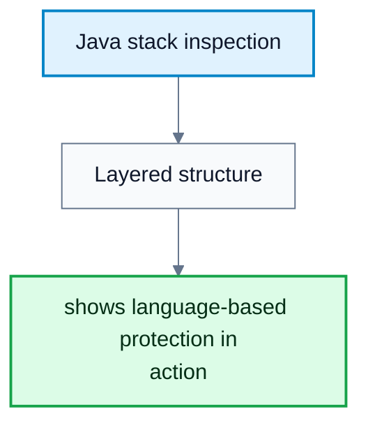

Caption: This diagram shows language-based protection in action.

---

# Processes

**Subject**: CSC3002F Operating Systems  
**Source**: `CSC3002F_MK_1_ProcessConcept.pdf`, Michelle Kuttel, pages 1-67  
**Generated**: 2026-06-03

---

## Core Content

### Programs, Processes, Threads, And The Kernel

#### Definitions

> **Program**: A passive set of instructions stored on disk.

> **Process**: A program in execution, with resources and protection.

> **Thread**: A single path of execution within a process.

> **Kernel**: The core OS component that manages resource access, memory, and process scheduling.

> **System Program**: A program used by the OS but not necessarily part of the kernel.

> **Application Program**: A program not associated with OS operation.

The source's key distinction is:

| Concept | Definition | Own Address Space? | Own Execution State? | Example |
|---|---|---:|---:|---|
| Program | Passive instructions on disk | No | No | `python`, `chrome`, `ls` |
| Process | Program in execution with resources/protection | Yes | Yes | One running Chrome instance |
| Thread | One execution path inside a process | No, shared with same-process threads | Yes | One worker thread inside Chrome |

Threads in the same process share code, heap, global data, and open files. Each thread has its own program counter, registers, and stack.

A modern OS has many processes executing concurrently: kernel/OS processes and user processes. The OS manages process creation, scheduling, termination, and inter-process communication. Web browsers such as Chrome use process-like isolation: one browser process plus many sandboxed content/helper processes, so a tab crash or malicious script is contained better than in a single-process design.


### Process Trees, PIDs, Boot, And Daemons

#### Definitions

> **Process Identifier (PID)**: A unique number used by the OS to identify a process.

> **Parent Process**: A process that creates another process.

> **Child Process**: A process created by a parent.

> **Process Tree**: The parent-child hierarchy of processes.

> **systemd**: The Linux process that is parent/adopter for system processes and usually has PID $1$.

> **launchd**: macOS's PID $1$ style system launcher.

> **Daemon**: A background process that runs without user intervention.

Processes spawn other processes and form a tree. Linux commands for inspecting this include:

| Command | Use |
|---|---|
| `ps -A --forest` | Show processes as a forest/tree |
| `ps -aef` | Show all processes with parent PIDs |
| `pstree` | Show process hierarchy |
| `cat /proc/sys/kernel/pid_max` | Show Linux maximum PID |

During boot:

1. A tiny bootstrap loader starts from firmware/NVM at a fixed location.
2. It initializes basic hardware such as CPU registers, device controllers, and memory.
3. It loads a fuller bootstrap program from boot blocks on a boot/system disk.
4. The full bootstrap program loads the kernel from secondary storage.
5. The kernel mounts the root filesystem and launches the first process, such as `systemd`.
6. That first process launches daemons on behalf of the system or users.

Example daemons:

| Daemon | Purpose |
|---|---|
| `sshd` | Secure remote shell access |
| `httpd` / Apache | Serve web pages and HTTP requests |
| `rsyslogd` | Collect/process/forward system logs |
| `cron` | Run scheduled periodic tasks |

PID allocation is OS-dependent. Linux exposes a maximum through `/proc/sys/kernel/pid_max`; macOS commonly has maximum PID $99998$; Windows has no fixed maximum in the same way and is constrained by word/system limits. PIDs are often allocated sequentially and wrap around, skipping still-used PIDs. Some systems randomize PIDs for security at some performance cost.


### Process Memory Layout And Execution Context

#### Definitions

> **Execution Context**: The state needed to resume a process, including program counter, registers, memory map, and resources.

> **Text Segment**: Compiled program code in memory.

> **Stack**: Memory for function parameters, return addresses, local variables, and temporary data.

> **Heap**: Memory dynamically allocated during runtime.

> **Stack Overflow**: Failure caused when the call stack exceeds its bound.

> **Heap Exhaustion**: Failure caused when dynamic allocation cannot obtain more heap memory.

A process is a program plus execution context. In memory it contains:

| Region / State | Contents |
|---|---|
| Text | Compiled code |
| Current state | Program counter and CPU registers |
| Stack | Function parameters, return addresses, temporary/local data |
| Data | Initialized static and global variables |
| Heap | Dynamically allocated memory |

Stack properties:

- Automatically managed by the system.
- Local variables are deallocated when they go out of scope.
- Usually limited in size and fast to access.
- Lifetime tied to variable scope.
- Deep/infinite recursion can cause stack overflow.

Heap properties:

- Used for dynamic memory allocation.
- Managed manually in C/C++ with `malloc/free` or `new/delete`; garbage collected in Java.
- Usually larger but slower.
- Lifetime independent of variable scope.
- Too many or too-large allocations can cause `OutOfMemoryError` or allocation failure.

Creating many threads can exhaust memory because each thread needs its own execution state and stack.


### Process Control Blocks

#### Definitions

> **Process Table**: OS-maintained list/table of active process records.

> **Process Control Block (PCB)**: Kernel data structure representing one process.

> **Process Group**: A group of related processes that can be signalled together.

Each PCB stores information the kernel needs:

| PCB Field | Purpose |
|---|---|
| Process state | Running, waiting, ready, etc. |
| Program counter | Next instruction location |
| CPU registers | Saved register values |
| CPU scheduling information | Priority and queue pointers |
| Memory-management information | Allocated memory/address-space details |
| Accounting information | CPU used, elapsed time, time limits |
| I/O status information | Allocated devices and open files |

In multithreaded OSes, per-process state and per-thread state are separated. Threads share address space/resources, but each thread has its own execution context. Linux implements the PCB as `task_struct`; Darwin/macOS has analogous structures such as `task`.
### Process Creation With `fork()`

#### Definitions

> **fork()**: UNIX system call that creates a new process by duplicating the calling process.

> **Copy-On-Write**: Optimization where parent and child initially share physical memory pages until one writes.

> **Ready Queue**: Queue of processes in memory that are ready to execute.

`fork()` creates a new PCB, initializes kernel resources from the parent, gives the child a new PID, initializes its program counter to the same point, creates a new address space initially copied from the parent, and places the child PCB on the ready queue.

`fork()` "returns twice":

| In Which Process? | Return Value |
|---|---|
| Parent | Child's PID |
| Child | $0$ |
| Error | $-1$ |

After ```fork()```:

- Parent and child have the same code after the fork.
- They have different return values from `fork()`.
- They have different PIDs.
- They usually share open files unless changed.
- Their address spaces are logically separate, often implemented with copy-on-write.
- They run concurrently in unspecified order.

If a program calls `fork()` twice without conditional control, the number of processes can double each time. With $k$ unconditional forks:

$$
\text{number of processes}=2^k
$$
### Program Replacement With `exec()`

#### Definitions

> **exec()**: UNIX system call family that replaces the current process's memory image with a new program.

> **Program Image**: The loaded memory representation of a program.

`exec()` is commonly used after `fork()`:

1. Parent calls `fork()`.
2. Child receives return value $0$.
3. Child calls `exec()` to replace itself with another program.
4. Parent may call `waitpid()` to wait for the child.

Important: `exec()` does not create a process. It wipes the calling process's old program image and loads a new one. The PID stays the same.

UNIX separates creation and program loading (`fork()` then `exec()`). Windows typically combines both in `CreateProcess`.
### Running Processes, States, Context Switches, And Queues

#### Definitions

> **New/Created State**: The process is being created.

> **Running State**: The process's instructions are executing on a processor.

> **Waiting State**: The process waits for an event such as I/O completion.

> **Ready State**: The process is in memory and waiting for a processor.

> **Terminated State**: The process has finished execution.

> **Context Switch**: Saving one process's context and loading another's.

Only one process can run on a given processor at any instant. A process moves among new, ready, running, waiting, and terminated states as it executes.

Context switch steps:

*1*. Save current process state into its PCB.
*2*. Decide which process should run next.
*3*. Load the new process state from its PCB.

Context switching is overhead: the system does no direct user work while switching. Typical speed is several microseconds, depending on hardware support and PCB complexity.

Queues:

| Queue | Contents |
|---|---|
| Job queue | All processes in the system |
| Ready queue | Processes in main memory, ready and waiting to execute |
| Device queue | Processes waiting for a particular I/O device |

Queueing diagrams use circles for resources, arrows for flow, and queues for waiting processes.


### Mobile OS Process Management

#### Definitions

> **Foreground App**: The app directly interacting with the user.

> **Background Service**: Work performed without a user interface, especially on Android.

Mobile systems require sophisticated resource management, multitasking, security, and failure isolation.

| System | Background Policy | Strength |
|---|---|---|
| iOS | Strongly restricts background execution; limited categories such as audio, VoIP, location | Battery life, predictable performance, security |
| Android | More flexible background work through services | Customizability and flexibility |
### Inter-Process Communication

#### Definitions

> **Independent Process**: A process that does not share data with other processes.

> **Cooperating Process**: A process that communicates with other processes.

> **Inter-Process Communication (IPC)**: OS-supported communication between processes.

> **Shared Memory**: IPC where processes read/write a shared memory region.

> **Pipe**: A unidirectional transient data channel between two processes.

> **Message Passing**: IPC where processes explicitly send and receive messages.

> **Socket**: Endpoint for bidirectional communication on the same machine or across a network.

> **Remote Procedure Call (RPC)**: Calling a function in another process/machine as if it were local.

Reasons for cooperation include information sharing, computation speedup through parallelization, and modularity.

| IPC Model | Strength | Caution |
|---|---|---|
| Shared memory | Fast | Requires synchronization |
| Pipes | Simple one-way process connection, common in shell pipelines | Usually transient/unidirectional |
| Message passing | Isolation-friendly and can be sync/async | More OS/channel overhead |
| Sockets | Same-machine or network communication, client-server systems | Requires addressing/port management |
| RPC | Makes remote communication look local | Failures/latency still exist despite local-looking call |

Example shell pipeline:

```sh
cat file1.txt | sort
```

Here `cat` writes to one end of a pipe and `sort` reads from the other.
### Process Termination, Orphans, And Zombies

#### Definitions

> **Normal Exit**: Process termination after executing its last statement or calling `exit()`.

> **Abnormal Termination**: Process termination due to error, exception, signal, or forced stop.

> **Orphan Process**: A child process whose parent terminates first.

> **Zombie Process**: A child process that has terminated but whose parent has not yet collected its exit status.

> **Reaping**: Collecting a terminated child's exit status and allowing its PCB/PID entry to be removed.

When a process exits, its resources such as memory, open files, and I/O buffers are deallocated and reclaimed. However, a terminated child is not fully removed until its parent or adopting process reaps it with `wait()` or `waitpid()`.

The OS keeps zombies so that:

1. The parent can still obtain the child's exit status.
2. The child's PID is not reused before the parent waits.
3. The parent does not accidentally wait for a different process with a recycled PID.

A parent may terminate a child because the child exceeded resources, the assigned task is no longer needed, or the parent is exiting and the OS does not allow the child to continue.

---

# Process Scheduling

**Subject**: CSC3002F Operating Systems  
**Source**: `CSC3002F_MK_2_ProcessScheduling_v3.pdf`, Michelle Kuttel, pages 1-52  
**Generated**: 2026-06-03

---

## Core Content

### Scheduling Basics, Bursts, And Preemption

#### Definitions

> **Processor Scheduling Policy**: The rule deciding which runnable thread/process runs next.

> **Ready Queue**: The collection of schedulable tasks/threads ready to execute.

> **CPU Burst**: A period during which a process/thread uses the CPU before blocking or yielding.

> **I/O-Bound Process**: A process with many short CPU bursts and frequent I/O waits.

> **CPU-Bound Process**: A process with few long CPU bursts.

> **Preemptive Scheduling**: Scheduling where the OS can take the CPU away from a running process.

> **Non-Preemptive / Cooperative Scheduling**: Scheduling where a process keeps the CPU until it blocks, yields, or terminates.

Modern OSes schedule kernel-level threads, but the slides use "process scheduling" and "thread scheduling" interchangeably.

The ready queue can be implemented as:

| Ready Queue Structure | Example Use |
|---|---|
| FIFO queue | FCFS/RR style algorithms |
| Priority queue | Windows-style priority scheduling |
| Tree | Linux CFS uses red-black trees |
| Unordered linked list | Simple conceptual queue |

Scheduling may occur when a process changes:

1. Running $\rightarrow$ waiting, such as I/O start.
2. Running $\rightarrow$ ready, such as timer interrupt/preemption.
3. Waiting $\rightarrow$ ready, such as I/O completion.
4. Running $\rightarrow$ terminated.

If scheduling happens only in cases 1 and 4, it is non-preemptive. Modern OS scheduling is preemptive, which improves responsiveness but introduces concurrency hazards because shared data can be interrupted mid-update.


### Context Switches And Scheduling Criteria

#### Definitions

> **Voluntary Context Switch**: A switch where a process gives up the CPU because it needs an unavailable resource.

> **Nonvoluntary Context Switch**: A switch where the CPU is taken from a process, such as time-slice expiry or higher-priority preemption.

> **CPU Utilization**: Fraction of time the CPU is busy.

> **Throughput**: Number of processes completed per unit time.

> **Turnaround Time**: Time from process submission to completion.

> **Waiting Time**: Total time a process spends waiting in the ready queue.

> **Response Time**: Time from request submission until first response.

> **Starvation**: Indefinite waiting because a process is continually denied CPU/resource access.

Linux reports context switches through tools such as `vmstat` and `/proc/<pid>/status`. The `/proc` status file can include `voluntary_ctxt_switches` and `nonvoluntary_ctxt_switches`.

Scheduling criteria:

| Criterion | Goal |
|---|---|
| CPU utilization | Maximize |
| Throughput | Maximize |
| Turnaround time | Minimize |
| Waiting time | Minimize |
| Response time | Minimize, especially for interactive systems |
| Fairness | Give runnable tasks reasonable CPU share |
| Starvation freedom / bounded waiting | No task waits forever |
| Predictability / low jitter | Keep response-time variation low |
| Scheduler overhead | Keep scheduling/context-switch cost low |

Interactive systems may prefer predictable response time over the absolute lowest average response time.
### Evaluating Scheduling Algorithms

#### Definitions

> **Deterministic Evaluation**: Comparing algorithms on a fixed scenario with exact numbers.

> **Queueing Model**: Probabilistic performance model based on arrival and service rates.

> **Simulation**: Programmed model generating arrivals, bursts, and departures to measure an algorithm.

> **Little's Law**: In steady state, average queue length equals arrival rate times average waiting time.

Little's Law:

$$
L=\lambda W
$$

where:

| Symbol | Meaning |
|---|---|
| $L$ | Average queue length |
| $\lambda$ | Average arrival rate |
| $W$ | Average waiting time in queue/system |

Example:

$$
\lambda=2\ \text{customers/minute},\quad W=5\ \text{minutes}
$$

$$
L=2\times5=10
$$
### First-Come, First-Served (FCFS)

#### Definitions

> **First-Come, First-Served (FCFS)**: Non-preemptive scheduling where the process at the head of the FIFO ready queue runs next.

> **Convoy Effect**: Short processes wait behind a long process, hurting response and utilization.

FCFS uses a FIFO queue. Arriving process PCBs are added to the end; the process at the head gets the CPU.

| Property | FCFS |
|---|---|
| Preemptive? | No |
| Strength | Simple and fair by arrival order |
| Weakness | Long average waiting/response time; convoy effect |

Example from the source:

| Process | Burst |
|---|---:|
| $P_1$ | $24$ |
| $P_2$ | $3$ |
| $P_3$ | $3$ |

If arrival order is $P_1,P_2,P_3$, waiting times are:

$$
W_{P_1}=0,\quad W_{P_2}=24,\quad W_{P_3}=27
$$

$$
\text{average waiting time}=\frac{0+24+27}{3}=17
$$

If arrival order is $P_2,P_3,P_1$:

$$
W_{P_2}=0,\quad W_{P_3}=3,\quad W_{P_1}=6
$$

$$
\text{average waiting time}=\frac{0+3+6}{3}=3
$$

Same burst times, different arrival order, very different waiting time.
### Shortest-Job-First (SJF) And Shortest-Remaining-Time-First

#### Definitions

> **Shortest-Job-First (SJF)**: Scheduling that chooses the process with the shortest next CPU burst.

> **Shortest-Remaining-Time-First (SRTF)**: Preemptive SJF where a newly arrived shorter remaining burst can preempt the current process.

> **Exponential Averaging**: Predicting the next CPU burst from the previous actual burst and previous prediction.

SJF is provably optimal for minimum average waiting time for a fixed set of processes if exact next CPU bursts are known. Exact implementation is impossible because the OS cannot know the future burst length. It predicts.

Prediction formula:

$$
\tau_{n+1}=\alpha t_n+(1-\alpha)\tau_n
$$

where:

| Symbol | Meaning |
|---|---|
| $\tau_{n+1}$ | Predicted next CPU burst |
| $t_n$ | Actual most recent CPU burst |
| $\tau_n$ | Previous prediction |
| $\alpha$ | Weighting factor, often $0.5$ |

Expanded:

$$
\tau_{n+1}=\alpha t_n+(1-\alpha)\alpha t_{n-1}+\cdots+(1-\alpha)^{n+1}\tau_0
$$

If $\alpha=0$, recent bursts are ignored. If $\alpha=1$, only the most recent actual burst counts.

Source SJF example:

| Process | Burst |
|---|---:|
| $P_1$ | $6$ |
| $P_2$ | $8$ |
| $P_3$ | $7$ |
| $P_4$ | $3$ |

SJF order: $P_4,P_1,P_3,P_2$. Waiting times:

$$
W_{P_4}=0,\quad W_{P_1}=3,\quad W_{P_3}=9,\quad W_{P_2}=16
$$

$$
\text{average waiting time}=\frac{0+3+9+16}{4}=7
$$

SJF can be preemptive or non-preemptive. With arrivals:

| Process | Arrival | Burst |
|---|---:|---:|
| $P_1$ | $0$ | $8$ |
| $P_2$ | $1$ | $4$ |
| $P_3$ | $2$ | $9$ |
| $P_4$ | $3$ | $5$ |

The source gives preemptive SJF average waiting time:

$$
\frac{(10-1)+(1-1)+(17-2)+(5-3)}{4}=6.5
$$

and compares non-preemptive SJF at $7.75$ and FCFS at $8.75$.


### Round-Robin (RR)

#### Definitions

> **Round-Robin (RR)**: Preemptive scheduling where each process receives up to one time quantum, then returns to the end of the ready queue if unfinished.

> **Time Quantum**: The maximum CPU time slice a process receives before preemption.

RR is like FCFS with preemption. The ready queue is treated as circular. A timer interrupt fires every quantum. If a CPU burst finishes before the quantum, the process voluntarily releases the CPU.

For $N$ ready processes and time quantum $q$, each process gets approximately:

$$
\frac{1}{N}
$$

of CPU time in chunks of at most $q$ time units.

Quantum trade-off:

| Quantum Size | Effect |
|---|---|
| Very large | RR approaches FCFS |
| Very small | Too many context switches; overhead high |
| Good practical value | Large relative to context-switch time and often larger than most CPU bursts |

Rule of thumb from the source: about $80\%$ of CPU bursts should be shorter than the time quantum.

Source RR example with $q=4$:

| Process | Burst |
|---|---:|
| $P_1$ | $24$ |
| $P_2$ | $3$ |
| $P_3$ | $3$ |

Waiting times from the source visualization:

$$
W_{P_1}=6,\quad W_{P_2}=4,\quad W_{P_3}=7
$$

$$
\text{average waiting time}=\frac{6+4+7}{3}=\frac{17}{3}=5.66
$$

RR often improves response time but may have higher waiting/turnaround time than SJF.


### Priority, Multilevel Queue, And Multilevel Feedback Queue

#### Definitions

> **Priority Scheduling**: Scheduling where each process has a priority and the highest-priority process runs next.

> **Aging**: Gradually increasing a waiting process's priority to prevent starvation.

> **Multilevel Queue Scheduling**: Scheduling with separate queues for classes or priorities, where a process stays in its assigned queue.

> **Multilevel Feedback Queue Scheduling**: Scheduling where processes can move between queues based on behavior.

Priority scheduling can be preemptive or non-preemptive. Priorities may be internal, such as predicted burst, memory needs, I/O behavior, or job type; or external, such as user importance. SJF is a form of priority scheduling where priority is inverse predicted next CPU burst length.

Problem: starvation. Solution: aging.

Multilevel queues can partition by priority or process type, such as foreground and background. Each queue may have its own algorithm, e.g. foreground RR and background FCFS. Scheduling between queues can be fixed-priority or time-sliced, e.g. $80\%$ CPU to foreground and $20\%$ to background.

Multilevel feedback queues allow upgrading and demoting:

| Parameter | Meaning |
|---|---|
| Number of queues | How many levels exist |
| Algorithm per queue | RR, FCFS, etc. |
| Upgrade rule | When long-waiting lower-priority tasks move up |
| Demotion rule | When CPU-heavy tasks move down |
| Entry rule | Which queue a new task enters |

Summary comparison from the source:

| Algorithm | Preemptive? | Strength | Weakness |
|---|---|---|---|
| FCFS | No | Simple, fair by arrival | Poor response time |
| SJF | Either | Best average waiting time | Needs burst prediction |
| RR | Yes | Good responsiveness | More overhead |
| Priority | Either | Expresses importance | Starvation |
| Multilevel queue | Usually mixed | Supports workload classes | Starvation |


### Linux Completely Fair Scheduler (CFS)

#### Definitions

> **Completely Fair Scheduler (CFS)**: Linux scheduler that allocates CPU proportionally using virtual runtime rather than a fixed time quantum.

> **Scheduling Class**: A category of tasks with a priority ordering.

> **Nice Value**: Linux user-visible priority adjustment from $-20$ to $+19$, where lower is higher priority.

> **Targeted Latency**: Time interval in which every runnable task should run at least once.

> **Virtual Runtime (`vruntime`)**: Runtime scaled by task weight/nice value.

> **Red-Black Tree**: A self-balancing binary search tree.

Standard Linux kernels have a default scheduling class and a higher-priority real-time scheduling class. The scheduler picks a task from the highest-priority class first.

CFS does not use a traditional fixed time quantum. It computes a share of CPU time from targeted latency and each task's nice-derived weight. For nice $0$:

$$
\text{vruntime}=\text{actual runtime}
$$

Higher-priority tasks accumulate `vruntime` more slowly; lower-priority tasks accumulate it faster. CFS stores runnable tasks in a red-black tree keyed by `vruntime` and picks the leftmost node, the task with smallest virtual runtime.


### Multicore Scheduling, SMT, Load Balancing, And Affinity

#### Definitions

> **Multicore Processor**: A chip with multiple computing cores.

> **Asymmetric Multiprocessing**: One processor handles scheduling/I/O/system activities while others run user code.

> **Symmetric Multiprocessing (SMP)**: Each processor is self-scheduling.

> **Memory Stall**: Time a processor waits for memory data.

> **Chip Multithreading (CMT)**: Hardware supports multiple hardware threads per core so another can run during stalls.

> **Simultaneous Multithreading (SMT)**: A form of CMT where one core can run multiple hardware threads at once, such as Intel Hyper-Threading.

> **Load Balancing**: Moving work so processors have approximately equal load.

> **Processor Affinity**: Keeping a thread on the same processor/core to preserve cache locality.

> **Non-Uniform Memory Access (NUMA)**: Architecture where memory access time depends on which processor/socket owns the memory.

SMP may use one global ready queue or per-core run queues. A global queue is simpler but risks lock contention and races: two CPUs must not choose the same thread or lose a queued thread. Per-core queues scale better and preserve cache locality, but require load balancing.

Load-balancing approaches:

| Approach | Meaning |
|---|---|
| Push migration | A supervisor moves tasks from overloaded CPUs to idle/less-busy CPUs |
| Pull migration | An idle CPU takes work from a busy CPU |

Linux CFS uses both and is NUMA-aware. It defines scheduling domains and NUMA nodes, balancing within domains first and migrating across NUMA nodes mainly under severe imbalance.

Thread load combines priority and average CPU utilization. A high-priority I/O-bound thread can have low load; a low-priority CPU-bound thread can have similar load. Queue load is the sum of thread loads in the queue.

---

# Process Synchronization

**Subject**: CSC3002F Operating Systems  
**Source**: `CSC3002F_MK_3_ProcessSynchronization_v2.pdf`, Michelle Kuttel, pages 1-68  
**Generated**: 2026-06-03

---

## Core Content

### Concurrency, Races, And Synchronization Constraints

#### Definitions

> **Concurrent Events**: Events where we cannot tell which will happen first.

> **Race Condition**: Correctness depends on timing or interleaving.

> **Data Race**: Unsynchronized concurrent access to the same memory location, with at least one write.

> **Synchronization Constraint**: A requirement about the order of events or access to shared state.

> **Mutual Exclusion**: A constraint that only one thread/process may execute a critical section at a time.

> **Atomic Operation**: An operation that executes indivisibly, with no visible intermediate state.

Operating systems are highly concurrent. Multiple processes/threads may interact with shared memory, run at arbitrary speeds, and suffer unpredictable delays from cache misses, page faults, and scheduler preemption. Maintaining data consistency requires synchronization mechanisms supplied by hardware, the OS, and programming languages.

The programmer is responsible for specifying the needed constraints; the compiler cannot infer which interleavings are allowed.

Synchronization constraints in the source:

| Constraint | Meaning |
|---|---|
| Signaling | Event $a_1$ must happen before event $b_1$ |
| Rendezvous | $a_1$ before $b_2$ and $b_1$ before $a_2$ |
| Barrier | All threads wait until all arrive |
| Reusable barrier | Barrier can be used more than once |
| Mutex | Critical section has one thread at a time |
| Multiplex | Critical section permits at most $n$ threads |


### Liveness Problems

#### Definitions

> **Liveness**: The requirement that processes/threads eventually make progress.

> **Deadlock**: Two or more threads permanently wait for each other, so none progresses.

> **Starvation**: A thread waits indefinitely because others keep getting the resource.

> **Livelock**: Threads keep changing state in response to each other but make no useful progress.

Key distinction:

| Problem | System Activity | Progress? |
|---|---|---|
| Deadlock | Threads stuck/inactive | No one in the cycle progresses |
| Starvation | Other threads may progress | One thread is continually denied |
| Livelock | Threads keep running/changing state | No useful progress |

Synchronization often fixes safety problems but can introduce liveness problems.
### Classic Synchronization Problems

#### Definitions

> **Producer-Consumer / Bounded Buffer Problem**: Producers add items to a buffer and consumers remove them, while respecting empty/full and mutual-exclusion constraints.

> **Readers-Writers Problem**: Many readers may read shared data concurrently, but writers need exclusive access.

> **Dining Philosophers Problem**: Philosophers need two neighboring chopsticks to eat, illustrating deadlock/starvation risks.

Producer-consumer constraints:

1. The shared buffer must be protected with mutual exclusion.
2. Consumers cannot consume from an empty buffer.
3. Producers cannot add to a full bounded buffer.

Readers-writers constraints:

| Requirement | Meaning |
|---|---|
| Concurrent readers allowed | Many readers may be in the critical section |
| Writer exclusion | A writer must be alone |
| Policy variants | Reader preference, writer preference, or fair/no-starvation |

Dining philosophers illustrates how each philosopher can hold one chopstick while waiting for another, creating deadlock. Deadlock freedom alone does not imply starvation freedom.


### Hardware Atomic Instructions

#### Definitions

> **test-and-set()**: Atomic instruction that reads a Boolean and sets it to true in one indivisible action.

> **compare-and-swap() (CAS)**: Atomic instruction that changes a value only if it still equals an expected value.

> **Atomic Variable**: A variable whose updates are guaranteed atomic.

Hardware atomic instructions are the base for locks and other synchronization tools.

Conceptual `test_and_set`:

```c
boolean test_and_set(boolean *target) {
    boolean rv = *target;
    *target = true;
    return rv;
}
```

Spinlock with `test_and_set`:

```c
do {
    while (test_and_set(&lock))
        ; // spin

    // critical section

    lock = false;

    // remainder section
} while (true);
```

Conceptual CAS:

```c
int compare_and_swap(int *value, int expected, int new_value) {
    int temp = *value;
    if (*value == expected)
        *value = new_value;
    return temp;
}
```

CAS spinlock:

```c
while (true) {
    while (compare_and_swap(&lock, 0, 1) != 0)
        ; // spin

    // critical section

    lock = 0;

    // remainder section
}
```

Atomic variables solve atomic updates of a single variable, but do not automatically protect compound invariants across multiple variables.
### Mutex Locks And Spinlocks

#### Definitions

> **Mutex Lock**: A lock that enforces mutual exclusion with `acquire()` and `release()`.

> **Spinlock**: A lock where waiting threads busy-wait until the lock is available.

> **Busy Waiting**: Repeatedly checking a condition until it changes.

> **Contended Lock**: A lock where at least one thread blocks or waits trying to acquire it.

Conceptual mutex:

```c
acquire() {
    while (!available)
        ; // busy wait
    available = false;
}

release() {
    available = true;
}
```

Real `acquire()` and `release()` must be atomic, usually implemented with hardware atomic instructions.

Busy waiting trade-off:

| Disadvantage | Advantage |
|---|---|
| Wastes CPU cycles | Avoids context-switch overhead |

Spinlocks are useful on multiprocessor systems when a lock is held for less than about two context switches. One core can spin while another core quickly exits the critical section. High lock contention reduces overall concurrent performance.
### Semaphores

#### Definitions

> **Semaphore**: An integer synchronization variable accessed only through atomic `wait()` and `signal()` operations.

> **wait() / P() / acquire()**: Semaphore operation that decrements or waits for a permit.

> **signal() / V() / release()**: Semaphore operation that increments and may wake a waiter.

> **Binary Semaphore**: Semaphore restricted to values $0$ and $1$.

> **Counting Semaphore**: Semaphore with an unrestricted integer value.

Naive semaphore concept:

```c
wait(S) {
    while (S <= 0)
        ; // busy wait
    S = S - 1;
}

signal(S) {
    S = S + 1;
}
```

Practical OS/Java semaphores usually block waiting threads rather than spin. The original semaphore definition does not allow reading the current value, although Java exposes some introspection.

Semaphore meanings:

| Value | Meaning |
|---:|---|
| Positive | Number of permits available |
| Zero | No permits; waiters block |

For a multiplex allowing at most $n$ threads, initialize the semaphore to $n$.

Implementation without busy waiting uses:

| Operation | Meaning |
|---|---|
| `block()` | Place invoking process on semaphore waiting queue |
| `wakeup(P)` | Remove a process from waiting queue and place it in ready queue |
### Semaphores For Signaling, Rendezvous, Barriers, And Producer-Consumer

#### Definitions

> **Circular Buffer**: Buffer with logical pointers `in` and `out` that wrap around modulo the buffer size.

> **Full Slot Semaphore**: Semaphore counting occupied buffer slots.

> **Empty Slot Semaphore**: Semaphore counting free buffer slots.

Signaling with semaphore initialized to $0$:

```text
Thread A:           Thread B:
a1                  wait(sem)
signal(sem)         b1
```

This forces $a_1$ before $b_1$.

Producer-consumer semaphore solution:

```c
// Shared:
// mutex = 1, full = 0, empty = n

producer:
while (true) {
    produce item;
    wait(empty);
    wait(mutex);
    add item to buffer;
    signal(mutex);
    signal(full);
}

consumer:
while (true) {
    wait(full);
    wait(mutex);
    remove item from buffer;
    signal(mutex);
    signal(empty);
    consume item;
}
```

| Semaphore | Initial Value | Purpose |
|---|---:|---|
| `mutex` | $1$ | Mutual exclusion on buffer structure |
| `full` | $0$ | Number of full slots |
| `empty` | $n$ | Number of empty slots |

Order matters. A producer must wait for an empty slot before entering the buffer update, then signal full after insertion. A consumer must wait for full before entering the buffer update, then signal empty after removal.


### Readers-Writers And Starvation

#### Definitions

> **Reader Preference**: Readers are not kept waiting unless a writer already has permission to write.

> **Writer Preference**: Once a writer is ready, it writes as soon as possible.

> **Lightswitch Pattern**: A pattern where the first entrant locks a shared resource and the last leaver unlocks it.

Reader-preference semaphore solution:

```c
// shared:
// rw_mutex = 1
// mutex = 1
// read_count = 0

writer:
while (true) {
    wait(rw_mutex);
    write;
    signal(rw_mutex);
}

reader:
while (true) {
    wait(mutex);
    read_count++;
    if (read_count == 1)
        wait(rw_mutex);
    signal(mutex);

    read;

    wait(mutex);
    read_count--;
    if (read_count == 0)
        signal(rw_mutex);
    signal(mutex);
}
```

This allows concurrent readers and writer exclusion, but writers may starve if readers keep arriving. A fair solution needs queueing or fair semaphore behavior so a hungry writer or reader cannot be postponed forever.


### Dining Philosophers

#### Definitions

> **Deadlock Freedom**: Guarantee that the system cannot reach a state where all relevant threads are permanently stuck.

> **Starvation Freedom**: Guarantee that every waiting/hungry thread eventually gets a turn.

Naive dining philosophers:

```c
do {
    wait(chopstick[i]);
    wait(chopstick[(i + 1) % 5]);

    eat;

    signal(chopstick[i]);
    signal(chopstick[(i + 1) % 5]);

    think;
} while (true);
```

Problem: if every philosopher picks up one chopstick and waits for the next, the system deadlocks.

Standard deadlock-avoidance solutions:

1. Allow at most $4$ philosophers at the table simultaneously.
2. Allow a philosopher to pick up chopsticks only if both are available, with pickup inside a critical section.
3. Use an asymmetric ordering: odd philosophers pick left then right; even philosophers pick right then left.

However, many deadlock-free solutions can still starve a philosopher. Starvation freedom requires fairness, such as queueing philosophers or fair semaphores.
### Common Semaphore Errors

Incorrect semaphore use can cause subtle timing bugs:

| Error | Result |
|---|---|
| Inverting `wait(mutex)` and `signal(mutex)` | Critical-section violation |
| Replacing `signal(mutex)` with `wait(mutex)` | Deadlock |
| Omitting `wait(mutex)` | Mutual-exclusion violation |
| Omitting `signal(mutex)` | Deadlock or permanent blocking |

Semaphores are powerful but low-level, so higher-level constructs such as monitors were created to reduce misuse.
### Monitors, Condition Variables, And Java Synchronization

#### Definitions

> **Monitor**: A high-level synchronization abstraction where internal variables are accessed only through monitor procedures and only one process is active in the monitor at a time.

> **Condition Variable**: A synchronization variable supporting `wait()` and `signal()`/notification for condition-based waiting.

> **Entry Set**: Java object set of threads waiting to acquire the object's lock.

> **Wait Set**: Java object set of threads that called `wait()` on the object.

Monitor structure:

```text
monitor monitor-name {
    shared variable declarations

    procedure P1(...) { ... }
    ...
    procedure Pn(...) { ... }

    initialization code(...) { ... }
}
```

Condition variable operations:

| Operation | Meaning |
|---|---|
| `x.wait()` | Suspend until signalled |
| `x.signal()` | Resume one waiting process, if any |

In Java:

- Every object has an intrinsic lock.
- A `synchronized` method requires the caller to own that object's lock.
- A thread calling `wait()` releases the lock, becomes blocked, and enters the object's wait set.
- A thread calling `notify()` moves an arbitrary waiting thread from wait set to entry set and marks it runnable.
- The awakened thread must reacquire the lock before continuing.

When using `wait()`, always check the condition in a loop:

```java
while (counter == 0) {
    this.wait();
}
```

Reasons:

1. Spurious wakeups can occur.
2. Another thread may change the state before the awakened thread reacquires the lock.

Java also provides atomic variables, semaphores, reentrant locks, condition variables, monitors, and concurrent collections. In practice, use well-tested concurrent data structures such as `BlockingQueue` when they match the problem.


### Linux Synchronization

#### Definitions

> **Fully Preemptive Kernel**: A kernel that can be preempted, creating potential kernel-level race conditions.

> **Reader-Writer Lock**: A lock allowing multiple readers or one writer.

Linux provides semaphores, atomic integers (`atomic_t`), mutex locks, spinlocks, and reader-writer versions of locks. Since Linux is fully preemptive, synchronization is required inside the kernel as well as in user programs.

---

# Deadlock

**Subject**: CSC3002F Operating Systems  
**Source**: `CSC3002F_MK_4_Deadlock_v2.pdf`, Michelle Kuttel, pages 1-71  
**Generated**: 2026-06-03

---

## Core Content

### Correctness Properties And Deadlock Definition

#### Definitions

> **Safety Property**: A property that must always be true.

> **Liveness Property**: A property that must eventually become true.

> **Deadlock**: A set of threads/processes is deadlocked when every member waits for an event that can be caused only by another member of the set.

> **Resource**: A finite system item used by processes/threads, such as CPU cycles, files, I/O devices, locks, semaphores, memory, disk blocks, or buffer space.

Deadlock is broader than locks and condition variables. It can happen anywhere a thread waits for an event that cannot happen because of a cycle of waiting for resources. Resources include locks, memory, processing time, disk blocks, buffer slots, files, and I/O devices.

A process/thread uses a resource in this sequence:

1. Request.
2. Use.
3. Release.

Testing may not discover deadlock because deadlock can depend on unlucky interleavings or particular workloads. Systems should be designed to be deadlock-free or to handle deadlock deliberately.


### Four Necessary Conditions

#### Definitions

> **Mutual Exclusion**: At least one resource can be used by only one process at a time.

> **Hold And Wait**: A process holds at least one resource while waiting to acquire additional resources held by others.

> **No Preemption**: A resource can be released only voluntarily by the process holding it.

> **Circular Wait**: A cycle of processes exists where each waits for a resource held by the next process in the cycle.

All four conditions must hold simultaneously for deadlock:

| Condition | Why It Matters |
|---|---|
| Mutual exclusion | If every resource were shareable, waiting for exclusive access would not arise |
| Hold and wait | If processes never held while waiting, cycles are harder to form |
| No preemption | If resources could be forcibly taken, a wait could be broken |
| Circular wait | The actual cycle that prevents progress |

Formal circular wait:

$$
P_0\rightarrow P_1\rightarrow \cdots \rightarrow P_n\rightarrow P_0
$$

where $P_i$ waits for a resource held by the next process.
### Resource-Allocation Graphs

#### Definitions

> **Resource-Allocation Graph (RAG)**: Directed graph with process nodes, resource-type nodes, request edges, and assignment edges.

> **Request Edge**: Edge $P_i \rightarrow R_j$ showing process $P_i$ is waiting for resource $R_j$.

> **Assignment Edge**: Edge $R_j \rightarrow P_i$ showing an instance of resource $R_j$ is allocated to process $P_i$.

<svg width="100%" viewBox="0 0 520 420" role="img">
<title>Resource-Allocation Graph</title>
<defs>
  <marker id="arr" viewBox="0 0 10 10" refX="8" refY="5" markerWidth="6" markerHeight="6" orient="auto-start-reverse">
    <path d="M2 1L8 5L2 9" fill="none" stroke="context-stroke" stroke-width="1.5" stroke-linecap="round" stroke-linejoin="round"/>
  </marker>
</defs>
<rect x="120" y="20" width="44" height="36" rx="3" fill="none" stroke="#888" stroke-width="1.4"/>
<circle cx="132" cy="36" r="4" fill="#888"/>
<circle cx="152" cy="36" r="4" fill="#888"/>
<text x="142" y="68" text-anchor="middle" font-size="12" fill="#888" font-family="sans-serif">R₁</text>
<text x="142" y="82" text-anchor="middle" font-size="10" fill="#4a90d9" font-family="sans-serif">(resource type)</text>
<rect x="310" y="20" width="44" height="36" rx="3" fill="none" stroke="#888" stroke-width="1.4"/>
<circle cx="322" cy="36" r="4" fill="#888"/>
<circle cx="342" cy="36" r="4" fill="#888"/>
<text x="332" y="68" text-anchor="middle" font-size="12" fill="#888" font-family="sans-serif">R₃</text>
<circle cx="142" cy="170" r="22" fill="none" stroke="#4a90d9" stroke-width="1.4"/>
<text x="142" y="175" text-anchor="middle" font-size="12" fill="#888" font-family="sans-serif">P₁</text>
<text x="80" y="175" text-anchor="middle" font-size="10" fill="#4a90d9" font-family="sans-serif">(process)</text>
<circle cx="262" cy="170" r="22" fill="none" stroke="#4a90d9" stroke-width="1.4"/>
<text x="262" y="175" text-anchor="middle" font-size="12" fill="#888" font-family="sans-serif">P₂</text>
<circle cx="370" cy="170" r="22" fill="none" stroke="#4a90d9" stroke-width="1.4"/>
<text x="370" y="175" text-anchor="middle" font-size="12" fill="#888" font-family="sans-serif">P₃</text>
<rect x="218" y="270" width="44" height="44" rx="3" fill="none" stroke="#888" stroke-width="1.4"/>
<circle cx="230" cy="285" r="4" fill="#888"/>
<circle cx="250" cy="285" r="4" fill="#888"/>
<circle cx="230" cy="303" r="4" fill="#888"/>
<circle cx="250" cy="303" r="4" fill="#888"/>
<text x="240" y="328" text-anchor="middle" font-size="12" fill="#888" font-family="sans-serif">R₂</text>
<text x="240" y="342" text-anchor="middle" font-size="10" fill="#4a90d9" font-family="sans-serif">(multiple instances)</text>
<rect x="350" y="270" width="44" height="44" rx="3" fill="none" stroke="#888" stroke-width="1.4"/>
<circle cx="372" cy="292" r="4" fill="#888"/>
<circle cx="372" cy="308" r="4" fill="#888"/>
<text x="372" y="328" text-anchor="middle" font-size="12" fill="#888" font-family="sans-serif">R₄</text>
<line x1="136" y1="56" x2="142" y2="146" stroke="#888" stroke-width="1.2" marker-end="url(#arr)"/>
<line x1="155" y1="56" x2="248" y2="152" stroke="#888" stroke-width="1.2" marker-end="url(#arr)"/>
<line x1="338" y1="56" x2="374" y2="148" stroke="#888" stroke-width="1.2" marker-end="url(#arr)"/>
<line x1="152" y1="188" x2="222" y2="268" stroke="#888" stroke-width="1.2" marker-end="url(#arr)"/>
<line x1="256" y1="192" x2="248" y2="268" stroke="#888" stroke-width="1.2" marker-end="url(#arr)"/>
<line x1="262" y1="270" x2="268" y2="194" stroke="#888" stroke-width="1.2" marker-end="url(#arr)"/>
<line x1="378" y1="192" x2="378" y2="268" stroke="#888" stroke-width="1.2" marker-end="url(#arr)"/>
<line x1="278" y1="155" x2="308" y2="48" stroke="#888" stroke-width="1.2" marker-end="url(#arr)"/>
<line x1="30" y1="375" x2="70" y2="375" stroke="#888" stroke-width="1.2" marker-end="url(#arr)"/>
<text x="78" y="379" font-size="10" fill="#888" font-family="sans-serif">request edge  (P to R)</text>
<line x1="270" y1="375" x2="310" y2="375" stroke="#888" stroke-width="1.2" marker-end="url(#arr)"/>
<text x="318" y="379" font-size="10" fill="#888" font-family="sans-serif">assignment edge  (R to P)</text>
<circle cx="41" cy="395" r="8" fill="none" stroke="#4a90d9" stroke-width="1.2"/>
<text x="78" y="399" font-size="10" fill="#888" font-family="sans-serif">process (circle)</text>
<rect x="262" y="387" width="16" height="16" rx="2" fill="none" stroke="#888" stroke-width="1.2"/>
<circle cx="267" cy="392" r="2.5" fill="#888"/>
<circle cx="273" cy="392" r="2.5" fill="#888"/>
<circle cx="267" cy="398" r="2.5" fill="#888"/>
<circle cx="273" cy="398" r="2.5" fill="#888"/>
<text x="286" y="399" font-size="10" fill="#888" font-family="sans-serif">resource type (dots = instances)</text>
</svg>

The graph has vertices:

$$
V=P\cup R
$$

where:

$$
P=\{P_1,P_2,\ldots,P_n\}
$$

is the set of processes and:

$$
R=\{R_1,R_2,\ldots,R_m\}
$$

is the set of resource types.

Rules:

1. When a process requests a resource, insert request edge $P_i\rightarrow R_j$.
2. When request is fulfilled, transform it into assignment edge $R_j\rightarrow P_i$.
3. When process releases the resource, delete the assignment edge.

Cycle interpretation:

| Graph State | Meaning |
|---|---|
| No cycle | No deadlock |
| Cycle and one instance per resource type | Deadlock exists |
| Cycle and multiple instances per resource type | Deadlock is possible but not guaranteed |

For multiple instances, a cycle may be broken if another instance becomes available from outside the cycle.


### Safe & DeadLock graphs


<svg width="100%" viewBox="0 0 680 480" role="img">
<title>Resource Allocation Graph – Safe State</title>
<defs>
  <marker id="arr" viewBox="0 0 10 10" refX="8" refY="5" markerWidth="6" markerHeight="6" orient="auto-start-reverse">
    <path d="M2 1L8 5L2 9" fill="none" stroke="context-stroke" stroke-width="1.5" stroke-linecap="round" stroke-linejoin="round"/>
  </marker>
</defs>
<text x="340" y="28" text-anchor="middle" font-size="13" font-weight="bold" fill="#ffffff" font-family="sans-serif">Example 1 — safe state</text>
<text x="340" y="44" text-anchor="middle" font-size="10" fill="#4a90d9" font-family="sans-serif">R1 has 2 instances · R2 has 1 instance · Available: R1=1, R2=0</text>
<rect x="185" y="60" width="110" height="50" rx="4" fill="none" stroke="#ffffff" stroke-width="1.4"/>
<circle cx="220" cy="85" r="5" fill="#ffffff"/>
<circle cx="260" cy="85" r="5" fill="#ffffff"/>
<text x="240" y="124" text-anchor="middle" font-size="12" fill="#ffffff" font-family="sans-serif">R1</text>
<text x="240" y="138" text-anchor="middle" font-size="10" fill="#4a90d9" font-family="sans-serif">(2 instances)</text>
<rect x="430" y="60" width="110" height="50" rx="4" fill="none" stroke="#ffffff" stroke-width="1.4"/>
<circle cx="485" cy="85" r="5" fill="#ffffff"/>
<text x="485" y="124" text-anchor="middle" font-size="12" fill="#ffffff" font-family="sans-serif">R2</text>
<text x="485" y="138" text-anchor="middle" font-size="10" fill="#4a90d9" font-family="sans-serif">(1 instance)</text>
<circle cx="100" cy="300" r="30" fill="none" stroke="#4a90d9" stroke-width="1.4"/>
<text x="100" y="305" text-anchor="middle" font-size="12" fill="#ffffff" font-family="sans-serif">P1</text>
<circle cx="310" cy="380" r="30" fill="none" stroke="#4a90d9" stroke-width="1.4"/>
<text x="310" y="385" text-anchor="middle" font-size="12" fill="#ffffff" font-family="sans-serif">P2</text>
<circle cx="520" cy="300" r="30" fill="none" stroke="#4a90d9" stroke-width="1.4"/>
<text x="520" y="305" text-anchor="middle" font-size="12" fill="#ffffff" font-family="sans-serif">P3</text>
<line x1="208" y1="110" x2="116" y2="272" stroke="#ffffff" stroke-width="1.2" marker-end="url(#arr)"/>
<line x1="262" y1="110" x2="298" y2="351" stroke="#ffffff" stroke-width="1.2" marker-end="url(#arr)"/>
<line x1="462" y1="110" x2="514" y2="271" stroke="#ffffff" stroke-width="1.2" marker-end="url(#arr)"/>
<line x1="126" y1="280" x2="428" y2="100" stroke="#ffffff" stroke-width="1.2" stroke-dasharray="6 3" marker-end="url(#arr)"/>
<line x1="494" y1="275" x2="297" y2="110" stroke="#ffffff" stroke-width="1.2" stroke-dasharray="6 3" marker-end="url(#arr)"/>
<text x="36" y="194" text-anchor="middle" font-size="10" fill="#4a90d9" font-family="sans-serif">holds R1,</text>
<text x="36" y="206" text-anchor="middle" font-size="10" fill="#4a90d9" font-family="sans-serif">wants R2</text>
<text x="310" y="430" text-anchor="middle" font-size="10" fill="#4a90d9" font-family="sans-serif">holds R1, no requests</text>
<text x="594" y="194" text-anchor="middle" font-size="10" fill="#4a90d9" font-family="sans-serif">holds R2,</text>
<text x="594" y="206" text-anchor="middle" font-size="10" fill="#4a90d9" font-family="sans-serif">wants R1</text>
<line x1="30" y1="455" x2="65" y2="455" stroke="#ffffff" stroke-width="1.2" marker-end="url(#arr)"/>
<text x="72" y="459" font-size="10" fill="#ffffff" font-family="sans-serif">assignment edge (R to P)</text>
<line x1="340" y1="455" x2="375" y2="455" stroke="#ffffff" stroke-width="1.2" stroke-dasharray="6 3" marker-end="url(#arr)"/>
<text x="382" y="459" font-size="10" fill="#ffffff" font-family="sans-serif">request edge (P to R)</text>
</svg>


<svg width="100%" viewBox="0 0 680 490" role="img">
<title>Resource Allocation Graph – Deadlock</title>
<defs>
  <marker id="arr" viewBox="0 0 10 10" refX="8" refY="5" markerWidth="6" markerHeight="6" orient="auto-start-reverse">
    <path d="M2 1L8 5L2 9" fill="none" stroke="context-stroke" stroke-width="1.5" stroke-linecap="round" stroke-linejoin="round"/>
  </marker>
</defs>
<text x="340" y="28" text-anchor="middle" font-size="13" font-weight="bold" fill="#ffffff" font-family="sans-serif">Example 2 — deadlock</text>
<text x="340" y="44" text-anchor="middle" font-size="10" fill="#4a90d9" font-family="sans-serif">R1 and R2 each have 1 instance · Available: R1=0, R2=0</text>
<rect x="185" y="60" width="110" height="50" rx="4" fill="none" stroke="#ffffff" stroke-width="1.4"/>
<circle cx="240" cy="85" r="5" fill="#ffffff"/>
<text x="240" y="124" text-anchor="middle" font-size="12" fill="#ffffff" font-family="sans-serif">R1</text>
<rect x="430" y="60" width="110" height="50" rx="4" fill="none" stroke="#ffffff" stroke-width="1.4"/>
<circle cx="485" cy="85" r="5" fill="#ffffff"/>
<text x="485" y="124" text-anchor="middle" font-size="12" fill="#ffffff" font-family="sans-serif">R2</text>
<circle cx="100" cy="300" r="30" fill="none" stroke="#e05c5c" stroke-width="1.8"/>
<text x="100" y="305" text-anchor="middle" font-size="12" fill="#e05c5c" font-family="sans-serif">P1</text>
<circle cx="380" cy="390" r="30" fill="none" stroke="#e05c5c" stroke-width="1.8"/>
<text x="380" y="395" text-anchor="middle" font-size="12" fill="#e05c5c" font-family="sans-serif">P2</text>
<circle cx="580" cy="300" r="30" fill="none" stroke="#4a90d9" stroke-width="1.4"/>
<text x="580" y="305" text-anchor="middle" font-size="12" fill="#ffffff" font-family="sans-serif">P3</text>
<line x1="213" y1="110" x2="118" y2="272" stroke="#e05c5c" stroke-width="1.6" marker-end="url(#arr)"/>
<line x1="126" y1="278" x2="428" y2="98" stroke="#e05c5c" stroke-width="1.6" stroke-dasharray="6 3" marker-end="url(#arr)"/>
<line x1="460" y1="110" x2="394" y2="361" stroke="#e05c5c" stroke-width="1.6" marker-end="url(#arr)"/>
<line x1="354" y1="367" x2="270" y2="110" stroke="#e05c5c" stroke-width="1.6" stroke-dasharray="6 3" marker-end="url(#arr)"/>
<line x1="554" y1="275" x2="542" y2="112" stroke="#ffffff" stroke-width="1.2" stroke-dasharray="6 3" marker-end="url(#arr)"/>
<text x="210" y="295" text-anchor="middle" font-size="11" fill="#e05c5c" font-family="sans-serif">Cycle!</text>
<text x="210" y="310" text-anchor="middle" font-size="10" fill="#e05c5c" font-family="sans-serif">P1 ↔ P2 deadlocked</text>
<text x="580" y="346" text-anchor="middle" font-size="10" fill="#4a90d9" font-family="sans-serif">P3 waits for R2</text>
<text x="580" y="360" text-anchor="middle" font-size="10" fill="#4a90d9" font-family="sans-serif">also stuck (victim)</text>
<line x1="30" y1="445" x2="65" y2="445" stroke="#e05c5c" stroke-width="1.6" marker-end="url(#arr)"/>
<text x="72" y="449" font-size="10" fill="#ffffff" font-family="sans-serif">assignment edge (in cycle)</text>
<line x1="30" y1="462" x2="65" y2="462" stroke="#e05c5c" stroke-width="1.6" stroke-dasharray="6 3" marker-end="url(#arr)"/>
<text x="72" y="466" font-size="10" fill="#ffffff" font-family="sans-serif">request edge (in cycle)</text>
<line x1="370" y1="445" x2="405" y2="445" stroke="#ffffff" stroke-width="1.2" stroke-dasharray="6 3" marker-end="url(#arr)"/>
<text x="412" y="449" font-size="10" fill="#ffffff" font-family="sans-serif">request edge (not in cycle)</text>
<text x="340" y="480" text-anchor="middle" font-size="10" fill="#ffffff" font-family="sans-serif">No process can run — R1 and R2 fully assigned. P1, P2, P3 all deadlocked.</text>
</svg>


<svg width="100%" viewBox="0 0 680 480" role="img">
<title>Resource Allocation Graph – exam question</title>
<defs>
  <marker id="arr" viewBox="0 0 10 10" refX="8" refY="5" markerWidth="6" markerHeight="6" orient="auto-start-reverse">
    <path d="M2 1L8 5L2 9" fill="none" stroke="context-stroke" stroke-width="1.5" stroke-linecap="round" stroke-linejoin="round"/>
  </marker>
</defs>
<circle cx="100" cy="240" r="28" fill="none" stroke="#ffffff" stroke-width="1.4"/>
<text x="100" y="245" text-anchor="middle" font-size="12" fill="#ffffff" font-family="sans-serif">T₁</text>
<circle cx="580" cy="140" r="28" fill="none" stroke="#ffffff" stroke-width="1.4"/>
<text x="580" y="145" text-anchor="middle" font-size="12" fill="#ffffff" font-family="sans-serif">T₂</text>
<circle cx="370" cy="180" r="28" fill="none" stroke="#ffffff" stroke-width="1.4"/>
<text x="370" y="185" text-anchor="middle" font-size="12" fill="#ffffff" font-family="sans-serif">T₃</text>
<circle cx="370" cy="340" r="28" fill="none" stroke="#ffffff" stroke-width="1.4"/>
<text x="370" y="345" text-anchor="middle" font-size="12" fill="#ffffff" font-family="sans-serif">T₄</text>
<rect x="210" y="60" width="44" height="44" rx="3" fill="none" stroke="#ffffff" stroke-width="1.4"/>
<circle cx="232" cy="82" r="5" fill="#ffffff"/>
<text x="232" y="52" text-anchor="middle" font-size="12" fill="#ffffff" font-family="sans-serif">R₁</text>
<rect x="210" y="215" width="44" height="44" rx="3" fill="none" stroke="#ffffff" stroke-width="1.4"/>
<circle cx="222" cy="232" r="5" fill="#ffffff"/>
<circle cx="242" cy="248" r="5" fill="#ffffff"/>
<text x="232" y="208" text-anchor="middle" font-size="12" fill="#ffffff" font-family="sans-serif">R₂</text>
<rect x="210" y="360" width="44" height="44" rx="3" fill="none" stroke="#ffffff" stroke-width="1.4"/>
<circle cx="232" cy="382" r="5" fill="#ffffff"/>
<text x="232" y="353" text-anchor="middle" font-size="12" fill="#ffffff" font-family="sans-serif">R₃</text>
<rect x="460" y="270" width="44" height="44" rx="3" fill="none" stroke="#ffffff" stroke-width="1.4"/>
<circle cx="472" cy="287" r="5" fill="#ffffff"/>
<circle cx="492" cy="303" r="5" fill="#ffffff"/>
<text x="482" y="263" text-anchor="middle" font-size="12" fill="#ffffff" font-family="sans-serif">R₄</text>
<rect x="460" y="115" width="44" height="44" rx="3" fill="none" stroke="#ffffff" stroke-width="1.4"/>
<circle cx="482" cy="137" r="5" fill="#ffffff"/>
<text x="482" y="108" text-anchor="middle" font-size="12" fill="#ffffff" font-family="sans-serif">R₅</text>
<line x1="120" y1="218" x2="220" y2="104" stroke="#4a90d9" stroke-width="1.2" marker-end="url(#arr)"/>
<line x1="128" y1="240" x2="210" y2="240" stroke="#4a90d9" stroke-width="1.2" marker-end="url(#arr)"/>
<line x1="120" y1="262" x2="220" y2="368" stroke="#4a90d9" stroke-width="1.2" marker-end="url(#arr)"/>
<line x1="254" y1="82" x2="342" y2="164" stroke="#ffffff" stroke-width="1.2" marker-end="url(#arr)"/>
<line x1="248" y1="222" x2="342" y2="188" stroke="#ffffff" stroke-width="1.2" marker-end="url(#arr)"/>
<line x1="248" y1="248" x2="342" y2="332" stroke="#ffffff" stroke-width="1.2" marker-end="url(#arr)"/>
<line x1="254" y1="374" x2="342" y2="354" stroke="#ffffff" stroke-width="1.2" marker-end="url(#arr)"/>
<line x1="466" y1="278" x2="398" y2="200" stroke="#ffffff" stroke-width="1.2" marker-end="url(#arr)"/>
<line x1="466" y1="300" x2="398" y2="336" stroke="#ffffff" stroke-width="1.2" marker-end="url(#arr)"/>
<line x1="460" y1="137" x2="398" y2="170" stroke="#ffffff" stroke-width="1.2" marker-end="url(#arr)"/>
<line x1="552" y1="140" x2="504" y2="139" stroke="#4a90d9" stroke-width="1.2" marker-end="url(#arr)"/>
<line x1="30" y1="450" x2="65" y2="450" stroke="#ffffff" stroke-width="1.2" marker-end="url(#arr)"/>
<text x="72" y="454" font-size="10" fill="#ffffff" font-family="sans-serif">assignment (R to T)</text>
<line x1="260" y1="450" x2="295" y2="450" stroke="#4a90d9" stroke-width="1.2" marker-end="url(#arr)"/>
<text x="302" y="454" font-size="10" fill="#4a90d9" font-family="sans-serif">request (T to R)</text>
<text x="340" y="472" text-anchor="middle" font-size="10" fill="#4a90d9" font-family="sans-serif">No deadlock — safe order: T₃ → T₂ → T₄ → T₁</text>
</svg>


### Handling Deadlocks

#### Definitions

> **Deadlock Prevention**: Structuring the system so at least one necessary deadlock condition cannot hold.

> **Deadlock Avoidance**: Dynamically deciding whether resource requests are safe before granting them.

> **Deadlock Detection**: Allowing deadlock to occur, then finding it.

> **Deadlock Recovery**: Breaking a detected deadlock.

Possible strategies:

| Strategy | Idea | Example |
|---|---|---|
| Ignore | Pretend deadlocks never occur | Common in Windows/Linux for many user-level deadlocks |
| Prevent | Ensure one necessary condition cannot hold | Resource ordering to break circular wait |
| Avoid | Stay out of unsafe states | Banker's Algorithm |
| Detect and recover | Allow, detect, then recover | Databases and transaction systems |

Undetected deadlock is bad because resources remain held by processes that cannot run, more processes block behind them, and eventually the system may stop functioning until manual restart.

Many general-purpose OSes do not solve all deadlocks globally because complete prevention/avoidance can reduce utilization, require advance information, and add overhead. They rely heavily on kernel/application developers to design correctly.
### Deadlock Prevention

#### Definitions

> **Resource Ordering**: Assigning a global order to resources and requiring all processes acquire resources in increasing order.

To prevent deadlock, break at least one necessary condition:

| Condition | Can We Remove It? | Notes |
|---|---|---|
| Mutual exclusion | Generally no | Safety often requires exclusive access |
| Hold and wait | Sometimes, but impractical | Low resource utilization and starvation risk |
| No preemption | Impractical for many resources | Some resources cannot safely be taken away |
| Circular wait | Often practical | Use global resource ordering |

Resource ordering example from the source: if a hash table has per-bucket locks and an operation moves an item from bucket $k_1$ to bucket $k_2$, always acquire the lower-numbered bucket lock before the higher-numbered one. Then no circular wait can form because all waits move in the same global direction.


### Deadlock Avoidance And Safe States

#### Definitions

> **Deadlock Avoidance**: Ensuring the system never enters an unsafe state by using advance resource-request information.

> **Safe State**: A state where there exists an order in which all processes can finish.

> **Unsafe State**: A state where no safe sequence is guaranteed.

> **Safe Sequence**: An ordering of all processes such that each can obtain needed resources from currently available resources plus resources released by earlier processes.

A state is safe if there exists:

$$
\langle P_1,P_2,\ldots,P_n\rangle
$$

such that for each $P_i$, its remaining resource needs can be satisfied by:

$$
\text{Available}+\sum_{j<i}\text{Allocation}_{P_j}
$$

If $P_i$ cannot be satisfied immediately, it can wait until all earlier $P_j$ finish and release resources. If the system is safe, no deadlock occurs. If unsafe, deadlock is possible.

Avoidance rule:

1. A process requests a currently available resource.
2. The system pretends to grant it.
3. The system checks whether the resulting state is safe.
4. If safe, grant; if unsafe, make the process wait and restore old state.

This can lower resource utilization because an available resource may still be withheld.


### Resource-Allocation Graph Avoidance

#### Definitions

> **Claim Edge**: Dashed edge $P_i\rightarrow R_j$ showing that process $P_i$ may request resource $R_j$ in the future.

For a single instance of each resource type, avoidance can use a RAG variant with claim edges:

1. Each process declares maximum resource use in advance.
2. Claim edge converts to request edge when the process requests the resource.
3. Request edge converts to assignment edge when resource is allocated.
4. Assignment edge reconverts to claim edge on release.

Granting rule:

$$
\text{grant request only if converting request edge to assignment edge creates no cycle}
$$

Cycle detection costs about:

$$
O(n^2)
$$

where $n$ is the number of threads/processes.
### Banker's Algorithm: Data Structures

#### Definitions

> **Banker's Algorithm**: Deadlock-avoidance algorithm for multiple instances of resource types using declared maximum demands.

> **Available Vector**: Vector of currently available instances for each resource type.

> **Max Matrix**: Matrix of each process's maximum declared demand for each resource type.

> **Allocation Matrix**: Matrix of current allocation to each process.

> **Need Matrix**: Matrix of remaining possible need for each process.

For $n$ threads/processes and $m$ resource types:

| Structure | Size | Meaning |
|---|---:|---|
| `Available` | $m$ | `Available[j] = k` means $k$ instances of $R_j$ are free |
| `Max` | $n\times m$ | `Max[i,j] = k` means $P_i$ may request at most $k$ of $R_j$ |
| `Allocation` | $n\times m$ | `Allocation[i,j] = k` means $P_i$ currently holds $k$ of $R_j$ |
| `Need` | $n\times m$ | `Need[i,j] = k` means $P_i$ may need $k$ more of $R_j$ |

Core formula:

$$
\text{Need}[i,j]=\text{Max}[i,j]-\text{Allocation}[i,j]
$$

The algorithm assumes each process declares maximum resource needs in advance and returns resources in finite time after receiving what it needs.
### Banker's Algorithm: Safety Check

To determine whether a state is safe:

1. Initialize:

$$
\text{Work}=\text{Available}
$$

$$
\text{Finish}[i]=\text{false}\quad\text{for all }i
$$

2. Find an $i$ such that:

$$
\text{Finish}[i]=\text{false}
$$

and:

$$
\text{Need}_i\le \text{Work}
$$

where comparison is componentwise.

3. If found, pretend $P_i$ finishes:

$$
\text{Work}=\text{Work}+\text{Allocation}_i
$$

$$
\text{Finish}[i]=\text{true}
$$

Then go back to step 2.

4. If all `Finish[i]` are true, the system is safe. Otherwise it is unsafe.

Time complexity is on the order of:

$$
O(mn^2)
$$
### Banker's Algorithm: Resource-Request Check

#### Definitions

> **Request Vector**: Vector `Request_i` where `Request_i[j] = k` means process $P_i$ asks for $k$ instances of $R_j$.

For a request by process $P_i$:

1. Check that the process did not exceed its declared maximum:

$$
\text{Request}_i\le \text{Need}_i
$$

If false, raise an error.

2. Check that resources are currently available:

$$
\text{Request}_i\le \text{Available}
$$

If false, $P_i$ must wait.

3. Pretend to allocate:

$$
\text{Available}=\text{Available}-\text{Request}_i
$$

$$
\text{Allocation}_i=\text{Allocation}_i+\text{Request}_i
$$

$$
\text{Need}_i=\text{Need}_i-\text{Request}_i
$$

4. Run the safety check.

5. If safe, grant. If unsafe, restore old state and make $P_i$ wait.
### Detection And Recovery

#### Definitions

> **Wait-For Graph**: Graph containing process nodes only, with $P_i\rightarrow P_j$ if $P_i$ waits for $P_j$.

> **Victim**: Process selected to abort or roll back during recovery.

> **Rollback**: Returning a process/system to a previous safe state.

> **Transaction**: Operation sequence that either commits completely or aborts as if it did not happen.

For single-instance resources, detection can maintain a wait-for graph and periodically search for cycles. A cycle means deadlock. Cycle search is about:

$$
O(n^2)
$$

For multiple-instance resources, detection uses an algorithm similar to Banker's Algorithm, costing about:

$$
O(mn^2)
$$

Recovery options:

| Option | Description |
|---|---|
| Abort all deadlocked processes | Fast but expensive/disruptive |
| Abort one at a time | Repeat until cycle eliminated |
| Rollback | Return selected victims to a safe checkpoint |
| Restart | Restart victim process after rollback/abort |

Victim selection should minimize cost. Cost may include priority, work done, resources held, resources still needed, and number of previous rollbacks. If the same process is always selected, recovery itself can cause starvation.

Transactions in file systems and databases support recovery because they can abort/roll back cleanly. The source's Amazon-style example illustrates timeout-based design: if inventory server is unavailable, the frontend can complete/queue the order and send an apology later rather than hang indefinitely.

Java does not provide explicit deadlock detection support, but a thread dump can help analyze a running program. Command:

```sh
jstack -l <pid>
```

shows thread states and locking information, including which locks blocked threads are waiting to acquire.
