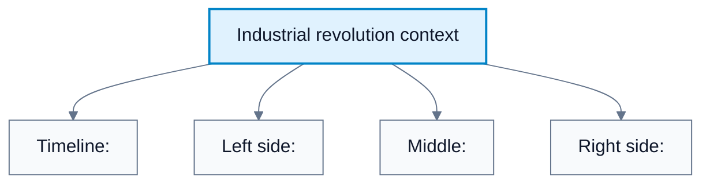
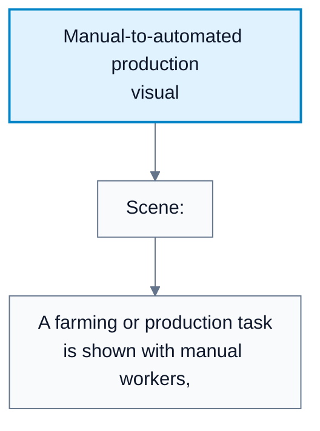
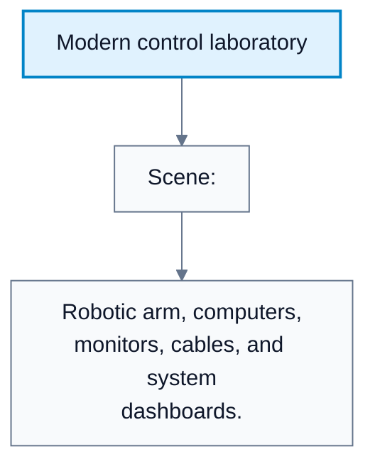
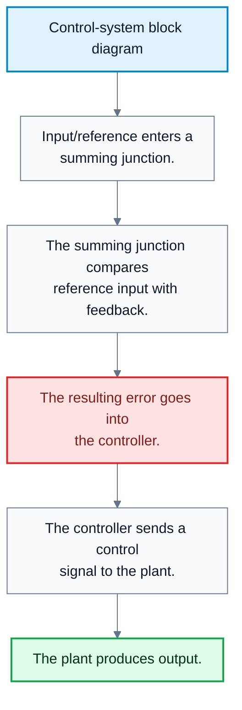
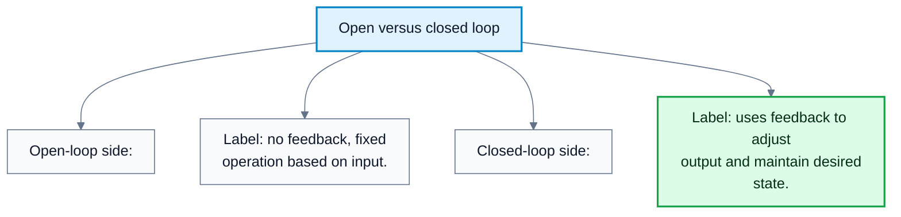

# Control Systems Introduction

**Subject**: CSC3041F Automated Planning  
**Source**: `Control/CSC3041F_Control_Lecture1.pdf`, Krupa Prag, slides 1-10  
**Generated**: 2026-06-01

---

## Core Content

### Why Control Matters

#### Definitions

> **Automation**: The use of machines or systems to perform tasks with reduced direct human intervention. *In plain language: a system does work by following designed mechanisms or rules instead of needing a person to act at every step.*

> **Control**: The act of managing, commanding, directing, or regulating a system's behaviour to achieve a desired output. *In plain language: control is about making a system do what we want.*

The lecture opens by placing control systems in a historical and technological context. The visual sequence moves from manual labour, through industrial mechanisation, to modern automated and AI-assisted systems. The point is that automation did not begin with modern AI. It grew from the same engineering goal that control systems address: make a physical or computational process produce a desired output reliably.

The industrial-revolution visuals show the transition from manual labour to machine-driven production. The modern-lab visuals show controlled robotic arms, automated guided vehicles, dashboards, sensors, and AI-enhanced production systems. These examples motivate why control is a core topic for automated planning: planning chooses what should happen, while control is concerned with making the system actually behave as intended.

#### Diagram: Industrial revolution context

Caption: The slide motivates control by showing the move from manual work to machine-driven systems that require regulation and coordination.

#### Diagram: Manual-to-automated production visual

Caption: Automation reduces direct human effort, but the machine still needs control to produce the desired result reliably.

#### Diagram: Modern control laboratory

Caption: Modern control systems combine sensors, computation, actuators, and software to regulate physical processes.

### Control Systems

#### Definitions

> **Control System**: A system that manages, commands, or regulates the behaviour of devices or systems using control loops to achieve a desired output. *In plain language: a control system pushes a process toward a target outcome.*

> **Input**: The reference or command given to a control system. *In plain language: what the system is asked to achieve.*

> **Output**: The controlled variable produced by the system. *In plain language: what the system actually does or produces.*

> **Plant**: The physical process or system being controlled. *In plain language: the thing we are trying to influence.*

> **Controller**: The mechanism or algorithm that decides what action to apply to the plant. *In plain language: the decision-making part of the control system.*

> **Feedback**: Information about the output returned to the input side of the control loop. *In plain language: the system checks what happened and uses that information to adjust.*

> **Sensor**: The component that measures the current state or output of the plant. *In plain language: the measuring device.*

The basic control-system idea is:

1. There is a target or reference input.
2. The controller decides what command should be sent.
3. The plant or system responds.
4. The output is measured or observed.
5. In feedback control, the measured output is compared against the desired output.

The core feedback-control relationship is:

$$
e(t)=r(t)-y(t)
$$

where:

| Symbol | Meaning |
|---|---|
| $r(t)$ | Reference input or desired output at time $t$ |
| $y(t)$ | Measured output at time $t$ |
| $e(t)$ | Error at time $t$ |

The controller's job is to choose a control action that reduces the error:

$$
e(t)\to 0
$$

#### Diagram: Control-system block diagram

Caption: A feedback control loop uses measured output to reduce the difference between desired and actual behaviour.

### Open-Loop And Closed-Loop Control

#### Definitions

> **Open-Loop Control System**: A control system with no feedback; it performs a fixed operation based on the input. *In plain language: it acts without checking whether the result was correct.*

> **Closed-Loop Control System**: A control system that uses feedback to adjust the output and maintain a desired state. *In plain language: it checks the result and corrects itself.*

> **Set-Point**: The desired target value for a controlled variable. *In plain language: the value we want the system to reach or maintain.*

The lecture introduces the main classification using examples.

| Feature | Open-Loop Control | Closed-Loop Control |
|---|---|---|
| Feedback | No feedback | Uses feedback |
| Operation | Fixed action based on input | Adjusts action based on measured output |
| Error correction | Cannot correct errors while operating | Can reduce error using feedback |
| Example from slides | Sprinkler or toaster | Thermostat or cruise control |

Open-loop logic:

$$
\text{Input}\to\text{Controller}\to\text{Plant}\to\text{Output}
$$

Closed-loop logic:

$$
\text{Reference}\to\text{Error Detector}\to\text{Controller}\to\text{Plant}\to\text{Output}\to\text{Sensor}\to\text{Feedback}
$$

The central conceptual difference is whether the output affects future control actions. In open loop, the output does not feed back. In closed loop, the output is measured, compared with the desired state, and used to update the control action.

#### Diagram: Open versus closed loop

Caption: Open-loop systems act without checking the result; closed-loop systems use feedback to correct behaviour.

## Worked Examples

### Example 1: Open-Loop Toaster

**Problem**: A toaster runs for $120$ seconds whenever the dial is set to medium. It does not measure bread colour or toaster temperature. Is this open-loop or closed-loop control?

**Step 1**: Identify the input.

$$
\text{input}=\text{timer setting}
$$

**Step 2**: Identify whether output is measured.

The toaster does not measure the toast colour.

**Step 3**: Decide whether feedback exists.

No feedback signal changes the heating time.

**Answer**: This is open-loop control because the toaster applies a fixed action and does not check the output.

### Example 2: Closed-Loop Room Temperature Control

**Problem**: A thermostat is set to $20^\circ\mathrm{C}$, but the measured room temperature is $18^\circ\mathrm{C}$. What is the error?

**Step 1**: Define the reference.

$$
r(t)=20
$$

**Step 2**: Define the measured output.

$$
y(t)=18
$$

**Step 3**: Compute the error.

$$
e(t)=r(t)-y(t)=20-18=2
$$

**Answer**: The error is $2^\circ\mathrm{C}$, so the controller should heat the room.

### Example 3: Identifying Control-System Components

**Problem**: In a simple cruise-control system, identify the plant, sensor, controller, input, and output.

**Step 1**: The desired speed is the reference input.

$$
r(t)=\text{desired speed}
$$

**Step 2**: The car's motion is the plant.

The engine, drivetrain, and vehicle dynamics are the process being controlled.

**Step 3**: The speedometer or speed sensor measures output.

$$
y(t)=\text{measured speed}
$$

**Step 4**: The cruise-control algorithm is the controller.

It decides throttle or braking commands.

**Answer**: The cruise controller uses measured speed feedback to reduce the difference between desired and actual speed.

---

## Common Mistakes / Gotchas

- Confusing automation with control. Automation performs tasks; control regulates a system toward a desired output.
- Treating every automated system as closed loop. A system can be automated but still open loop.
- Forgetting that feedback requires measurement of the output or state.
- Calling a controller the plant. The controller decides actions; the plant is the process being acted on.
- Forgetting that error is defined relative to a reference or set-point.
- Assuming open-loop systems are always bad. They can be simple and useful when the environment is predictable.

---

## Summary / Cheat Sheet

| Term | Meaning |
|---|---|
| Automation | Reduced direct human intervention |
| Control system | Regulates a system to achieve desired output |
| Plant | Physical process being controlled |
| Controller | Decision mechanism choosing control action |
| Sensor | Measures output or state |
| Feedback | Output information returned to the controller |
| Set-point | Desired target value |
| Error | Difference between desired and measured output |
| Open loop | No feedback |
| Closed loop | Uses feedback |

**Key Formulas**:

$$
e(t)=r(t)-y(t)
$$

$$
e(t)\to 0
$$

**Key Takeaways**:

- Control is about regulating behaviour toward a desired output.
- Open-loop systems act without checking the result.
- Closed-loop systems use feedback to reduce error.
- The basic closed-loop components are reference input, error detector, controller, plant, sensor, and feedback path.

---

## Practice Questions

**Q1**: What is a control system?  
> Answer: A control system manages, commands, or regulates a device or process to achieve a desired output.

**Q2**: What is the difference between open-loop and closed-loop control?  
> Answer: Open-loop control has no feedback and performs a fixed action. Closed-loop control measures the output, compares it to the desired state, and adjusts the action.

**Q3**: In the equation $e(t)=r(t)-y(t)$, what do $r(t)$ and $y(t)$ mean?  
> Answer: $r(t)$ is the desired reference value and $y(t)$ is the measured output.

**Q4**: Why is a toaster usually an open-loop system?  
> Answer: It heats for a preset time and usually does not measure the toast colour or correct the heating action while operating.

**Q5**: Why is a thermostat closed loop?  
> Answer: It measures room temperature, compares it to the set-point, and switches heating or cooling to reduce the error.
