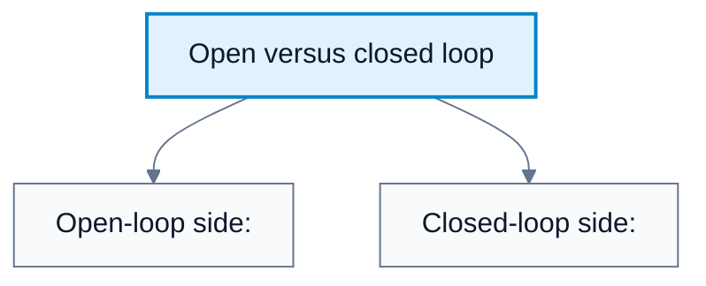
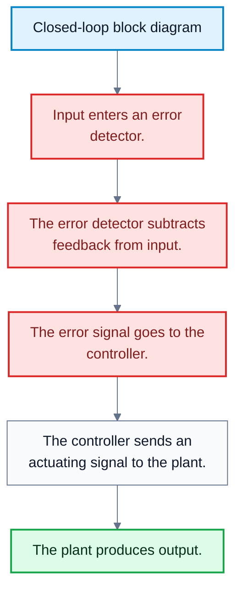
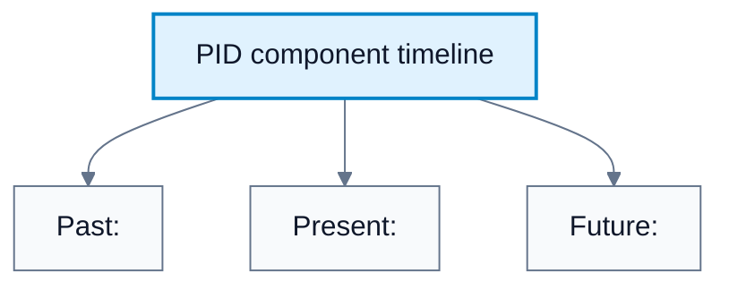

# Open/Closed Loop Control And PID Preview

**Subject**: CSC3041F Automated Planning  
**Source**: `Control/CSC3041F_Control_lecture2.pdf`, Krupa Prag, slides 1-17  
**Generated**: 2026-06-01

---

## Core Content

### Open-Loop Control Systems

#### Definitions

> **Open-Loop Control System**: A control system with no feedback; the output does not affect the control action. *In plain language: the system acts according to a preset rule and does not check whether it worked.*

> **Calibration**: The process of setting or adjusting a system so that a chosen input produces the expected output. *In plain language: tuning the system beforehand so the fixed action is likely to work.*

Open-loop control is simple because the controller does not need a sensor or feedback path. The logic is:

$$
\text{Input}\to\text{Controller}\to\text{Actuator}\to\text{Plant}\to\text{Output}
$$

The lecture gives the toaster example: a toaster applies heat for a selected time. It does not automatically compensate if the toaster is already warm from a previous round.

Advantages:

| Advantage | Meaning |
|---|---|
| Simplicity | Easy to design and build |
| Cost-effective | Fewer components because no feedback sensors are needed |
| Stability | It cannot over-correct itself through feedback because there is no feedback loop |

Disadvantages:

| Disadvantage | Meaning |
|---|---|
| Inaccuracy | It cannot account for environmental changes |
| No disturbance rejection | It cannot compensate for external noise or disturbances |
| Requires calibration | The designer must know the system response beforehand |

The main limitation is:

$$
\text{No feedback}\Rightarrow\text{no automatic correction}
$$

#### Diagram: Open versus closed loop

Caption: The main distinction is whether measured output affects future action.

### Closed-Loop Control Systems

#### Definitions

> **Closed-Loop Control System**: A feedback control system that monitors actual state and compares it to desired state. *In plain language: it keeps checking the result and correcting itself.*

> **Feedback Signal**: The measured output returned to the controller or error detector. *In plain language: information about what the system actually did.*

> **Error Detector**: The part of the loop that compares desired input with feedback. *In plain language: the subtraction point that finds the difference between target and actual output.*

> **Actuating Signal**: The controller's command sent to the plant. *In plain language: the action signal produced by the controller.*

Closed-loop control uses output measurement to reduce error. The standard feedback relationship is:

$$
e(t)=r(t)-y(t)
$$

where $r(t)$ is the reference input and $y(t)$ is the measured output.

The closed-loop process is:

1. The user or planner supplies a reference input.
2. The sensor measures the output.
3. The error detector compares reference input and feedback.
4. The controller computes a control signal.
5. The plant responds.
6. The new output is measured and fed back.
7. The loop repeats.

Closed-loop control is useful when disturbances, uncertainty, or changing plant behaviour make fixed open-loop actions unreliable.

#### Diagram: Closed-loop block diagram

Caption: Feedback allows a closed-loop system to reduce error and reject disturbances.

### State-Space And Dynamics

#### Definitions

> **State Space**: The set of variables needed to describe the current condition of a system. *In plain language: the information needed to know what situation the system is in.*

> **Dynamics**: The rules that describe how the system state changes over time. *In plain language: how the system moves from one state to the next.*

The lecture asks two core modelling questions:

1. How do we represent the state space?
2. How do we represent the dynamics?

For a discrete-time control system, a common state-space form is:

$$
x_{t+1}=f(x_t,u_t)
$$

where:

| Symbol | Meaning |
|---|---|
| $x_t$ | State at time $t$ |
| $u_t$ | Control action at time $t$ |
| $f$ | Dynamics function |

For a linear model, this is often written:

$$
x_{t+1}=Ax_t+Bu_t
$$

where $A$ describes how the current state evolves and $B$ describes how control input affects the state.
### Stability, Noise, And Objectives

#### Definitions

> **Stability**: The property that a system returns to equilibrium or stays bounded after a disturbance. *In plain language: if nudged, the system does not explode or drift away uncontrollably.*

> **Equilibrium**: A state where the system can remain without changing if no disturbance occurs. *In plain language: a balanced resting condition.*

> **Noise**: Unwanted variation or disturbance affecting measurements or system behaviour. *In plain language: messy outside effects or sensor errors.*

> **Cost Function**: A mathematical objective measuring how undesirable a behaviour is. *In plain language: a score the controller tries to make small.*

> **Objective Function**: The mathematical goal that the controller optimises. *In plain language: what the controller is trying to achieve.*

The lecture frames control design with these questions:

1. If the system is nudged, does it return to equilibrium or explode?
2. Can the controller handle noise?
3. How should the cost or objective function be defined?

A common tracking objective is to minimise squared error:

$$
J=\sum_{t=0}^{T} e_t^2
$$

where:

$$
e_t=r_t-y_t
$$

Controllers can also penalise excessive control effort:

$$
J=\sum_{t=0}^{T}\left(e_t^2+\lambda u_t^2\right)
$$

where $\lambda$ controls the trade-off between accurate tracking and low control effort.
### Why Use A Model?

#### Definitions

> **Mathematical Model**: An explicit mathematical representation of a system's dynamics. *In plain language: equations that predict how the system behaves.*

> **Model-Based Control**: Control that relies on an explicit model of the plant. *In plain language: the controller uses equations about the system.*

> **Model-Free Control**: Control that does not use an explicit mathematical model of the plant. *In plain language: the controller acts from rules, feedback, or learned behaviour rather than equations of physics.*

The lecture asks why we use a model. The main reasons are:

| Reason | Meaning |
|---|---|
| Prediction | Estimate future states before acting |
| Efficiency | Use known physics instead of learning everything by trial |
| Constraints | Encode limits such as safe temperature, speed, torque, or position |

Model-based control works well when the model is accurate enough and the optimisation can be solved fast enough. It struggles when the model is wrong, the plant is too complex, or unmodelled disturbances dominate.

Model-free control is motivated by cases where a mathematical representation is unavailable, too expensive, or too inaccurate. Instead of deriving the full dynamics, a model-free controller maps measurement or error directly to action.
### PID Controllers

#### Definitions

> **PID Controller**: A proportional-integral-derivative controller; a model-free closed-loop feedback mechanism. *In plain language: a controller that uses present, past, and predicted future error.*

> **Proportional Component**: The part of PID that reacts to current error. *In plain language: push harder when the current error is bigger.*

> **Integral Component**: The part of PID that reacts to accumulated past error. *In plain language: correct long-term offset that has built up over time.*

> **Derivative Component**: The part of PID that reacts to the rate of change of error. *In plain language: predict where the error is heading and damp motion.*

PID is described as the workhorse of industry. It is:

1. Model-free.
2. Closed-loop.
3. Based on feedback error.
4. Built from proportional, integral, and derivative terms.

The standard continuous-time PID control law is:

$$
u(t)=K_p e(t)+K_i\int_0^t e(\tau)\,d\tau+K_d\frac{de(t)}{dt}
$$

where:

| Term | Meaning | Time Intuition |
|---|---|---|
| $K_p e(t)$ | Proportional term | Present |
| $K_i\int_0^t e(\tau)\,d\tau$ | Integral term | Past |
| $K_d\frac{de(t)}{dt}$ | Derivative term | Future trend |

The objective of a PID controller is usually:

$$
e(t)\to 0
$$

while avoiding excessive overshoot, oscillation, or slow response.

#### Diagram: PID component timeline

Caption: PID combines current error, accumulated error, and error trend.

## Worked Examples

### Example 1: Open-Loop Heater Disturbance

**Problem**: A timed heater runs for $10$ minutes. A gust of cold wind cools the room while the heater is running. Can the controller compensate?

**Step 1**: Identify whether feedback exists.

The heater runs for a fixed time and does not measure temperature.

**Step 2**: Identify the disturbance.

The gust of wind changes the environment.

**Step 3**: Decide whether the controller can reject the disturbance.

With no temperature feedback, it cannot increase power or run longer.

**Answer**: No. This is an open-loop controller, so it has no disturbance rejection.

### Example 2: Closed-Loop Error Calculation

**Problem**: A water tank controller wants level $r(t)=50$ cm. The measured level is $y(t)=44$ cm. Compute the error.

**Step 1**: Use the tracking error formula.

$$
e(t)=r(t)-y(t)
$$

**Step 2**: Substitute values.

$$
e(t)=50-44=6
$$

**Answer**: The error is $6$ cm, so the controller should increase inflow or reduce outflow.

### Example 3: PID Terms For Cruise Control

**Problem**: A car's target speed is $100$ km/h and actual speed is $92$ km/h. The car has been below target for several seconds, but the speed is already increasing quickly. Explain the PID response.

**Step 1**: Compute the current error.

$$
e(t)=100-92=8
$$

**Step 2**: Interpret the proportional term.

The positive current error asks for more throttle.

**Step 3**: Interpret the integral term.

Because the car has been below target for several seconds, accumulated error also asks for more throttle.

**Step 4**: Interpret the derivative term.

Because the speed is increasing quickly, the derivative term can reduce throttle to prevent overshoot.

**Answer**: PID balances present error, accumulated past error, and the rate at which error is changing.

### Example 4: Linear State-Space Prediction

**Problem**: A simple scalar system has:

$$
x_{t+1}=0.8x_t+2u_t
$$

If $x_t=5$ and $u_t=1$, predict $x_{t+1}$.

**Step 1**: Substitute values.

$$
x_{t+1}=0.8(5)+2(1)
$$

**Step 2**: Compute.

$$
x_{t+1}=4+2=6
$$

**Answer**: The next state is $x_{t+1}=6$.

---

## Common Mistakes / Gotchas

- Treating open-loop simplicity as always beneficial. It is cheap and stable, but cannot correct unexpected changes.
- Forgetting that closed-loop control needs measurement.
- Confusing the plant with the controller.
- Defining stability as "does not move." Stable systems may move but return to equilibrium or remain bounded.
- Ignoring noise and disturbances when deciding whether open loop is acceptable.
- Assuming model-free means "no design." Model-free controllers still need rules, gains, policies, or learning procedures.
- Thinking PID is predictive in a model-based sense. Its derivative term predicts error trend, but PID does not use a full plant model.
- Forgetting that integral action can remove steady-state error but can also contribute to overshoot if badly tuned.

---

## Summary / Cheat Sheet

| Term | Meaning |
|---|---|
| Open loop | Fixed operation with no feedback |
| Closed loop | Feedback adjusts action |
| Calibration | Pre-setting a system's response |
| Disturbance rejection | Ability to compensate for external effects |
| State space | Variables describing the system condition |
| Dynamics | Rules for state evolution |
| Stability | Return to equilibrium or stay bounded |
| Cost function | Mathematical penalty to minimise |
| Model-based control | Uses explicit plant model |
| Model-free control | Does not use explicit plant model |
| PID | Proportional-integral-derivative controller |

**Key Formulas**:

$$
e(t)=r(t)-y(t)
$$

$$
x_{t+1}=f(x_t,u_t)
$$

$$
x_{t+1}=Ax_t+Bu_t
$$

$$
J=\sum_{t=0}^{T}\left(e_t^2+\lambda u_t^2\right)
$$

$$
u(t)=K_p e(t)+K_i\int_0^t e(\tau)\,d\tau+K_d\frac{de(t)}{dt}
$$

**Key Takeaways**:

- Open-loop systems are simple and cheap but cannot handle unexpected disturbances.
- Closed-loop systems use feedback to reduce error.
- State-space and dynamics describe what the system is and how it changes.
- Models help prediction, efficiency, and constraint handling.
- PID is model-free, closed-loop, and based on present, past, and future error behaviour.

---

## Practice Questions

**Q1**: Give one advantage and one disadvantage of open-loop control.  
> Answer: Advantage: it is simple and cost-effective. Disadvantage: it cannot correct disturbances because it has no feedback.

**Q2**: What is the feedback signal used for in a closed-loop system?  
> Answer: It reports the measured output so the controller can compare actual behaviour with the desired state.

**Q3**: Why does a model help in control?  
> Answer: A model allows prediction, efficient planning, and explicit handling of constraints.

**Q4**: What do the proportional, integral, and derivative terms respond to?  
> Answer: Proportional responds to current error, integral responds to accumulated past error, and derivative responds to the rate of change of error.

**Q5**: Write the standard continuous-time PID equation.  
> Answer: $$u(t)=K_p e(t)+K_i\int_0^t e(\tau)\,d\tau+K_d\frac{de(t)}{dt}.$$
