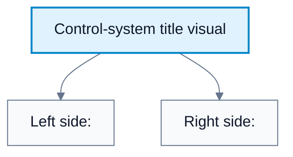
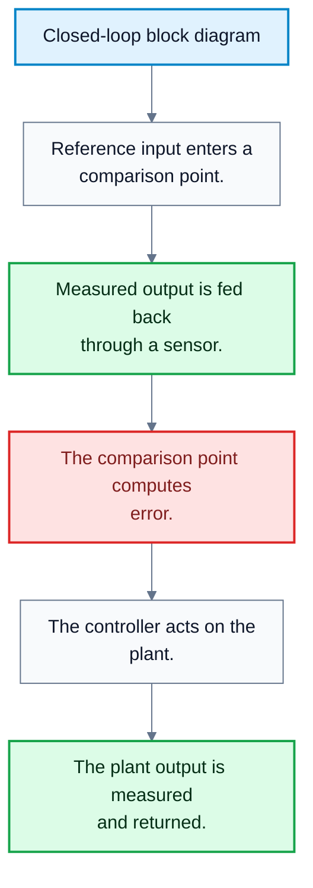
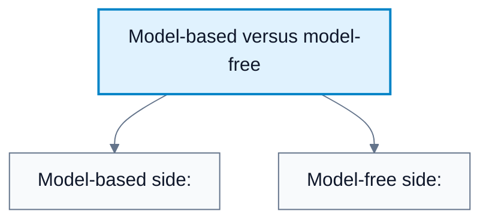
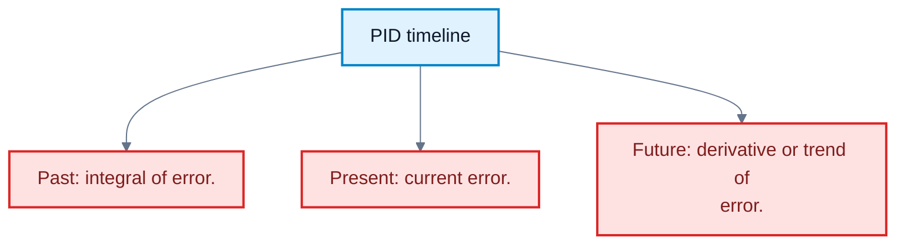

# Model-Based, Model-Free, And PID Control

**Subject**: CSC3041F Automated Planning  
**Source**: `Control/CSC3041F_Control_lecture3.pdf`, Krupa Prag, slides 1-14  
**Generated**: 2026-06-01

---

## Core Content

### Control-System Components

#### Definitions

> **Control System**: A framework, which may be mathematical, mechanical, or electronic, used to manage, command, direct, or regulate the behaviour of other devices or systems. *In plain language: a control system makes another system behave in a desired way.*

> **Plant / Process**: The physical system you are trying to influence. *In plain language: the system being controlled, such as a drone airframe or robot.*

> **Sensor**: The component that measures the current state. *In plain language: the system's measuring device, such as GPS, accelerometers, or thermometers.*

> **Controller**: The brain or algorithm that decides what to do based on sensor data in a feedback control system. *In plain language: the decision-maker.*

> **Actuator**: The component that carries out the controller's command. *In plain language: the motor, valve, heater, or other device that physically acts.*

The lecture defines a control system as a framework for regulating behaviour. The main components are:

| Component | Role | Example |
|---|---|---|
| Plant / process | System being influenced | Drone airframe, robot body, water tank |
| Sensor | Measures current state | GPS, accelerometer, thermometer |
| Controller | Chooses control action | PID algorithm, model predictive controller, learned policy |
| Actuator | Applies the action | Motor, valve, heater |

In feedback control, the controller uses measured state or output to decide the next action. The general relationship is:

$$
u_t=\pi(y_t,r_t)
$$

where $u_t$ is the control action, $y_t$ is measured output, $r_t$ is the desired reference, and $\pi$ is the controller rule.

#### Diagram: Control-system title visual

Caption: The diagram frames control as transforming an input force or command into a regulated output through a mechanism.

### Open-Loop And Closed-Loop Classification

#### Definitions

> **Open-Loop Control System**: A non-feedback controller whose logic is input to controller to actuator to plant to output. *In plain language: the controller acts without seeing the result.*

> **Closed-Loop Control System**: A feedback control system that constantly monitors actual state and compares it to desired state. *In plain language: the controller checks what happened and corrects the error.*

> **Error**: The difference between desired state and actual state. *In plain language: how far the system is from the target.*

> **Set-Point**: The desired target state or output. *In plain language: the value the system should maintain.*

Open-loop control has no circular path:

$$
\text{Input}\to\text{Controller}\to\text{Actuator}\to\text{Plant}\to\text{Output}
$$

Its main weakness is that it cannot handle external factors, noise, or changes in the system.

Closed-loop control monitors the actual state and compares it to the desired state:

$$
e(t)=r(t)-y(t)
$$

The controller then acts to reduce:

$$
e(t)\to 0
$$

| Feature | Open Loop | Closed Loop |
|---|---|---|
| Feedback | None | Present |
| Error correction | No automatic correction | Corrects based on measured error |
| Robustness to changes | Weak | Stronger |
| Complexity | Lower | Higher |
| Example | Timed toaster | Thermostat |

#### Diagram: Open-loop block diagram

```mermaid
%%{init: {"theme":"base","themeVariables":{"primaryColor":"#e0f2fe","primaryTextColor":"#0f172a","primaryBorderColor":"#0284c7","lineColor":"#64748b","secondaryColor":"#f8fafc","tertiaryColor":"#dcfce7","fontFamily":"Inter, ui-sans-serif, system-ui, -apple-system, BlinkMacSystemFont, Segoe UI, sans-serif"},"flowchart":{"curve":"basis","htmlLabels":true,"padding":12}}}%%
flowchart LR
    N0["Input"]
    N1["Controller"]
    N2["Actuator"]
    N3["Plant"]
    N4["Output"]
    N0 --> N1
    N1 --> N2
    N2 --> N3
    N3 --> N4

    classDef default fill:#f8fafc,stroke:#64748b,stroke-width:1px,color:#0f172a;
    classDef focus fill:#e0f2fe,stroke:#0284c7,stroke-width:2px,color:#0f172a;
    classDef outcome fill:#dcfce7,stroke:#16a34a,stroke-width:2px,color:#052e16;
    classDef warning fill:#fee2e2,stroke:#dc2626,stroke-width:2px,color:#7f1d1d;
    classDef muted fill:#f1f5f9,stroke:#94a3b8,stroke-width:1px,color:#334155;
    class N4 outcome;
```

Caption: Open-loop control does not measure its own result.

#### Diagram: Closed-loop block diagram

Caption: Closed-loop control uses feedback to reduce the gap between target and actual state.

### Model-Based Control

#### Definitions

> **Model-Based Control**: Control that relies on an explicit mathematical description of the plant's dynamics. *In plain language: the controller uses equations that describe the system.*

> **Model**: A mathematical representation of how the plant changes over time. *In plain language: an equation-based predictor of system behaviour.*

> **Differential Equation**: An equation describing how a quantity changes continuously over time. *In plain language: a rule for motion or change.*

> **Model Predictive Control (MPC)**: A model-based control approach that predicts future behaviour and optimises actions over a future horizon. *In plain language: plan ahead using a model, then apply the next best action.*

In model-based control, the controller uses a mathematical model of the plant. In continuous time, dynamics are often represented as:

$$
\dot{x}(t)=f(x(t),u(t))
$$

In discrete time, a common form is:

$$
x_{t+1}=f(x_t,u_t)
$$

For a linear system:

$$
x_{t+1}=Ax_t+Bu_t
$$

Model-based control can be seen as the planner-style control method because it predicts consequences before acting.

Advantages:

| Advantage | Meaning |
|---|---|
| Efficiency | Known physics reduces the need for many trials |
| Predictability | The controller can look ahead and anticipate future states |
| Constraint handling | Safety limits can be hard-coded into the model logic |
| Interpretability | If something fails, the equations can be inspected |
| Transferability | A physics-based model can transfer to equivalent systems |

Disadvantages:

| Disadvantage | Meaning |
|---|---|
| Model mismatch | If the model is wrong, performance can be poor or unstable |
| Computational cost | Real-time optimisation can be expensive |
| Modelling complexity | Complex systems can be hard to describe exactly |
| Unmodelled dynamics | Wind, wear, friction changes, and disturbances may be missing |
| Maintenance | The model may need updates as the plant or environment changes |
### Model-Free Control

#### Definitions

> **Model-Free Control**: Control that does not know or use the underlying physics of the plant. *In plain language: the controller maps measurements directly to actions without explicit dynamics equations.*

> **Policy**: A mapping from state or error to action. *In plain language: the rule that says what to do in each situation.*

> **Learned Policy**: A policy obtained from data or experience. *In plain language: a control rule learned by trial, simulation, or examples.*

A model-free controller maps measured error or state directly to an action:

$$
u_t=\pi(x_t)
$$

or:

$$
u_t=\pi(e_t)
$$

It does not need to know the exact plant dynamics. This makes it attractive when the physics are too hard to write down or when enough simulation/trial data is available.

Advantages:

| Advantage | Meaning |
|---|---|
| Versatility | Can be applied to many systems without deriving physics |
| Fast prototyping | Does not require a team to derive full differential equations |
| Creative behaviour | A learned controller may find unexpected solutions |
| Useful for complex tasks | Works when explicit modelling is too difficult |

Disadvantages:

| Disadvantage | Meaning |
|---|---|
| Exposure-dependent | Performance depends on what was seen during learning |
| Data hungry | Learning can require millions of interactions |
| Unsafe exploration | Failure during learning can damage real systems |
| Harder guarantees | Stability and safety are harder to prove |

The lecture's comparison is not that one category is always better. Model-based control is strong when the model is accurate and tractable. Model-free control is strong when explicit modelling is impractical and enough safe training is possible.

#### Diagram: Model-based versus model-free

Caption: Model-based control uses explicit dynamics; model-free control relies on rules or learned policies without explicit plant equations.

### PID Control

#### Definitions

> **PID Control**: Proportional-integral-derivative control; a model-free closed-loop feedback mechanism. *In plain language: a controller that reacts to current error, accumulated past error, and how fast error is changing.*

> **SISO**: Single-input single-output. *In plain language: one control input and one controlled output.*

> **MIMO**: Multi-input multi-output. *In plain language: multiple control inputs and multiple controlled outputs.*

> **Linear Dynamics**: Dynamics where superposition approximately applies. *In plain language: changes combine predictably and proportionally.*

> **Non-Linear Dynamics**: Dynamics where the response is not proportional or additive. *In plain language: behaviour can change dramatically depending on the state.*

> **Tracking**: Trying to follow a desired set-point or trajectory. *In plain language: keep the output close to the target.*

> **Optimisation**: Choosing actions to minimise or maximise an objective. *In plain language: find the best behaviour according to a score.*

PID is model-free and closed-loop. It calculates error as the difference between desired set-point and measured process variable:

$$
e(t)=r(t)-y(t)
$$

The standard PID equation is:

$$
u(t)=K_p e(t)+K_i\int_0^t e(\tau)\,d\tau+K_d\frac{de(t)}{dt}
$$

The three terms correspond to:

| Component | Informal Name | What It Uses | Effect |
|---|---|---|---|
| Proportional | Present | Current error | Reacts immediately to error size |
| Integral | Past | Accumulated error | Removes steady-state offset |
| Derivative | Future | Error rate of change | Dampens and anticipates motion |

PID characteristics from the lecture:

| Characteristic | PID Implication |
|---|---|
| SISO vs MIMO | PID is typically designed to track one variable |
| Linear vs non-linear | PID works best near a set-point where behaviour is approximately linear |
| Tracking vs optimisation | PID minimises error; it does not reason deeply about efficiency |
| Adaptation to change | Once tuned, gains are fixed unless manually retuned |

PID drawbacks:

1. It still relies heavily on human intuition and physics.
2. Decision speed can become an issue in demanding systems.
3. Under complex dynamics or high uncertainty, PID may not be the best controller.

#### Diagram: PID timeline

Caption: PID combines memory, immediate response, and damping.

## Worked Examples

### Example 1: Choosing Open Loop Or Closed Loop

**Problem**: A fan runs at a fixed speed whenever a switch is turned on. It does not measure room temperature. Is it open loop or closed loop?

**Step 1**: Check whether output is measured.

The fan does not measure temperature.

**Step 2**: Check whether output changes the control action.

The speed is fixed by the switch.

**Answer**: It is open loop because there is no feedback.

### Example 2: Model-Based Prediction

**Problem**: A plant is modelled by:

$$
x_{t+1}=Ax_t+Bu_t
$$

with:

$$
A=0.9,\quad B=0.5,\quad x_t=10,\quad u_t=4
$$

Compute the predicted next state.

**Step 1**: Substitute values.

$$
x_{t+1}=0.9(10)+0.5(4)
$$

**Step 2**: Compute.

$$
x_{t+1}=9+2=11
$$

**Answer**: The model predicts $x_{t+1}=11$.

### Example 3: PID For Cruise Control

**Problem**: A cruise-control system has target speed $100$ km/h and measured speed $96$ km/h. What is the error, and how should the proportional term respond?

**Step 1**: Compute error.

$$
e(t)=r(t)-y(t)=100-96=4
$$

**Step 2**: Compute proportional contribution symbolically.

$$
u_P(t)=K_p e(t)=4K_p
$$

**Step 3**: Interpret the action.

Since the car is below target speed, the proportional term should increase throttle.

**Answer**: The error is $4$ km/h, and the proportional term asks for a throttle increase proportional to $K_p$.

### Example 4: PID For Water Tank Level

**Problem**: A water tank target level is $2.0$ m and measured level is $1.7$ m. The level has been below target for a long time. Which PID component helps eliminate the persistent offset?

**Step 1**: Compute current error.

$$
e(t)=2.0-1.7=0.3
$$

**Step 2**: Identify the persistent condition.

The error has remained positive for a long time.

**Step 3**: Choose the PID component.

The integral term accumulates past error:

$$
u_I(t)=K_i\int_0^t e(\tau)\,d\tau
$$

**Answer**: The integral component helps remove the steady-state offset.

### Example 5: When Model-Free Control Makes Sense

**Problem**: A robot has many flexible joints and uncertain contact with the environment. Writing exact differential equations is very difficult, but the task can be simulated millions of times. Which control family is plausible?

**Step 1**: Check model availability.

The physics are difficult to write down exactly.

**Step 2**: Check training possibility.

Large-scale simulation is available.

**Answer**: Model-free or learned control is plausible, because the controller can be trained from interactions instead of relying on a hand-derived model.

---

## Common Mistakes / Gotchas

- Treating model-based and closed-loop as synonyms. A controller can be closed loop and model-free, such as PID.
- Treating model-free as automatically adaptive. A fixed PID controller is model-free but not automatically adaptive once gains are fixed.
- Forgetting that model mismatch can destabilise a model-based controller.
- Assuming PID is good for every control problem. It works best for SISO, near-linear, set-point tracking tasks.
- Confusing tracking with optimisation. PID tracks error; it does not optimise a rich objective unless embedded in a larger design.
- Assuming derivative control is the same as long-horizon prediction. It only uses the local rate of change of error.
- Forgetting that learned model-free systems may be unsafe during exploration.

---

## Summary / Cheat Sheet

| Term | Meaning |
|---|---|
| Plant | System being controlled |
| Sensor | Measures state or output |
| Controller | Computes action |
| Actuator | Applies action |
| Open loop | No feedback |
| Closed loop | Uses feedback |
| Model-based | Uses explicit dynamics |
| Model-free | No explicit dynamics model |
| MPC | Model-based look-ahead optimisation |
| PID | Model-free feedback controller |
| SISO | Single input, single output |
| MIMO | Multiple inputs, multiple outputs |
| Tracking | Minimise error to target |

**Key Formulas**:

$$
e(t)=r(t)-y(t)
$$

$$
\dot{x}(t)=f(x(t),u(t))
$$

$$
x_{t+1}=f(x_t,u_t)
$$

$$
x_{t+1}=Ax_t+Bu_t
$$

$$
u_t=\pi(x_t)
$$

$$
u(t)=K_p e(t)+K_i\int_0^t e(\tau)\,d\tau+K_d\frac{de(t)}{dt}
$$

**Key Takeaways**:

- A control system regulates a plant using sensors, controllers, and actuators.
- Open loop has no feedback; closed loop uses feedback to reduce error.
- Model-based control is efficient and interpretable when the model is accurate.
- Model-free control is useful when explicit modelling is too hard.
- PID is a model-free closed-loop controller designed mainly for tracking one variable.

---

## Practice Questions

**Q1**: What are the four main components of a control system listed in the lecture?  
> Answer: Plant/process, sensor, controller, and actuator.

**Q2**: What is model mismatch?  
> Answer: Model mismatch occurs when the mathematical model does not match the real plant, which can cause poor performance or instability.

**Q3**: Why is model-based control often interpretable?  
> Answer: Because decisions can be traced through the equations and constraints used by the controller.

**Q4**: Why can model-free control be risky in real systems?  
> Answer: If it learns through exploration, it may need to fail many times, which can damage real hardware.

**Q5**: Why is PID usually described as SISO tracking control?  
> Answer: It is typically tuned to minimise error for one controlled output using one control input.

**Q6**: What does the derivative term in PID do?  
> Answer: It reacts to how quickly the error is changing, helping damp oscillation and reduce overshoot.
