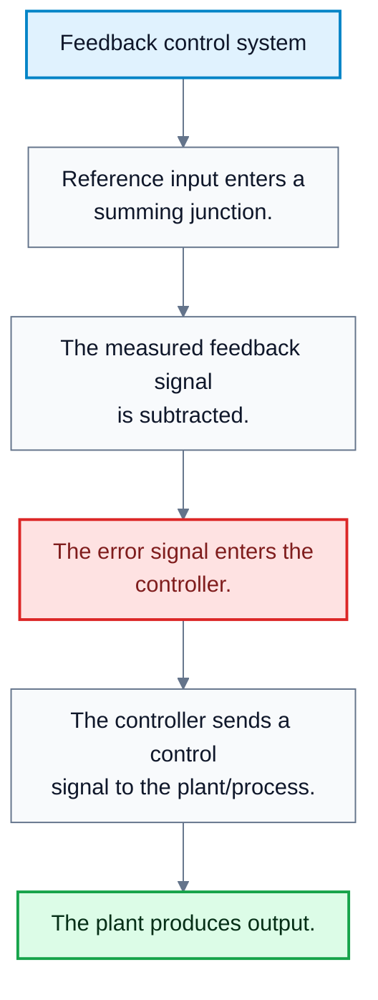
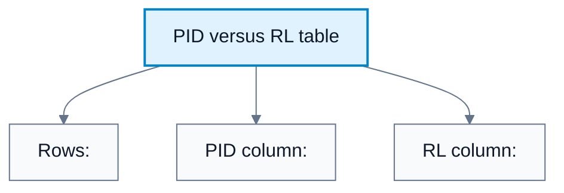
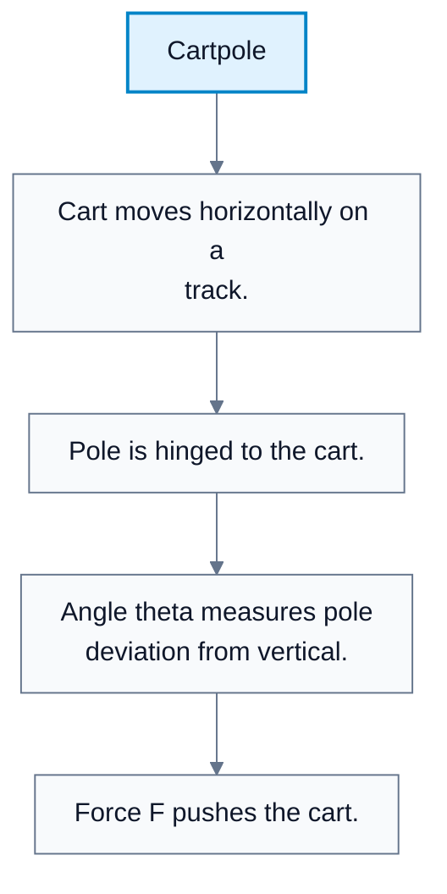
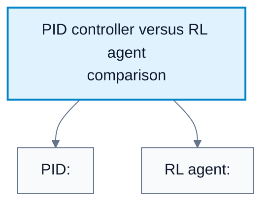
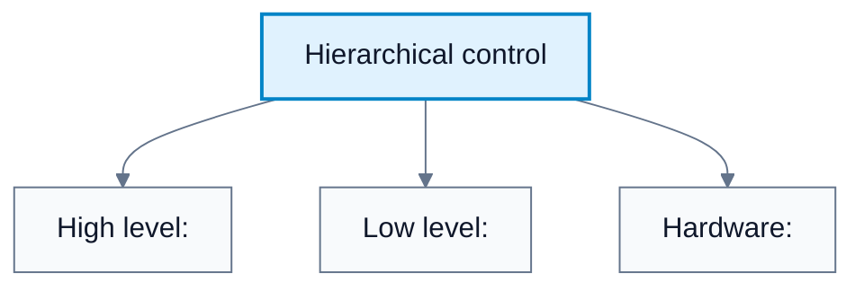
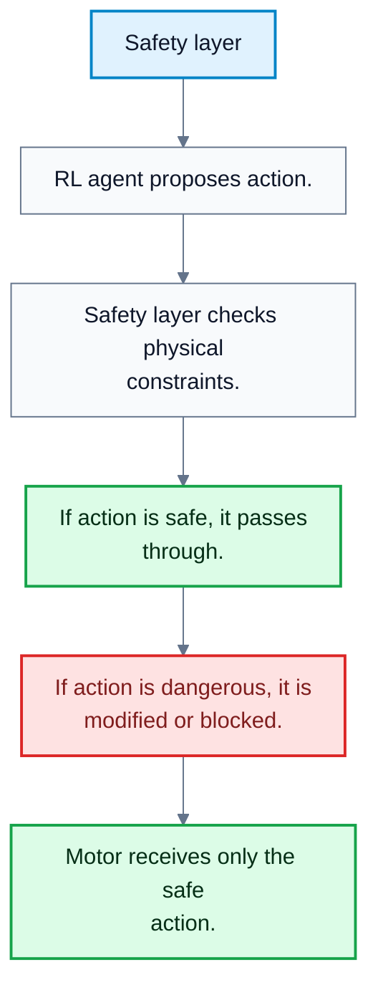

# Reinforcement Learning For Control

**Subject**: CSC3041F Automated Planning  
**Source**: `Control/CSC3041F_Control_lecture4.pdf`, Krupa Prag, slides 1-18  
**Generated**: 2026-06-01

---

## Core Content

### Plant Characteristics

#### Definitions

> **Plant Characteristics**: Properties of the system being controlled that affect controller design. *In plain language: the features of the real system that determine what kind of controller is suitable.*

> **Superposition**: The property that combined inputs produce the sum of their separate effects. *In plain language: effects add cleanly in a linear system.*

> **External Force**: A disturbance or influence from outside the controller-plant pair. *In plain language: something from the environment that pushes the system around.*

> **Repetitive Task**: A task with repeated, predictable structure. *In plain language: the system keeps doing roughly the same thing.*

> **Uncertainty**: Lack of exact knowledge about the state, dynamics, environment, or future disturbances. *In plain language: the controller does not fully know what will happen.*

Before choosing between PID, model-based control, or reinforcement-learning control, the lecture asks how the plant behaves.

Key questions:

1. Is the plant linear or non-linear?
2. Does superposition apply?
3. Do we have a model of the plant?
4. Can human intuition or physics be used?
5. Are we mainly interacting with an uncertain environment?
6. Can external forces be included in the plant model?
7. Is the task repetitive or uncertain?
8. How many inputs and outputs exist?

The answers shape controller choice:

| Plant Feature | Classical Control More Natural | RL More Natural |
|---|---|---|
| Linear dynamics | Yes | Sometimes unnecessary |
| Strong physics model available | Yes | Less necessary |
| Many interacting inputs/outputs | Harder | Often more suitable |
| High uncertainty | Harder | Often more suitable |
| Repetitive task | Strong | Strong if enough data/simulation exists |
| Unknown environment interaction | Harder | Often more suitable |

#### Diagram: Feedback control system

Caption: This is the classical closed-loop structure that PID and many other controllers use.

### PID To Reinforcement Learning

#### Definitions

> **Reinforcement Learning (RL)**: Learning by interaction where an agent chooses actions and receives rewards. *In plain language: the controller learns what to do by trying actions and observing outcomes.*

> **Agent**: The decision-making learner in reinforcement learning. *In plain language: the thing choosing actions.*

> **Policy**: A mapping from states to actions or action probabilities. *In plain language: the agent's control rule.*

> **Online Learning**: Learning that continues while the system is operating. *In plain language: the controller can keep adapting from new experience.*

The lecture contrasts PID with reinforcement learning:

| Feature | PID | Reinforcement Learning |
|---|---|---|
| SISO vs MIMO | SISO | MIMO |
| Linear vs non-linear | Linear | Non-linear |
| Adaptability | Fixed after tuning | Can continue to learn online |

A PID controller is usually written:

$$
u(t)=K_p e(t)+K_i\int_0^t e(\tau)\,d\tau+K_d\frac{de(t)}{dt}
$$

An RL controller is usually represented as a policy:

$$
a_t=\pi(s_t)
$$

or a stochastic policy:

$$
a_t\sim\pi(\cdot\mid s_t)
$$

The RL objective is to maximise expected discounted reward:

$$
J(\pi)=\mathbb{E}_{\pi}\left[\sum_{t=0}^{\infty}\gamma^t r_t\right]
$$

where:

| Symbol | Meaning |
|---|---|
| $s_t$ | State at time $t$ |
| $a_t$ | Action at time $t$ |
| $r_t$ | Reward at time $t$ |
| $\gamma$ | Discount factor |
| $\pi$ | Policy |

#### Diagram: PID versus RL table

Caption: RL is introduced as a more adaptive control approach for complex and changing systems.

### Cartpole As A Control Example

#### Definitions

> **Cartpole**: A benchmark control task where a controller moves a cart to keep an attached pole balanced upright. *In plain language: push the cart left or right so the pole does not fall.*

> **Force**: The control action applied to the cart. *In plain language: the push used to move the cart.*

> **Angle**: The pole's deviation from upright. *In plain language: how far the pole is leaning.*

The cartpole diagram shows:

1. A cart on a track.
2. A pole hinged to the cart.
3. The pole angle $\theta$ measured relative to vertical.
4. A force $F$ applied to the cart.

A typical state representation is:

$$
s_t=(x_t,\dot{x}_t,\theta_t,\dot{\theta}_t)
$$

where:

| Variable | Meaning |
|---|---|
| $x_t$ | Cart position |
| $\dot{x}_t$ | Cart velocity |
| $\theta_t$ | Pole angle |
| $\dot{\theta}_t$ | Pole angular velocity |

A typical control action is:

$$
a_t=F_t
$$

or a discrete choice:

$$
a_t\in\{\text{push left},\text{push right}\}
$$

The control goal is to keep:

$$
\theta_t\approx 0
$$

while keeping the cart on the track.

The lecture compares PID with an RL agent such as PPO:

| Feature | PID Controller | RL Agent (PPO) |
|---|---|---|
| Foundations | Calculus and linear algebra | Probability and optimisation |
| Initial performance | Smooth if tuned well | Often jittery or sub-optimal |
| Reaction to $2\times$ mass | Brittle; likely to fail or oscillate | May generalise to new dynamics |
| Debugging | Easier; inspect equation roots | Hard; black-box neural network |

#### Diagram: Cartpole

Caption: Cartpole is a compact example of feedback control under unstable dynamics.

#### Diagram: PID controller versus RL agent comparison

Caption: PID is interpretable and reliable near its design point; RL is more flexible but less transparent.

### Automation Versus Autonomy

#### Definitions

> **Automation**: A system that follows a predefined set of rules to perform a repetitive task. *In plain language: it does a known task according to fixed instructions.*

> **Autonomy**: A system that can adapt its behaviour to achieve a goal in an uncertain or changing environment. *In plain language: it can adjust its behaviour when the situation changes.*

The lecture frames classical control as automation and RL-based control as autonomy.

| Concept | Description | Example |
|---|---|---|
| Automation | Follows predefined rules for a repetitive task | Robotic arm on an assembly line |
| Autonomy | Adapts behaviour to reach a goal in uncertainty | Drone navigating a changing construction site |

Automation is appropriate when the environment and task are stable. Autonomy is more appropriate when the system must make decisions under changing conditions.
### Integration Strategies: How RL Meets Hardware

#### Definitions

> **Direct Controller**: An RL agent that replaces the traditional feedback controller entirely. *In plain language: RL directly chooses low-level control signals.*

> **Hierarchical Control**: A design where low-level controllers handle fast reflexes and a high-level controller sets goals or set-points. *In plain language: PID handles fast motor control while RL acts as a manager.*

> **System Identification**: Learning or estimating a model of a system from data. *In plain language: learn the plant equations instead of deriving them by hand.*

> **Model Predictive Control (MPC)**: A model-based control method that optimises future actions using a model. *In plain language: plan ahead with a learned or known model.*

The lecture gives three integration strategies.

| Strategy | How It Works | Benefit | Risk / Cost |
|---|---|---|---|
| RL as direct controller | RL observes raw sensor data and outputs raw control signals | Can learn complex non-linear movements | Hard to guarantee safety; black box |
| Hierarchical control | PID handles low-level reflexes; RL sends high-level set-points | Combines safe low-level control with adaptive high-level decisions | Requires interface design between layers |
| RL for system identification | RL or learning estimates model matrices such as $A$ and $B$ | Enables classical MPC after learning the model | Learned model may be inaccurate outside training data |

For system identification, a learned linear model might be:

$$
x_{t+1}=Ax_t+Bu_t
$$

Once $A$ and $B$ are estimated, MPC can use the model for prediction and constrained optimisation.

#### Diagram: Hierarchical control

Caption: Hierarchical control lets RL make adaptive decisions while classical controllers handle fast reflexes.

### Implementation Pipeline

#### Definitions

> **Simulation**: Training or testing a controller in a virtual environment. *In plain language: practise safely before touching real hardware.*

> **Domain Randomisation**: Randomising simulation parameters so the learned controller becomes robust to real-world variation. *In plain language: train under many fake worlds so the real world is less surprising.*

> **Deployment**: Running the controller on the real system. *In plain language: moving from simulation to hardware.*

The implementation pipeline is:

1. Simulation.
2. Domain randomisation.
3. Deployment.

The purpose of simulation is safety and data scale. The purpose of domain randomisation is robustness. Deployment is the risky final step where the controller must deal with real sensors, real delays, real actuators, and real failure modes.
### Real-World Applications In South Africa

#### Definitions

> **LIDAR**: A sensing technology that measures distance using light pulses. *In plain language: a laser-based way to perceive shapes and obstacles.*

> **Micro-Grid**: A local energy grid that can manage distributed energy sources and loads. *In plain language: a small controllable power network.*

> **Disturbance Rejection**: A controller's ability to compensate for external disturbances. *In plain language: keep working even when the environment pushes back.*

The lecture gives South African application examples:

| Area | Example | Why RL-Based Control Fits |
|---|---|---|
| Mining | Autonomous underground vehicles navigating tunnels with RL-based LIDAR processing | Tunnels are uncertain and difficult to model completely |
| Energy | Optimising micro-grid load balancing with renewable wind and solar | Renewables are non-linear and unpredictable |
| Agriculture | RL-controlled drones for precision spraying in orchards | Wind disturbances require real-time adaptation |

These examples share a common theme: the environment is uncertain, non-linear, or hard to model fully.
### Safety In RL Control

#### Definitions

> **Safe RL**: Reinforcement learning methods designed to avoid unsafe actions during learning or deployment. *In plain language: RL with explicit protection against dangerous behaviour.*

> **Shielding**: A safety mechanism that blocks unsafe actions proposed by an RL agent. *In plain language: a guard that stops bad commands before they reach the motor.*

> **Safety Layer**: A layer between the RL agent and actuator that overrides physically dangerous actions. *In plain language: a final safety check before hardware moves.*

The lecture's safety warning is that classical control often allows mathematical stability proofs, but deep RL usually does not.

The challenge:

$$
\text{How do we stop an RL agent from exploring a state that breaks the machine?}
$$

The proposed solution is Safe RL using shielding or safety layers. The structure is:

$$
\text{RL action}\to\text{Safety layer}\to\text{Motor command}
$$

If the RL agent suggests an unsafe action:

$$
a_t^{\mathrm{safe}}\ne a_t^{\mathrm{RL}}
$$

because the safety layer overrides the action.

#### Diagram: Safety layer

Caption: Safe RL protects hardware from dangerous exploration and unsafe deployment actions.

## Worked Examples

### Example 1: Choosing PID Or RL For A Plant

**Problem**: A heater controls one room temperature near a fixed set-point. The plant is roughly linear near the set-point and has one input and one output. Which controller is a natural first choice?

**Step 1**: Identify input/output structure.

The problem is SISO.

**Step 2**: Identify dynamics.

The plant is roughly linear near the set-point.

**Step 3**: Match to controller type.

PID is strong for SISO near-linear tracking.

**Answer**: PID is a natural first choice.

### Example 2: Cartpole State And Action

**Problem**: Write a reasonable state and action representation for cartpole.

**Step 1**: Include cart motion.

$$
x_t,\quad \dot{x}_t
$$

**Step 2**: Include pole motion.

$$
\theta_t,\quad \dot{\theta}_t
$$

**Step 3**: Combine into a state.

$$
s_t=(x_t,\dot{x}_t,\theta_t,\dot{\theta}_t)
$$

**Step 4**: Define action.

$$
a_t=F_t
$$

or:

$$
a_t\in\{\text{push left},\text{push right}\}
$$

**Answer**: A typical state is $(x_t,\dot{x}_t,\theta_t,\dot{\theta}_t)$ and the action is force applied to the cart.

### Example 3: RL Objective For Control

**Problem**: An RL agent gets reward $r_t=1$ for every time step the cartpole remains balanced. Write the optimisation objective.

**Step 1**: Use discounted return.

$$
G_t=\sum_{k=0}^{\infty}\gamma^k r_{t+k}
$$

**Step 2**: Optimise expected return under policy $\pi$.

$$
J(\pi)=\mathbb{E}_{\pi}[G_0]
$$

**Step 3**: Substitute the expanded return.

$$
J(\pi)=\mathbb{E}_{\pi}\left[\sum_{t=0}^{\infty}\gamma^t r_t\right]
$$

**Answer**: The agent learns a policy that maximises expected discounted time-balanced reward.

### Example 4: Hierarchical Control In A Self-Driving Car

**Problem**: A self-driving car uses RL to decide a target steering angle, but a PID controller turns the wheels to that exact angle. Identify the high-level and low-level controllers.

**Step 1**: High-level decision.

The RL agent chooses the target steering angle.

**Step 2**: Low-level tracking.

The PID controller tracks that steering angle using actuator feedback.

**Answer**: RL is the high-level supervisor, and PID is the low-level reflex controller.

### Example 5: Safety Layer Override

**Problem**: An RL policy suggests motor torque $a_t^{\mathrm{RL}}=120$ Nm, but the safe hardware limit is $80$ Nm. What should a safety layer do?

**Step 1**: State the constraint.

$$
|a_t|\le 80
$$

**Step 2**: Check proposed action.

$$
120>80
$$

**Step 3**: Override with a safe action.

$$
a_t^{\mathrm{safe}}=80
$$

**Answer**: The safety layer should block or clip the unsafe command before it reaches the motor.

---

## Common Mistakes / Gotchas

- Assuming RL is always better than PID. PID is often better for simple, linear, SISO tracking.
- Forgetting that PID gains are fixed after tuning unless an adaptive layer is added.
- Treating RL as automatically safe because it learns. Exploration can be dangerous on real hardware.
- Confusing automation with autonomy. Automation follows predefined rules; autonomy adapts to uncertainty.
- Deploying directly to hardware without simulation and robustness testing.
- Assuming a policy trained in one simulator will work in the real world without domain randomisation.
- Treating a neural RL controller as easy to debug. It is often much less interpretable than PID.
- Forgetting that RL can be used to learn a model rather than directly controlling the plant.
- Ignoring actuator limits, delays, and sensor noise during deployment.

---

## Summary / Cheat Sheet

| Term | Meaning |
|---|---|
| Plant characteristics | Properties that determine controller choice |
| Linear | Superposition applies |
| Non-linear | Superposition does not generally apply |
| PID | Fixed, often SISO, near-linear tracking controller |
| RL | Adaptive, often MIMO, non-linear control approach |
| Cartpole | Benchmark balancing control problem |
| Automation | Predefined rules for repetitive tasks |
| Autonomy | Adaptive behaviour in changing environments |
| Direct RL controller | RL outputs low-level control signals |
| Hierarchical control | RL sets high-level goals; PID handles low-level tracking |
| System identification | Learning a model from data |
| Domain randomisation | Vary simulation parameters to improve robustness |
| Safe RL | RL with safety constraints or protective layers |
| Shielding | Blocking unsafe RL actions |

**Key Formulas**:

PID:

$$
u(t)=K_p e(t)+K_i\int_0^t e(\tau)\,d\tau+K_d\frac{de(t)}{dt}
$$

RL policy:

$$
a_t=\pi(s_t)
$$

Stochastic RL policy:

$$
a_t\sim\pi(\cdot\mid s_t)
$$

RL objective:

$$
J(\pi)=\mathbb{E}_{\pi}\left[\sum_{t=0}^{\infty}\gamma^t r_t\right]
$$

Linear system identification model:

$$
x_{t+1}=Ax_t+Bu_t
$$

Cartpole state:

$$
s_t=(x_t,\dot{x}_t,\theta_t,\dot{\theta}_t)
$$

Safety constraint:

$$
a_t^{\mathrm{safe}}\in\mathcal{A}_{\mathrm{safe}}
$$

**Key Takeaways**:

- Controller choice depends on plant complexity, model availability, uncertainty, and input/output structure.
- PID is strong for fixed, near-linear, SISO tracking problems.
- RL is attractive for non-linear, uncertain, MIMO, adaptive control.
- RL can meet hardware through direct control, hierarchical supervision, or system identification.
- Safe RL needs shields or safety layers because deep RL usually lacks classical stability guarantees.

---

## Practice Questions

**Q1**: List three plant characteristics that affect controller design.  
> Answer: Linearity/non-linearity, whether a model is available, uncertainty, external forces, task repetitiveness, and number of inputs/outputs.

**Q2**: What is the main difference between automation and autonomy?  
> Answer: Automation follows predefined rules for repetitive tasks. Autonomy adapts behaviour to achieve goals in uncertain or changing environments.

**Q3**: Why can RL be more suitable than PID for some control problems?  
> Answer: RL can handle MIMO, non-linear, uncertain tasks and can continue learning, while PID is usually fixed and best for SISO near-linear tracking.

**Q4**: What is hierarchical control?  
> Answer: A layered design where low-level controllers such as PID handle fast tracking, while a high-level controller such as RL sends set-points or decisions.

**Q5**: How can RL be used for system identification?  
> Answer: It can learn a model, such as matrices $A$ and $B$ in $x_{t+1}=Ax_t+Bu_t$, which can then be used by a model-based controller like MPC.

**Q6**: Why is safety a major issue in RL control?  
> Answer: RL learns by exploration, and unsafe exploratory actions can break real hardware. Deep RL also usually lacks the stability proofs available in classical control.
