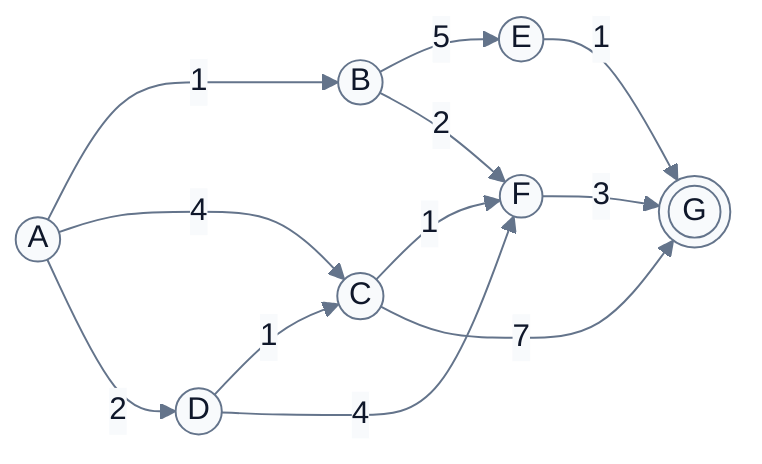
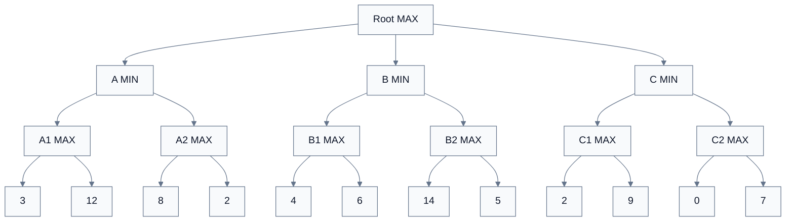
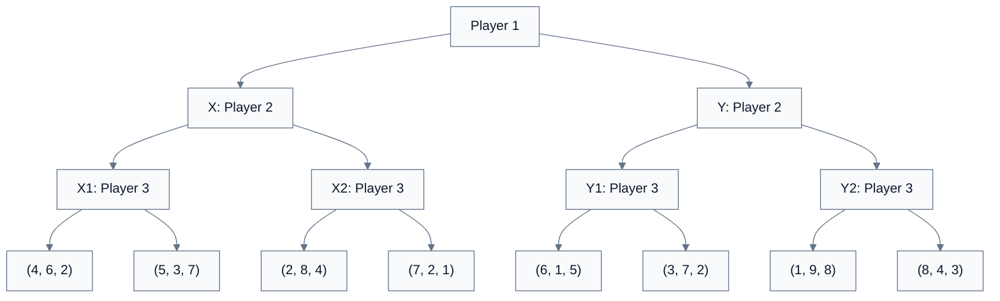

---
tags:
  - automated-planning
---

# CSC3041F FINAL Mock Exam

**Course:** Automated Planning and Control  
**Time:** 3 hours  
**Total:** 180 marks

## Instructions

1. Answer all questions.
2. Show all working for calculation questions.
3. Bold numbers in square brackets indicate marks.
4. Unless stated otherwise, break ties alphabetically or from left to right.
5. You may leave answers as exact fractions or decimals rounded to 3 d.p.

---

## Section A: Multiple Choice Questions

### Question 1: Multiple Choice Questions [20]

Select the **one** correct answer for each question.

1. In state-space search, a **node** usually contains:
   - A. only the current state
   - B. only the action that was just taken
   - C. the state plus search information such as parent, action and path cost
   - D. the entire transition model
   - E. the heuristic function

2. A graph-search algorithm uses an explored/reached set mainly to:
   - A. make all heuristics admissible
   - B. avoid repeated states and cycles
   - C. guarantee depth-first search is optimal
   - D. remove the need for a goal test
   - E. make stochastic transitions deterministic

3. Breadth-first search is optimal when:
   - A. all actions have equal positive cost
   - B. heuristic values are consistent
   - C. the branching factor is 1
   - D. the search tree has no goal states
   - E. costs may be negative

4. Uniform-cost search expands the frontier node with minimum:
   - A. depth
   - B. heuristic value $h(n)$
   - C. path cost $g(n)$
   - D. evaluation value $f(n)=g(n)+h(n)$
   - E. branching factor

5. Iterative deepening search combines:
   - A. BFS completeness with DFS memory efficiency
   - B. UCS optimality with greedy search speed
   - C. alpha-beta pruning with minimax values
   - D. MCTS rollouts with Bellman backups
   - E. policy iteration with value iteration

6. A heuristic $h$ is admissible if:
   - A. $h(n)\ge h^*(n)$ for every node
   - B. $h(n)\le h^*(n)$ for every node
   - C. $h(n)=0$ only at the start node
   - D. $h(n)$ ignores the goal state
   - E. $h(n)$ is always larger than $g(n)$

7. A* graph search is guaranteed optimal when all step costs are positive and $h$ is:
   - A. random
   - B. deterministic only
   - C. consistent
   - D. larger than the true cost-to-go
   - E. equal to the depth

8. Beam search differs from A* because beam search:
   - A. always stores every frontier node
   - B. has no evaluation function
   - C. keeps only a limited number of promising nodes
   - D. is guaranteed complete for finite graphs
   - E. requires stochastic policies

9. In minimax, a MAX node chooses the successor with:
   - A. minimum value
   - B. maximum value
   - C. average value
   - D. highest visit count
   - E. lowest path cost

10. Alpha-beta pruning can remove branches that:
    - A. cannot affect the final minimax decision
    - B. have no heuristic evaluation
    - C. have a non-zero reward
    - D. are generated after a terminal state
    - E. are stochastic

11. In a three-player game with utilities $(u_1,u_2,u_3)$, a rational player $i$ normally chooses the successor that:
    - A. maximizes $u_i$
    - B. maximizes the sum $u_1+u_2+u_3$
    - C. minimizes $u_1$
    - D. maximizes the next player's utility
    - E. ignores terminal utilities

12. In Monte Carlo Tree Search, the UCB score is used to balance:
    - A. discounting and bootstrapping
    - B. exploration and exploitation
    - C. policy evaluation and policy improvement only
    - D. open-loop and closed-loop control
    - E. admissibility and consistency

13. A Markov Decision Process is commonly defined by:
    - A. $(S,A,P,R,\gamma)$
    - B. $(V,Q,A^*)$
    - C. $(K_p,K_i,K_d)$
    - D. $(\alpha,\beta,\epsilon)$
    - E. $(g,h,f)$

14. The discounted return from time $t$ is:
    - A. $G_t=\sum_{k=0}^{\infty}\gamma^k R_{t+k+1}$
    - B. $G_t=R_t-\gamma R_{t+1}$
    - C. $G_t=\max_a Q(s,a)$
    - D. $G_t=\alpha \delta_t$
    - E. $G_t=\nabla_\theta J(\theta)$

15. The Bellman expectation equation for a stochastic policy state value is:
    - A. $V^\pi(s)=\sum_a \pi(a|s)\sum_{s'}P(s'|s,a)[R(s,a,s')+\gamma V^\pi(s')]$
    - B. $V^\pi(s)=\max_a Q^\pi(s,a)$
    - C. $V^\pi(s)=R(s)+\alpha\delta_t$
    - D. $V^\pi(s)=\sum_a Q^\pi(s,a)$
    - E. $V^\pi(s)=Q^\pi(s,a)-A^\pi(s,a)$

16. Value iteration repeatedly applies:
    - A. the Bellman optimality backup
    - B. only random rollouts
    - C. only supervised regression
    - D. the PID derivative term
    - E. the minimax backup

17. The TD(0) error for a value function estimate is:
    - A. $\delta_t=R_{t+1}+\gamma V(S_{t+1})-V(S_t)$
    - B. $\delta_t=G_t-V(S_{t+1})$
    - C. $\delta_t=\max_a Q(S_t,a)$
    - D. $\delta_t=h(n)-h^*(n)$
    - E. $\delta_t=K_p e_t$

18. Q-learning is usually described as:
    - A. on-policy because its target uses the action actually taken
    - B. off-policy because its target uses a greedy next-action value
    - C. model-based because it requires $P$ and $R$
    - D. deterministic because it has no learning rate
    - E. a depth-limited search algorithm

19. In DQN, a target network is used mainly to:
    - A. make the environment deterministic
    - B. stabilize bootstrapped targets
    - C. remove the need for rewards
    - D. replace the replay buffer
    - E. perform alpha-beta pruning

20. In a closed-loop controller, the control action is based on:
    - A. a fixed pre-planned sequence only
    - B. feedback from the measured output or state
    - C. a heuristic search frontier
    - D. the minimax value of a game tree
    - E. a replay buffer only

---

## Section B: State-Space and Heuristic Search

### Question 2: Problem Formulation and Search Models [10]

A robot moves on the following grid. $S$ is the start, $G$ is the goal, $\#$ is a wall and $\cdot$ is a free cell.

$$
\begin{array}{cccc}
S & \cdot & \cdot & \#\\
\# & \cdot & \cdot & \cdot\\
\cdot & \cdot & \# & G
\end{array}
$$

The robot may move Up, Down, Left or Right, with unit step cost. Moves into walls or outside the grid are illegal.

1. Formulate this as a search problem by specifying $S$, $A(s)$, $Result(s,a)$, the goal test and the path cost. [**4**]
2. Draw or list the first two levels of the search tree from the start state, using action order $U,D,L,R$. [**2**]
3. Explain the difference between a **state** and a **node** for this problem. [**2**]
4. Explain why graph search is preferable to tree search on this grid. [**2**]

### Question 3: Uninformed Search Calculations [10]

Consider the directed weighted graph below. Start is $A$, goal is $G$. Edge labels are action costs.

Use alphabetical tie-breaking.

1. Give the BFS expansion order and the path returned by BFS. [**2**]
2. Give the DFS expansion order and the path returned by DFS. [**2**]
3. Give the uniform-cost search expansion order and the optimal path cost. [**3**]
4. For iterative deepening depth-first search, list the depth limit at which the goal is first found and the path returned. [**2**]
5. Which of the above algorithms is guaranteed to return the cheapest path here, and why? [**1**]

### Question 4: Heuristic Search, A* and Beam Search [10]

For the same graph in Question 3, suppose the heuristic estimates to $G$ are:

$$
\begin{array}{c|ccccccc}
s & A & B & C & D & E & F & G\\
\hline
h(s) & 5 & 4 & 3 & 4 & 1 & 2 & 0
\end{array}
$$

1. Compute $f(n)=g(n)+h(n)$ for the frontier after expanding $A$. [**2**]
2. Run A* graph search until $G$ is selected for expansion. Give the expansion order and final path. [**4**]
3. Is the heuristic admissible for every state? Justify using true cheapest costs-to-go. [**2**]
4. Run beam search with beam width $b=2$, ranking nodes by $h(n)$. Give the path returned or state if it fails. [**2**]

### Question 5: Heuristic Design and Memory-Limited Search [10]

Consider the 8-puzzle state below, with blank tile `_` and goal state shown on the right.

$$
\text{Current}=
\begin{bmatrix}
2&8&3\\
1&6&4\\
7&\square&5
\end{bmatrix},
\qquad
\text{Goal}=
\begin{bmatrix}
1&2&3\\
8&\square&4\\
7&6&5
\end{bmatrix}.
$$

1. Compute the misplaced-tile heuristic, ignoring the blank. [**2**]
2. Compute the Manhattan-distance heuristic, ignoring the blank. [**3**]
3. Explain why the Manhattan-distance heuristic dominates misplaced tiles for this problem. [**1**]
4. State one relaxed version of the 8-puzzle that produces an admissible heuristic. [**1**]
5. If $h_1$ and $h_2$ are admissible, explain why $h(s)=\max(h_1(s),h_2(s))$ is usually preferred to $h(s)=\min(h_1(s),h_2(s))$. [**1**]
6. Briefly explain why A* can have high memory usage, and how reference-count cleanup, beam search or delta-beam search can reduce memory pressure. [**2**]

---

## Section C: Game Search and MCTS

### Question 6: Minimax and Alpha-Beta Pruning [13]

Consider the depth-3 game tree below. The root is a MAX node, then MIN nodes, then MAX nodes. Terminal utilities are shown left to right.

1. Compute the backed-up minimax value of every internal node. [**5**]
2. Which root action should MAX choose? [**1**]
3. Run alpha-beta pruning left to right. List every leaf that is evaluated and every leaf that is pruned. [**5**]
4. Explain how a better move ordering could change the number of leaves evaluated without changing the final move. [**2**]

### Question 7: Multiplayer Minimax and Evaluation Functions [7]

The following terminal utilities are for a three-player game. The root player is Player 1. At depth 1, Player 2 moves. At depth 2, Player 3 moves.

1. Apply multiplayer minimax, where each player maximizes their own utility component. Which terminal utility is selected under $X$? Which is selected under $Y$? [**4**]
2. Which root action should Player 1 choose? [**1**]
3. Give one reason an evaluation function is needed in large games. [**1**]
4. State whether these utilities are constant-sum/$K$-sum, and explain how cooperation or shifting alliances could change the backup decision. [**1**]

### Question 8: Monte Carlo Tree Search [5]

At a search node $s$, three actions have the following statistics:

$$
\begin{array}{c|cc}
\text{Action} & Q(s,a) & N(s,a)\\
\hline
a_1 & 0.62 & 10\\
a_2 & 0.50 & 2\\
a_3 & 0.70 & 20
\end{array}
$$

The parent visit count is $N(s)=32$ and $c_{\text{ucb}}=1.4$.

1. Name the four phases of MCTS and state which phase uses the UCB score. [**1**]
2. Compute the UCB score
   $$
   \mathrm{UCB}(s,a)=Q(s,a)+c_{\text{ucb}}\sqrt{\frac{\ln N(s)}{1+N(s,a)}}.
   $$
   for each action. [**2**]
3. Which action is selected by UCT? [**1**]
4. After a rollout return $G=0.8$ from $a_2$, update $N(s,a_2)$ and $Q(s,a_2)$ using the incremental mean backup. [**1**]

---

## Section D: Reinforcement Learning Foundations and Dynamic Programming

### Question 9: MDPs, Returns and Policies [8]

An agent has states $S=\{s_0,s_1,T\}$, actions $A=\{L,R\}$, discount $\gamma=0.9$, and terminal state $T$.

Transitions:

$$
\begin{aligned}
(s_0,L)&\to (s_0,0), & (s_0,R)&\to (s_1,1),\\
(s_1,L)&\to (s_0,0), & (s_1,R)&\to (T,4).
\end{aligned}
$$

1. Write the MDP tuple for this problem. [**2**]
2. Compute the return for the trajectory $s_0,R,1,s_1,R,4,T$. [**2**]
3. For deterministic policy $\mu(s_0)=R,\mu(s_1)=R$, compute $V^\mu(s_1)$ and $V^\mu(s_0)$. [**2**]
4. Explain one way this problem would change if the state were only partially observable. [**2**]

### Question 10: Value Functions and Bellman Equations [10]

Consider a policy $\pi$ with:

$$
\pi(L|s_0)=0.25,\quad \pi(R|s_0)=0.75,\quad
\pi(L|s_1)=0.4,\quad \pi(R|s_1)=0.6.
$$

Use the MDP from Question 9.

1. Write the stochastic Bellman expectation equation for $V^\pi(s_0)$. [**2**]
2. Write the stochastic Bellman expectation equation for $Q^\pi(s_0,R)$. [**2**]
3. Write the deterministic Bellman expectation equation for $V^\mu(s)$. [**2**]
4. Write the deterministic Bellman expectation equation for $Q^\mu(s,a)$. [**2**]
5. Define the advantage function $A^\pi(s,a)$, and explain what a positive value means. [**2**]

### Question 11: Value Iteration and Policy Iteration [12]

Use the MDP from Question 9. Initialize $V_0(s_0)=V_0(s_1)=V_0(T)=0$.

1. Perform two full iterations of value iteration:
   $$
   V_{k+1}(s)=\max_a\sum_{s'}P(s'|s,a)\left[R(s,a,s')+\gamma V_k(s')\right].
   $$
   Show $V_1$ and $V_2$. [**4**]
2. Extract the greedy policy from $V_2$. [**2**]
3. Starting with policy $\mu_0(s_0)=L,\mu_0(s_1)=R$, evaluate $V^{\mu_0}(s_0)$ and $V^{\mu_0}(s_1)$. [**3**]
4. Improve the policy greedily using $V^{\mu_0}$. State whether the policy changes. [**2**]
5. Explain the difference between policy evaluation and policy improvement. [**1**]

---

## Section E: Model-Free, Deep and Modern Reinforcement Learning

### Question 12: Monte Carlo, TD and Eligibility Traces [10]

An episode produces:

$$
S_0=A,\ R_1=2,\ S_1=B,\ R_2=-1,\ S_2=A,\ R_3=3,\ S_3=T,
$$

with $\gamma=0.9$. Current estimates are $V(A)=1.0$, $V(B)=0.5$. Learning rate $\alpha=0.2$.

1. Compute the first-visit Monte Carlo return for state $A$. [**2**]
2. Compute the every-visit Monte Carlo returns for both visits to $A$. [**2**]
3. Compute the TD(0) update for $V(A)$ at $t=0$. [**2**]
4. Compute the 2-step return from $t=0$. [**2**]
5. With accumulating eligibility traces, write the update rule for $e_t(s)$ and state what $\lambda=0$ and $\lambda=1$ correspond to. [**2**]

### Question 13: Control Updates and Exploration [10]

At transition $S_t=s$, $A_t=a_1$, $R_{t+1}=2$, $S_{t+1}=s'$. Let $\gamma=0.9$, $\alpha=0.1$, and:

$$
\begin{array}{c|cc}
\text{Action} & Q(s,a) & Q(s',a)\\
\hline
a_1 & 1.0 & 3.0\\
a_2 & 2.0 & 1.0\\
a_3 & 0.5 & 2.0
\end{array}
$$

The behaviour policy chooses $A_{t+1}=a_3$. The target policy at $s'$ is:

$$
\pi(a_1|s')=0.5,\quad \pi(a_2|s')=0.2,\quad \pi(a_3|s')=0.3.
$$

1. Compute the SARSA target and updated $Q(s,a_1)$. [**2**]
2. Compute the Q-learning target and updated $Q(s,a_1)$. [**2**]
3. Compute the Expected SARSA target and updated $Q(s,a_1)$. [**2**]
4. For $\epsilon$-greedy with $\epsilon=0.2$ and three actions, compute the probability of selecting the greedy action at $s$. [**2**]
5. Write the softmax/Boltzmann action selection probability and explain the effect of temperature $\tau$. [**2**]

### Question 14: Function Approximation, DQN and Policy Gradients [10]

1. For linear value approximation $V_w(s)=w^\top x(s)$, write the gradient update for one TD target $y$. [**2**]
2. In DQN, write the target
   $$
   y=r+\gamma\max_{a'}Q_{\theta^-}(s',a')
   $$
   and the squared loss. Explain the roles of replay buffer and target network. [**3**]
3. A stochastic policy has $\pi_\theta(a|s)=0.2$, return $G_t=5$, and $\nabla_\theta \log \pi_\theta(a|s)=(1,-2)$. Compute the REINFORCE gradient estimate with no baseline. [**1**]
4. With baseline $b(s)=3$, compute the new policy-gradient multiplier and explain why baselines can reduce variance without changing the expected gradient. [**2**]
5. For PPO, write the clipped surrogate objective using the probability ratio $r_t(\theta)$. [**2**]

### Question 15: Modern RL Families and Practical Choices [10]

1. Explain why tabular $Q(s,a)$ methods do not scale well to continuous control problems. [**2**]
2. In an actor-critic method, state what the actor learns and what the critic learns. [**2**]
3. Give one example of a DQN extension and explain the instability or limitation it is designed to reduce. [**2**]
4. Compare true model-based RL with model-free RL in terms of sample efficiency and model bias. [**2**]
5. Give one risk of offline RL and one risk of multi-agent or multi-objective RL. [**2**]

---

## Section F: Control Systems and RL for Control

### Question 16: Control Calculations and Design [15]

A mobile robot tries to maintain a distance of $10$ m from a wall. At time $t$, the measured distance is $8$ m. Use error $e_t=r_t-y_t$, where $r_t$ is the reference and $y_t$ is the measured output. Let:

$$
K_p=0.6,\quad K_i=0.1,\quad K_d=0.2,\quad
\Delta t=1,
$$

previous error $e_{t-1}=1$, and accumulated integral error before this step $I_{t-1}=4$.

1. Compute the proportional, integral and derivative terms, and the PID control output
   $$
   u_t=K_p e_t+K_i I_t+K_d\frac{e_t-e_{t-1}}{\Delta t}.
   $$
   [**4**]
2. State whether this controller is open-loop or closed-loop, and justify. [**2**]
3. A linear state-space model is
   $$
   x_{t+1}=Ax_t+Bu_t,\qquad y_t=Cx_t,
   $$
   where
   $$
   A=\begin{bmatrix}1&1\\0&1\end{bmatrix},\quad
   B=\begin{bmatrix}0\\1\end{bmatrix},\quad
   C=\begin{bmatrix}1&0\end{bmatrix}.
   $$
   If $x_t=(2,3)^\top$ and $u_t=-1$, compute $x_{t+1}$ and $y_t$. [**3**]
4. Compare model-based control, model-free control and model predictive control in one sentence each. [**3**]
5. Give one advantage and one risk of using reinforcement learning for real-world control. [**2**]
6. Name one practical technique for transferring a learned controller from simulation to the real system. [**1**]

### Question 17: RL for Control Deployment [10]

A company wants to train an autonomous cartpole-style balancing system in simulation before deploying it on hardware.

1. Define a suitable state, action and reward for the cartpole control task. [**3**]
2. Explain the difference between automation and autonomy in this setting. [**2**]
3. Name two ways RL can be integrated with classical control or safety systems. [**2**]
4. Outline a practical deployment pipeline from simulation to real hardware. [**2**]
5. Give one South African application area where RL control could be useful. [**1**]

---

## Coverage Checklist

This mock exam is designed to cover the full CSC3041 notes:

- **Search:** state-space formulation, problem-solving agents, problem spaces and instances, tree search, graph search, reached states, BFS, UCS, DFS, depth-limited search, iterative deepening, heuristic design, N-puzzle heuristics, admissibility, consistency, relaxation, combining heuristics, greedy search, A*, memory issues, reference-count intuition, beam search, delta-beam search, adversarial search, minimax, multiplayer minimax, $K$-sum games, alpha-beta pruning, move ordering, evaluation functions, horizon effects and MCTS.
- **Reinforcement Learning:** agents, environments, imitation-learning contrast, rewards, delayed rewards, returns, horizons, MDPs, Markov property, partial observability, policies, $V$, $Q$, advantage, stochastic and deterministic Bellman expectation equations, Bellman optimality, value iteration, policy iteration, generalized policy iteration, Monte Carlo learning, TD learning, $n$-step returns, eligibility traces, SARSA, Q-learning, Expected SARSA, exploration, function approximation, DQN, replay buffers, target networks, DQN extensions, policy gradients, baselines, actor-critic ideas, PPO, continuous control, model-based RL, offline RL, multi-agent RL and multi-objective RL.
- **Control:** control-system components, open-loop and closed-loop control, feedback, disturbances, noise, stability, objectives, PID control, state-space models, model-based control, model-free control, model predictive control, plant characteristics, cartpole, automation versus autonomy, RL for control, integration strategies, implementation pipeline, simulation transfer, safety layers and practical applications.
