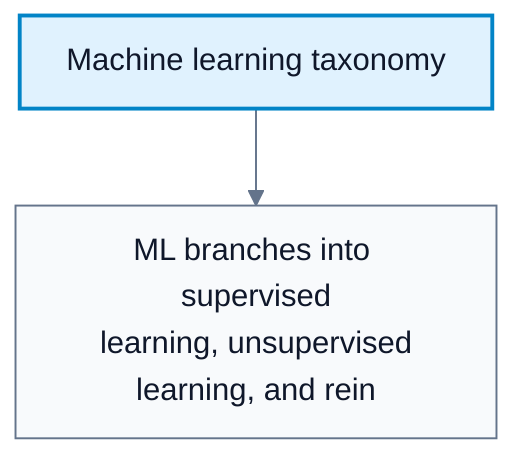
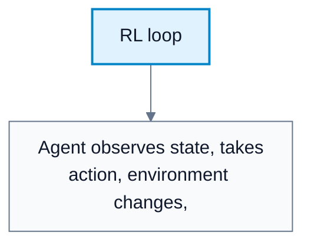
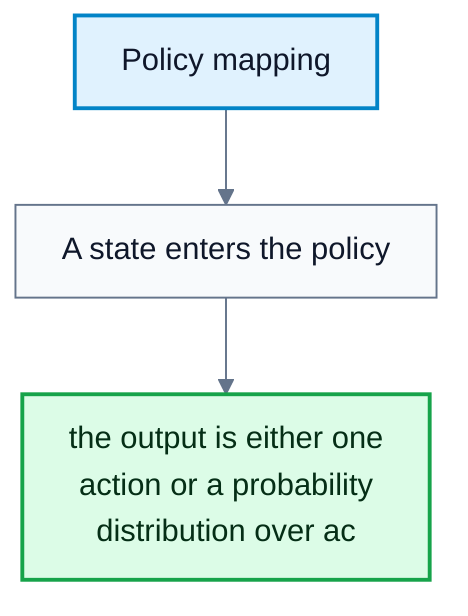
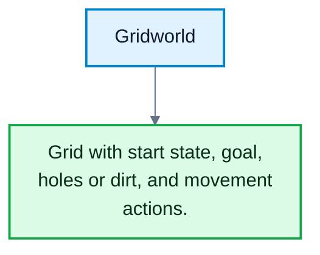

---
tags:
  - automated-planning
---

# RL Introduction

**Subject**: CSC3041F Automated Planning  
**Source**: `RL/1RL_3041F.pdf`, Asad Jeewa, slides 1-32  
**Generated**: 2026-05-31

---

## Contents

- [[#Core Content|Core Content]]
  - [[#Reinforcement Learning In Machine Learning|Reinforcement Learning In Machine Learning]]
  - [[#Imitation Learning As A Contrast|Imitation Learning As A Contrast]]
  - [[#What RL Learns|What RL Learns]]
  - [[#RL Loop|RL Loop]]
  - [[#Policies|Policies]]
  - [[#Reward Functions And Delayed Rewards|Reward Functions And Delayed Rewards]]
  - [[#Environment And Dynamics|Environment And Dynamics]]
  - [[#Gridworld Example|Gridworld Example]]
  - [[#Real-World Uses And Challenges|Real-World Uses And Challenges]]

---

## Core Content

### Reinforcement Learning In Machine Learning

#### Definitions

> **Machine Learning**: A broad AI field concerned with algorithms that learn from data and make decisions without being explicitly programmed for every scenario. *In plain language: systems improve from examples or experience rather than hand-coded rules.*

> **Supervised Learning**: Learning from input-output pairs. *In plain language: learn from labeled examples.*

> **Unsupervised Learning**: Learning patterns from unlabeled data. *In plain language: find structure without given answers.*

> **Reinforcement Learning (RL)**: Learning through trial and error from interaction with an environment. *In plain language: an agent learns what to do by acting and receiving rewards or penalties.*

RL differs from supervised learning because the agent is not simply given the correct action for every state. It must discover behavior by interacting with the environment and receiving feedback.

#### Diagram: Machine learning taxonomy

Caption: This places RL as a learning paradigm focused on interaction and reward rather than labeled targets.

### Imitation Learning As A Contrast

#### Definitions

> **Imitation Learning**: Learning to predict actions from states using demonstrations. *In plain language: copy what an expert did.*

An imitation-learning approach treats action choice as supervised learning: given state-action examples, predict the action. This is limited because:

1. It cannot easily learn new behaviors beyond the demonstrated data.
2. It is limited to the distribution of behavior in the dataset.
3. It may fail in states the demonstrator rarely or never visited.

RL is broader because it can improve through trial and error.
### What RL Learns

#### Definitions

> **Behavior Learning**: Learning a mapping from states to actions. *In plain language: learning what to do in each situation.*

> **Sequential Decision Making**: Multi-stage decision making where current actions affect future states and rewards. *In plain language: today's move changes tomorrow's options.*

> **Agent**: The learner or decision maker. *In plain language: the entity choosing actions.*

> **Environment**: The system or world the agent interacts with. *In plain language: everything the agent acts inside and receives feedback from.*

RL asks questions such as:

1. What should I do now to solve a problem later?
2. How do my actions affect the environment?
3. How can current actions be credited for future rewards?

The central issue is delayed consequence. A good action may not pay off immediately, and a bad action may only be punished later.
### RL Loop

#### Definitions

> **State / Observation ($s_t$)**: The agent's current view or representation of the environment. *In plain language: what the agent knows at time $t$.*

> **Action ($a_t$)**: A decision made by the agent. *In plain language: what the agent does.*

> **Reward ($r_t$)**: Feedback signal returned by the environment. *In plain language: a number saying how good or bad the outcome was.*

The RL loop:

1. The agent observes state $s_t$.
2. The agent chooses action $a_t$.
3. The environment updates.
4. The environment returns reward $r_t$.
5. The agent uses this experience to improve future behavior.

RL learns behavior through trial and error without explicitly encoding every rule of the task.

#### Diagram: RL loop

Caption: The loop is the basic data-generating process for RL.

### Policies

#### Definitions

> **Policy ($\pi$)**: A representation of the agent's behavior, mapping states to actions or action probabilities. *In plain language: the agent's strategy.*

> **Deterministic Policy**: A policy where each state maps to one action. *In plain language: in this state, always do this action.*

> **Stochastic Policy**: A policy giving a probability distribution over actions. *In plain language: in this state, choose among actions with specified probabilities.*

Policy forms:

$$
a=\pi(s)
$$

$$
\pi(a\mid s)=P(A_t=a\mid S_t=s)
$$

The goal of RL is to find an optimal policy that maximizes expected discounted return:

$$
J(\pi)=\mathbb{E}\!\left[\sum_t \gamma^t r(S_t,A_t)\right]
$$

#### Diagram: Policy mapping

Caption: The policy is the behavior object RL tries to improve.

### Reward Functions And Delayed Rewards

#### Definitions

> **Reward Function**: A function associating behavior with reward or penalty. *In plain language: the scoring rule.*

> **Sparse Reward**: A reward signal that appears rarely. *In plain language: the agent gets feedback only occasionally.*

> **Delayed Reward**: A reward that arrives long after the action that caused it. *In plain language: the consequence comes later.*

> **Credit Assignment**: The problem of deciding which earlier actions caused later rewards. *In plain language: figuring out what deserves credit or blame.*

The reward function provides scalar feedback:

$$
R(s,a)=c
$$

The agent should not act myopically by chasing only immediate rewards. It needs a notion of value that links present actions to future consequences.

#### Diagram: Gridworld

Caption: Gridworld makes states, actions, rewards, and delayed consequences concrete.

### Environment And Dynamics

#### Definitions

> **Dynamics / Transition Function**: A model of how the world changes after actions. *In plain language: the rule for the next state.*

The environment:

1. Provides observations or states $s_t$.
2. Receives actions $a_t$.
3. Returns reward $r_t=r(s_t,a_t)$.
4. Defines dynamics $T(s_{t+1}\mid s_t,a_t)$.
### Gridworld Example

Gridworld illustrates RL components:

| Component | Example |
|---|---|
| States | Position on grid, such as start $(1,1)$ and goal $(4,3)$ |
| Actions | `{Up, Down, Left, Right}` |
| Rewards | $+1$ for finding dirt, $-1$ for falling into a hole, $-0.001$ per move |
| Environment | Grid transition rules |

Reward values define desired behavior. Their relative scale matters more than their absolute magnitude. Multiplying every reward by the same positive constant usually does not change the optimal policy, but large rewards can destabilize neural network training.
### Real-World Uses And Challenges

RL domains include robotics, autonomous vehicles, finance, healthcare, video games, and language-model alignment or feedback systems.

Common challenges:

| Challenge | Why It Is Hard |
|---|---|
| High-dimensional states/actions | Too many possibilities to enumerate |
| Delayed or sparse rewards | Hard credit assignment |
| Safety and ethics | Bad exploration can be costly |
| Limited online interaction | The agent may not be allowed many real-world trials |
| Unpredictable environments | Learned behavior must tolerate uncertainty |
