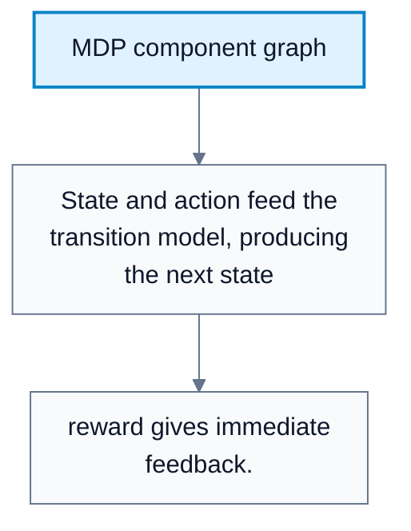
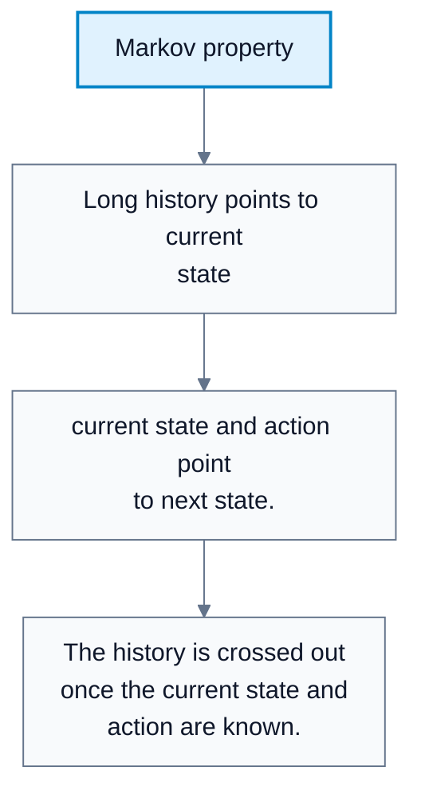
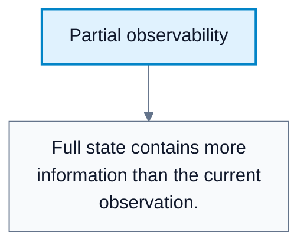
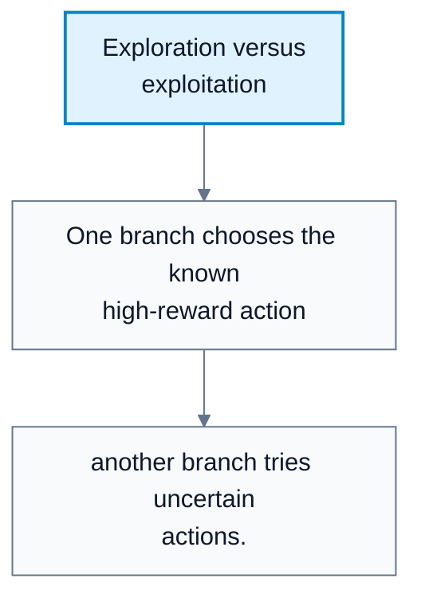

---
tags:
  - automated-planning
---

# Markov Decision Processes

**Subject**: CSC3041F Automated Planning  
**Source**: `RL/Edit_2RL_3041F.pdf`, Asad Jeewa, slides 1-23  
**Generated**: 2026-05-31

---

## Contents

- [[#Core Content|Core Content]]
  - [[#Formalizing RL|Formalizing RL]]
  - [[#The Markov Property|The Markov Property]]
  - [[#Markov Models|Markov Models]]
  - [[#Action And State Spaces|Action And State Spaces]]
  - [[#Partial Observability|Partial Observability]]
  - [[#Discount Factor Gamma|Discount Factor Gamma]]
  - [[#Exploration Versus Exploitation|Exploration Versus Exploitation]]
  - [[#Return And Horizon|Return And Horizon]]
  - [[#Models In RL|Models In RL]]

---

## Core Content

### Formalizing RL

#### Definitions

> **Markov Decision Process (MDP)**: A mathematical model of sequential decision making defined by states, actions, transitions, rewards, and a discount factor. *In plain language: the standard formal setup for RL problems.*

> **State Set (`S`)**: The set of possible environment configurations. *In plain language: all situations the agent may be in.*

> **Action Set (`A`)**: The set of decisions available to the agent. *In plain language: everything the agent can do.*

> **Transition Function (`T`)**: A probability model for the next state given current state and action. *In plain language: how the world changes after an action.*

> **Reward Function (`R`)**: The immediate feedback signal. *In plain language: the score received for acting.*

> **Discount Factor ($\gamma$)**: A number in `(0,1]` controlling how much future rewards matter. *In plain language: how far-sighted the agent is.*

An MDP is:

$$
\langle S,A,T,R,\gamma\rangle
$$

with:

$$
T(s,a,s')=P(S_{t+1}=s'\mid S_t=s,A_t=a)
$$

$$
R(s,a)=c
$$

$$
\gamma\in(0,1]
$$

#### Diagram: MDP component graph

Caption: This diagram shows the formal MDP pieces and how they interact.

### The Markov Property

#### Definitions

> **Markov Property**: The future depends only on the current state and action, not the full history. *In plain language: if the state contains all relevant information, the past does not need to be remembered separately.*

Formal statement:

$$
P(S_{t+1}\mid S_t,A_t,S_{t-1},A_{t-1},\ldots,S_0,A_0)=P(S_{t+1}\mid S_t,A_t)
$$

This is an assumption used to make the problem tractable. It is not automatically true in the real world. The state $s_t$ must contain all relevant information from the past for the assumption to be valid.

#### Diagram: Markov property

Caption: The state should summarize all relevant past information.

### Markov Models

#### Definitions

> **Markov Chain**: A sequence of states satisfying the Markov property, without actions or rewards. *In plain language: states evolve probabilistically, but the agent does not control them.*

> **MDP**: A Markov chain extended with actions and rewards. *In plain language: the agent can influence transitions and gets feedback.*

| Model | Includes States | Includes Actions | Includes Rewards | Control? |
|---|---|---|---|---|
| Markov chain | Yes | No | No | No |
| MDP | Yes | Yes | Yes | Yes |
### Action And State Spaces

#### Definitions

> **Discrete Action Space**: A finite set of actions. *In plain language: choose from a list like left/right/jump.*

> **Continuous Action Space**: Real-valued actions. *In plain language: choose a number or vector, such as steering angle.*

> **High-Dimensional State Space**: A state representation with many variables, such as images or sensor arrays. *In plain language: the input is large and complex.*

Action spaces:

| Type | Example |
|---|---|
| Discrete | Move left, move right, jump |
| Continuous | Steering angle in `[-1,1]`, throttle in `[0,1]` |

State/observation spaces:

| Type | Example |
|---|---|
| Discrete | Gridworld positions |
| Continuous | Position and velocity vector |
| High-dimensional | Camera frames or robot sensors |
### Partial Observability

#### Definitions

> **Fully Observable MDP**: The agent sees the complete environment state. *In plain language: the observation is the full state.*

> **Partially Observable MDP (POMDP)**: The agent only sees an observation that may omit hidden state information. *In plain language: the agent has an incomplete view.*

> **Observation ($o_t$)**: What the agent actually sees at time $t$. *In plain language: the sensor reading or partial view.*

In a fully observable MDP:

$$
o_t=s_t
$$

$$
s_t=\text{complete environment snapshot}
$$

In a POMDP:

$$
o_t=\text{partial view of }s_t
$$

Example: a self-driving car may observe nearby objects but not the full world state around it.

#### Diagram: Partial observability

Caption: POMDPs are harder because the agent must act with incomplete information.

### Discount Factor Gamma

$\gamma$ controls preference for immediate versus delayed rewards:

| Gamma Behavior | Meaning |
|---|---|
| $\gamma\to0$ | Myopic agent, focuses on immediate reward |
| $\gamma\to1$ | Far-sighted agent, values future rewards almost as much as immediate rewards |

Gamma is typically greater than `0.9` in long-term tasks. It has mathematical benefits:

1. Helps ensure cumulative return is finite.
2. Supports value-function convergence.
3. Stabilizes dynamic programming.
4. Reduces the impact of long-term uncertainty.
### Exploration Versus Exploitation

#### Definitions

> **Exploration**: Trying actions to discover new information. *In plain language: experiment to learn.*

> **Exploitation**: Using current knowledge to maximize reward. *In plain language: take the action you already believe is best.*

Too much exploitation can trap the agent in local optima. Too much exploration slows learning.

Common approaches:

| Approach | Idea |
|---|---|
| Epsilon-greedy | Usually choose best-known action, sometimes random |
| Softmax | Sample actions by preference scores |
| Random perturbations | Add noise to actions |
| Uncertainty estimation | Explore where the model is unsure |
| Curiosity/intrinsic motivation | Reward novel or surprising states |

#### Diagram: Exploration versus exploitation

Caption: RL must balance immediate performance with information gathering.

### Return And Horizon

#### Definitions

> **Cumulative Discounted Return ($G_t$)**: Discounted sum of future rewards from time `t`. *In plain language: the total future reward, with later rewards weighted less.*

> **Horizon ($H$)**: Number of future steps considered. *In plain language: how far ahead the agent looks.*

Return:

$$
G_t=\sum_{k=0}^{H}\gamma^k R_{t+k+1}
$$

Rewards are observed after actions, so the first reward after time $t$ is $R_{t+1}$.
### Models In RL

#### Definitions

> **Model**: The agent's internal representation of environment dynamics and rewards. *In plain language: a predictor of next state and reward.*

> **Model-Based RL**: RL that knows or learns a model of transitions and rewards, then plans with it. *In plain language: learn/use how the world works, then think ahead.*

> **Model-Free RL**: RL that learns behavior or values directly from experience without modeling transitions. *In plain language: learn what works from trial and error without predicting the whole world.*

A model predicts:

$$
\hat{s}_{t+1}\approx s_{t+1}
$$

$$
\hat{r}_t\approx r_t
$$

Comparison:

| Type | Given | Goal | Strength | Challenge |
|---|---|---|---|---|
| Model-based RL | $S,A,T,R$ known or learnable | Plan using model | Can reduce real interactions | Model errors affect planning |
| Model-free RL | $S,A,R$ from experience | Learn policy/value directly | Avoids explicit dynamics model | Often sample inefficient |
