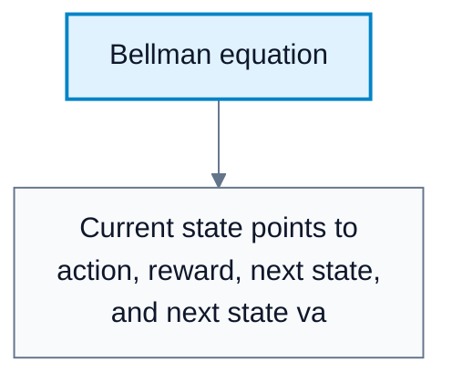
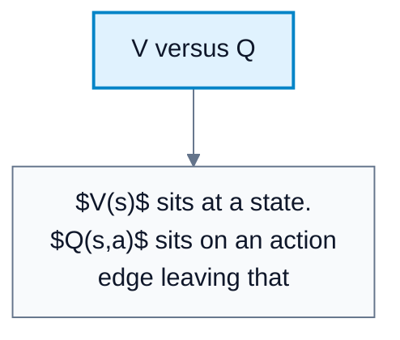
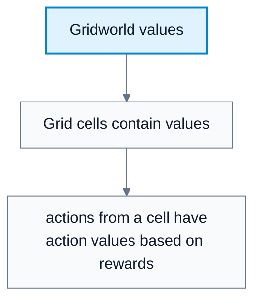

---
tags:
  - automated-planning
---

# Value Functions

**Subject**: CSC3041F Automated Planning  
**Source**: `RL/3RL_3041F_Edit.pdf`, Asad Jeewa, slides 1-17  
**Generated**: 2026-05-31

---

## Contents

- [[#Core Content|Core Content]]
  - [[#Return|Return]]
  - [[#Policy|Policy]]
  - [[#State-Value Functions|State-Value Functions]]
  - [[#Bellman Equation|Bellman Equation]]
  - [[#Action-Value Functions|Action-Value Functions]]
  - [[#Relationship Between V And Q|Relationship Between V And Q]]

---

## Core Content

### Return

#### Definitions

> **Return ($G_t$)**: The cumulative discounted reward from time `t` onward. *In plain language: the total future reward the agent cares about.*

> **Horizon (`H`)**: The number of future steps included in the return. *In plain language: how far forward the sum goes.*

The return is:

$$
G_t=R_{t+1}+\gamma R_{t+2}+\gamma^2R_{t+3}+\cdots
$$

$$
G_t=\sum_{k=0}^{H}\gamma^k R_{t+k+1}
$$

The farther in the future a reward is, the less it matters when $\gamma<1$.
### Policy

#### Definitions

> **Policy ($\pi$)**: The agent's behavior rule mapping states to actions or probabilities over actions. *In plain language: the strategy the agent follows.*

> **Optimal Policy**: A policy that maximizes expected discounted return. *In plain language: the best strategy under the objective.*

Policy notation:

$$
a=\pi(s)
$$

$$
\pi(a\mid s)=P(A_t=a\mid S_t=s)
$$

$$
\sum_{a\in A}\pi(a\mid s)=1\quad\forall s\in S
$$

The RL objective:

$$
J(\pi)=\mathbb{E}_{\pi}[G_0]
$$
### State-Value Functions

#### Definitions

> **State-Value Function ($V_{\pi}(s)$)**: Expected return starting in state $s$ and following policy $\pi$. *In plain language: how good it is to be in state $s$ if you keep following this policy.*

For stochastic policies and stochastic environments:

$$
V_{\pi}(s)=\mathbb{E}_{a\sim\pi(\cdot\mid s),\,s'\sim P(\cdot\mid s,a)}\!\left[R(s,a)+\gamma V_{\pi}(s')\right]
$$

For a deterministic policy and deterministic environment:

$$
V_{\pi}(s)=R(s,\pi(s))+\gamma V_{\pi}(s')
$$

The value function is not automatically bounded between $0$ and $1$; its range depends on reward scale and discount factor.
### Bellman Equation

#### Definitions

> **Bellman Equation**: A recursive equation defining value as immediate reward plus discounted future value. *In plain language: today's value equals reward now plus the value of what comes next.*

Derivation:

$$
V_{\pi}(s)=\mathbb{E}_{\pi}[G_t\mid S_t=s]
$$

$$
G_t=R_{t+1}+\gamma G_{t+1}
$$

$$
V_{\pi}(s)=\mathbb{E}_{\pi}[R_{t+1}+\gamma G_{t+1}\mid S_t=s]
$$

$$
V_{\pi}(s)=\mathbb{E}_{\pi}[R(s,a)+\gamma V_{\pi}(s')]
$$

Short version:

$$
\text{current value}=\text{immediate reward}+\gamma\cdot\text{future value}
$$

#### Diagram: Bellman equation

Caption: The diagram shows that value is recursive: immediate reward plus discounted value of what follows.

### Action-Value Functions

#### Definitions

> **Action-Value Function ($Q_{\pi}(s,a)$)**: Expected return after taking action $a$ in state $s$, then following policy $\pi$. *In plain language: how good this specific action is from this state.*

For stochastic dynamics:

$$
Q_{\pi}(s,a)=\mathbb{E}_{s'\sim P(\cdot\mid s,a)}\!\left[R(s,a)+\gamma\mathbb{E}_{a'\sim\pi(\cdot\mid s')}Q_{\pi}(s',a')\right]
$$

For deterministic dynamics and policy:

$$
Q_{\pi}(s,a)=R(s,a)+\gamma Q_{\pi}(s',a')
$$

$Q$ is useful when you need to compare actions directly.
### Relationship Between V And Q

The value of a state is the policy-weighted average of its action values:

$$
V_{\pi}(s)=\mathbb{E}_{a\sim\pi}[Q_{\pi}(s,a)]
$$

$$
V_{\pi}(s)=\sum_a \pi(a\mid s)Q_{\pi}(s,a)
$$

The action value can be written using the next state's value:

$$
Q_{\pi}(s,a)=\mathbb{E}_{s'\sim P}\!\left[R(s,a,s')+\gamma V_{\pi}(s')\right]
$$

Use $V$ when evaluating states. Use $Q$ when choosing or improving actions.

#### Diagram: V versus Q

Caption: `V` values states; `Q` values state-action choices.

#### Diagram: Gridworld values

Caption: Gridworld shows how values propagate backward from rewarding or terminal states.
