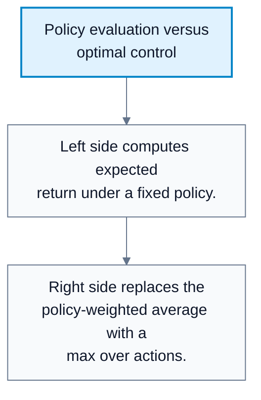
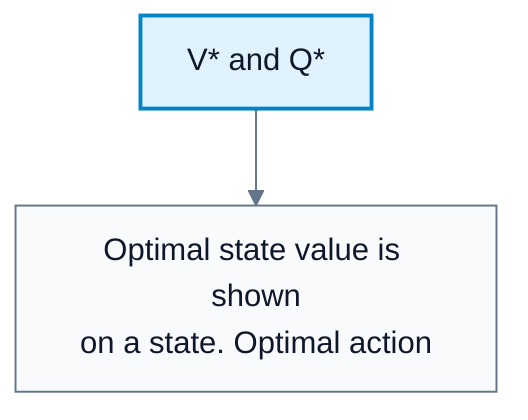
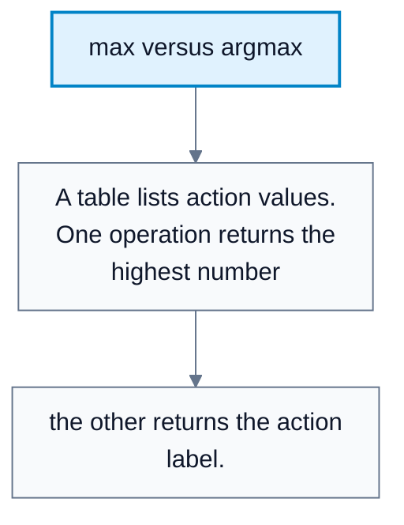

# Optimal Value Functions

**Subject**: CSC3041F Automated Planning  
**Source**: `RL/4RL_3041F_Edit.pdf`, Asad Jeewa, slides 1-13  
**Generated**: 2026-05-31

---

## Core Content

### From Policy Evaluation To Optimal Control

#### Definitions

> **Policy Evaluation**: Computing the expected return for a fixed policy. *In plain language: ask how good this current strategy is.*

> **Optimal Control**: Finding a policy that maximizes expected return. *In plain language: choose the best possible actions, not just evaluate a given strategy.*

Policy evaluation:

$$
V_{\pi}(s)=\sum_a \pi(a\mid s)\left[R(s,a)+\gamma V_{\pi}(s')\right]
$$

Optimal control changes the question:

$$
V^*(s)=\max_a\left[R(s,a)+\gamma V^*(s')\right]
$$

Policy evaluation asks: "What return do I get if I follow $\pi$?"  
Optimal control asks: "What is the best return achievable if I choose optimally?"

#### Diagram: Policy evaluation versus optimal control

Caption: The diagram shows the transition from evaluating behavior to improving behavior.

### Optimal State-Value And Action-Value Functions

#### Definitions

> **Optimal State-Value Function ($V^*(s)$)**: The maximum expected return achievable from state `s`. *In plain language: the best possible value of being in this state.*

> **Optimal Action-Value Function ($Q^*(s,a)$)**: The maximum expected return after taking action `a` in state `s`, then acting optimally. *In plain language: the best possible value after first choosing this action.*

Optimal Bellman equations:

$$
V^*(s)=\max_a\left[R(s,a)+\gamma V^*(s')\right]
$$

$$
Q^*(s,a)=R(s,a)+\gamma\max_{a'}Q^*(s',a')
$$

For stochastic transitions, the expectation over next states/rewards is included:

$$
V^*(s)=\max_a\sum_{s',r}p(s',r\mid s,a)\left[r+\gamma V^*(s')\right]
$$

#### Diagram: V* and Q*

Caption: State value scores the state; action value scores each possible first action.

### Optimal Policies

#### Definitions

> **Optimal Policy ($\pi^*$)**: A policy that achieves the optimal value function. *In plain language: a strategy that gets the best expected return.*

> **Policy Domination**: $\pi_1\ge \pi_2$ if $V_{\pi_1}(s)\ge V_{\pi_2}(s)$ for all states. *In plain language: one policy is at least as good from every starting state.*

The optimal value is:

$$
V^*(s)=\max_{\pi}V_{\pi}(s)
$$

The optimal value function is unique, but the optimal policy may not be unique. Multiple actions can tie for the same maximum value.
### Extracting A Policy From V* Or Q*

#### Definitions

> **max**: Returns the best value. *In plain language: what the best score is.*

> **argmax**: Returns the action that achieves the best value. *In plain language: which choice gives the best score.*

If $Q^*$ is known:

$$
\pi^*(s)=\arg\max_a Q^*(s,a)
$$

If only $V^*$ is known, do one-step lookahead using the model:

$$
\pi^*(s)=\arg\max_a\mathbb{E}\left[R_{t+1}+\gamma V^*(s')\right]
$$

Difference:

| Expression | Returns |
|---|---|
| $\max_a Q^*(s,a)$ | Best value |
| $\arg\max_a Q^*(s,a)$ | Best action |

#### Diagram: max versus argmax

Caption: This distinction is essential when extracting an optimal policy.

### Solving MDPs

The goal is to find or approximate $\pi^*$. Bellman optimality equations provide the target:

1. Solve or approximate $V^*$ or $Q^*$.
2. Extract $\pi^*$ by choosing best actions.
3. Use iterative methods when exact solution is impossible.

Challenges:

| Challenge | Why It Matters |
|---|---|
| Large state spaces | Cannot store or solve every state exactly |
| Continuous states/actions | Exact tabular methods do not apply |
| Large action spaces | The $\max$ over actions can be expensive |
### Bellman Optimality Derivation

The proof structure:

$$
\begin{aligned}
V^*(s)&=\max_{\pi}V_{\pi}(s)\\
&=\max_{\pi}\mathbb{E}_{\pi}[G_t\mid S_t=s]\\
G_t&=R_{t+1}+\gamma G_{t+1}\\
V^*(s)&=\max_a\mathbb{E}[R_{t+1}+\gamma G_{t+1}\mid S_t=s,A_t=a]\\
&=\max_a\mathbb{E}[R_{t+1}+\gamma V^*(S_{t+1})\mid S_t=s,A_t=a]\\
&=\max_a\sum_{s',r}p(s',r\mid s,a)[r+\gamma V^*(s')]\\
&=\max_a Q^*(s,a)
\end{aligned}
$$

The key move is optimizing separately over the first action, then assuming optimal behavior thereafter.

## Worked Examples

### Example 1: Policy Evaluation Versus Optimal Control

**Problem**: In state $(3,3)$, action values are:

$$
Q(s,\mathrm{Right})=0.999,\quad Q(s,\mathrm{Down})=-0.001,\quad Q(s,\mathrm{Left})=-0.001
$$

A policy chooses Right with probability `0.8`, Down with `0.2`, Left with `0`.

**Step 1: Policy evaluation**  
$V_{\pi}(3,3)=0.8(0.999)+0.2(-0.001)+0(-0.001)=0.799$.

**Step 2: Optimal control**  
$V^*(3,3)=\max\{0.999,-0.001,-0.001\}=0.999$.

**Answer**: The fixed policy is worth `0.799`; the optimal value is `0.999`.

### Example 2: max Versus argmax

**Problem**: $Q^*(s,\mathrm{Up})=4$, $Q^*(s,\mathrm{Right})=7$, $Q^*(s,\mathrm{Down})=2$.

**Step 1: max**  
$\max_a Q^*(s,a)=7$.

**Step 2: argmax**  
$\arg\max_a Q^*(s,a)=\mathrm{Right}$.

**Answer**: The best value is `7`; the optimal action is `Right`.

---

## Common Mistakes / Gotchas

- Confusing $V_{\pi}$ with $V^*$. The first is for a fixed policy; the second is best over policies.
- Confusing $\max$ with $\arg\max$.
- Assuming the optimal policy is unique. It may not be if actions tie.
- Trying to extract a policy from $V^*$ without a model. One-step lookahead needs transition and reward information.
- Forgetting expectations over next states in stochastic MDPs.
- Treating Bellman optimality equations as easy to solve exactly in large spaces.

---

## Summary / Cheat Sheet

| Term | Meaning |
|---|---|
| Policy evaluation | Compute value of fixed $\pi$ |
| Optimal control | Find best policy |
| $V^*(s)$ | Best achievable state value |
| $Q^*(s,a)$ | Best achievable value after first action `a` |
| $\pi^*$ | Optimal policy |
| max | Best value |
| argmax | Action giving best value |

**Key Formulas**:

$$
V^*(s)=\max_{\pi}V_{\pi}(s)
$$

$$
V^*(s)=\max_a\sum_{s',r}p(s',r\mid s,a)[r+\gamma V^*(s')]
$$

$$
Q^*(s,a)=R(s,a)+\gamma\max_{a'}Q^*(s',a')
$$

$$
\pi^*(s)=\arg\max_a Q^*(s,a)
$$

**Key Takeaways**:

- Optimal control replaces policy averaging with action maximization.
- $V^*$ is unique; $\pi^*$ may not be.
- $Q^*$ directly supports action selection.
- Bellman optimality equations define the target for solving MDPs.

---

## Practice Questions

**Q1**: What is the difference between policy evaluation and optimal control?  
> Answer: Policy evaluation computes return for a fixed policy; optimal control finds the best policy.

**Q2**: If two actions tie for the highest $Q^*$, what happens to the optimal policy?  
> Answer: There may be multiple optimal policies, each choosing one of the tied actions.

**Q3**: Why does extracting $\pi^*$ from $V^*$ require a model?  
> Answer: You must evaluate each action's expected immediate reward plus next-state value, which requires transition and reward information.

**Q4**: What does $\arg\max_a Q^*(s,a)$ return?  
> Answer: The action with the highest optimal action value in state `s`.
