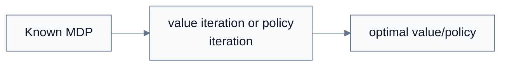
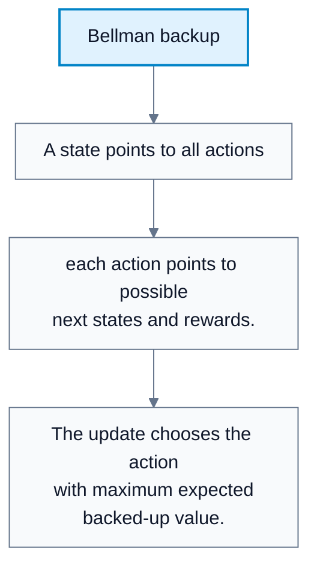
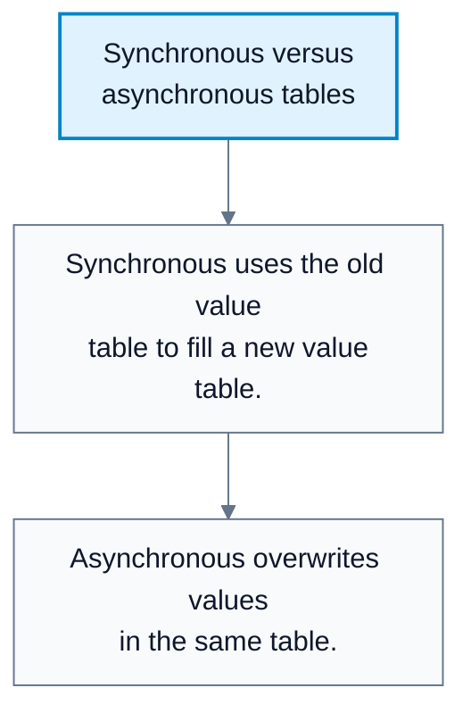
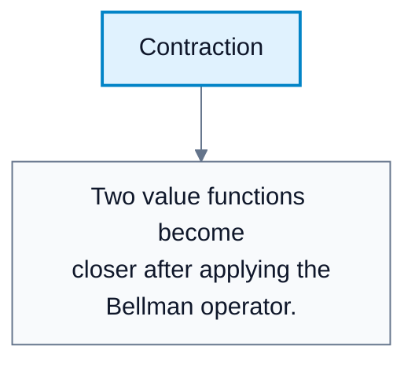

# Value Iteration

**Subject**: CSC3041F Automated Planning  
**Source**: `RL/5RL_3041F_Edit.pdf`, Asad Jeewa, slides 1-18  
**Generated**: 2026-05-31

---

## Core Content

### Solving A Known MDP

#### Definitions

> **Value Iteration**: A dynamic programming algorithm that repeatedly applies the Bellman optimality update to find $V^*$. *In plain language: keep updating state values until they converge to optimal values.*

> **Dynamic Programming (DP)**: Solving a problem by combining solutions to overlapping subproblems. *In plain language: solve smaller value problems and reuse them.*

> **Model-Based Algorithm**: An algorithm assuming transition dynamics and rewards are known. *In plain language: it plans with a known model of the environment.*

Value iteration assumes:

1. Finite/discrete state space.
2. Finite/discrete action space.
3. Known transition model `T`.
4. Known reward function `R`.

Goal:

$$
\text{Find }\pi^*\text{ that maximizes expected return.}
$$

#### Diagram: Bigger picture of exact model-based RL



Caption: Value iteration is one exact planning method for known finite MDPs.


### Bellman Optimality As An Update

#### Definitions

> **Bellman Optimality Operator (`T`)**: The operator that maps a value function to a new value function using the optimality update. *In plain language: one full round of "make values more optimal".*

The Bellman optimality equation:

$$
V^*(s)=\max_a\sum_{s',r}p(s',r\mid s,a)[r+\gamma V^*(s')]
$$

Value iteration repeatedly applies the update:

$$
V_{k+1}(s)=\max_a\sum_{s',r}p(s',r\mid s,a)[r+\gamma V_k(s')]
$$

The lecture describes Bellman as top-down recursive and value iteration as bottom-up: values are repeatedly improved from successor-state estimates.
### Value Iteration Algorithm

```text
VALUE-ITERATION(MDP, theta):
    initialize V(s) arbitrarily, often 0 for all states
    repeat:
        delta = 0
        for each state s:
            old = V(s)
            V(s) = max_a sum_{s',r} p(s',r|s,a)[r + gamma V(s')]
            delta = max(delta, |old - V(s)|)
    until delta < theta
    return policy pi where pi(s) = argmax_a sum_{s',r} p(s',r|s,a)[r + gamma V(s')]
```

The result is a value function close to $V^*$, from which an optimal or near-optimal policy is extracted greedily.

#### Diagram: Bellman backup



Caption: This is the computation performed for every state in a value iteration sweep.


### Synchronous And Asynchronous Updates

#### Definitions

> **Synchronous Update**: Updating all states using values from the previous iteration. *In plain language: compute the next table from a frozen old table.*

> **Asynchronous Update**: Updating states one at a time using the latest available values. *In plain language: update in place and immediately reuse new values.*

Comparison:

| Scheme | How It Updates | Benefit |
|---|---|---|
| Synchronous | Uses separate old and new value tables | Consistent and parallelizable |
| Asynchronous | Updates values in place | Often faster convergence |

#### Diagram: Synchronous versus asynchronous tables



Caption: The update scheme affects implementation and speed but not the Bellman target.


### Complexity

The lecture gives value iteration complexity for stochastic environments as:

$$
O(|S|^2|A|)
$$

Reason:

1. Loop over states: $|S|$.
2. Loop over actions: $|A|$.
3. Loop over next states: $|S|$.

This is per full sweep/iteration. The number of iterations needed depends on discount factor, convergence threshold, and MDP structure.
### Challenges

Value iteration limitations:

| Challenge | Explanation |
|---|---|
| Requires perfect model | Needs transition `T` and reward `R` |
| Curse of dimensionality | State/action spaces can be too large |
| Tabular assumption | Exact table does not work for continuous spaces |
| Computational cost | Repeated sweeps can be expensive |
### Convergence

#### Definitions

> **Contraction**: An operator that brings value functions closer together by a factor less than 1. *In plain language: repeated updates shrink errors.*

> **Infinity Norm ($\|\cdot\|_{\infty}$)**: The maximum absolute difference across all states. *In plain language: the biggest disagreement anywhere in the value table.*

The Bellman optimality operator is a contraction when $0\le\gamma<1$:

$$
\|\mathcal{T}V-\mathcal{T}U\|_{\infty}\le \gamma\|V-U\|_{\infty}
$$

This guarantees convergence to a unique fixed point, which is $V^*$.

The lecture emphasizes that $k$ in $V_k$ means iteration number, not timestep.

#### Diagram: Contraction



Caption: Contraction is why repeated Bellman updates converge.

## Worked Examples

### Example 1: One Bellman Update

**Problem**: State $s$ has two deterministic actions. $\gamma=0.9$.

| Action | Reward | Next State Value |
|---|---:|---:|
| A | 1 | 5 |
| B | 3 | 2 |

**Step 1: Compute backed-up value for A**  
$1+0.9\cdot5=5.5$.

**Step 2: Compute backed-up value for B**  
$3+0.9\cdot2=4.8$.

**Step 3: Take max**  
$\max(5.5,4.8)=5.5$.

**Answer**: New value is $V(s)=5.5$, and greedy action is $A$.

### Example 2: Complexity Count

**Problem**: An MDP has $100$ states and $4$ actions. Each action can transition to any state.

**Step 1: Count state-action-next-state operations**  
$|S|^2|A|=100^2\cdot4$.

**Step 2: Compute**  
$10{,}000\cdot4=40{,}000$.

**Answer**: One full value iteration sweep has about $40{,}000$ transition computations.

---

## Common Mistakes / Gotchas

- Trying to run value iteration without a transition/reward model.
- Confusing iteration index $k$ with environment timestep $t$.
- Forgetting the $\max$ over actions in the Bellman optimality update.
- Assuming one sweep gives $V^*$. Convergence usually requires repeated sweeps.
- Ignoring the cost of summing over next states in stochastic MDPs.
- Applying tabular value iteration directly to huge continuous spaces.

---

## Summary / Cheat Sheet

| Term | Meaning |
|---|---|
| Value iteration | Repeated Bellman optimality updates |
| DP | Reuse overlapping subproblem solutions |
| Model-based | Requires known `T` and `R` |
| Synchronous | Use old table to fill new table |
| Asynchronous | Update in place |
| Contraction | Operator shrinks value-function error |

**Key Formulas**:

$$
V_{k+1}(s)=\max_a\sum_{s',r}p(s',r\mid s,a)[r+\gamma V_k(s')]
$$

$$
\pi(s)=\arg\max_a\sum_{s',r}p(s',r\mid s,a)[r+\gamma V(s')]
$$

$$
\text{Complexity per sweep}=O(|S|^2|A|)
$$

$$
\|\mathcal{T}V-\mathcal{T}U\|_{\infty}\le \gamma\|V-U\|_{\infty}
$$

**Key Takeaways**:

- Value iteration solves finite known MDPs by approximating $V^*$.
- It repeatedly applies Bellman optimality updates.
- Synchronous and asynchronous schemes differ in table update mechanics.
- Convergence is guaranteed by the contraction property when $\gamma<1$.

---

## Practice Questions

**Q1**: What model information does value iteration require?  
> Answer: It requires transition probabilities and rewards, plus the state/action sets and discount factor.

**Q2**: Why is value iteration called dynamic programming?  
> Answer: Each state's value is a subproblem depending on successor-state values, and updates reuse those subproblem estimates.

**Q3**: What does $\theta$ usually control in value iteration pseudocode?  
> Answer: The convergence threshold for stopping when value changes become small.

**Q4**: Why does value iteration have $O(|S|^2|A|)$ complexity per sweep in stochastic MDPs?  
> Answer: For each state and action, the update may sum over all possible next states.
