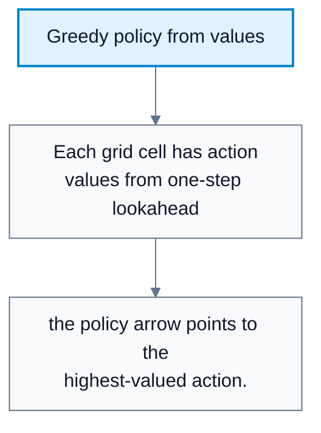
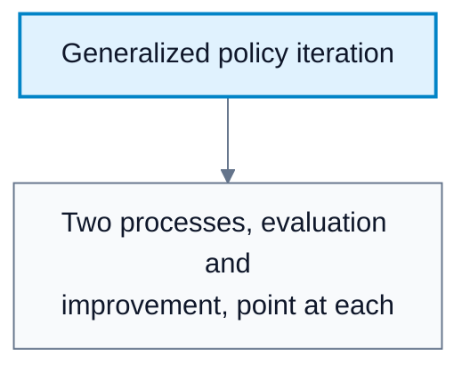
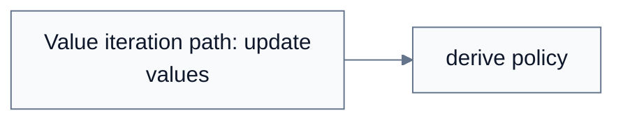

---
tags:
  - automated-planning
---

# Policy Iteration

**Subject**: CSC3041F Automated Planning  
**Source**: `RL/6RL_3041F_Edit.pdf`, Asad Jeewa, slides 1-18  
**Generated**: 2026-05-31

---

## Contents

- [[#Core Content|Core Content]]
  - [[#Relationship To Value Iteration|Relationship To Value Iteration]]
  - [[#Policy Evaluation|Policy Evaluation]]
  - [[#Policy Improvement|Policy Improvement]]
  - [[#Policy Iteration Algorithm|Policy Iteration Algorithm]]
  - [[#Synchronous And Asynchronous Policy Iteration|Synchronous And Asynchronous Policy Iteration]]
  - [[#Convergence And Policy Improvement|Convergence And Policy Improvement]]
  - [[#Generalized Policy Iteration|Generalized Policy Iteration]]
  - [[#Choosing Policy Iteration Or Value Iteration|Choosing Policy Iteration Or Value Iteration]]

---

## Core Content

### Relationship To Value Iteration

#### Definitions

> **Policy Iteration**: A dynamic programming algorithm that alternates between evaluating a policy and improving it. *In plain language: score the current plan, then make the plan greedier, and repeat.*

> **Policy Evaluation**: Computing $V_{\pi}$ for the current policy. *In plain language: how good is my current plan?*

> **Policy Improvement**: Updating the policy to choose better actions according to the current value function. *In plain language: can I improve my plan by changing actions?*

Value iteration computes $V^*$ directly and derives $\pi^*$ after convergence. Policy iteration keeps an explicit policy throughout:

| Method | Main Object | Repeated Step |
|---|---|---|
| Value iteration | Value function | Apply Bellman optimality update |
| Policy iteration | Policy plus value function | Evaluate policy, then improve policy |

Both are exact model-based dynamic programming methods for finite MDPs.
### Policy Evaluation

#### Definitions

> **Bellman Expectation Equation**: The Bellman equation for a fixed policy. *In plain language: value when you follow the current strategy, not necessarily the best one.*

For a fixed policy $\pi$, evaluation solves:

$$
V_{\pi}(s)=\sum_a\pi(a\mid s)\sum_{s',r}p(s',r\mid s,a)[r+\gamma V_{\pi}(s')]
$$

This can be solved exactly or approximately by repeated sweeps until values stabilize.
### Policy Improvement

#### Definitions

> **Greedy Policy**: A policy that chooses an action with maximum one-step lookahead value. *In plain language: choose the action that looks best according to the current value table.*

Given a value function, improve the policy by:

$$
\pi_{\mathrm{new}}(s)=\arg\max_a\sum_{s',r}p(s',r\mid s,a)[r+\gamma V_{\pi}(s')]
$$

If $\pi_{\mathrm{new}}$ is the same as $\pi$ for all states, the policy is stable and optimal for a finite MDP.

#### Diagram: Greedy policy from values



Caption: Policy improvement turns value estimates into actions.


### Policy Iteration Algorithm

```text
POLICY-ITERATION(MDP):
    initialize policy pi arbitrarily
    initialize V(s) arbitrarily

    repeat:
        # Policy evaluation
        compute or approximate V_pi

        policy_stable = true

        # Policy improvement
        for each state s:
            old_action = pi(s)
            pi(s) = argmax_a sum_{s',r} p(s',r|s,a)[r + gamma V(s')]
            if pi(s) != old_action:
                policy_stable = false

    until policy_stable
    return pi, V
```

The lecture's plain-language pattern:

1. Evaluate: "How much is my current plan worth?"
2. Improve: "Can I do better by changing my actions?"
3. Repeat until the plan stops changing.
### Synchronous And Asynchronous Policy Iteration

#### Definitions

> **Synchronous Policy Iteration**: Evaluate all states fully, then improve the policy for all states. *In plain language: finish scoring the whole plan before changing it.*

> **Asynchronous Policy Iteration**: Evaluate and improve individual states one at a time or in partial batches. *In plain language: update pieces of the plan as you go.*

| Scheme | Description |
|---|---|
| Synchronous | Separate full evaluation and full improvement phases |
| Asynchronous | Interleave evaluation and improvement in a chosen order |
### Convergence And Policy Improvement

#### Definitions

> **Policy Improvement Theorem**: If a new greedy policy is no worse than the old policy in every state, repeated improvement reaches an optimal policy in finite MDPs. *In plain language: greedifying a value function cannot make the policy worse when done correctly.*

Policy iteration is guaranteed to find an optimal policy in a finite number of policy improvements for finite tabular MDPs.
### Generalized Policy Iteration

#### Definitions

> **Generalized Policy Iteration (GPI)**: The framework where policy evaluation and policy improvement interact, possibly partially or approximately. *In plain language: keep estimating values and improving behavior, even if neither step is fully finished.*

GPI relaxes strict policy iteration:

1. Evaluation may be partial or approximate.
2. Improvement may happen after each evaluation step.
3. The two processes influence each other continuously.

Many modern RL algorithms are forms of GPI.

#### Diagram: Generalized policy iteration



Caption: Modern RL often alternates partial evaluation and partial improvement.


### Choosing Policy Iteration Or Value Iteration

| Method | Strength | Cost |
|---|---|---|
| Policy iteration | Tracks policy improvement explicitly; often fewer iterations | Each iteration can be expensive because evaluation may be costly |
| Value iteration | Simpler per iteration; directly updates values | May require more iterations; policy produced after convergence |

Policy iteration is attractive when a reasonable initial policy is available.

#### Diagram: Value iteration versus policy iteration



Caption: The diagram shows that policy iteration explicitly maintains the policy.
