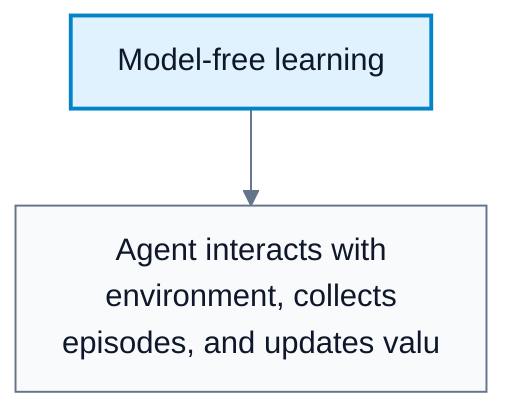
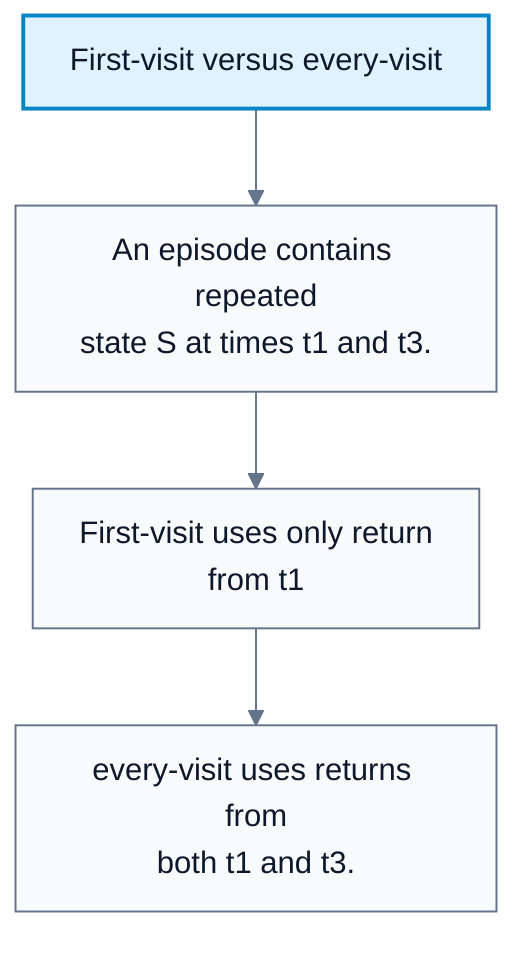
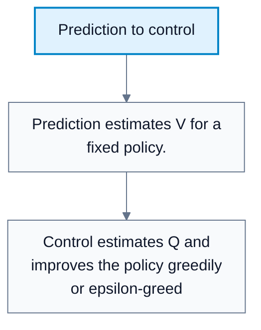

# Monte Carlo Methods

**Subject**: CSC3041F Automated Planning  
**Source**: `RL/7RL_3041F_Edit.pdf`, Asad Jeewa, slides 1-17  
**Generated**: 2026-05-31

---

## Core Content

### Model-Free RL

#### Definitions

> **Model-Free RL**: RL where transition dynamics `T` and reward function `R` are not known as models. *In plain language: learn from experience instead of planning with known rules.*

> **Experience**: Observed states, actions, rewards, and next states from interacting with the environment. *In plain language: the data generated by acting.*

In many real-world problems, the environment model is unknown or too complex. Without a model, the agent learns values from actual or sampled experience.

Model-free methods include:

1. Monte Carlo methods.
2. Temporal Difference learning.
### Monte Carlo Methods

#### Definitions

> **Monte Carlo Method**: A method using random sampling to estimate quantities that are difficult to compute exactly. *In plain language: estimate by averaging samples.*

> **Episode**: A complete trajectory from a starting state to a terminal state. *In plain language: one full run of the task.*

> **Monte Carlo Prediction**: Estimating $V_{\pi}(s)$ for a fixed policy from sampled episodes. *In plain language: evaluate a policy using complete experience returns.*

Monte Carlo RL learns value functions from episodes. It waits until the episode ends, computes actual returns, then updates value estimates.

Comparison:

| Method | Sampling Use |
|---|---|
| Monte Carlo RL | Learn value functions from episodes |
| Monte Carlo search | Evaluate actions through simulated rollouts |

#### Diagram: Model-free learning

Caption: Monte Carlo learns from sampled experience rather than a known model.

### Bootstrapping Contrast

#### Definitions

> **Bootstrapping**: Updating an estimate using another estimate. *In plain language: improve a guess using a later guess instead of waiting for final truth.*

Monte Carlo does not bootstrap. It waits for the full return:

$$
G_t=R_{t+1}+\gamma R_{t+2}+\cdots
$$

Then it updates $V(s)$ toward $G_t$.
### Monte Carlo Properties

| Property | Monte Carlo |
|---|---|
| Model-free | Does not need known `T` or `R` |
| Update timing | After episode ends |
| Bootstrapping | No |
| Data requirement | Many episodes may be needed |
| Variance | Can be high |
| Domain type | Works naturally with episodic tasks |

Monte Carlo estimates are unbiased for $V_{\pi}$ when returns are sampled correctly, but they can have high variance because full trajectories include many random events.
### First-Visit And Every-Visit MC

#### Definitions

> **First-Visit Monte Carlo**: Uses only the return following the first occurrence of a state in an episode. *In plain language: update a state once per episode, at its first visit.*

> **Every-Visit Monte Carlo**: Uses the return following every occurrence of a state in an episode. *In plain language: update a state every time it appears.*

Procedure:

1. Collect episodes by following policy $\pi$.
2. For each visited state `s`, compute the return $G_t$ following that visit.
3. Update $V(s)$ from observed returns.

Comparison:

| Method | Benefit | Drawback |
|---|---|---|
| First-visit MC | Simpler; unbiased estimate | Uses less data per episode |
| Every-visit MC | Useful with limited data | Repeated visits are correlated and redundant |

#### Diagram: First-visit versus every-visit

Caption: The two methods differ in how repeated states inside one episode are used.

### MC Prediction

For a fixed policy:

$$
V(s)=\frac{1}{N(s)}\sum_{i=1}^{N(s)}G_i(s)
$$

Incremental update:

$$
V(s)\leftarrow V(s)+\alpha\left[G_t-V(s)\right]
$$

where $\alpha$ is the learning rate. If using sample averages, $\alpha$ can be $1/N(s)$.
### From Prediction To Control

#### Definitions

> **Monte Carlo Control**: Learning action values and improving the policy using Monte Carlo returns. *In plain language: use episode outcomes to learn which actions are good and make the policy greedier.*

Control requires action values:

$$
Q(s,a)=\frac{1}{N(s,a)}\sum_{i=1}^{N(s,a)}G_i(s,a)
$$

Monte Carlo control loop:

1. Generate episodes using an exploratory policy, often epsilon-greedy.
2. Update $Q(s,a)$ from sampled returns.
3. Improve the policy toward greediness with respect to `Q`.
4. Repeat until the policy stabilizes or performance is acceptable.

Exploration is needed so that all useful state-action pairs are sampled.

#### Diagram: Prediction to control

Caption: Control needs action values because it must choose actions.

## Worked Examples

### Example 1: First-Visit Return Average

**Problem**: State $S$ is first visited in three episodes with returns $4$, $6$, and $5$.

**Step 1: Sum returns**  
$4+6+5=15$.

**Step 2: Divide by visits**  
$15/3=5$.

**Answer**: $V(S)=5$.

### Example 2: Incremental MC Update

**Problem**: Current $V(S)=4$, observed return $G=10$, learning rate $\alpha=0.25$.

**Step 1: Compute error**  
$G-V(S)=10-4=6$.

**Step 2: Update**  
$V(S)\leftarrow4+0.25\cdot6=5.5$.

**Answer**: New value estimate is $5.5$.

### Example 3: MC Control Policy Improvement

**Problem**: For state `s`, learned action values are $Q(s,\mathrm{Left})=2$, $Q(s,\mathrm{Right})=5$.

**Step 1: Choose greedy action**  
`Right` has higher value.

**Step 2: Improve policy**  
Set the policy to choose `Right` most often, while still exploring if epsilon-greedy.

**Answer**: The policy shifts toward `Right`.

---

## Common Mistakes / Gotchas

- Trying to update Monte Carlo values before an episode has finished.
- Forgetting that classic MC needs episodic tasks.
- Confusing Monte Carlo RL with Monte Carlo tree search.
- Ignoring exploration in MC control.
- Assuming every-visit samples are independent. Repeated visits in one episode are correlated.
- Using state values $V$ when action selection requires action values $Q$.

---

## Summary / Cheat Sheet

| Term | Meaning |
|---|---|
| Monte Carlo | Estimate by averaging sampled returns |
| Episode | Complete trajectory to terminal state |
| First-visit MC | Update from first occurrence per episode |
| Every-visit MC | Update from every occurrence per episode |
| MC prediction | Estimate $V_{\pi}$ |
| MC control | Estimate `Q` and improve policy |
| Bootstrapping | Updating from another estimate; MC does not bootstrap |

**Key Formulas**:

$$
V(s)=\frac{1}{N(s)}\sum_{i=1}^{N(s)}G_i(s)
$$

$$
V(s)\leftarrow V(s)+\alpha\left[G_t-V(s)\right]
$$

$$
Q(s,a)=\frac{1}{N(s,a)}\sum_{i=1}^{N(s,a)}G_i(s,a)
$$

**Key Takeaways**:

- Monte Carlo methods are model-free.
- They update from complete sampled returns.
- They are unbiased but can have high variance.
- Control requires exploration and action values.

---

## Practice Questions

**Q1**: Why does Monte Carlo prediction wait until the episode ends?  
> Answer: It needs the full return $G_t$, which includes rewards until termination.

**Q2**: What is the difference between first-visit and every-visit MC?  
> Answer: First-visit uses only the first occurrence of a state per episode; every-visit uses all occurrences.

**Q3**: Why does MC control estimate $Q(s,a)$ instead of only $V(s)$?  
> Answer: To improve a policy, the agent must compare actions in each state.

**Q4**: What is the main disadvantage of Monte Carlo methods?  
> Answer: They can have high variance and require complete episodes.
