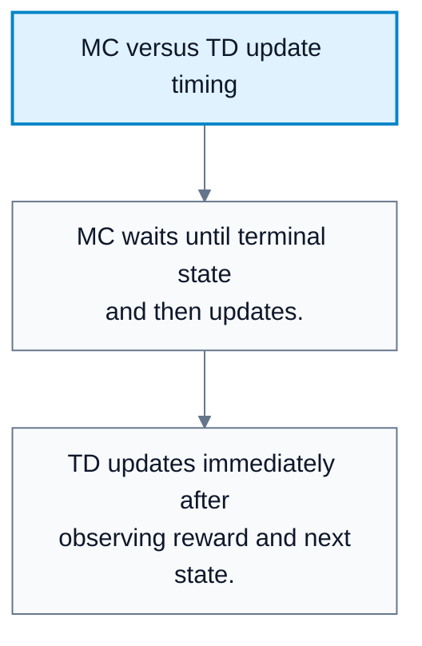
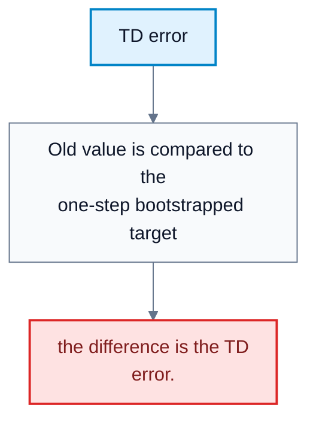
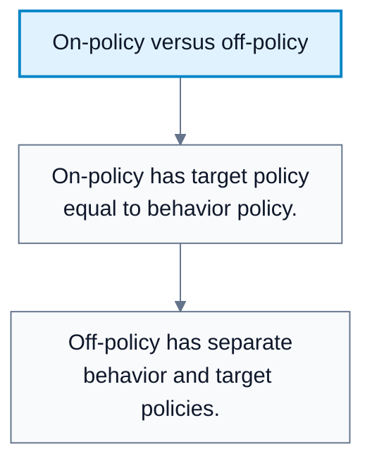
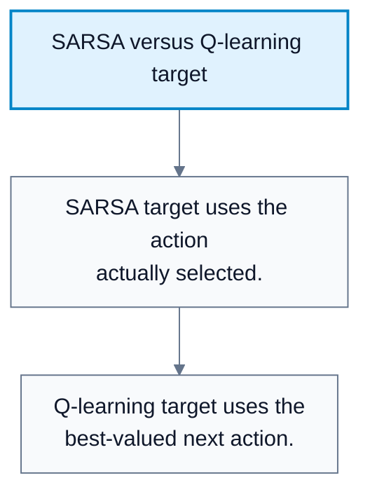

# Temporal Difference Learning

**Subject**: CSC3041F Automated Planning  
**Source**: `RL/8RL_3041F_Edit.pdf`, Asad Jeewa, slides 1-22  
**Generated**: 2026-05-31

---

## Core Content

### Why Temporal Difference Learning

#### Definitions

> **Temporal Difference (TD) Learning**: Model-free learning that updates value estimates using observed rewards and current value estimates of successor states. *In plain language: learn after each step using one real reward plus a guess about the future.*

> **Online Update**: Updating during the episode rather than after it finishes. *In plain language: learn step by step while acting.*

Monte Carlo waits until an episode ends. That is inefficient or impossible in tasks that:

1. Have no natural terminal state.
2. Have very long episodes.
3. Need rapid updates, such as driving, trading, robotics, or game move evaluation.

TD learning solves this by bootstrapping.

#### Diagram: MC versus TD update timing

Caption: TD is suitable for continuing or long-running tasks.

#### Diagram: TD error

Caption: TD learning moves estimates toward one-step targets.

### TD Properties

#### Definitions

> **TD Target**: The one-step target $R+\gamma V(s')$. *In plain language: actual reward now plus estimated future value.*

> **TD Error**: Difference between the TD target and the current estimate. *In plain language: how wrong the current prediction was after seeing one step.*

TD is:

| Property | Meaning |
|---|---|
| Model-free | Does not need known `T` or `R` |
| Bootstrapping | Uses current value estimates |
| Online | Updates after each transition |
| Data-driven | Learns from observed states, actions, rewards |

TD error:

$$
\delta_t=R_{t+1}+\gamma V(S_{t+1})-V(S_t)
$$

TD(0) value update:

$$
V(S_t)\leftarrow V(S_t)+\alpha\delta_t
$$
### Monte Carlo Versus TD

| Feature | Monte Carlo | Temporal Difference |
|---|---|---|
| Model-free | Yes | Yes |
| Natural domains | Episodic | Continuing or episodic |
| Bootstrapping | No | Yes |
| Bias/variance | Unbiased, high variance | Biased, lower variance |
| Update timing | After episode ends | Step by step |
| Convergence speed | Can be slower | Often faster |

TD is biased because it updates from current estimates, but it often has lower variance and learns faster.
### Learning Rate Alpha

#### Definitions

> **Learning Rate ($\alpha$)**: Step size controlling how much a new update changes the estimate. *In plain language: how much the agent trusts new evidence.*

High $\alpha$ means recent experience strongly overwrites old knowledge. Low $\alpha$ averages new data cautiously. A decaying learning rate acts like $1/N$, trusting early data strongly and later data less as more samples accumulate.

Generic update pattern:

$$
\mathrm{NewEstimate}\leftarrow \mathrm{OldEstimate}+\alpha(\mathrm{Target}-\mathrm{OldEstimate})
$$
### N-Step TD And Bias-Variance

#### Definitions

> **N-Step TD**: TD that uses `n` rewards before bootstrapping from a later value estimate. *In plain language: look ahead several steps, then use a value guess.*

> **Bias-Variance Trade-Off**: The trade-off between systematic error from bootstrapping and noise from sampled returns. *In plain language: shorter guesses are biased but stable; longer sampled returns are less biased but noisier.*

$TD(0)$ uses one reward before bootstrapping. Monte Carlo uses the whole episode and no bootstrap term. N-step TD lies between them:

$$
G_t^{(n)}=R_{t+1}+\gamma R_{t+2}+\cdots+\gamma^{n-1}R_{t+n}+\gamma^nV(S_{t+n})
$$

As `n` increases:

1. Bootstrapping bias decreases.
2. Variance increases.
3. The update becomes more Monte Carlo-like.
### From Prediction To Control

TD prediction estimates $V_{\pi}(s)$ for a fixed policy. TD control estimates $Q(s,a)$ and improves the policy.

Control loop:

1. Generate experience with an exploratory policy.
2. Update $Q(s,a)$ after each step using TD errors.
3. Improve the policy toward greedy behavior with respect to `Q`.
4. Repeat.
### On-Policy And Off-Policy Learning

#### Definitions

> **Target Policy**: The policy being learned or evaluated. *In plain language: the strategy the algorithm is trying to improve.*

> **Behavior Policy**: The policy used to generate actions and data. *In plain language: the strategy used to act while collecting experience.*

> **On-Policy Learning**: Learning about the same policy used to act. *In plain language: learn from what you actually do.*

> **Off-Policy Learning**: Learning about a different policy from the one used to act. *In plain language: learn a target strategy from exploratory or external behavior.*

Why separate policies?

1. Exploration: act randomly while learning a stable greedy policy.
2. Data efficiency: reuse old data.
3. Safety: learn from safer behavior data.

#### Diagram: On-policy versus off-policy

Caption: Separating policies allows exploration while learning a different greedy target.

### SARSA And Q-Learning

#### Definitions

> **SARSA**: An on-policy TD control algorithm using the tuple `(S, A, R, S', A')`. *In plain language: update based on the action the current policy actually takes next.*

> **Q-Learning**: An off-policy TD control algorithm that updates toward the best next action. *In plain language: learn as if the agent will act greedily next, even if it explores now.*

SARSA update:

$$
Q(S_t,A_t)\leftarrow Q(S_t,A_t)+\alpha\left[R_{t+1}+\gamma Q(S_{t+1},A_{t+1})-Q(S_t,A_t)\right]
$$

Q-learning update:

$$
Q(S_t,A_t)\leftarrow Q(S_t,A_t)+\alpha\left[R_{t+1}+\gamma\max_a Q(S_{t+1},a)-Q(S_t,A_t)\right]
$$

Comparison:

| Feature | SARSA | Q-Learning |
|---|---|---|
| Policy type | On-policy | Off-policy |
| Behavior policy | Epsilon-greedy | Epsilon-greedy |
| Target | Actual next action `A'` | Greedy best next action |
| Strategy | Learns from what it does | Learns from best it could do |
| Risk | More conservative | More aggressive |
| Trade-off | More stable | More sample efficient |

#### Diagram: SARSA versus Q-learning target

Caption: This single target difference explains the conservative/aggressive behavior difference.

## Worked Examples

### Example 1: TD(0) Value Update

**Problem**: $V(s)=10$, reward $R=2$, $V(s')=12$, $\gamma=0.5$, $\alpha=0.1$.

**Step 1: Compute target**  
$R+\gamma V(s')=2+0.5\cdot12=8$.

**Step 2: Compute TD error**  
$\delta=8-10=-2$.

**Step 3: Update**  
$V(s)\leftarrow10+0.1(-2)=9.8$.

**Answer**: New value estimate is $9.8$.

### Example 2: SARSA Versus Q-Learning Target

**Problem**: $R=1$, $\gamma=0.9$, next action actually chosen has $Q(s',a')=3$, and the best next action has value $5$.

**Step 1: SARSA target**  
$1+0.9\cdot3=3.7$.

**Step 2: Q-learning target**  
$1+0.9\cdot5=5.5$.

**Answer**: Q-learning updates toward a more optimistic greedy target; SARSA updates toward the behavior actually taken.

---

## Common Mistakes / Gotchas

- Saying TD is Monte Carlo because both are model-free. TD bootstraps; MC does not.
- Forgetting that TD can update before episode termination.
- Confusing target policy and behavior policy.
- Using the Q-learning max target in SARSA.
- Ignoring the learning rate's effect on stability.
- Assuming a larger `n` is always better in n-step TD. It reduces bias but increases variance.

---

## Summary / Cheat Sheet

| Term | Meaning |
|---|---|
| TD learning | Model-free bootstrapping |
| TD target | $R+\gamma V(s')$ |
| TD error | Target minus old estimate |
| Alpha | Learning rate |
| N-step TD | Uses `n` rewards before bootstrapping |
| On-policy | Learn about behavior policy |
| Off-policy | Learn target policy from different behavior |
| SARSA | On-policy TD control |
| Q-learning | Off-policy TD control |

**Key Formulas**:

$$
\delta_t=R_{t+1}+\gamma V(S_{t+1})-V(S_t)
$$

$$
V(S_t)\leftarrow V(S_t)+\alpha\delta_t
$$

$$
G_t^{(n)}=R_{t+1}+\gamma R_{t+2}+\cdots+\gamma^{n-1}R_{t+n}+\gamma^nV(S_{t+n})
$$

SARSA:

$$
Q(S,A)\leftarrow Q(S,A)+\alpha\left[R+\gamma Q(S',A')-Q(S,A)\right]
$$

Q-learning:

$$
Q(S,A)\leftarrow Q(S,A)+\alpha\left[R+\gamma\max_a Q(S',a)-Q(S,A)\right]
$$

**Key Takeaways**:

- TD combines model-free learning with bootstrapping.
- It updates online, making it useful for long or continuing tasks.
- SARSA learns from actual behavior; Q-learning learns a greedy target.
- Bias and variance are controlled partly by how far ahead the update looks.

---

## Practice Questions

**Q1**: What is the TD error?  
> Answer: The difference between the target $R+\gamma V(s')$ and the current estimate $V(s)$.

**Q2**: Why is TD useful for continuing tasks?  
> Answer: It updates after each step and does not need an episode to terminate.

**Q3**: What is the key difference between SARSA and Q-learning?  
> Answer: SARSA uses the value of the actual next action; Q-learning uses the maximum next action value.

**Q4**: Is TD biased or unbiased?  
> Answer: TD is generally biased because it updates using current estimates, but it often has lower variance than Monte Carlo.
