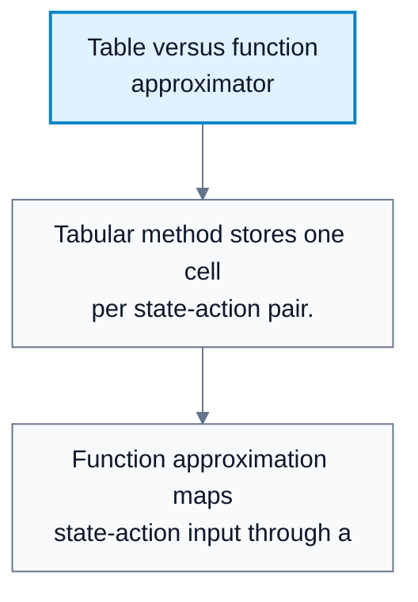
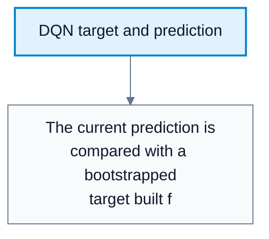
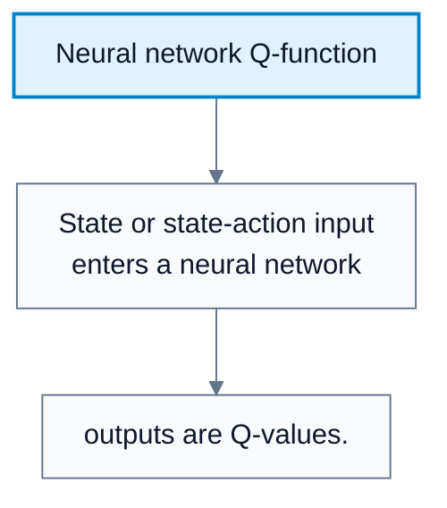
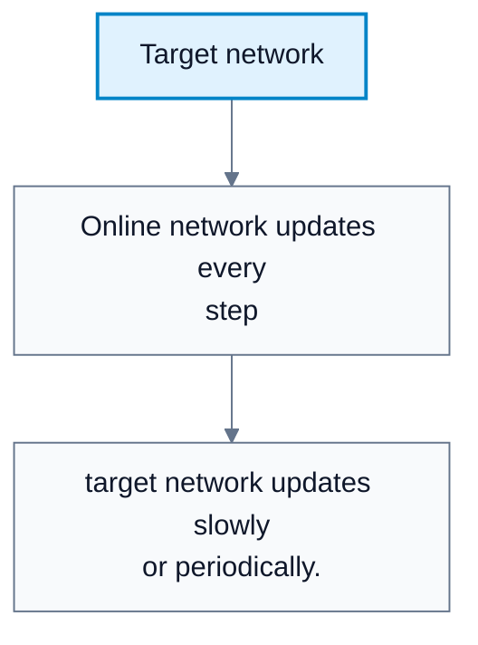
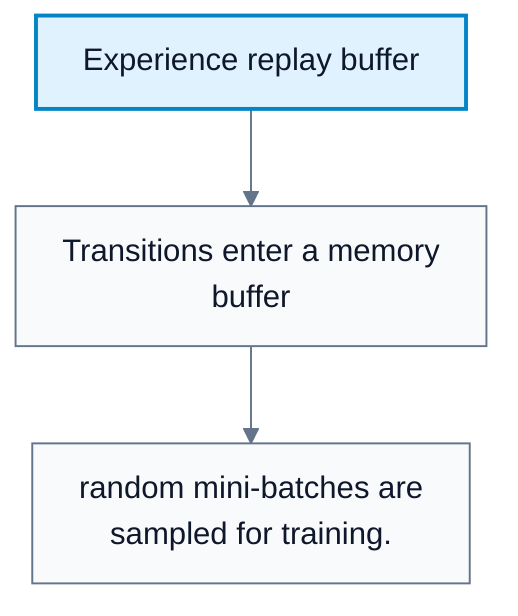

# Function Approximation And DQN

**Subject**: CSC3041F Automated Planning  
**Source**: `RL/9RL_3041F_Edit.pdf`, Asad Jeewa, slides 1-18  
**Generated**: 2026-05-31

---

## Core Content

### Why Tables Do Not Scale

#### Definitions

> **Tabular RL**: RL that stores one value for every state or state-action pair. *In plain language: a lookup table of values.*

> **Function Approximation**: Replacing a table with a parameterized function. *In plain language: learn a formula/model that predicts values, including for unseen states.*

Tabular Q-learning stores $Q(s,a)$ for every state-action pair. Real-world tasks often have huge or continuous state spaces, so:

1. Memory explodes.
2. Most states are never visited.
3. Exact state-action tables cannot generalize.

Function approximation replaces the table:

$$
Q(s,a)\to Q(s,a;\theta)
$$

where $\theta$ are learnable parameters.

#### Diagram: Table versus function approximator



Caption: Function approximation enables generalization to unseen states.


### Parameterized Value Functions

#### Definitions

> **Parameter ($\theta$)**: A tunable value inside the model. *In plain language: a learned weight controlling predictions.*

> **Generalization**: Applying learned structure from seen states to unseen states. *In plain language: use patterns instead of memorizing every exact case.*

Possible approximators:

| Function Type | Description |
|---|---|
| Linear model | Simple weighted features |
| Decision tree | Rule-based splits |
| Neural network | Nonlinear model with many parameters |

The model maps inputs to values:

$$
(s,a)\to Q(s,a;\theta)
$$
### TD Error Minimization

For Q-learning with function approximation, the TD error is:

$$
\delta=r+\gamma\max_{a'}Q(s',a';\theta)-Q(s,a;\theta)
$$

Learning adjusts $\theta$ to reduce prediction error. The value model is trained so $Q(s,a;\theta)$ gets closer to the target.
### Gradient Descent

#### Definitions

> **Gradient Descent**: An optimization method that updates parameters in the direction that reduces a loss function. *In plain language: change the weights in the direction that lowers error.*

> **Loss Function**: A function measuring prediction error. *In plain language: how wrong the model is.*

Gradient descent update:

$$
\theta\leftarrow\theta-\alpha\nabla_{\theta}L(\theta)
$$

where $\alpha$ is the learning rate.

#### Diagram: DQN target and prediction



Caption: The squared difference is the loss optimized by gradient descent.


### Deep Q-Networks

#### Definitions

> **Deep Q-Network (DQN)**: A neural network approximation of the Q-function trained with Q-learning targets. *In plain language: use a neural network instead of a Q-table.*

> **Mean Squared Error (MSE)**: Squared difference between target and prediction. *In plain language: penalize bigger prediction errors more strongly.*

DQN target:

$$
y=r+\gamma\max_{a'}Q(s',a';\theta)
$$

DQN loss:

$$
L(\theta)=\left(y-Q(s,a;\theta)\right)^2
$$

Then optimize $\theta$ by gradient descent.
### DQN Instability

DQN can be unstable because:

| Problem | Meaning |
|---|---|
| Correlated samples | Consecutive transitions are similar, causing noisy gradients |
| Non-stationary targets | The network's own changing predictions define the target |
| Bootstrapping error | Prediction errors can feed back into future targets |

The network can "chase" moving Q-values because both the prediction and target depend on learned parameters.

#### Diagram: Neural network Q-function



Caption: DQN uses a neural network as the action-value function.


#### Diagram: Target network



Caption: A slower target network reduces non-stationary target instability.


### Stabilizing DQN

#### Definitions

> **Experience Replay**: Storing transitions and sampling them randomly for training. *In plain language: learn from shuffled past experience instead of only the latest step.*

> **Target Network**: A separate network used to compute targets and updated more slowly. *In plain language: keep the target steadier while the main network learns.*

Experience replay stores transitions:

```text
(s, a, r, s')
```

Benefits:

1. Breaks correlation between consecutive samples.
2. Reuses data efficiently.
3. Smooths learning.

The target network stabilizes $y$ by using a delayed copy of the Q-network for target computation.

#### Diagram: Experience replay buffer



Caption: Replay reduces sample correlation and improves data reuse.


### Gradient-Based Monte Carlo

Gradient-based MC updates a differentiable value function using full returns rather than TD targets. The gradient adjusts each parameter in proportion to its effect on the prediction.

Comparison:

| Method | Target |
|---|---|
| Gradient MC | Full sampled return $G_t$ |
| DQN / TD | Bootstrapped target $r+\gamma\max_{a'}Q(s',a')$ |

## Worked Examples

### Example 1: DQN Target

**Problem**: $r=1$, $\gamma=0.9$, next-state Q-values are $[2,5,3]$.

**Step 1: Take maximum next Q**  
$\max[2,5,3]=5$.

**Step 2: Compute target**  
$y=1+0.9\cdot5=5.5$.

**Answer**: The DQN target is $5.5$.

### Example 2: MSE Loss

**Problem**: Target $y=5.5$, current prediction $Q(s,a;\theta)=4.0$.

**Step 1: Error**  
$5.5-4.0=1.5$.

**Step 2: Square**  
$1.5^2=2.25$.

**Answer**: The squared loss is $2.25$.

### Example 3: Why Replay Helps

**Problem**: An agent walks through similar states for 100 consecutive steps.

**Step 1: Without replay**  
Training samples are highly correlated, so updates overfit the recent trajectory.

**Step 2: With replay**  
Random samples mix old and new transitions.

**Answer**: Replay breaks correlation and makes gradients more stable.

---

## Common Mistakes / Gotchas

- Thinking function approximation just compresses a table. Its key benefit is generalization.
- Forgetting that DQN targets are non-stationary unless stabilized.
- Training only on consecutive samples and ignoring correlation.
- Using the same rapidly changing network for both prediction and target without understanding instability.
- Confusing model parameters $\theta$ with policy parameters in policy-gradient methods.
- Applying tabular convergence intuitions directly to nonlinear DQN.

---

## Summary / Cheat Sheet

| Term | Meaning |
|---|---|
| Function approximation | Use $Q(s,a;\theta)$ instead of a table |
| Parameter $\theta$ | Learnable model weights |
| Gradient descent | Update weights to reduce loss |
| DQN | Neural network Q-learning |
| Experience replay | Randomly sample stored transitions |
| Target network | Slow network for stable targets |

**Key Formulas**:

$$
Q(s,a)\to Q(s,a;\theta)
$$

$$
\delta=r+\gamma\max_{a'}Q(s',a';\theta)-Q(s,a;\theta)
$$

$$
\theta\leftarrow\theta-\alpha\nabla_{\theta}L(\theta)
$$

$$
y=r+\gamma\max_{a'}Q(s',a';\theta)
$$

$$
L(\theta)=\left(y-Q(s,a;\theta)\right)^2
$$

**Key Takeaways**:

- Tabular methods do not scale to huge or continuous spaces.
- Function approximation lets RL generalize across states.
- DQN trains a neural Q-function with bootstrapped targets.
- Replay buffers and target networks stabilize DQN learning.

---

## Practice Questions

**Q1**: Why do tabular methods fail in large state spaces?  
> Answer: They require storing and visiting every state-action pair, which becomes impossible in huge or continuous spaces.

**Q2**: What does $\theta$ represent?  
> Answer: The learnable parameters of the value-function approximator.

**Q3**: What are the two main DQN stabilization techniques in the lecture?  
> Answer: Experience replay and target networks.

**Q4**: Why are DQN targets non-stationary?  
> Answer: The target depends on Q-values predicted by a network whose parameters are changing during training.
