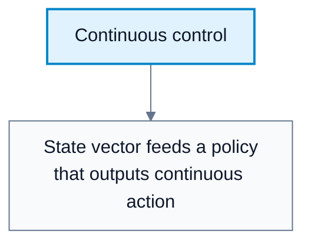
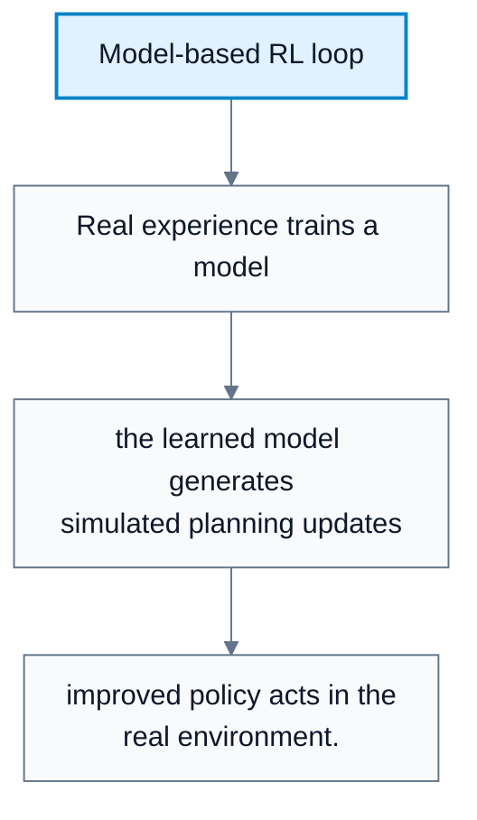
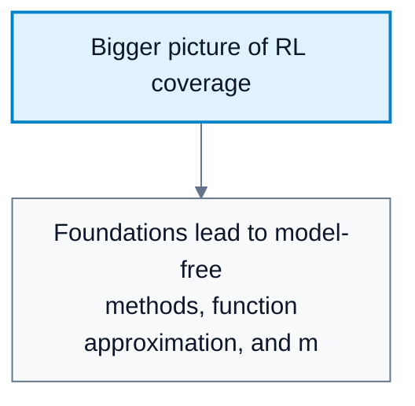
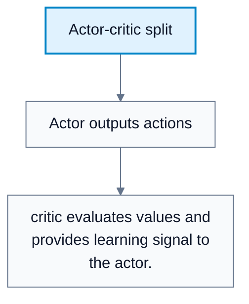
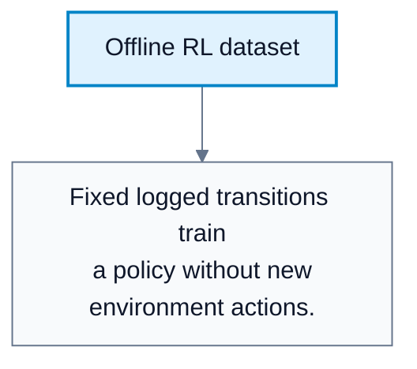

---
tags:
  - automated-planning
---

# Modern Reinforcement Learning

**Subject**: CSC3041F Automated Planning  
**Source**: `RL/10RL_3041F.pdf`, Asad Jeewa, slides 1-18  
**Generated**: 2026-05-31

---

## Contents

- [[#Core Content|Core Content]]
  - [[#What The RL Block Covered|What The RL Block Covered]]
  - [[#Beyond Discrete Gridworld|Beyond Discrete Gridworld]]
  - [[#Continuous Control|Continuous Control]]
  - [[#True Model-Based RL|True Model-Based RL]]
  - [[#N-Step Bootstrapping And Eligibility Traces|N-Step Bootstrapping And Eligibility Traces]]
  - [[#DQN Extensions|DQN Extensions]]
  - [[#Policy Gradient Methods|Policy Gradient Methods]]
  - [[#Actor-Critic Methods|Actor-Critic Methods]]
  - [[#Multi-Agent And Multi-Objective RL|Multi-Agent And Multi-Objective RL]]
  - [[#Offline RL|Offline RL]]
  - [[#Practical Tools|Practical Tools]]

---

## Core Content

### What The RL Block Covered

The lecture reviews the path so far:

1. RL fundamentals.
2. MDPs and value functions.
3. Value iteration and policy iteration.
4. Monte Carlo and Temporal Difference learning.
5. Tabular Q-learning.
6. Function approximation and DQN.

The rest of modern RL extends these foundations beyond discrete Gridworld-style problems.
### Beyond Discrete Gridworld

#### Definitions

> **Continuous State Space**: A state space where states are real-valued vectors rather than finite categories. *In plain language: positions, velocities, or sensor readings can vary continuously.*

> **Continuous Action Space**: An action space where actions are real-valued. *In plain language: choose a steering angle or motor torque, not just left/right.*

> **Sparse Reward**: A reward signal that appears rarely. *In plain language: feedback is infrequent.*

Real problems add complications:

| Issue | Example |
|---|---|
| Continuous states | Robot position and velocity |
| Image states | Atari or camera input needing feature extraction |
| Continuous actions | Steering, throttle, torque |
| Sparse rewards | Reward only after success |
| Stochastic dynamics | Same action may produce varied outcomes |
| Partial/noisy observations | Sensors are incomplete or noisy |
| Long horizons | Current actions matter far in the future |
| Safe exploration | Bad actions can cause real harm |

Images often require feature extraction using convolutional neural networks.
### Continuous Control

#### Definitions

> **Continuous Control**: RL where actions are continuous values. *In plain language: controlling real-valued motors, steering, or forces.*

DQN is not suitable for continuous action spaces because it relies on maximizing over discrete action values. Common continuous-control methods:

| Algorithm | Role |
|---|---|
| DDPG | Deep deterministic policy gradient for continuous actions |
| TD3 | Improved stability over DDPG |
| SAC | Soft actor-critic, entropy-regularized and stable |

Applications include robotics and control systems.

#### Diagram: Continuous control



Caption: Continuous action spaces require methods beyond discrete DQN.


### True Model-Based RL

#### Definitions

> **True Model-Based RL**: RL that learns an environment model from data and uses it for planning. *In plain language: learn how the world works, then simulate plans inside the learned model.*

> **Dyna**: A model-based RL idea combining real experience with simulated planning updates. *In plain language: learn from the real world and from imagined experience generated by the model.*

Earlier model-based planning assumed `T` and `R` were already known. True model-based RL learns them:

```text
Estimate T(s,a,s') and R(s,a) from data
Use learned T and R to plan
Apply value iteration, policy iteration, or other planning on the learned model
```

Risk: model errors can compound during planning.

#### Diagram: Model-based RL loop



Caption: True model-based RL learns dynamics and uses them for planning.


### N-Step Bootstrapping And Eligibility Traces

#### Definitions

> **N-Step Bootstrapping**: Using `n` rewards before bootstrapping from a value estimate. *In plain language: look ahead several steps, then use a value guess.*

> **Eligibility Trace**: A decaying memory of recently visited states or actions. *In plain language: keep temporary credit for recent states so they can be updated when reward arrives.*

N-step return:

$$
G_t^{(n)}=R_{t+1}+\gamma R_{t+2}+\cdots+\gamma^{n-1}R_{t+n}+\gamma^nV(S_{t+n})
$$

Update:

$$
V(S_t)\leftarrow V(S_t)+\alpha\left[G_t^{(n)}-V(S_t)\right]
$$

Small `n` gives more bias and lower variance. Large `n` gives less bias and higher variance. Eligibility traces generalize n-step learning into online multi-step updates.
### DQN Extensions

#### Definitions

> **Double DQN**: A DQN variant reducing overestimation bias. *In plain language: separate action selection from action evaluation to avoid overly optimistic Q-values.*

> **Dueling DQN**: A DQN variant separating state value and action advantage. *In plain language: learn how good a state is and how much each action adds.*

> **Prioritized Replay**: Sampling more important experiences more often. *In plain language: train more on transitions with high learning signal.*

> **Rainbow DQN**: A combined DQN system incorporating multiple improvements. *In plain language: a bundle of strong DQN upgrades.*

DQN was a seminal algorithm and many later algorithms improved its stability and efficiency.

#### Diagram: Bigger picture of RL coverage



Caption: The diagram positions each modern topic as an extension of the earlier course foundations.


### Policy Gradient Methods

#### Definitions

> **Policy Gradient Method**: A method that learns a parameterized policy directly by optimizing expected reward. *In plain language: update the policy itself instead of first learning a Q-table.*

> **REINFORCE**: A basic Monte Carlo policy-gradient algorithm. *In plain language: increase probability of actions that led to high returns.*

Policy gradients learn:

$$
\pi(a\mid s;\theta)
$$

They avoid a $\max$ over actions and can work well in continuous action spaces. The key idea is gradient ascent on expected reward.
### Actor-Critic Methods

#### Definitions

> **Actor-Critic Method**: A method combining a policy learner with a value estimator. *In plain language: one part chooses actions, another part judges them.*

> **Actor**: The policy component. *In plain language: decides what to do.*

> **Critic**: The value-function component. *In plain language: evaluates actions or states.*

Actor-critic methods combine value-based and policy-based learning.

Benefits:

1. Lower variance than pure policy gradients.
2. More stable than pure DQN in some settings.

Examples include A2C and A3C.

#### Diagram: Actor-critic split



Caption: Actor-critic methods combine policy optimization with value estimation.


### Multi-Agent And Multi-Objective RL

#### Definitions

> **Multi-Agent RL (MARL)**: RL with multiple learning agents. *In plain language: several agents learn while affecting each other.*

> **Multi-Objective RL (MORL)**: RL with multiple objectives represented by vector rewards. *In plain language: optimize several goals, not just one scalar reward.*

MARL challenges:

1. Environment becomes non-stationary because other agents learn.
2. Credit assignment across agents is hard.
3. Coordination and competition must be modeled.

MORL challenges:

1. Objectives conflict.
2. Preferences must be chosen or learned.
3. Scaling to complex environments is difficult.

Examples:

| Area | Example Trade-Off |
|---|---|
| Autonomous driving | Safety versus speed |
| Robotics | Energy versus performance |
| Finance | Risk versus return |
### Offline RL

#### Definitions

> **Offline RL**: Learning from a fixed dataset without new environment interaction. *In plain language: train only from logged data.*

Offline RL matters when interaction is expensive or dangerous, such as healthcare, finance, and autonomous driving.

Challenges:

1. Distribution shift: dataset differs from deployment environment.
2. Overestimation of unseen actions.
3. Limited exploration because the agent cannot try new actions.

#### Diagram: Offline RL dataset



Caption: Offline RL is useful when exploration in the real world is unsafe or expensive.


### Practical Tools

| Area | Algorithms / Libraries | Environments / Datasets |
|---|---|---|
| RL | Stable-Baselines3, CleanRL | OpenAI Gymnasium |
| MARL | RLlib | PettingZoo |
| MORL | MORL-Baselines | MO-Gymnasium |
| Offline RL | CORL | Minari |
