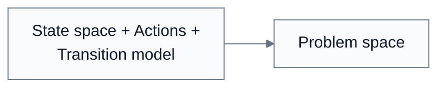
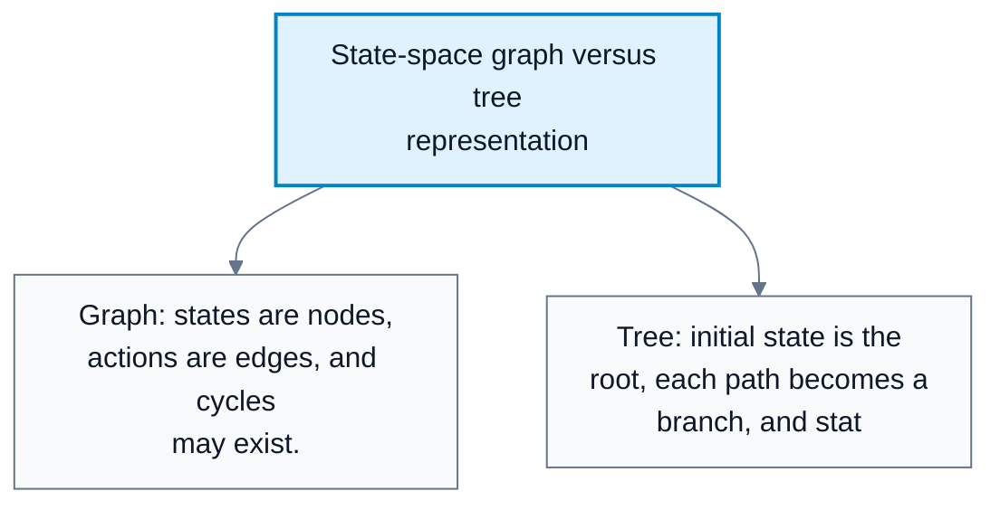
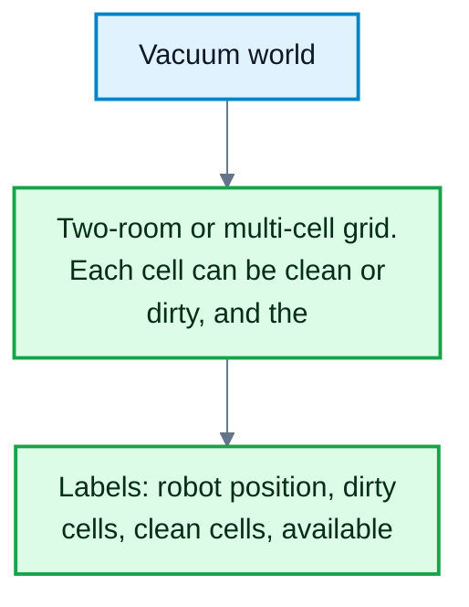
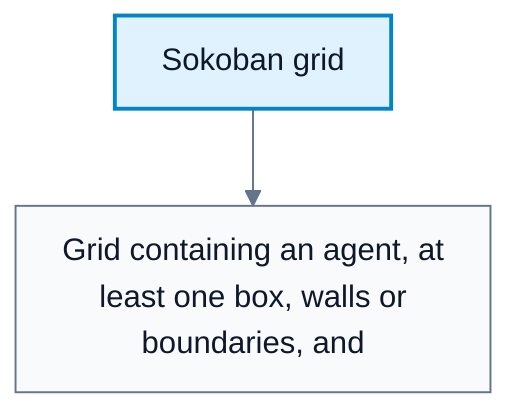

# State Space Search

**Subject**: CSC3041F Automated Planning  
**Source**: `Lecture1.pdf`, Zola Mahlaza, slides 1-32  
**Generated**: 2026-05-31

---

## Core Content

### AI Search As Problem Solving

#### Definitions

> **Search**: The process of finding a solution, data item, path, or pattern within a defined computational space that satisfies a query. *In plain language: search is systematic trial-and-error over possible choices until a goal is reached.*

> **AI Search**: A universal AI problem-solving mechanism used when the exact sequence of steps to solve a problem is not known in advance. *In plain language: the agent explores possible actions because it does not already know the answer.*

AI search is useful when a problem is not solved by a fixed formula. The agent must explore candidate sequences of actions and test whether they lead to the desired outcome. The lecture separates three broad kinds of AI search problems:

| Problem Type | What Is Being Searched |
|---|---|
| Single-agent path finding | A path from an initial state to a goal state |
| Game playing | A strategy in a space affected by other agents |
| Constraint-satisfaction problems | Assignments of variables that satisfy constraints |

The delivery-agent example captures the central idea. If an autonomous agent must deliver a package from Tokai to Rondebosch and the environment is observable, the agent can plan a route by searching possible moves before it acts.
### Problem-Solving Agent Framework

#### Definitions

> **Goal Formulation**: Choosing the objective that the agent should achieve. *In plain language: decide what counts as success.*

> **Problem Formulation**: Choosing the states, actions, transition model, costs, initial state, and goal test needed for search. *In plain language: turn the real task into a mathematical search problem.*

> **Open-Loop System**: A plan executed without monitoring percepts during execution. *In plain language: the agent follows the plan as if the world behaves exactly as expected.*

> **Closed-Loop System**: A plan-execution approach that monitors percepts and reacts to changes. *In plain language: the agent keeps checking the world and adjusts if things change.*

The problem-solving framework has four phases:

1. **Goal formulation**: Limit the objectives and actions being considered. Example: the goal is Rondebosch.
2. **Problem formulation**: Specify which states and actions matter for reaching that goal.
3. **Search**: Simulate action sequences until one reaches a goal.
4. **Execution**: Execute the solution actions one at a time.

Environment assumptions determine whether planning can be open loop or must be closed loop:

| Environment Type | Planning Implication |
|---|---|
| Fully observable, deterministic, known | A solution can be a fixed action sequence; percepts can be ignored during execution |
| Nondeterministic or uncertain | The agent should monitor percepts and use a closed-loop approach |

#### Diagram: Four-phase problem-solving framework

```mermaid
%%{init: {"theme":"base","themeVariables":{"primaryColor":"#e0f2fe","primaryTextColor":"#0f172a","primaryBorderColor":"#0284c7","lineColor":"#64748b","secondaryColor":"#f8fafc","tertiaryColor":"#dcfce7","fontFamily":"Inter, ui-sans-serif, system-ui, -apple-system, BlinkMacSystemFont, Segoe UI, sans-serif"},"flowchart":{"curve":"basis","htmlLabels":true,"padding":12}}}%%
flowchart LR
    N0["Goal formulation"]
    N1["Problem formulation"]
    N2["Search"]
    N3["Execution"]
    N0 --> N1
    N1 --> N2
    N2 --> N3

    classDef default fill:#f8fafc,stroke:#64748b,stroke-width:1px,color:#0f172a;
    classDef focus fill:#e0f2fe,stroke:#0284c7,stroke-width:2px,color:#0f172a;
    classDef outcome fill:#dcfce7,stroke:#16a34a,stroke-width:2px,color:#052e16;
    classDef warning fill:#fee2e2,stroke:#dc2626,stroke-width:2px,color:#7f1d1d;
    classDef muted fill:#f1f5f9,stroke:#94a3b8,stroke-width:1px,color:#334155;
    class N0 outcome;
```



Caption: This matters because the search algorithm is only one phase; a badly formulated problem gives poor search results.


### Problem Spaces

#### Definitions

> **Problem Space**: The set of all possible situations that can be encountered in a problem, governed by allowed actions and their relationships. *In plain language: it is the whole universe of possible configurations.*

> **State Space**: The set `S` of all states in the problem. *In plain language: every possible configuration the problem could be in.*

> **State**: A specific configuration of the problem, often represented as a tuple of features or variables. *In plain language: one snapshot of the world.*

> **Action**: A possible move or change that maps one state to another. *In plain language: something the agent can do.*

> **Transition Model**: A function describing the state reached after applying an action in a state. *In plain language: the rule for how actions change the world.*

A state can be written as:

$$
s=(v_1,v_2,v_3,\ldots,v_n),\quad s\in S
$$

An action is often written as a function from states to states. The transition model is commonly written:

$$
T:S\times A\to S
$$

For a deterministic chess-like transition:

$$
s=\{(N_w:a1),(K_w:g1),(K_b:g8),\mathrm{Turn}:\mathrm{White}\}
$$

$$
A(s)=\{N\to b3,N\to c2,K\to f1,K\to f2,K\to h1,K\to h2\}
$$

$$
T(s,N\to b3)=\{(N_w:b3),(K_w:g1),(K_b:g8),\mathrm{Turn}:\mathrm{Black}\}
$$

The problem space is the combination of:

1. State space.
2. Actions.
3. Transition model.
### Problem Instances

#### Definitions

> **Problem Instance**: A concrete version of a problem space with an initial state and goal state(s), and often an action cost function. *In plain language: one specific search problem to solve.*

> **Action Cost Model**: A rule assigning costs to actions or transitions. *In plain language: it says how expensive each move is.*

> **Initial State**: The state where search begins. *In plain language: the starting point.*

> **Goal State**: A state satisfying the goal condition. *In plain language: a state where the agent has succeeded.*

Action costs matter because not all actions are equally valuable. In the chess example, treating every move as cost `1` hides important differences: losing a bishop may be worth `3`, while losing a queen may be worth `9`. A cost model lets search prefer lower-cost solutions instead of merely shorter action sequences.

A problem instance is:

$$
\text{Problem instance}=\text{problem space}+\text{initial state}+\text{goal state(s)}+\text{optional action cost function}
$$

#### Diagram: Problem space composition



Caption: This shows the difference between a general domain and one concrete task inside that domain.


### Search Tasks And Solutions

#### Definitions

> **Path**: Any sequence of actions. *In plain language: a route through the state space.*

> **Solution**: A path from the initial state to a goal state. *In plain language: a route that reaches success.*

> **Optimal Solution**: A solution with the lowest path cost among all solutions. *In plain language: the cheapest successful route.*

> **Path Cost**: The sum of action costs along a path. *In plain language: the total cost of a complete route.*

The problem-solving task is: given a problem instance, find a solution, preferably an optimal one.

State spaces can be represented as graphs:

| Graph Element | Search Meaning |
|---|---|
| Node | State |
| Edge | Action or transition |
| Directed edge | Action has a direction |
| Undirected edge | Action is reversible |
### Tree Search And Graph Search

#### Definitions

> **Tree Search**: Search that represents paths as a tree rooted at the initial state, duplicating states reached by multiple paths. *In plain language: the same state may appear many times if there are many ways to reach it.*

> **Graph Search**: Search that tracks reached states to avoid redundant paths and cycles. *In plain language: the agent remembers states it has already reached.*

Tree search is simple because every node has one unique path back to the root. Graph search is more robust because it notices when the same state appears again through a different path. The trade-off is memory: graph search must store reached-state history.

#### Diagram: State-space graph versus tree representation



Caption: This matters because tree search is simpler but can duplicate work, while graph search needs memory to avoid redundancy.


### State-Space Size

State-space complexity can grow extremely fast. Tic-tac-toe on a `3 x 3` grid has each cell in one of three states: empty, `X`, or `O`, giving:

$$
3^9=19{,}683
$$

Chess is vastly larger. The lecture uses Shannon's estimate of roughly $10^{120}$ possible unique games, which is larger than can be stored naively.
### Vacuum World And Sokoban

#### Definitions

> **Vacuum World**: A small search problem where a robot cleans rooms. *In plain language: it is a toy domain for practicing state, action, transition, and goal definitions.*

> **Sokoban**: A puzzle where an agent pushes boxes onto target locations. *In plain language: it is a planning problem with spatial movement constraints.*

For a vacuum world with `n` cells:

$$
\text{State-space size}=n\cdot 2^n
$$

This comes from `n` possible robot locations and $2^n$ possible clean/dirty configurations.

Typical vacuum-world formulation:

| Component | Example |
|---|---|
| States | Robot location plus clean/dirty status of each cell |
| Actions | `clean`, `left`, `right`, `up`, `down` |
| Initial state | Any valid configuration |
| Goal states | All cells clean |
| Transition | $result(cell\_dirty,clean)=cell\_clean$ |

#### Diagram: Vacuum world



Caption: The diagram gives a complete small example of states, actions, transitions, initial states, and goal states.


#### Diagram: Sokoban grid



Caption: Sokoban shows why planning can be hard: the agent must reason about box positions, not just its own location.

## Worked Examples

### Example 1: Formulate Vacuum World

**Problem**: A two-room vacuum world has rooms `A` and `B`. Each room can be clean or dirty, and the robot is in one room.

**Step 1: Define states**  
A state is $(robot\_location,status_A,status_B)$. Example: $(A,dirty,clean)$.

**Step 2: Define actions**  
Actions are `clean`, `left`, and `right`. In a two-room world, `left` and `right` move between `A` and `B` where legal.

**Step 3: Define transition model**  
$T((A,dirty,clean),clean)=(A,clean,clean)$.

**Step 4: Define initial state**  
Any valid state may be an initial state. Example: $(A,dirty,dirty)$.

**Step 5: Define goal states**  
All states where both rooms are clean, regardless of robot location:

```text
(A, clean, clean)
(B, clean, clean)
```

**Answer**: A solution from $(A,dirty,dirty)$ could be $[clean,right,clean]$.

### Example 2: Path Cost Changes The Best Solution

**Problem**: In a chess-inspired problem, one plan saves a bishop and another saves a queen. Each move has unit length, but losing pieces has cost: bishop `3`, queen `9`.

**Step 1: Compare by action count only**  
If every move costs `1`, two plans with the same number of moves appear equivalent.

**Step 2: Add domain-specific action costs**  
A plan losing a queen has a much larger cost than a plan losing a bishop.

**Step 3: Choose by path cost**  
The optimal solution minimizes total cost, not just action count.

**Answer**: Once costs reflect piece values, protecting the queen is usually preferred over protecting the bishop.

---

## Common Mistakes / Gotchas

- Confusing a **problem space** with a **problem instance**. A problem space is the whole domain; an instance has a specific initial state and goal.
- Treating a state as only the agent location. A state must include all variables needed to predict future transitions.
- Forgetting the cost model. Shortest in number of actions is not always cheapest.
- Assuming tree search and graph search are the same. Tree search duplicates states; graph search tracks reached states.
- Using open-loop execution when the environment is nondeterministic.
- Underestimating state-space growth. Small-looking games can have enormous state spaces.

---

## Summary / Cheat Sheet

| Term | Meaning |
|---|---|
| Search | Systematic exploration of possible choices to satisfy a query or goal |
| State | One complete configuration of the problem |
| State space | Set of all possible states |
| Action | Operation that can change state |
| Transition model | Rule mapping state and action to next state |
| Problem space | State space plus actions plus transition model |
| Problem instance | Problem space plus initial state, goal state(s), and usually costs |
| Solution | Path from initial state to a goal state |
| Optimal solution | Solution with lowest path cost |
| Tree search | Path-based search that can duplicate states |
| Graph search | State-aware search that avoids redundant paths |

**Key Formulas**:

$$
s=(v_1,v_2,\ldots,v_n),\quad s\in S
$$

$$
T:S\times A\to S
$$

$$
\text{Problem instance}=\text{problem space}+\text{initial state}+\text{goal state(s)}+\text{action cost function}
$$

$$
\text{Vacuum world state count}=n\cdot 2^n
$$

$$
\text{Tic-tac-toe naive state count}=3^9=19{,}683
$$

**Key Takeaways**:

- Search is needed when the action sequence is not known in advance.
- A good formulation must include states, actions, transitions, costs, initial state, and goal test.
- Graph representations expose cycles; tree representations expose paths.
- Cost models determine whether the best solution means shortest or cheapest.

---

## Practice Questions

**Q1**: What is the difference between a problem space and a problem instance?  
> Answer: A problem space is the full set of states, actions, and transitions in the domain. A problem instance adds a specific initial state, goal state(s), and usually an action cost model.

**Q2**: Why can tree search duplicate states?  
> Answer: Tree search represents paths from the root. If two different paths reach the same state, that state appears in two different tree nodes.

**Q3**: In a two-cell vacuum world, why are $(A,clean,clean)$ and $(B,clean,clean)$ both goal states?  
> Answer: The goal is that all cells are clean. The robot's final location does not matter unless the problem definition adds a location requirement.

**Q4**: When is open-loop execution reasonable?  
> Answer: When the environment is fully observable, deterministic, and known, so the planned action sequence will behave as expected.
