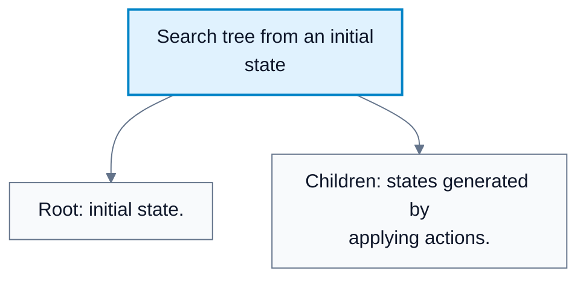
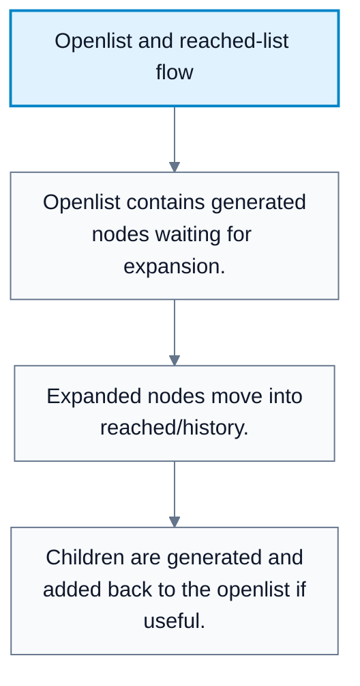
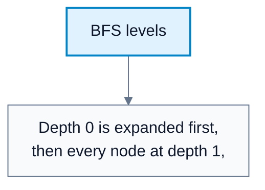
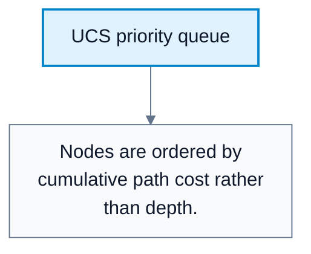

# Uninformed Search

**Subject**: CSC3041F Automated Planning  
**Source**: `Lecture2.pdf`, Zola Mahlaza, slides 1-24  
**Generated**: 2026-05-31

---

## Core Content

### Search Tasks And Search Trees

#### Definitions

> **Uninformed Search**: Search that does not use heuristic information about closeness to the goal. *In plain language: the algorithm explores without a domain-specific guess about which node is best.*

> **Search Tree**: A tree representation of paths explored from the initial state. *In plain language: it records possible action sequences, not just unique states.*

> **Root**: The first node of the search tree, always the initial state. *In plain language: where the search starts.*

> **Expansion**: The process of generating a node's children using available actions. *In plain language: take a state and list the states reachable in one step.*

> **Successor Generation**: Applying actions and the transition model to create child nodes. *In plain language: calculate what each legal action leads to.*

A search task finds a solution from a starting state to a goal state. Since uninformed search avoids heuristic guidance, its main differences come from how it chooses the next node to expand.

The search tree differs from the state-space graph:

| Representation | Meaning |
|---|---|
| State-space graph | Unique states and transitions in the problem |
| Search tree | Actual paths explored from the initial state |

The same state can appear multiple times in a search tree if there are multiple paths to it.

#### Diagram: Search tree from an initial state



Caption: This shows why a search tree records paths and can duplicate states from the state-space graph.


### Openlist, Reached States, And Redundancy

#### Definitions

> **Openlist / Frontier**: The data structure storing nodes generated but not yet expanded. *In plain language: the waiting list of candidate nodes.*

> **Reached / History / Closed List**: A data structure storing states already reached or expanded. *In plain language: memory of where the search has already been.*

> **Redundant Path**: A path that reaches a state already reachable by another path. *In plain language: repeated work.*

> **Cycle**: A path that returns to a previously visited state. *In plain language: a loop.*

The generic search loop is:

1. Put the initial state in the openlist.
2. Choose one node from the openlist.
3. If it is a goal, return the path.
4. Expand it using available actions and the transition model.
5. Add useful children to the openlist.
6. Move the expanded node to reached/history if graph search is being used.

Graph search checks for redundant paths and cycles. Tree-like search does not. The trade-off is:

| Approach | Benefit | Cost |
|---|---|---|
| Tree-like search | Lower bookkeeping, simpler | Can repeat states and loop forever |
| Graph search | Avoids redundant paths and cycles | Requires explicit memory for reached states |

#### Diagram: Openlist and reached-list flow



Caption: This is the control loop shared by BFS, UCS, DFS, A*, and beam search.


### Performance Measures

#### Definitions

> **Time Complexity**: Total time taken, often measured by number of states and actions explored. *In plain language: how much work the algorithm does.*

> **Space Complexity**: Maximum memory required during search. *In plain language: how many nodes or states the algorithm must store.*

> **Completeness**: Whether the algorithm is guaranteed to find a solution if one exists. *In plain language: will it eventually find an answer?*

> **Cost Optimality**: Whether the algorithm always returns a lowest-cost solution. *In plain language: does it find the cheapest answer, not merely any answer?*

The four core questions for comparing search algorithms are:

| Criterion | Question |
|---|---|
| Time complexity | How many states/actions are explored? |
| Space complexity | How much memory is required? |
| Completeness | Is a solution guaranteed if one exists? |
| Cost optimality | Is the lowest-cost solution guaranteed? |
### Breadth-First Search

#### Definitions

> **Breadth-First Search (BFS)**: An uninformed search algorithm that explores all nodes at the current depth before moving to the next depth. *In plain language: try every one-step solution, then every two-step solution, and so on.*

> **Branching Factor**: The number of children generated per node, usually written `b`. *In plain language: how many choices you tend to have at each step.*

> **Depth**: The number of actions from the root to a node. *In plain language: how many steps have been taken.*

BFS uses a first-in, first-out queue. It is designed for problems where the fewest number of actions matters and all action costs are the same.

```text
BFS(problem):
    frontier = queue(initial_state)
    reached = {initial_state}
    while frontier is not empty:
        node = frontier.pop_front()
        if goal_test(node.state):
            return path_to(node)
        for action in actions(node.state):
            child = result(node.state, action)
            if child not in reached:
                reached.add(child)
                frontier.push_back(child)
    return failure
```

BFS is complete if every node has a finite number of children. It is guaranteed to find the solution with the minimum number of actions. It is cost-optimal only when all actions have the same cost.

#### Diagram: BFS levels



Caption: BFS finds the shallowest solution because it exhausts all shorter paths first.


### Uniform-Cost Search

#### Definitions

> **Uniform-Cost Search (UCS)**: An uninformed search algorithm that expands nodes in order of increasing cumulative path cost. *In plain language: always try the cheapest known partial route next.*

> **Cumulative Path Cost**: The total cost from the initial state to the current node. *In plain language: what the route has cost so far.*

UCS fixes the main limitation of BFS: BFS assumes equal action costs. UCS orders the openlist by:

$$
f(n)=\mathrm{path\_cum\_cost}(n)
$$

UCS is complete and cost-optimal when step costs are positive and there are no zero-cost traps. The lecture gives the complexity:

$$
O\!\left(b^{1+\lfloor C/c\rfloor}\right)
$$

where:

| Symbol | Meaning |
|---|---|
| `b` | branching factor |
| `C` | cost of the optimal solution |
| `c` | smallest possible positive step cost |

The reason UCS is cost-optimal is that the first goal popped from the priority queue has cost no greater than any other path still waiting in the openlist.

#### Diagram: UCS priority queue



Caption: UCS finds the cheapest solution when action costs differ.


### Best-First Search As A Contrast

#### Definitions

> **Best-First Search**: A search framework that expands the node judged best by an evaluation function. *In plain language: order the openlist by some score and expand the best-scoring node.*

> **Greedy Best-First Search**: Best-first search that prioritizes nodes using only a heuristic estimate of closeness to the goal. *In plain language: always go toward what looks closest.*

Although Lecture 2 focuses on uninformed search, it introduces best-first search as a useful contrast. Greedy best-first search uses a heuristic such as Euclidean distance to the goal. That can be efficient, but it is not uninformed because it uses extra domain information.

## Worked Examples

### Example 1: BFS With Equal Step Costs

**Problem**: Start at $S$. Actions lead to $A$ and $B$. From $A$, the goal $G$ is reached in one more step. From $B$, another route to $G$ takes two more steps. All actions cost $1$.

**Step 1: Expand depth 0**  
Openlist becomes `[A, B]`.

**Step 2: Expand depth 1**  
Expand `A`, generating `G` at depth `2`.

**Step 3: Check goal**  
When $G$ is selected, BFS returns path $S\to A\to G$.

**Answer**: BFS returns the two-action solution, which is optimal because all action costs are equal.

### Example 2: UCS With Unequal Costs

**Problem**: $S\to A\to G$ has costs $5+1=6$. $S\to B\to G$ has costs $1+2=3$.

**Step 1: Initialize openlist**  
$A$ has path cost $5$; $B$ has path cost $1$.

**Step 2: Expand cheapest node**  
UCS expands $B$ before $A$.

**Step 3: Generate goal**  
$G$ through $B$ has cost $3$, which is cheaper than the pending route through $A$.

**Answer**: UCS returns $S\to B\to G$, while BFS might return the wrong path if it only counts actions.

---

## Common Mistakes / Gotchas

- Calling BFS cost-optimal without checking whether all action costs are equal.
- Forgetting that graph search needs a reached/history data structure.
- Treating cycles as ordinary duplicate states. Cycles can cause infinite loops in tree-like search.
- Confusing the openlist with the reached list. The openlist is waiting to be expanded; reached is memory.
- Assuming greedy best-first search is uninformed. It uses a heuristic, so it is informed.
- Using UCS with zero-cost actions without handling the risk of endless cheap expansions.

---

## Summary / Cheat Sheet

| Term | Meaning |
|---|---|
| Uninformed search | Search without heuristic estimates |
| Openlist/frontier | Generated but unexpanded nodes |
| Reached/closed list | States already seen or expanded |
| Expansion | Generate successors from a node |
| BFS | Expands shallowest nodes first |
| UCS | Expands cheapest cumulative-cost nodes first |
| Completeness | Guaranteed to find a solution if one exists |
| Cost optimality | Guaranteed to find a lowest-cost solution |

**Key Formulas**:

$$
f(n)=\mathrm{path\_cum\_cost}(n)
$$

$$
\text{UCS time/space}=O\!\left(b^{1+\lfloor C/c\rfloor}\right)
$$

**Key Takeaways**:

- BFS is strong when all actions have equal cost and shallow solutions are expected.
- UCS is the correct uninformed choice when action costs differ.
- Search algorithms mainly differ in how they order the openlist.
- Graph search is more robust than tree-like search because it can discard redundant paths.

---

## Practice Questions

**Q1**: Why is BFS guaranteed to find the minimum-action solution?  
> Answer: BFS expands all nodes at depth `0`, then all nodes at depth `1`, and so on. Therefore, no deeper solution is considered before all shallower possibilities have been checked.

**Q2**: Why does UCS remain cost-optimal when actions have different costs?  
> Answer: UCS expands the lowest cumulative-cost path first. The first goal popped from the priority queue cannot be more expensive than any unexpanded path.

**Q3**: What extra memory does graph search require compared with tree-like search?  
> Answer: It requires a reached/history/closed structure that records states already reached or expanded.

**Q4**: Why is greedy best-first search not an uninformed algorithm?  
> Answer: It uses a heuristic estimate, such as distance to the goal, so it uses information beyond the problem definition.
