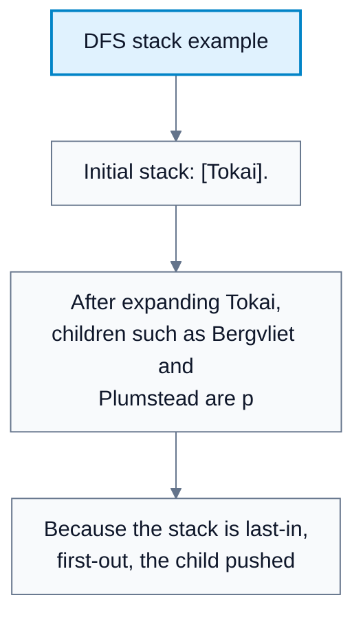
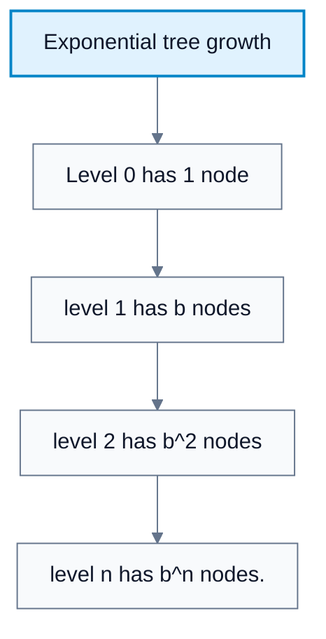
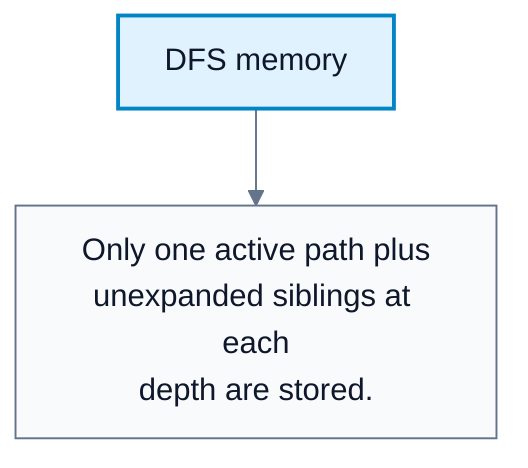
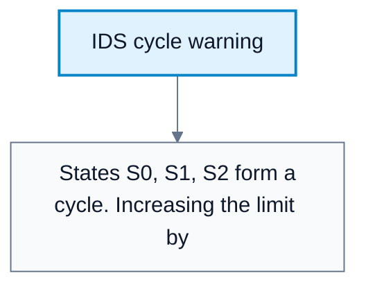

# Depth-First Search And Iterative Deepening

**Subject**: CSC3041F Automated Planning  
**Source**: `Lecture3.pdf`, Zola Mahlaza, slides 1-27  
**Generated**: 2026-05-31

---

## Core Content

### Depth-First Search

#### Definitions

> **Depth-First Search (DFS)**: A search algorithm that expands the deepest node currently in the openlist. *In plain language: follow one branch as far as possible before backing up.*

> **LIFO Stack**: Last-in, first-out data structure used by DFS. *In plain language: the newest node added is the first one expanded.*

> **Maximum Depth**: The longest depth reached in the search tree, usually written `m`. *In plain language: the deepest the search may go.*

DFS can be viewed in the best-first framework using:

$$
f(n)=-\mathrm{depth}(n)
$$

A deeper node has a lower score if the algorithm selects the minimum `f`, so the deepest node is chosen first. In practice, DFS is normally implemented with a LIFO stack.

DFS is attractive because it stores only a path plus unexpanded siblings, so memory use can be far lower than BFS. Its major weaknesses are incompleteness on infinite spaces and vulnerability to cycles in tree-like search.
### DFS Properties

#### Definitions

> **Tree-Like DFS**: DFS without reached-state checking. *In plain language: DFS that can revisit states and enter cycles.*

> **Graph DFS**: DFS with reached-state checking. *In plain language: DFS that remembers visited states to avoid repeated work.*

The lecture's DFS summary:

| Property | DFS |
|---|---|
| Completeness | Not complete in infinite spaces or cyclic tree search |
| Cost optimality | Not cost-optimal |
| Time complexity | $O(b^m)$ |
| Space complexity | $O(bm)$ for tree-like DFS |
| Main benefit | Better memory use when tree-like search is feasible |

The source slide states DFS is complete only under restrictive conditions. The safe study version is: DFS is not generally complete; it is complete only when the reachable search space is finite and cycles are controlled.
### Why DFS Uses Less Space Than BFS

#### Definitions

> **Branching Factor (`b`)**: Number of successors generated per node. *In plain language: how many choices appear at each step.*

> **Depth (`n` or `m`)**: Number of actions from root to a node. *In plain language: how far down the tree a node is.*

BFS can store an entire frontier level, giving exponential memory. DFS only stores the current branch plus siblings waiting at each level.

For depth `n` and branching factor `b`, DFS storage is:

$$
O(bn)\ \text{or}\ O(bm)
$$

The intuition:

1. At each level, only one child is actively explored.
2. The other siblings wait on the stack.
3. There are at most about `b` waiting nodes per level.
4. Across `n` levels, memory is proportional to `b * n`.

#### Diagram: DFS stack example



Caption: This shows why child ordering matters in DFS.


#### Diagram: Exponential tree growth



Caption: This explains why BFS memory grows exponentially.


#### Diagram: DFS memory



Caption: DFS saves memory because it avoids storing every node at a frontier level.


### Depth-Limited Search

#### Definitions

> **Depth-Limited Search**: DFS with a maximum depth limit `l`; nodes at depth `l` are treated as if they have no successors. *In plain language: DFS that refuses to go deeper than a chosen cutoff.*

> **Cutoff**: A search outcome meaning the depth limit stopped exploration before the algorithm could prove failure. *In plain language: the answer might exist deeper, but this run was not allowed to look.*

Depth limiting prevents infinite loops in tree-like DFS by forcing the search to stop at a maximum depth.

Properties:

| Property | Depth-Limited DFS |
|---|---|
| Time complexity | $O(b^l)$ |
| Space complexity | $O(bl)$ |
| Advantage | Avoids infinite descent |
| Risk | If `l` is too small, the goal is unreachable in that run |

Depth limits should be chosen using problem-specific knowledge when available.
### Iterative Deepening Search

#### Definitions

> **Iterative Deepening Search (IDS)**: Repeated depth-limited DFS with increasing limits. *In plain language: run DFS to depth 0, then depth 1, then depth 2, and continue until a solution is found.*

> **Solution Depth (`d`)**: Depth of the shallowest solution. *In plain language: the number of actions in the first found minimum-depth solution.*

IDS avoids guessing the correct depth limit:

```text
for limit in 0, 1, 2, 3, ...:
    result = depth_limited_search(problem, limit)
    if result is solution:
        return result
    if result is failure with no cutoff:
        return failure
```

IDS has modest memory requirements and follows the same top-down discovery order as BFS. It can still repeat work, but the repeated upper levels are cheap compared with the deepest level in an exponentially growing tree.

When a solution exists at depth `d`:

$$
\text{Time}=O(b^d),\qquad \text{Space}=O(bd)
$$

The time is still $O(b^d)$, the same asymptotic class as BFS, because the deepest level dominates the total node generations.

#### Diagram: IDS cycle warning



Caption: IDS limits infinite descent, but depth limits alone do not remove repeated work.


### Comparative Summary

| Algorithm | Complete? | Cost Optimal? | Time | Space |
|---|---|---|---|---|
| BFS | Yes if state space is finite or branching finite and solution finite | Yes if all actions cost the same | $O(b^d)$ | $O(b^d)$ |
| UCS | Yes with finite branching and positive step costs | Yes | $O\!\left(b^{1+\lfloor C/c\rfloor}\right)$ | $O\!\left(b^{1+\lfloor C/c\rfloor}\right)$ |
| DFS | Not generally | No | $O(b^m)$ | $O(bm)$ |
| Depth-limited DFS | No if limit too small | No | $O(b^l)$ | $O(bl)$ |
| IDS | Yes in finite-depth solution spaces | Yes if all actions cost the same | $O(b^d)$ | $O(bd)$ |

## Worked Examples

### Example 1: DFS Stack Order

**Problem**: From `Tokai`, successors are generated in the order `[Bergvliet, Plumstead]`. The DFS openlist is a stack.

**Step 1: Push successors**  
Stack becomes `[Bergvliet, Plumstead]`.

**Step 2: Pop next node**  
DFS pops `Plumstead`, because it was pushed last.

**Step 3: Continue deeply**  
DFS expands descendants of `Plumstead` before returning to `Bergvliet`.

**Answer**: DFS follows the most recently added branch first.

### Example 2: Iterative Deepening To Depth 3

**Problem**: A solution exists at depth `3`.

**Step 1: Limit 0**  
Check only the root. No solution; cutoff occurs.

**Step 2: Limit 1**  
Check root and one-action states. No solution; cutoff occurs.

**Step 3: Limit 2**  
Check all paths of length up to 2. No solution; cutoff occurs.

**Step 4: Limit 3**  
Check paths of length up to 3 and find the solution.

**Answer**: IDS finds the shallowest solution while using DFS-like memory.

---

## Common Mistakes / Gotchas

- Saying DFS is complete without mentioning finite state spaces and cycle handling.
- Forgetting that DFS is not cost-optimal.
- Thinking IDS is inefficient because it repeats work. In exponential trees, the deepest level dominates, so repeated shallow levels usually do not change the asymptotic time.
- Choosing a depth limit too small and interpreting cutoff as proof of no solution.
- Confusing $m$ and $d$: $m$ is maximum depth, while $d$ is solution depth.
- Assuming depth limits remove cycles. They prevent infinite descent but do not remove repeated cyclic paths.

---

## Summary / Cheat Sheet

| Term | Meaning |
|---|---|
| DFS | Expands deepest open node first |
| Stack | LIFO data structure used for DFS |
| Depth-limited search | DFS with maximum depth `l` |
| Cutoff | Limit stopped the search before proving failure |
| IDS | Repeated depth-limited DFS with increasing limits |
| `b` | Branching factor |
| `m` | Maximum depth |
| `d` | Depth of shallowest solution |

**Key Formulas**:

$$
\begin{aligned}
\text{DFS time} &= O(b^m), & \text{DFS space} &= O(bm)\\
\text{Depth-limited time} &= O(b^l), & \text{Depth-limited space} &= O(bl)\\
\text{IDS time} &= O(b^d), & \text{IDS space} &= O(bd)
\end{aligned}
$$

**Key Takeaways**:

- DFS saves memory but risks incompleteness and non-optimality.
- Depth limits stop infinite descent but can hide deeper goals.
- IDS combines BFS-like shallowest-solution behavior with DFS-like memory.
- Child ordering matters because DFS follows stack order.

---

## Practice Questions

**Q1**: Why is DFS usually more memory efficient than BFS?  
> Answer: DFS stores the current path plus unexpanded siblings, while BFS may store an entire frontier level with $b^d$ nodes.

**Q2**: What does a cutoff mean in depth-limited search?  
> Answer: The search hit the depth limit. It does not prove no solution exists; a solution may be deeper.

**Q3**: Why does IDS have time $O(b^d)$ despite repeating nodes?  
> Answer: In an exponentially growing tree, the deepest level has far more nodes than all shallower levels combined, so repeated shallow work is dominated by the final iteration.

**Q4**: Is DFS cost-optimal?  
> Answer: No. DFS returns the first solution found along its traversal order, which may not be the cheapest.
