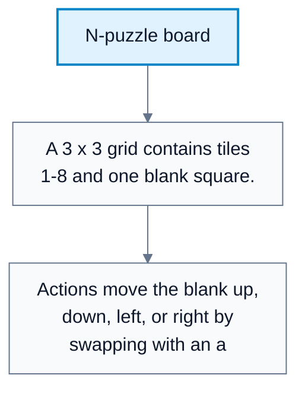
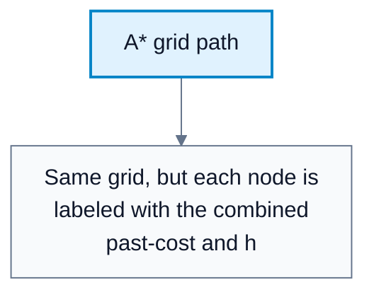
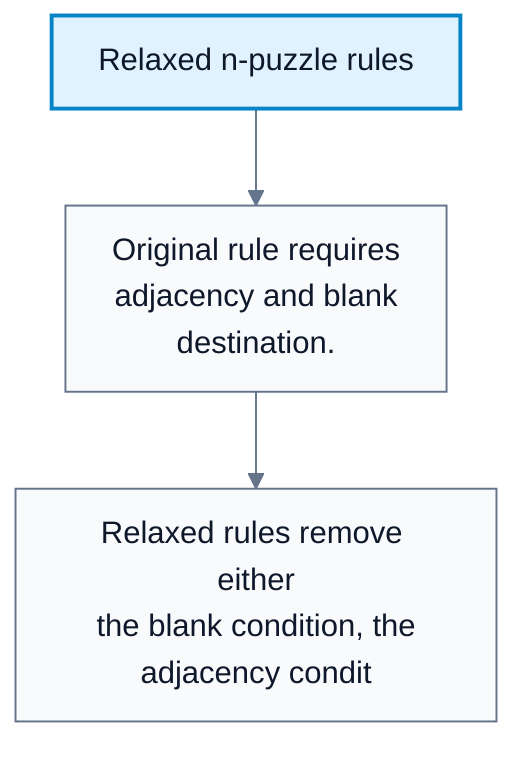
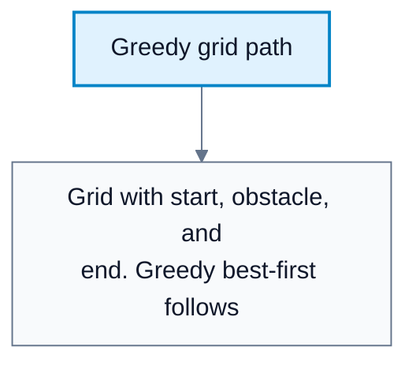
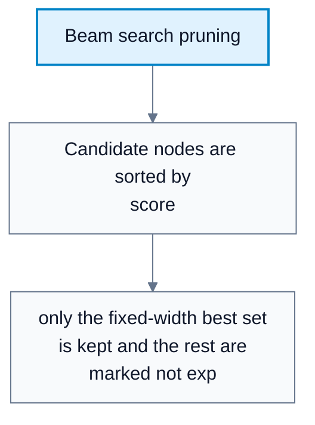

---
tags:
  - automated-planning
---

# Heuristic Search, A*, And Beam Search

**Subject**: CSC3041F Automated Planning  
**Source**: `Lecture 4 - Copy.pdf`, Zola Mahlaza, slides 1-41  
**Generated**: 2026-05-31

---

## Contents

- [[#Core Content|Core Content]]
  - [[#Heuristics|Heuristics]]
  - [[#Admissibility And Consistency|Admissibility And Consistency]]
  - [[#N-Puzzle As A Heuristic Domain|N-Puzzle As A Heuristic Domain]]
  - [[#Common N-Puzzle Heuristics|Common N-Puzzle Heuristics]]
  - [[#Heuristic Creation Through Relaxation|Heuristic Creation Through Relaxation]]
  - [[#Combining Heuristics|Combining Heuristics]]
  - [[#A* Search|A* Search]]
  - [[#Beam Search|Beam Search]]

---

## Core Content

### Heuristics

#### Definitions

> **Heuristic**: A function estimating the remaining cost from a node to a goal. *In plain language: a domain-informed guess about how far the goal is.*

> **h*(n)**: The true lowest possible cost from node `n` to a goal. *In plain language: the exact future cost if an oracle knew the best route.*

> **$h(n)$**: A heuristic estimate of $h^*(n)$. *In plain language: the best guess we can compute cheaply.*

The ideal search score would use $h^*(n)$, but exact future cost is almost never available. Instead, informed search uses a heuristic:

$$
h:S\to \mathbb{R}_{\ge 0}
$$

$$
h(n)\approx h^*(n)
$$

The heuristic should use domain knowledge to estimate the cost of the cheapest path from the current node to a goal.
### Admissibility And Consistency

#### Definitions

> **Admissible Heuristic**: A heuristic satisfying $h(n)\le h^*(n)$ for every node. *In plain language: it never overestimates the true cheapest remaining cost.*

> **Consistent / Monotone Heuristic**: A heuristic satisfying $h(n)\le c(n,a,n')+h(n')$ for every transition. *In plain language: the estimated distance cannot drop by more than the cost of one action.*

The lecture emphasizes that heuristics used for optimal search should be admissible and monotone/consistent.

| Property | Formal Test | Why It Matters |
|---|---|---|
| Admissible | $h(n)\le h^*(n)$ | Avoids ruling out an actually good path |
| Consistent | $h(n)\le c(n,a,n')+h(n')$ | Keeps estimates well-behaved along edges and supports A* optimality |

Consistency is stronger than admissibility. If a heuristic is consistent, it is also admissible under the usual assumption that goal states have heuristic value `0`.
### N-Puzzle As A Heuristic Domain

#### Definitions

> **N-Puzzle**: A sliding-tile puzzle on a grid with numbered tiles and an empty square. *In plain language: move the blank around to put tiles in goal order.*

> **Relaxed Problem**: A simplified version of a problem with one or more constraints removed. *In plain language: an easier problem whose exact solution can become a heuristic for the original.*

In the 8-puzzle:

| Component | Description |
|---|---|
| States | Configurations of numbers `1` to `8` plus one blank |
| State-space size | $9!=362{,}880$ possible arrangements |
| Actions | Move blank left, right, up, or down where legal |
| Action cost | Each move costs `1` |
| Goal | Usually tiles in numerical order with blank at the end |
| Transition model | Moving the blank swaps it with the neighboring tile |

Only half of all arrangements are reachable from a given parity class. For 8-puzzle, this gives approximately $9!/2=181{,}440$ reachable states. For the 15-puzzle, $15!/2$ is already in the trillions, making heuristics crucial.

#### Diagram: N-puzzle board



Caption: The board illustrates why exact search grows quickly and why heuristic estimates are needed.


#### Diagram: A* grid path



Caption: A* balances distance already traveled with estimated distance remaining.


### Common N-Puzzle Heuristics

#### Definitions

> **Misplaced-Tile Heuristic / Hamming Distance**: Number of tiles not in their goal positions. *In plain language: count how many tiles are wrong.*

> **Manhattan Distance**: Sum over tiles of horizontal plus vertical distance from current position to goal position. *In plain language: count how many grid steps each tile is from where it belongs, ignoring obstacles.*

> **Gaschnig Distance**: A heuristic based on a relaxed puzzle where tiles may move into the blank position from anywhere. *In plain language: repeatedly swap tiles with the blank under a relaxed rule until the goal is reached.*

The lecture gives two common candidates:

$$
h_1(n)=\text{number of misplaced tiles}
$$

$$
h_2(n)=\sum_{t\in\text{tiles}}\text{ManhattanDistance}(t,\text{goal}(t))
$$

These heuristics estimate remaining path length but simplify the real puzzle. They ignore interactions such as two tiles blocking each other.
### Heuristic Creation Through Relaxation

Relaxation removes constraints from the original problem. For the n-puzzle, the original rule is:

```text
A tile can move from square X to square Y if X is adjacent to Y and Y is blank.
```

Possible relaxations:

| Relaxed Rule | Resulting Heuristic |
|---|---|
| Tile can move from `X` to `Y` if `X` is adjacent to `Y` | Manhattan distance |
| Tile can move from `X` to `Y` if `Y` is blank | Gaschnig distance |
| Tile can move from `X` to `Y` regardless of adjacency/blank | Misplaced tiles / Hamming-style relaxation |

Relaxed problems create a supergraph: extra transitions can create shortcuts. Therefore, the optimal cost in the relaxed problem cannot exceed the optimal cost in the original problem. That is why relaxed-problem exact costs often become admissible heuristics.

The consistency argument from the lecture:

We want:

$$
h(n)\le c(n,a,n')+h(n')
$$

Relaxed cost cannot be worse:

$$
c_{\mathrm{relaxed}}(n,a,n')\le c(n,a,n')
$$

If $h$ is consistent in the relaxed problem:

$$
h(n)\le c_{\mathrm{relaxed}}(n,a,n')+h(n')
$$

Therefore:

$$
h(n)\le c(n,a,n')+h(n')
$$

#### Diagram: Relaxed n-puzzle rules



Caption: Relaxation creates easier problems whose exact solutions can estimate the original problem.


### Combining Heuristics

#### Definitions

> **Heuristic Combination**: Using multiple heuristic functions together to produce one search estimate. *In plain language: compare several guesses and choose a combined score.*

The slides discuss multiple heuristics $h_1,h_2,h_3,\ldots$ and mention combining them. A conservative combination that preserves admissibility is usually:

$$
h(n)=\max\{h_1(n),h_2(n),h_3(n),\ldots\}
$$

because the maximum of admissible lower bounds is still a lower bound and is more informative than each individual heuristic. If using the source slide's $\min$ rule, it also preserves admissibility/consistency, but it is less informative because it chooses the weakest estimate. The practical cost is computation overhead: computing the combined heuristic may require computing every component heuristic.
### A* Search

#### Definitions

> **A* Search**: An informed best-first search algorithm using $f(n)=g(n)+h(n)$. *In plain language: choose nodes by combining cost so far with estimated cost remaining.*

> **$g(n)$**: Cost from the initial state to node $n$. *In plain language: what the path has already cost.*

> **$f(n)$**: Estimated total solution cost through node $n$. *In plain language: past cost plus estimated future cost.*

A* uses:

$$
f(n)=g(n)+h(n)
$$

This differs from greedy best-first search:

| Algorithm | Score | Interpretation |
|---|---|---|
| Greedy best-first | $f(n)=h(n)$ | Only estimated future cost |
| A* | $f(n)=g(n)+h(n)$ | Cost so far plus estimated future cost |

If the heuristic is admissible and consistent, A* is optimal and complete on finite search spaces.

#### Diagram: Greedy grid path



Caption: Greedy search can be fast because it uses `h`, but it ignores accumulated path cost.


### Beam Search

#### Definitions

> **Beam Search**: A memory-limited search that keeps only the best `k` nodes at each selection step. *In plain language: sort candidates and keep only a fixed-width shortlist.*

> **Beam Width (`k`)**: Number of nodes retained by beam search. *In plain language: how many candidates survive each pruning step.*

Beam search reduces A* memory use by pruning the openlist:

```text
1. Sort nodes by f.
2. Keep only the top k nodes.
3. Discard the rest.
```

This sacrifices guarantees:

| Algorithm | Complete? | Optimal? | Space |
|---|---|---|---|
| A* with good heuristic | Yes on finite search spaces | Yes | $O(b^d)$ |
| Beam search | No | No | $O(km)$ |

#### Diagram: Beam search pruning



Caption: Beam search controls memory by deliberately throwing away candidates.
