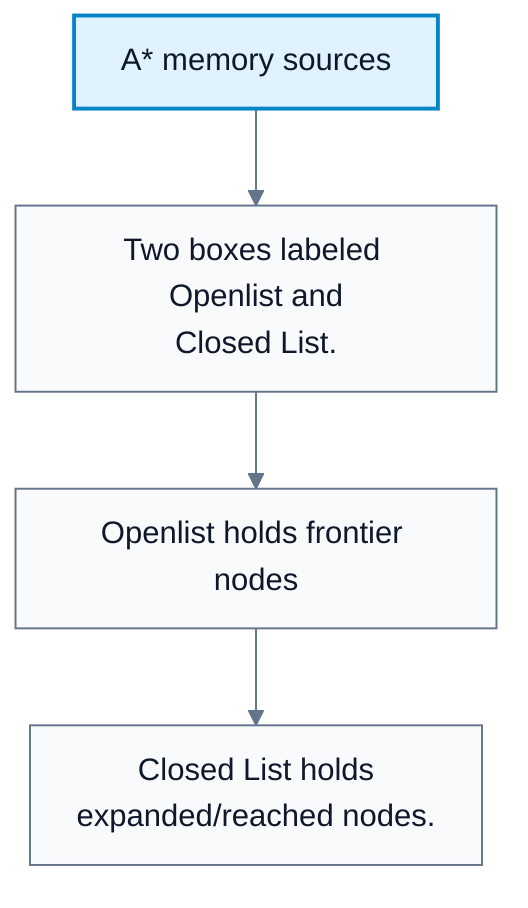
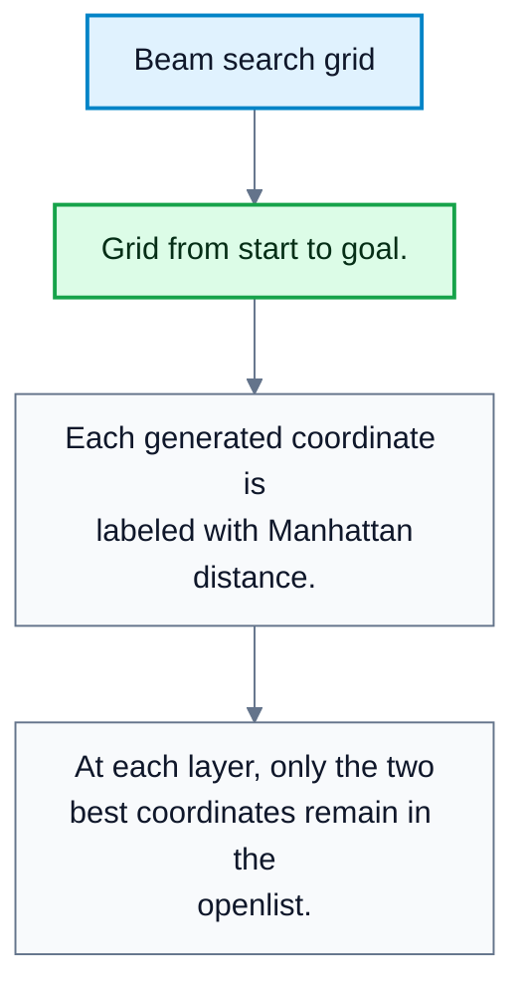
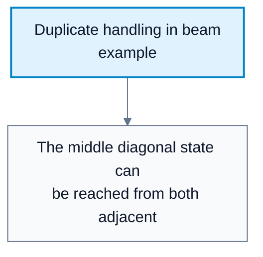
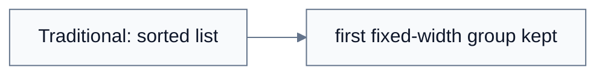

# A* Memory Usage And Beam Search

**Subject**: CSC3041F Automated Planning  
**Source**: `Lecture 5.pdf`, Zola Mahlaza, slides 1-18  
**Generated**: 2026-05-31

---

## Core Content

### A* Space Complexity

#### Definitions

> **A* Search**: Informed search using $f(n)=g(n)+h(n)$. *In plain language: expand the node with the lowest estimated total path cost.*

> **Openlist / Frontier**: Nodes generated but not expanded. *In plain language: candidates waiting for exploration.*

> **Closed List / Reached List**: Expanded or reached nodes stored to avoid cycles and redundant work. *In plain language: memory of states already handled.*

A* is complete and optimal on finite search spaces when the heuristic is admissible and consistent. Its limitation is memory:

$$
\text{Space complexity}=O(b^d)
$$

where $b$ is branching factor and $d$ is depth of the goal. A* stores:

1. The openlist/frontier.
2. The closed/reached list.

Both can grow very large.

#### Diagram: A* memory sources



Caption: A* memory grows because it stores both future candidates and past states.


### Reference Counts

#### Definitions

> **Reference Count**: A count of how many future references to a node are still needed. *In plain language: a bookkeeping number that tells when a stored node can be safely removed.*

The lecture presents reference counts as a memory-saving idea. If a node is stored in the closed list only so future paths can refer to it, it can be permanently removed once its reference count reaches zero.

Step-by-step idea:

1. Store expanded nodes in the closed list to avoid cycles and redundant work.
2. Attach a reference count to each stored node.
3. Decrement the count when a dependent branch no longer needs that node.
4. Delete the node once the count reaches zero.

This can reduce memory pressure but adds bookkeeping overhead.
### Beam Search

#### Definitions

> **Beam Search**: Search that sorts candidates by score and retains only a fixed number $k$. *In plain language: keep only the best-looking candidates and discard the rest.*

> **Beam Width ($k$)**: The number of nodes kept after pruning. *In plain language: the size of the shortlist.*

Beam search is introduced as a direct response to A* memory usage:

```text
1. Sort by f.
2. Select only the top k elements.
```

In the grid example, the agent moves from $(0,0)$ to $(3,3)$ with actions $\{\mathrm{Up},\mathrm{Down},\mathrm{Left},\mathrm{Right}\}$ and Manhattan distance as heuristic. With $k=2$, only the two best candidates survive at each step.

Beam search can be much cheaper in memory:

$$
\text{Space}=O(km)
$$

where $m$ is maximum depth. But it is not complete and not optimal.

#### Diagram: Beam search grid



Caption: The diagram shows how beam search prunes candidates even when they are legal paths.


#### Diagram: Duplicate handling in beam example



Caption: Even memory-limited search still needs a policy for duplicate states.


#### Diagram: Traditional beam versus delta beam



Caption: Delta beam trades fixed memory for more adaptive pruning.


### Delta-Beam Search

#### Definitions

> **Delta-Beam Search**: Beam search that keeps all nodes within a chosen score distance of the best node. *In plain language: keep every candidate close enough to the current best, rather than a fixed number.*

> **Delta Threshold**: The maximum allowed score gap from the best candidate. *In plain language: how far behind the best a node may be and still survive.*

Traditional beam search keeps exactly $k$ nodes. Delta-beam search keeps every node whose score is within a threshold of the best score:

$$
\text{keep }n\text{ if }f(n)\le f(n_{\mathrm{best}})+\delta
$$

Comparison:

| Method | Keeps | Memory Behavior | Risk |
|---|---|---|---|
| Traditional beam | Best $k$ nodes | Predictable | May discard useful alternatives |
| Delta beam | Nodes close to best score | Variable | May exceed memory limits |

Delta beam is more robust because it does not force arbitrary pruning when many nodes are similarly good, but memory use is less predictable.

## Worked Examples

### Example 1: Beam Search With $k=2$

**Problem**: Start $(0,0)$, goal $(3,3)$, Manhattan heuristic. From $(0,0)$, legal successors are $(1,0)$ and $(0,1)$.

**Step 1: Compute heuristic**  
$h(1,0)=5$; $h(0,1)=5$.

**Step 2: Keep top $k=2$**  
Both nodes survive.

**Step 3: Expand survivors**  
New candidates might include $(2,0)$, $(1,1)$, and $(0,2)$, all with $h=4$.

**Step 4: Apply beam width**  
Only two of the three $h=4$ nodes can remain. The discarded node is not expanded later.

**Answer**: Beam search reduces memory but may discard a path that later becomes best.

### Example 2: Delta Beam

**Problem**: Candidate scores are:

| Node | $f$ |
|---|---:|
| A | 10 |
| B | 11 |
| C | 12 |
| D | 17 |

The delta threshold is `2`.

**Step 1: Find best score**  
Best is $A$ with $f=10$.

**Step 2: Keep nodes within delta**  
Keep nodes with $f\le12$.

**Step 3: Result**  
Keep `A`, `B`, and `C`; discard `D`.

**Answer**: Delta beam keeps three nodes, even if traditional beam width might have kept only two.

---

## Common Mistakes / Gotchas

- Forgetting that A* memory pressure comes from both the openlist and closed list.
- Assuming reference counts are free. They save memory only by adding bookkeeping logic.
- Treating beam search as cost-optimal. It is not.
- Forgetting that beam search can discard the only valid path to a goal.
- Assuming delta-beam memory is bounded by a fixed $k$. It is variable and can exceed expectations.
- Using a beam width that is too narrow for a problem with deceptive heuristics.

---

## Summary / Cheat Sheet

| Term | Meaning |
|---|---|
| A* memory | Openlist plus closed/reached list |
| Reference count | Bookkeeping count for when a node can be removed |
| Beam search | Sort by score, keep top `k` |
| Beam width | Number of nodes retained |
| Delta beam | Keep nodes within a score threshold of the best |

**Key Formulas**:

$$
\text{A* space}=O(b^d)
$$

$$
\text{Beam search space}=O(km)
$$

$$
\text{Delta-beam keep rule: }f(n)\le f(n_{\mathrm{best}})+\delta
$$

**Key Takeaways**:

- A* gives strong guarantees but can exhaust memory.
- Beam search is a memory-control technique, not an optimal search guarantee.
- Delta beam adapts the number of retained nodes to score quality.
- Memory savings must be balanced against the risk of pruning the useful path.

---

## Practice Questions

**Q1**: Why does A* need a closed list?  
> Answer: To prevent cycles and redundant work by remembering states that have already been reached or expanded.

**Q2**: What guarantee is lost when switching from A* to beam search?  
> Answer: Completeness and cost optimality are lost because beam search discards candidates.

**Q3**: How does delta beam differ from traditional beam search?  
> Answer: Traditional beam keeps exactly the top `k` nodes; delta beam keeps all nodes whose score is within a threshold of the best score.

**Q4**: When can beam search be a practical choice despite weak guarantees?  
> Answer: When the state space is too large for A*, memory is the main constraint, and an approximate or good-enough solution is acceptable.
