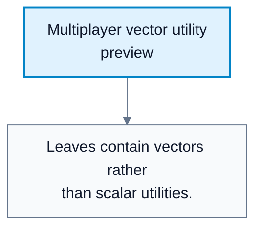
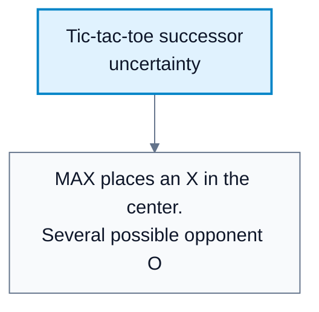
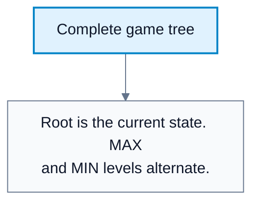
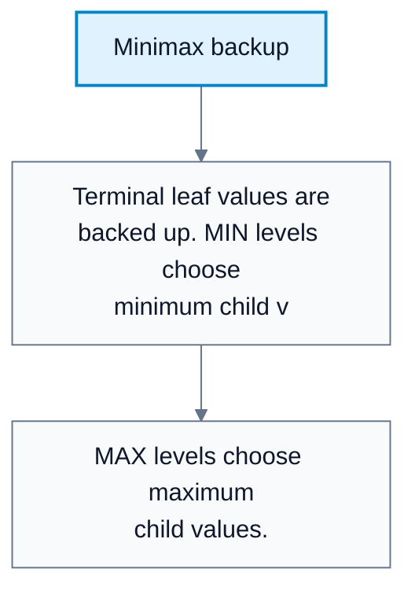

---
tags:
  - automated-planning
---

# Adversarial Search And Minimax

**Subject**: CSC3041F Automated Planning  
**Source**: `Lecture 6 - Copy.pdf`, Zola Mahlaza, slides 1-40  
**Generated**: 2026-05-31

---

## Contents

- [[#Core Content|Core Content]]
  - [[#From Pathfinding To Games|From Pathfinding To Games]]
  - [[#Game Properties Used In The Course|Game Properties Used In The Course]]
  - [[#MAX And MIN|MAX And MIN]]
  - [[#Formal Game Definition|Formal Game Definition]]
  - [[#Game Trees|Game Trees]]
  - [[#Minimax Value|Minimax Value]]
  - [[#Minimax Algorithm|Minimax Algorithm]]
  - [[#Limits Of Minimax|Limits Of Minimax]]

---

## Core Content

### From Pathfinding To Games

#### Definitions

> **Adversarial Search**: Search in environments containing agents with conflicting goals. *In plain language: planning when another decision-maker is trying to block or beat you.*

> **Competitive Environment**: An environment with multiple agents whose utilities conflict. *In plain language: one agent's gain can be another agent's loss.*

> **Game-Tree Search**: Search over possible moves by all players in a game. *In plain language: build a tree of "if I move here, they could move there" possibilities.*

Single-agent search assumes the action result is determined by the environment. Games are different because another agent chooses actions too. If the opponent is treated as just part of the environment, the environment becomes nondeterministic from the agent's viewpoint: after the agent moves, it does not know which successor state the opponent will choose.

The lecture motivates a stronger approach: explicitly model the other agent and search through the game tree.

#### Diagram: Multiplayer vector utility preview



Caption: This introduces why two-player zero-sum minimax must be extended for multiplayer games.


### Game Properties Used In The Course

#### Definitions

> **Deterministic Game**: A game where actions have predictable outcomes and no randomness. *In plain language: the same move in the same state always has the same result.*

> **Two-Player Game**: A game with exactly two agents. *In plain language: one player versus one opponent.*

> **Turn-Taking Game**: A game where players act one at a time. *In plain language: players alternate moves.*

> **Perfect Information**: Both players can see the entire game state at all times. *In plain language: nothing relevant is hidden.*

> **Zero-Sum Game**: A game where one player's gain is the other player's loss. *In plain language: what helps one side hurts the other side by the same amount.*

The course focuses first on games with these properties:

| Property | Meaning |
|---|---|
| Deterministic | No random outcomes |
| Two-player | Exactly two agents |
| Turn-taking | One move at a time |
| Perfect information | Both players observe the whole state |
| Zero-sum | Utilities directly oppose each other |

These assumptions make minimax possible.
### MAX And MIN

#### Definitions

> **MAX**: The player whose utility the algorithm is trying to maximize, usually the first mover. *In plain language: "our" player.*

> **MIN**: The adversary, modeled as trying to minimize MAX's utility. *In plain language: the opponent who chooses moves that are worst for MAX.*

> **Terminal State**: A state where the game is over. *In plain language: no further moves matter because the outcome has been reached.*

> **Utility Function**: A function assigning a numerical payoff to a terminal state for a player. *In plain language: a score for the final outcome.*

In a two-player zero-sum game, the algorithm can evaluate outcomes from MAX's perspective. If MAX wins, utility might be `1`; if MIN wins, utility might be `-1`; a draw might be `0` or `0.5`, depending on the course convention.

#### Diagram: Tic-tac-toe successor uncertainty



Caption: This shows why the opponent cannot be treated as a passive deterministic environment.


#### Diagram: Complete game tree



Caption: The game tree represents all possible move sequences from a position.


#### Diagram: Minimax backup



Caption: This is the core idea of optimal adversarial reasoning.


### Formal Game Definition

#### Definitions

> **Initial State**: The starting state of the game. *In plain language: the board before any moves.*

> **ToMove(s)**: Function returning whose turn it is at state `s`. *In plain language: tells which player acts next.*

> **Actions(s)**: Legal actions available in state `s`. *In plain language: all moves the current player may make.*

> **Result(s, a)**: Transition model returning the state after action `a` in state `s`. *In plain language: apply a move to the board.*

> **Is-terminal(s)**: Test for whether `s` is a terminal state. *In plain language: checks whether the game is over.*

> **$\mathrm{Utility}(s,p)$**: Payoff to player $p$ in terminal state $s$. *In plain language: final score for a player.*

A game for minimax needs:

```text
Initial state
ToMove(s)
Actions(s)
Result(s, a)
Is-terminal(s)
Utility(s, p)
```

The initial state, actions, and transition model define the state-space graph. The game tree unfolds this graph into paths of alternating moves.
### Game Trees

#### Definitions

> **Complete Game Tree**: A search tree following every legal move sequence until terminal states. *In plain language: every possible game from the current position.*

> **Leaf Node**: A node with no children in the tree, usually a terminal state in a complete game tree. *In plain language: an endpoint of a searched line.*

Tic-tac-toe is small enough that a full tree is manageable: at most $9!$ leaf orderings. Chess is not: the lecture notes a minimum number of leaf nodes around $10^{40}$, making full generation infeasible.
### Minimax Value

#### Definitions

> **Minimax Value**: The utility of a state assuming both players play optimally from that state onward. *In plain language: what the position is worth if neither side makes a mistake.*

At terminal states:

$$
\mathrm{minimax}(s)=\mathrm{Utility}(s,\mathrm{MAX})
$$

At MAX states:

$$
\mathrm{minimax}(s)=\max_{a\in\mathrm{Actions}(s)}\mathrm{minimax}(\mathrm{Result}(s,a))
$$

At MIN states:

$$
\mathrm{minimax}(s)=\min_{a\in\mathrm{Actions}(s)}\mathrm{minimax}(\mathrm{Result}(s,a))
$$

The rule is:

1. MAX chooses the successor with the highest value.
2. MIN chooses the successor with the lowest value.
3. Values propagate backward from terminal states to the root.
### Minimax Algorithm

The core algorithm explores the game tree depth-first:

```text
MINIMAX-DECISION(state):
    return action a in Actions(state) that maximizes MIN-VALUE(Result(state, a))

MAX-VALUE(state):
    if Is-terminal(state):
        return Utility(state, MAX)
    v = -infinity
    for action in Actions(state):
        v = max(v, MIN-VALUE(Result(state, action)))
    return v

MIN-VALUE(state):
    if Is-terminal(state):
        return Utility(state, MAX)
    v = +infinity
    for action in Actions(state):
        v = min(v, MAX-VALUE(Result(state, action)))
    return v
```

Properties:

| Property | Minimax |
|---|---|
| Time complexity | $O(b^m)$ |
| Space complexity | $O(bm)$ with depth-first implementation |
| Complete? | Yes for finite game trees |
| Optimal? | Yes if the opponent is optimal and utility is correct |

Here `b` is branching factor and `m` is maximum depth.
### Limits Of Minimax

Minimax assumes the opponent is optimal. That may be too conservative in some cases. The lecture gives a useful dilemma:

| Situation | Minimax View | Risk-Taking View |
|---|---|---|
| MAX plays safest optimal move | Game ends in a draw | Avoids losing if MIN is optimal |
| MAX plays risky move | MIN can force bad outcome | If MIN blunders, MAX may win |

Minimax is appropriate when the opponent is treated as perfectly rational. Against weak or noisy opponents, a different model may exploit mistakes.
