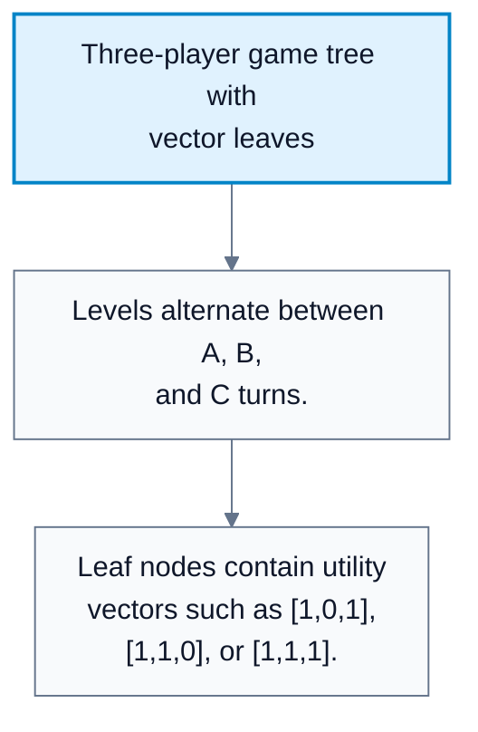
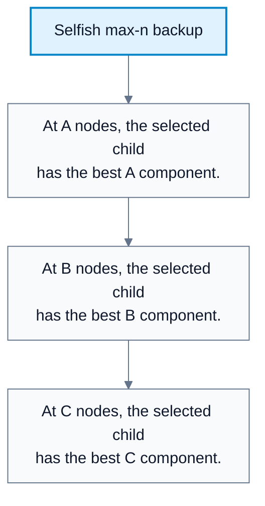
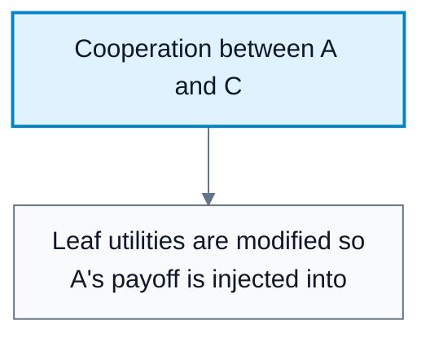
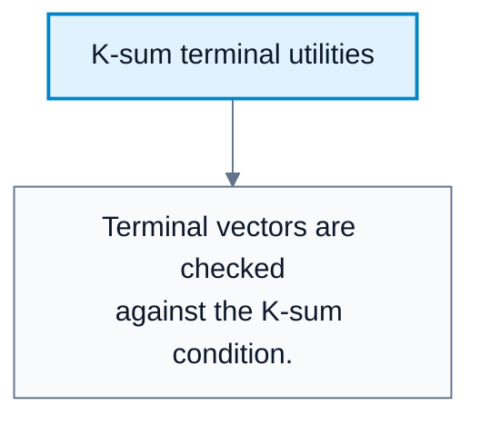

---
tags:
  - automated-planning
---

# Multiplayer Minimax

**Subject**: CSC3041F Automated Planning  
**Source**: `Lecture 7 - Copy - Copy.pdf`, Zola Mahlaza, slides 1-44  
**Generated**: 2026-05-31

---

## Contents

- [[#Core Content|Core Content]]
  - [[#Why Multiplayer Games Need An Extension|Why Multiplayer Games Need An Extension]]
  - [[#Max-N Style Backup|Max-N Style Backup]]
  - [[#Cooperation And Shifting Alliances|Cooperation And Shifting Alliances]]
  - [[#K-Sum Games|K-Sum Games]]
  - [[#K-Sum Backup With Cooperation|K-Sum Backup With Cooperation]]
  - [[#Complexity And Limits|Complexity And Limits]]

---

## Core Content

### Why Multiplayer Games Need An Extension

#### Definitions

> **Multiplayer Game**: A game with more than two agents. *In plain language: more than one opponent or teammate may affect the outcome.*

> **Utility Vector**: A vector giving each player's utility at a state, such as `[VA, VB, VC]`. *In plain language: one score per player.*

> **Selfish Agent**: An agent that chooses actions only to maximize its own utility component. *In plain language: it only cares about its own score.*

Two-player zero-sum minimax uses one scalar utility because MAX's gain is MIN's loss. In multiplayer games, a leaf state must store a utility vector:

$$
\mathrm{Utility}(s)=[V_A,V_B,V_C]
$$

Each internal node is controlled by the player whose turn it is. That player selects the successor that is best for its own component of the vector.

#### Diagram: Three-player game tree with vector leaves



Caption: The diagram shows why internal values must be vectors rather than a single number.


### Max-N Style Backup

#### Definitions

> **Max-N Backup**: A multiplayer minimax-style backup where each player chooses the successor maximizing its own utility component. *In plain language: at A's turn choose the child with highest A score; at B's turn choose highest B score; and so on.*

For three players `A`, `B`, and `C`:

```text
If ToMove(s) = A:
    value(s) = child vector with maximum A component
If ToMove(s) = B:
    value(s) = child vector with maximum B component
If ToMove(s) = C:
    value(s) = child vector with maximum C component
```

This models pure competition where every agent is selfish. It does not automatically model alliances, cooperation, or changing relationships.

#### Diagram: Selfish max-n backup



Caption: This captures pure competition where every agent acts for itself.


### Cooperation And Shifting Alliances

#### Definitions

> **Cooperation**: A situation where one or more agents care about another agent's utility as well as their own. *In plain language: players may help each other.*

> **Shifting Alliance**: A cooperation structure whose weights change based on the game state. *In plain language: who helps whom can change during the game.*

The lecture discusses cooperation by modifying utility. For example, if agents $A$ and $C$ cooperate against $B$, then $A$ and $C$ may be treated as a combined side. One simple approach is to sum their scores and treat $(A+C)$ as one adversary against $B$.

Limitations:

| Approach | Limitation |
|---|---|
| Hardcode $B+C$ against $A$ | Cannot model changing loyalties |
| Hardcode $A+C$ cooperation | May ignore cases where cooperation stops being rational |
| Weighted utilities | More flexible but needs state-dependent weights |

For shifting alliances, the lecture suggests weighted combinations. When calculating a player's effective utility, use weights for other agents that can change by state.

#### Diagram: Cooperation between A and C



Caption: The diagram shows how cooperation changes backed-up choices without changing the game tree shape.


### K-Sum Games

#### Definitions

> **K-Sum Game**: A game where the sum of all players' terminal utilities equals a constant $K$. *In plain language: there is a fixed total amount of value divided among players.*

> **Zero-Sum Game**: A special K-sum game with $K=0$. *In plain language: total utility is fixed at zero, so gains are exactly offset by losses.*

For three players:

$$
V_A+V_B+V_C=K
$$

The lecture uses K-sum to preserve the "fixed total value" idea. If $A$ and $C$ cooperate, then their gains must come at $B$'s expense in a strict K-sum setup.

#### Diagram: K-sum terminal utilities



Caption: K-sum enforces a fixed total amount of value across all players.


### K-Sum Backup With Cooperation

The source gives a three-player pattern where `A` and `C` may cooperate and `B` is opposed. At terminal states:

$$
\mathrm{minimax}(s)=\mathrm{Utility}(s)
$$

For non-terminal states, the player to move determines how successor vectors are compared. A simplified interpretation:

| Player To Move | Backup Intuition |
|---|---|
| $A$ | Choose successor that improves $A$'s component |
| $B$ | Choose successor that harms the $A/C$ side or improves $B$ |
| $C$ | Choose successor that improves $C$ while respecting cooperation with $A$ |

The exact utility transform depends on how cooperation is encoded. The key exam point is that scalar minimax is not enough: multiplayer games need vector utilities and an explicit assumption about competition or cooperation.
### Complexity And Limits

The branching/depth problem remains:

$$
\text{Time}=O(b^m)
$$

No multiplayer extension removes the exponential depth term. The lecture ends by motivating pruning: we need to eliminate nodes, but no pruning method removes the exponent completely.
