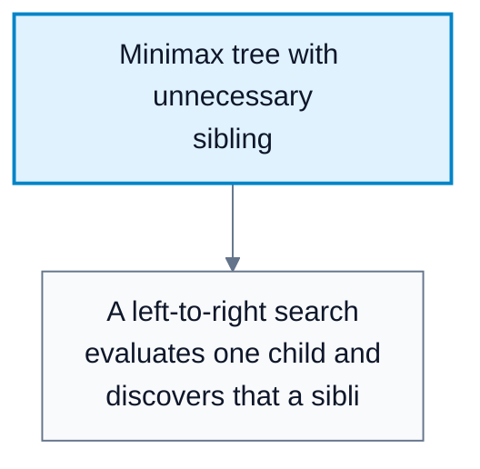
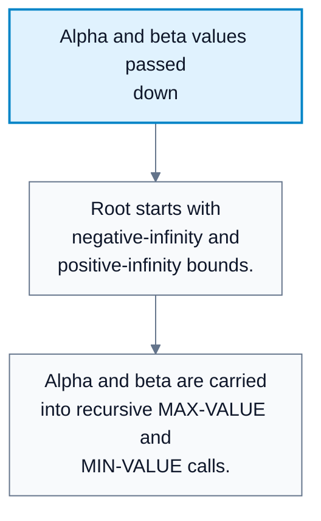
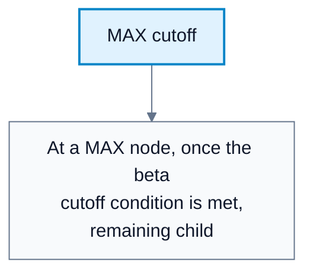
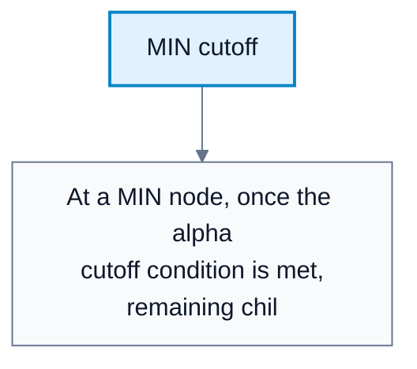

# Alpha-Beta Search

**Subject**: CSC3041F Automated Planning  
**Source**: `Lecture 8.pdf`, Zola Mahlaza, slides 1-32  
**Generated**: 2026-05-31

---

## Core Content

### Motivation For Pruning

#### Definitions

> **Alpha-Beta Pruning**: A minimax optimization that avoids exploring branches that cannot affect the final decision. *In plain language: stop searching a subtree once you know it cannot change the move choice.*

> **Pruning**: Discarding part of the search tree without evaluating every leaf. *In plain language: skip branches proven irrelevant.*

Minimax has time complexity:

$$
O(b^m)
$$

where `b` is branching factor and `m` is maximum depth. Alpha-beta pruning does not remove the exponential nature of game search, but it can reduce the number of nodes explored dramatically.

The key observation: if one branch is already known to be worse than a previously available choice, no future details in that branch can make it relevant.

#### Diagram: Minimax tree with unnecessary sibling



Caption: The diagram motivates pruning by showing a branch whose exact value cannot affect the root action.


### Alpha And Beta

#### Definitions

> **Alpha ($\alpha$)**: The highest-value choice found so far for MAX along the current search path. *In plain language: MAX's best guaranteed option so far.*

> **Beta ($\beta$)**: The lowest-value choice found so far for MIN along the current search path. *In plain language: MIN's best guaranteed option so far.*

> **Cutoff**: A point where a branch is abandoned because $\alpha$ and $\beta$ prove it cannot affect the result. *In plain language: the rest of the branch cannot matter.*

Initial values:

$$
\alpha=-\infty,\qquad \beta=+\infty
$$

At a MAX node, the algorithm updates $\alpha$. At a MIN node, it updates $\beta$.

#### Diagram: Alpha and beta values passed down



Caption: Alpha and beta are bounds inherited from earlier choices in the current path.


### Alpha-Beta Search Algorithm

```text
ALPHA-BETA-SEARCH(state):
    v = MAX-VALUE(state, -infinity, +infinity)
    return action associated with v

MAX-VALUE(state, alpha, beta):
    if Is-terminal(state):
        return Utility(state)
    v = -infinity
    for action in Actions(state):
        v = max(v, MIN-VALUE(Result(state, action), alpha, beta))
        if v >= beta:
            return v
        alpha = max(alpha, v)
    return v

MIN-VALUE(state, alpha, beta):
    if Is-terminal(state):
        return Utility(state)
    v = +infinity
    for action in Actions(state):
        v = min(v, MAX-VALUE(Result(state, action), alpha, beta))
        if v <= alpha:
            return v
        beta = min(beta, v)
    return v
```

The source slides use the label "alpha-delta" in some places, but the variables and pruning logic are the standard alpha-beta algorithm.
### MAX Node Logic

#### Definitions

> **MAX-VALUE**: Recursive function that returns the best value MAX can force from a state. *In plain language: evaluate the position when it is MAX's turn.*

At a MAX node:

1. If the state is terminal, return its utility.
2. Set $v=-\infty$.
3. For each action, evaluate the resulting MIN state.
4. Update $v=\max(v,child\_value)$.
5. If $v\ge\beta$, stop: MIN would never allow this branch.
6. Update $\alpha\leftarrow\max(\alpha,v)$.
### MIN Node Logic

#### Definitions

> **MIN-VALUE**: Recursive function that returns the worst value MAX can be forced into from a state. *In plain language: evaluate the position when it is MIN's turn.*

At a MIN node:

1. If the state is terminal, return its utility.
2. Set $v=+\infty$.
3. For each action, evaluate the resulting MAX state.
4. Update $v=\min(v,child\_value)$.
5. If $v\le\alpha$, stop: MAX already has a better option elsewhere.
6. Update $\beta\leftarrow\min(\beta,v)$.

#### Diagram: MAX cutoff



Caption: MIN already has a better alternative, so this MAX branch will not be chosen by MIN.


#### Diagram: MIN cutoff



Caption: MAX already has a better alternative, so this MIN branch cannot affect MAX's final decision.


### Ordering And Complexity

#### Definitions

> **Move Ordering**: The order in which successor states are searched. *In plain language: which possible moves are checked first.*

Alpha-beta pruning effectiveness depends heavily on move ordering.

| Ordering Quality | Effect |
|---|---|
| Worst ordering | Can behave like ordinary minimax |
| Good ordering | Prunes many branches |
| Perfect ordering | Time can approach $O(b^{m/2})$ |

The source notes a practical chess-style ordering heuristic:

1. Captures.
2. Threats.
3. Forward moves.
4. Backward moves.

This is not perfect, but it tends to reveal strong branches early, increasing pruning.

## Worked Examples

### Example 1: MIN Cutoff

**Problem**: MAX already has $\alpha=5$ from a previous branch. Now search a MIN node. Its first child returns $3$.

**Step 1: Update MIN value**  
$v=\min(+\infty,3)=3$.

**Step 2: Compare to alpha**  
$v\le\alpha$ because $3\le5$.

**Step 3: Prune**  
MAX would never choose a branch that MIN can hold to $3$ when MAX already has an option worth $5$.

**Answer**: Prune the remaining children of the MIN node.

### Example 2: MAX Cutoff

**Problem**: MIN has $\beta=4$ from an earlier option. At a MAX node, a child returns $6$.

**Step 1: Update MAX value**  
$v=\max(-\infty,6)=6$.

**Step 2: Compare to beta**  
$v\ge\beta$ because $6\ge4$.

**Step 3: Prune**  
MIN will avoid this branch because it already has an option that keeps MAX to $4$.

**Answer**: Prune the remaining children of the MAX node.

### Example 3: Why Move Ordering Matters

**Problem**: A MAX node has child values `[9, 1, 2]`, but those values are unknown until searched.

**Step 1: Good ordering**  
Searching `9` first sets a strong alpha and may prune later branches.

**Step 2: Bad ordering**  
Searching `1` and `2` first gives weak alpha values and may force more exploration.

**Answer**: Alpha-beta is still correct in either order, but good ordering prunes more.

---

## Common Mistakes / Gotchas

- Thinking alpha-beta changes the final minimax answer. It does not; it only avoids irrelevant work.
- Updating alpha at MIN nodes or beta at MAX nodes.
- Forgetting the cutoff tests: MAX cuts when $v\ge\beta$; MIN cuts when $v\le\alpha$.
- Assuming alpha-beta is always $O(b^{m/2})$. That requires perfect move ordering.
- Treating pruned nodes as unknown in a way that changes the returned minimax value. They are safely irrelevant to the decision.
- Confusing the slide label "alpha-delta" with a separate algorithm; the standard method uses alpha and beta bounds.

---

## Summary / Cheat Sheet

| Term | Meaning |
|---|---|
| Alpha | Best value MAX can guarantee so far |
| Beta | Best value MIN can guarantee so far |
| Pruning | Skipping branches that cannot affect the root decision |
| MAX cutoff | Stop when $v\ge\beta$ |
| MIN cutoff | Stop when $v\le\alpha$ |
| Move ordering | Successor order, crucial for pruning effectiveness |

**Key Formulas**:

$$
\alpha_0=-\infty,\qquad \beta_0=+\infty
$$

$$
\alpha\leftarrow \max(\alpha,v),\qquad \beta\leftarrow \min(\beta,v)
$$

$$
\text{Best-case time}=O\!\left(b^{m/2}\right),\qquad \text{Worst-case time}=O(b^m)
$$

**Key Takeaways**:

- Alpha-beta returns the same decision as minimax.
- It prunes branches that cannot change that decision.
- Good move ordering is the difference between minor and major savings.
- The algorithm remains exponential in the worst case.

---

## Practice Questions

**Q1**: What does alpha represent?  
> Answer: The best value MAX has found so far along the current search path.

**Q2**: At a MIN node, when can you prune?  
> Answer: When the current value `v` is less than or equal to $\alpha$.

**Q3**: Does alpha-beta pruning ever change the minimax value?  
> Answer: No. It only skips branches proven unable to affect the minimax decision.

**Q4**: Why does good move ordering help alpha-beta pruning?  
> Answer: Strong early moves create tighter alpha or beta bounds, so more later branches can be cut off.
