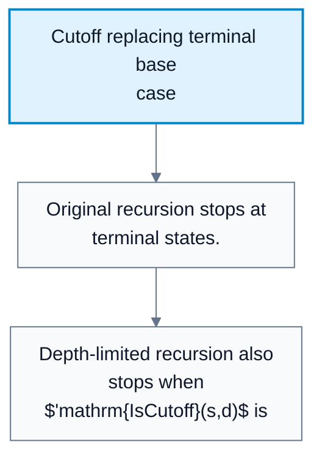
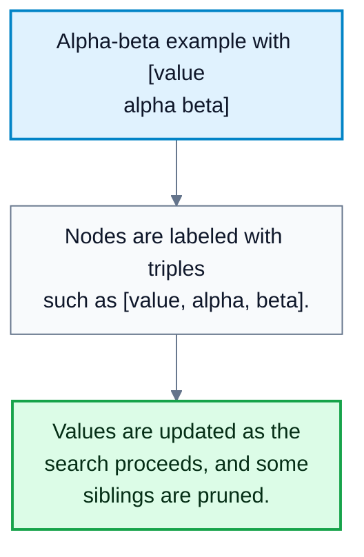
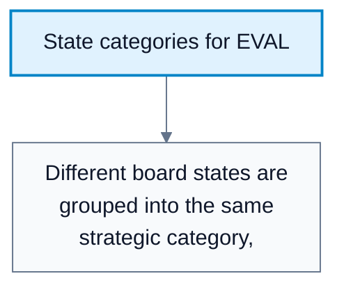
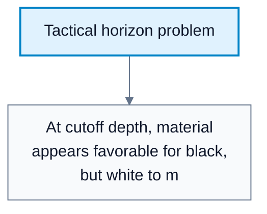

---
tags:
  - automated-planning
---

# Evaluation Functions

**Subject**: CSC3041F Automated Planning  
**Source**: `Lecture 9 - Copy.pdf`, Zola Mahlaza, slides 1-39  
**Generated**: 2026-05-31

---

## Contents

- [[#Core Content|Core Content]]
  - [[#Why Evaluation Functions Are Needed|Why Evaluation Functions Are Needed]]
  - [[#Replacing Terminal-Only Utility|Replacing Terminal-Only Utility]]
  - [[#Evaluation Function Requirements|Evaluation Function Requirements]]
  - [[#Feature-Based Evaluation|Feature-Based Evaluation]]
  - [[#Probability-Style Evaluation|Probability-Style Evaluation]]
  - [[#Neural Evaluation Functions|Neural Evaluation Functions]]
  - [[#Dangers Of Cutoff Evaluation|Dangers Of Cutoff Evaluation]]

---

## Core Content

### Why Evaluation Functions Are Needed

#### Definitions

> **Evaluation Function / EVAL**: A heuristic function estimating the payoff of a non-terminal game state. *In plain language: a quick score for a position when we cannot search to the end.*

> **Cutoff Test / IS-CUTOFF**: A test deciding whether search should stop before a terminal state. *In plain language: a depth or condition where the algorithm stops expanding and uses EVAL.*

> **Utility Function**: A payoff function for terminal states. *In plain language: the true final score after the game is over.*

Alpha-beta pruning is still exponential. Even in the best case, it can be around:

$$
O\!\left(b^{m/2}\right)
$$

For deep games, searching all the way to terminal states is impossible. The solution is to cut off search early and apply a heuristic evaluation function.
### Replacing Terminal-Only Utility

Pure minimax uses:

```text
if Is-terminal(s):
    return Utility(s)
```

Depth-limited minimax with evaluation uses:

```text
if Is-terminal(s):
    return Utility(s)
if IS-CUTOFF(s, depth):
    return EVAL(s)
```

The key functions become:

| Function | Role |
|---|---|
| $\mathrm{IsTerminal}(s)$ | True when the game is over |
| $\mathrm{IsCutoff}(s,d)$ | True when search should stop at depth or another cutoff condition |
| $\mathrm{Utility}(s,p)$ | Exact payoff in terminal states |
| $\mathrm{Eval}(s,p)$ | Estimated payoff in non-terminal cutoff states |

For terminal states, EVAL should match utility:

$$
\mathrm{Eval}(s,p)=\mathrm{Utility}(s,p)\quad\text{when }s\text{ is terminal}
$$

#### Diagram: Cutoff replacing terminal base case



Caption: This shows exactly where EVAL enters minimax or alpha-beta.


### Evaluation Function Requirements

#### Definitions

> **Correlation With Winning**: The evaluation value should increase when actual win prospects improve. *In plain language: better positions should get better scores.*

> **Monotone Evaluation**: An evaluation whose ordering agrees with position quality. *In plain language: if a state is truly better, the score should not rank it worse.*

The lecture states that a good EVAL:

1. Must be cheap enough to compute.
2. Must be strongly correlated with actual chances of winning.
3. Should assign higher values to better win prospects.
4. Does not need to be linear.
5. May use nonlinear feature interactions.

In deterministic perfect-information games, "chance" means uncertainty caused by limited search, not randomness in the game. A cutoff position has unknown future consequences because the algorithm did not search all the way to a terminal outcome.

#### Diagram: Alpha-beta example with [value alpha beta]



Caption: This reinforces how alpha-beta tracks bounds during search.


### Feature-Based Evaluation

#### Definitions

> **Feature**: A measurable property of a game state used by EVAL. *In plain language: a useful signal about the position, such as material or king safety.*

> **Weighted Combination**: An evaluation function that multiplies each feature by a weight and sums the results. *In plain language: score the position by adding up feature scores.*

Most practical evaluation functions compute values from state features:

| Game Feature Example | What It Tries To Capture |
|---|---|
| Number of pawns | Material advantage |
| Number of knights/bishops/rooks/queens | Piece strength |
| Pawn location | Positional structure |
| King safety | Tactical danger |
| Endgame category | Known strategic patterns |

A simple weighted evaluation has the form:

$$
\mathrm{EVAL}(s)=w_1f_1(s)+w_2f_2(s)+\cdots+w_kf_k(s)
$$

The lecture notes that treating features as independent is often an approximation. For example, the value of an extra pawn may depend on king safety or endgame type.

#### Diagram: State categories for EVAL



Caption: Grouping states lets the evaluator estimate win prospects from shared features.


### Probability-Style Evaluation

For a category of similar states, historical outcomes can estimate expected value:

$$
\mathbb{E}[U]=P(\mathrm{win})U(\mathrm{win})+P(\mathrm{draw})U(\mathrm{draw})+P(\mathrm{loss})U(\mathrm{loss})
$$

Example from the lecture's style:

$$
P(\mathrm{win})=0.60,\quad P(\mathrm{draw})=0.40,\quad P(\mathrm{loss})=0
$$

$$
U(\mathrm{win})=1,\quad U(\mathrm{draw})=0.5,\quad U(\mathrm{loss})=0
$$

$$
\mathbb{E}[U]=0.60\cdot 1+0.40\cdot 0.5+0\cdot 0=0.80
$$

Drawbacks:

1. Too many state categories.
2. Requires historical data.
3. May not scale to complex games.
### Neural Evaluation Functions

#### Definitions

> **Neural Evaluation Function**: A learned model that maps a state to an estimated value. *In plain language: a neural network trained on historical positions or self-play to score game states.*

The lecture notes that state-of-the-art systems may use neural networks to obtain EVAL from historical data. This avoids manual feature engineering but introduces training-data and model-quality concerns.
### Dangers Of Cutoff Evaluation

#### Definitions

> **Horizon Effect**: A search error where an important event lies just beyond the cutoff depth. *In plain language: the algorithm stops too early and misses a tactic about to happen.*

The lecture highlights a chess-style danger: at the depth limit, a material-based evaluation may show that black has extra material, but if it is white's turn and white can win the queen immediately, the cutoff score is misleading.

Possible mitigation:

1. Make problem-specific cutoff changes.
2. Do not apply EVAL to positions with pending tactical moves.
3. Extend search until a quieter/stable position is reached.
4. Use iterative deepening and better move ordering.

There is no catch-all rule.

#### Diagram: Tactical horizon problem



Caption: This shows why a shallow material score can be misleading.
