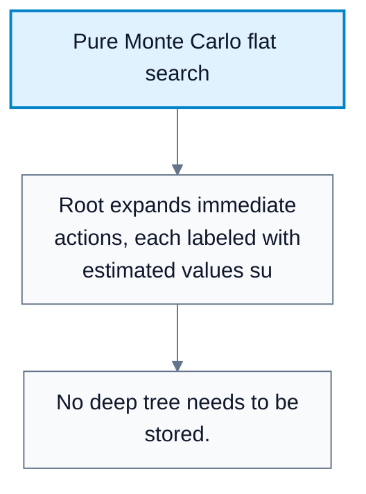
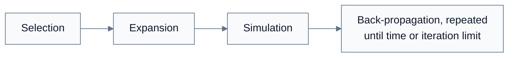
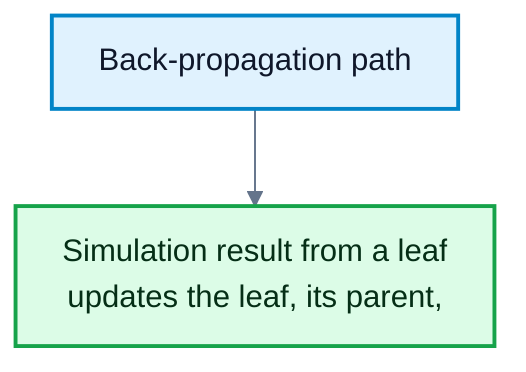
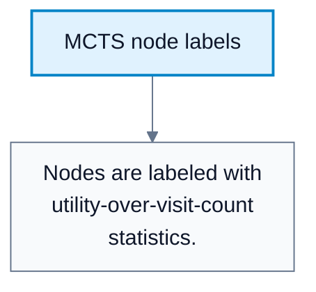

# Monte Carlo Tree Search

**Subject**: CSC3041F Automated Planning  
**Source**: `Lecture 10.pdf`, Zola Mahlaza, slides 1-35  
**Generated**: 2026-05-31

---

## Core Content

### Limits Of Alpha-Beta

#### Definitions

> **Monte Carlo Tree Search (MCTS)**: A search algorithm that estimates action values by repeated simulated play and selectively grows a search tree. *In plain language: try many possible futures, learn which moves tend to survive, and focus search there.*

> **Simulation / Playout**: A complete simulated game from a state to a terminal outcome. *In plain language: play the game out, possibly using a simple policy, to see what happens.*

Alpha-beta pruning struggles in games with enormous branching factors and weak static evaluation functions. The lecture uses Go as motivation: the branching factor begins very high, and material-style evaluation is not reliable because positions remain fluid until the endgame.

MCTS replaces heavy handcrafted evaluation with simulations:

$$
\widehat{V}(s)=\frac{\text{total utility from simulations starting at }s}{\text{number of simulations from }s}
$$

For binary win/loss games, the estimated value can be interpreted as a win percentage.
### Pure Monte Carlo Search

#### Definitions

> **Pure Monte Carlo Search**: A flat search method that runs `N` simulations from the current state for each candidate move and chooses the move with the best estimated outcome. *In plain language: test each immediate move by rollouts, but do not maintain a deep search tree.*

Pure Monte Carlo search:

1. Start at the current game state.
2. For each available action, run simulations.
3. Estimate the action value from simulation outcomes.
4. Choose the action with the highest estimated value.

It differs from MCTS because it does not need to keep a growing tree. It is flatter and less structured.

#### Diagram: Pure Monte Carlo flat search



Caption: Pure Monte Carlo evaluates immediate moves by simulations without structured tree growth.


### Playout Policies

#### Definitions

> **Playout Policy**: The policy used to choose moves during simulations. *In plain language: the rule for how simulated players act.*

> **Self-Play**: Training or evaluation where agents play against copies of themselves. *In plain language: the system generates experience by playing itself.*

In simple games, playout actions may be random. In harder games, random play can be too noisy, so playout policies may use:

1. Simple game-specific heuristics.
2. Self-play generated data.
3. Learned models from game histories.

The lecture describes an unintelligent agent playing itself, assigning scores to positions from game histories, and using that data to improve the model.
### Exploration And Exploitation

#### Definitions

> **Exploitation**: Choosing actions that currently look best. *In plain language: use what you already believe is good.*

> **Exploration**: Trying less-tested actions to learn whether they may be better. *In plain language: test uncertain options instead of always choosing the current favorite.*

> **Upper Confidence Bound (UCB)**: A selection rule balancing average reward with an exploration bonus. *In plain language: prefer moves that are good or not yet tested enough.*

A greedy strategy is pure exploitation. If $C=0$, selection ignores exploration and chooses the currently best estimated move. MCTS needs a selection policy that balances:

1. High average utility.
2. Sufficient exploration of less-visited nodes.

A standard UCB-style score is:

$$
\mathrm{score}(n)=\frac{U(n)}{N(n)}+C\sqrt{\frac{\ln N(\mathrm{parent}(n))}{N(n)}}
$$

where:

| Symbol | Meaning |
|---|---|
| $U(n)$ | Total utility from simulations passing through node $n$ |
| $N(n)$ | Number of simulations/visits at node $n$ |
| $N(\mathrm{parent})$ | Visits to the parent node |
| $C$ | Exploration constant greater than zero |

The lecture notes $C=0$ as greedy and mentions a theoretical value around $1.41$ for balancing exploration and exploitation.
### The Four MCTS Phases

#### Definitions

> **Selection**: Starting at the root and following the selection policy to a promising node. *In plain language: walk down the current tree using the UCB-style score.*

> **Expansion**: Adding a new child node to the tree. *In plain language: grow the tree by one unexplored move.*

> **Simulation**: Running a playout from the new node to an outcome. *In plain language: play the game out from there.*

> **Back-Propagation**: Updating statistics on the path from the simulated node back to the root. *In plain language: send the simulation result back up the tree.*

MCTS repeats these phases until a time limit or iteration limit is reached:

```text
while time remains:
    leaf = SELECT(root)
    child = EXPAND(leaf)
    result = SIMULATE(child)
    BACKPROPAGATE(child, result)
return best root action
```

The returned action is usually the root child with the best visit/value statistic.

#### Diagram: MCTS four-phase loop



Caption: This is the complete control flow of MCTS.


#### Diagram: Back-propagation path



Caption: Back-propagation lets one playout affect future selection at every level it passed through.


### MCTS Example Structure

In the lecture example:

1. $C=0$, so selection is greedy.
2. Each simulation batch has $10$ simulations.
3. Node labels use $utility/number\_of\_simulations$, such as $8/10$.
4. After a child is simulated, its result is back-propagated to ancestors.

If a root child has $8/10$, another has $6/10$, and another has $4/10$, greedy selection chooses the $8/10$ child. Later simulations may reveal that a deeper branch changes the average, and back-propagation updates the root statistics.

#### Diagram: MCTS node labels



Caption: MCTS decisions are based on accumulated statistics, not exact minimax values.


### Strengths Of MCTS

The lecture emphasizes:

| Strength | Explanation |
|---|---|
| Handles massive state spaces | It samples futures instead of enumerating all leaves |
| Heuristic-free in principle | It can use simulations instead of handcrafted EVAL |
| Variable-depth exploration | Different parts of the tree can be explored to different depths |
| Anytime behavior | Can return an action after a time or iteration limit |

## Worked Examples

### Example 1: Estimate A Binary Win Rate

**Problem**: A move is simulated $10$ times and wins $6$.

**Step 1: Count wins**  
Wins $=6$.

**Step 2: Count simulations**  
Simulations $=10$.

**Step 3: Estimate value**  
$6/10=0.6$.

**Answer**: The move's estimated value is $0.6$ or $60\%$.

### Example 2: Greedy Selection With $C=0$

**Problem**: Three root children have values $4/10$, $6/10$, and $8/10$. Selection uses $C=0$.

**Step 1: Convert to averages**  
$4/10=0.4$, $6/10=0.6$, $8/10=0.8$.

**Step 2: Choose highest average**  
$0.8$ is highest.

**Answer**: Greedy selection chooses the child labeled $8/10$.

### Example 3: UCB Exploration Bonus

**Problem**: Node A has average $0.8$ from many visits. Node B has average $0.7$ from very few visits.

**Step 1: Exploitation term**  
A looks better by average value.

**Step 2: Exploration term**  
B receives a larger exploration bonus because $N(B)$ is small.

**Step 3: Compare UCB scores**  
If B's uncertainty bonus is large enough, MCTS selects B for more testing.

**Answer**: UCB can choose a lower-average but underexplored node to reduce uncertainty.

---

## Common Mistakes / Gotchas

- Confusing pure Monte Carlo search with MCTS. Pure Monte Carlo is flat; MCTS grows a tree.
- Using only greedy selection. Greedy exploitation can miss better underexplored moves.
- Forgetting to back-propagate to every ancestor, not just the simulated leaf.
- Treating simulation outcomes as exact values. They are estimates with sampling noise.
- Assuming random playouts are always good enough. Complex games may need better playout policies.
- Forgetting that MCTS is an anytime algorithm: the returned action depends on the time or iteration budget.

---

## Summary / Cheat Sheet

| Term | Meaning |
|---|---|
| MCTS | Simulation-based tree search |
| Playout | Simulated game to an outcome |
| Pure Monte Carlo | Flat rollout evaluation of immediate moves |
| Selection | Follow policy down the current tree |
| Expansion | Add a new node |
| Simulation | Run a playout |
| Back-propagation | Update statistics up to the root |
| UCB | Balances exploitation and exploration |

**Key Formulas**:

$$
\widehat{V}(n)=\frac{\text{total utility}}{\text{number of simulations}}
$$

$$
\mathrm{score}(n)=\frac{U(n)}{N(n)}+C\sqrt{\frac{\ln N(\mathrm{parent}(n))}{N(n)}}
$$

$$
C=0\quad\text{gives greedy exploitation}
$$

**Key Takeaways**:

- MCTS samples future play instead of enumerating the full tree.
- It is especially useful when branching factor is huge and static evaluation is weak.
- The four phases are selection, expansion, simulation, and back-propagation.
- UCB-style selection balances promising moves with uncertain moves.

---

## Practice Questions

**Q1**: What are the four phases of MCTS?  
> Answer: Selection, expansion, simulation, and back-propagation.

**Q2**: Why is $C=0$ greedy in UCB-style selection?  
> Answer: It removes the exploration bonus, so selection uses only the current average utility.

**Q3**: How does MCTS differ from alpha-beta search?  
> Answer: Alpha-beta reasons with exact minimax values up to a searched depth, while MCTS estimates values through simulations and grows the tree selectively.

**Q4**: Why is MCTS useful for games like Go?  
> Answer: The branching factor is huge and static evaluation is difficult, so simulation-based sampling is more practical than exhaustive minimax-style search.
