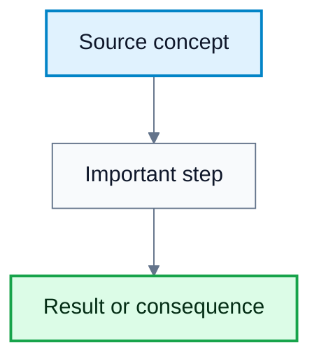

# [TOPIC NAME]

**Subject**: [Course / Subject Name]
**Source**: [Title, Author, Pages/Slides]
**Generated**: [Date]

---

## Core Content

### [Subsection 1]

#### Definitions

> **Term**: Definition. *In plain language: ...*

[Full explanation of the subsection. Use LaTeX for every mathematical variable, expression, recurrence, complexity bound, and formula, e.g. `$f(n)=g(n)+h(n)$` or:

$$
V^*(s)=\max_a \sum_{s',r} p(s',r \mid s,a)\left[r+\gamma V^*(s')\right]
$$
]

Caption: Recreated source diagram placed next to the concept it explains.

### [Subsection 2]

#### Definitions

> **Term**: Definition. *In plain language: ...*

[Full explanation of the subsection.]

---

## Worked Examples

### Example 1: [Name]
**Problem**: ...
**Step 1**: ...
**Step 2**: ...
**Answer**: ...

---

## Common Mistakes / Gotchas
-

---

## Summary / Cheat Sheet

| Term | Meaning |
|------|---------|
| | |

**Key Formulas**:

$$
\text{Formula goes here in LaTeX.}
$$

**Key Takeaways**:
-

---

## Practice Questions

**Q1**: ...
> Answer: ...

**Q2**: ...
> Answer: ...

**Q3**: ...
> Answer: ...
